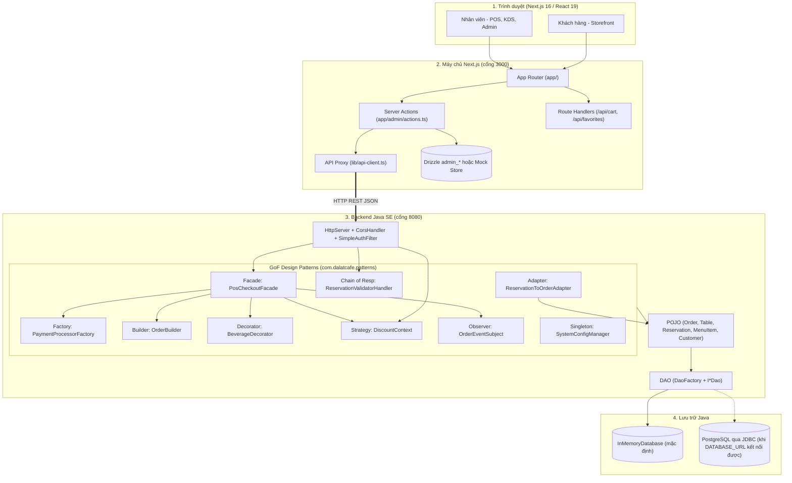
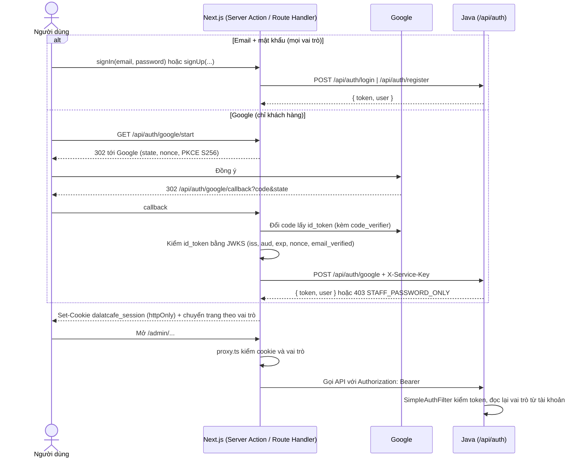
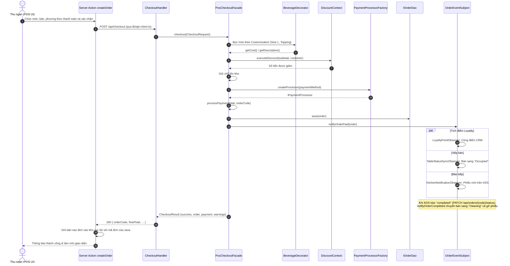
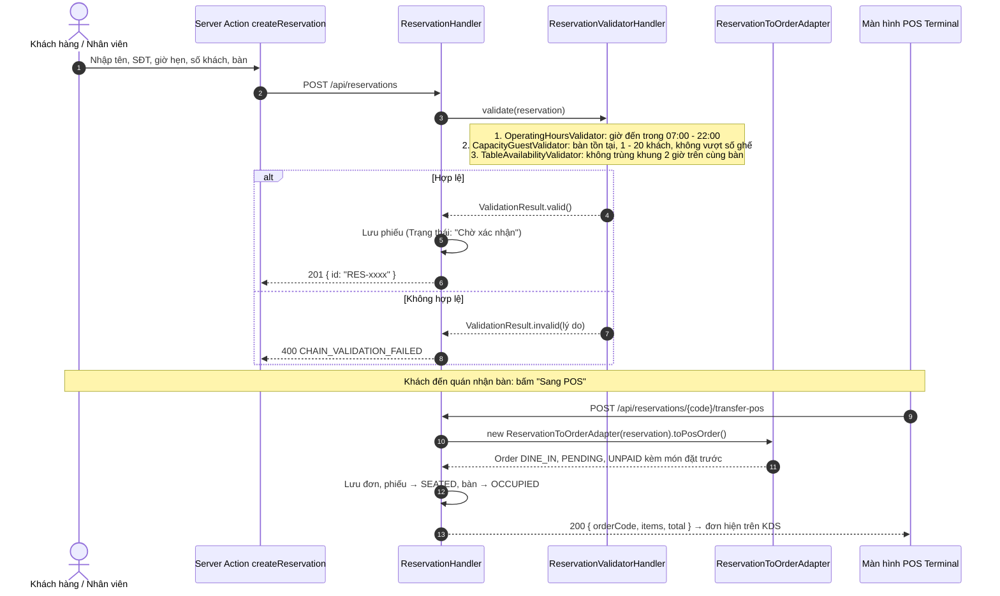

# KIẾN TRÚC HỆ THỐNG (SYSTEM ARCHITECTURE)
## DỰ ÁN: ĐÀ LẠT CAFE OPERATIONS & MANAGEMENT

Đây là nguồn duy nhất cho kiến trúc tổng thể, cơ chế tích hợp Next.js ↔ Java, phân quyền và các luồng dữ liệu chính. Công nghệ và lệnh chạy xem [README](../README.md); API xem [API_SPEC.md](API_SPEC.md); dữ liệu xem [DATABASE.md](DATABASE.md); chi tiết 9 pattern xem [DESIGN_PATTERNS_SPEC.md](DESIGN_PATTERNS_SPEC.md).

---

## 1. Tổng quan kiến trúc

Hệ thống chia thành các tầng tách biệt. Frontend chạy được độc lập (zero-crash). Khi Backend Java hoạt động, các nghiệp vụ POS được chuyển sang Java xử lý.

Lưu ý: kho của frontend và kho của Java là hai bộ dữ liệu riêng, xem [DATABASE.md](DATABASE.md).

---

## 2. Tích hợp Frontend Next.js ↔ Backend Java

### 2.1. Cấu hình
- `JAVA_BACKEND_URL` nhận giá trị mặc định `http://localhost:8080`. Đặt `off` để tắt hẳn việc gọi sang Java.
- `lib/api-client.ts` gửi JSON kèm `Authorization: Bearer <token>` lấy từ cookie phiên (xem §4), đặt timeout 2,5 giây, và không ném ngoại lệ. Mỗi lời gọi trả về một trong ba kết quả:
  - `ok`: thành công.
  - `rejected`: Java trả 4xx (lỗi nghiệp vụ).
  - `unreachable`: lỗi mạng, quá thời gian chờ, phản hồi không phải JSON, hoặc 5xx.

### 2.2. Ánh xạ Server Action → Endpoint

| Server Action | Endpoint Java | Điều kiện gửi sang Java | Sau khi Java trả lời |
| :--- | :--- | :--- | :--- |
| `createOrder` | `POST /api/checkout` | Đơn **đã thanh toán**; mọi món đều có trong menu Java (ghép theo **tên**, vì hai kho đánh số món khác nhau); không có biến thể tính phụ thu. Size L / topping được gửi dưới dạng `customizations` | Ghi một bản sao vào kho frontend, mang mã đơn của Java, để KDS và sơ đồ bàn hiển thị |
| `updateTableStatus` | `PUT /api/tables/{id}` | Luôn gửi | Cập nhật kho frontend |
| `createReservation` | `POST /api/reservations` | Luôn gửi | Java chạy chuỗi kiểm định, kết quả của Java là quyết định cuối cùng |
| `getReservations` (trang Đặt bàn) | `GET /api/reservations` | Luôn gửi | Gộp phiếu Java với phiếu cục bộ; Java không phản hồi thì chỉ hiện phiếu cục bộ |
| `transferReservationToPos` | `POST /api/reservations/{code}/transfer-pos` | Phiếu có nguồn Java | Ghi bản sao đơn vào kho frontend; phiếu cục bộ dùng bản sao Adapter phía frontend (`transferMockReservation`) |

### 2.3. Quy tắc chịu lỗi (Zero-Crash & An toàn tiền)
- **Java từ chối (4xx):** trả lỗi nghiệp vụ cho nhân viên, không ghi dữ liệu ở đâu cả.
- **Java không phản hồi:** Server Action ghi vào kho frontend (Drizzle hoặc Mock Store). Giao diện không crash.
- **Đơn chưa thanh toán:** chỉ lưu ở frontend, vì `/api/checkout` luôn thu tiền.
- **Món Java không có, hoặc biến thể có phụ thu:** đơn lưu ở frontend thay vì gửi sang Java với giá sai.
- **Chế độ JDBC mất kết nối:** Java trả `503 DATABASE_UNAVAILABLE` và không thu tiền. `api-client` xếp mã này vào loại `rejected` (không phải `unreachable`), nên nhân viên nhận lỗi và đơn **không** bị ghi cục bộ như đã thanh toán. Các lỗi 5xx khác vẫn được coi là `unreachable`.

---

## 3. Các tầng xử lý

| Tầng | Công nghệ | Trách nhiệm |
| :--- | :--- | :--- |
| Trình diễn | React 19 Client Components | Storefront (menu, tìm kiếm, tuỳ biến món, giỏ hàng); Admin: POS, KDS (4 cột, cảnh báo trễ quá 10 phút), sơ đồ 15 bàn, đặt bàn, kho, CRM, báo cáo |
| Máy chủ Next.js | Server Components, Server Actions, Route Handlers | Chặn truy cập Admin (`assertAdminAccess`), gọi sang Java qua `api-client`, ghi kho frontend, làm mới giao diện (`revalidatePath('/admin', 'layout')`) |
| Nghiệp vụ Java | Java SE 17, không dùng framework | 9 GoF pattern (bảng tóm tắt tại [DESIGN_PATTERNS_SPEC §2](DESIGN_PATTERNS_SPEC.md#2-bảng-tổng-hợp-các-design-patterns-gof)) và 4 REST handler |
| DAO Java | `DaoFactory` → `InMemory*Dao` / `Jdbc*Dao` | `InMemoryDatabase` là chế độ chạy mặc định và cũng dùng cho kiểm thử. JDBC (chỉ PostgreSQL) bật khi `DATABASE_URL` kết nối được |

---

## 4. Xác thực & phân quyền (RBAC)

**Tài khoản** nằm ở backend Java (bảng `users`, in-memory hoặc JDBC). Mật khẩu băm PBKDF2-HMAC-SHA256 (600.000 vòng, salt ngẫu nhiên). Java phát **access token JWT HS256** (`TokenService`); Next.js giữ token trong cookie `dalatcafe_session` (`httpOnly`, `sameSite=lax`, `secure` khi production) và kiểm chữ ký bằng `jose` với cùng `AUTH_JWT_SECRET`.

| Vai trò | Được làm |
| :--- | :--- |
| `CUSTOMER` | Storefront, `/account` (đơn, voucher, mật khẩu). Tự đăng ký tại `/register` hoặc tiếp tục với Google |
| `STAFF` | Thêm toàn bộ console `/admin`: POS, KDS, bàn, đặt bàn, kho, khách hàng |
| `MANAGER` | Thêm tạo món (`POST /api/menu`), thống kê, nhân sự, lịch làm việc |
| `ADMIN` | Thêm cài đặt quán (`/api/config`) và `/admin/users` (cấp tài khoản, đổi vai trò, khoá) |

**Ba lớp kiểm tra:**
1. `proxy.ts` (Next 16, thay cho middleware): chặn sớm. Chưa đăng nhập → `/login?next=…`; thiếu vai trò → về trang của vai trò đó (`/admin?denied=1` hoặc `/`). Luật đường dẫn ở `lib/auth/roles.ts`.
2. Tầng dữ liệu frontend: layout admin và các trang MANAGER/ADMIN gọi `requirePageRole`, mọi hàm dữ liệu và Server Action gọi `assertAdminAccess(vai trò)`. Đây là kiểm tra có thẩm quyền, theo hướng dẫn DAL của Next.js.
3. Java `SimpleAuthFilter`: kiểm Bearer token cho mọi endpoint, rồi đọc lại tài khoản nên đổi vai trò hay khoá tài khoản có hiệu lực ngay.

**An toàn:** cùng một câu trả lời cho email sai và mật khẩu sai; khoá email sau 5 lần sai trong 15 phút; `?next=` chỉ nhận đường dẫn nội bộ; token `alg: none` hoặc ký bằng khoá khác bị từ chối; Google chỉ đăng nhập được tài khoản khách hàng, nên tài khoản nhân viên luôn chịu cơ chế khoá khi sai mật khẩu và do quản trị viên quản lý; quản trị viên cuối cùng không thể bị hạ quyền. Lần chạy đầu, `AdminBootstrap` tạo một ADMIN từ `ADMIN_EMAIL` / `ADMIN_PASSWORD`, hoặc in mật khẩu dùng một lần vào log server.

**Giới hạn:** token có hạn 8 giờ và không thu hồi được trước hạn, nhưng Java đọc lại tài khoản ở mỗi request nên khoá tài khoản vẫn có tác dụng ngay ở phía Java; trang admin của frontend có thể còn mở cho tới khi token hết hạn (dữ liệu Java khi đó trả 401). Bộ đếm sai mật khẩu nằm trong bộ nhớ của một tiến trình Java.

---

## 5. Luồng dữ liệu chính

### 5.1. Bán hàng tại quầy & chốt đơn (POS Checkout)

### 5.2. Đặt bàn trước & chuyển sang POS

