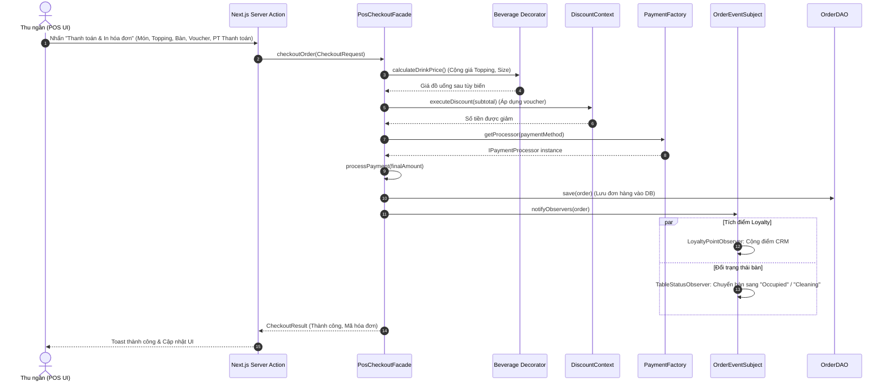
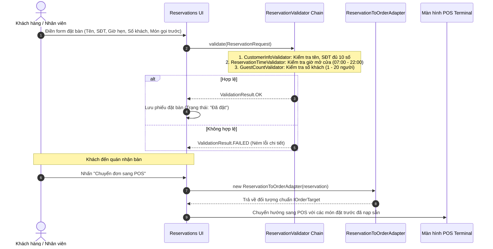

# KIẾN TRÚC HỆ THỐNG PHẦN MỀM (SYSTEM ARCHITECTURE)
## DỰ ÁN: ĐÀ LẠT CAFE OPERATIONS & MANAGEMENT

---

**Phiên bản tài liệu:** 1.0.0  
**Ngày lập:** 14/10/2026  
**Mục tiêu:** Mô tả chi tiết kiến trúc phân tầng, cơ chế giao tiếp giữa Next.js Frontend và Backend Java thuần SE, luồng dữ liệu nghiệp vụ, mô hình dữ liệu và phân định ranh giới phát triển (Scope Boundaries).

---

## 1. Tổng quan Kiến trúc Hệ thống

Hệ thống **Đà Lạt Cafe** được xây dựng theo kiến trúc **Phân tầng Tách biệt (Decoupled Multi-tier Architecture)**:

```mermaid
graph TB
    subgraph Client_Tier ["1. Tầng Trình diễn (Presentation Layer - Next.js 16 / React 19)"]
        StorefrontClient["Khách hàng Storefront (Browser)"]
        AdminClient["Nhân viên POS & Quản lý Admin (Browser/Tablet)"]
    end

    subgraph App_Server_Tier ["2. Tầng Máy chủ Ứng dụng Next.js (App Server - Port 3000)"]
        AppRouter["Next.js App Router (app/)"]
        ServerActions["Server Actions (app/admin/actions.ts)"]
        RouteHandlers["Route Handlers (app/api/cart, /api/favorites)"]
        ClientFallback["In-Memory Mock Store Fallback (lib/db/mock-store.ts)"]
        
        StorefrontClient --> AppRouter
        AdminClient --> AppRouter
        AppRouter --> ServerActions
        AppRouter --> RouteHandlers
        ServerActions -.->|Chế độ Standalone| ClientFallback
    end

    subgraph Core_Backend_Tier ["3. Tầng Nghiệp vụ Lõi Java thuần (Core Backend - Port 8080)"]
        JavaHttpServer["Java SE HTTP Dispatcher (com.sun.net.httpserver.HttpServer)"]
        
        subgraph Pattern_Domain ["⭐ GoF Design Patterns Domain (com.coffeeshop.patterns)"]
            Facade["Facade: PosCheckoutFacade"]
            Chain["Chain of Resp: ReservationValidator"]
            Adapter["Adapter: ReservationToOrderAdapter"]
            Factory["Factory: PaymentProcessorFactory"]
            Builder["Builder: OrderBuilder"]
            Decorator["Decorator: ToppingDecorator"]
            Strategy["Strategy: DiscountStrategy"]
            Observer["Observer: OrderEventSubject"]
            Singleton["Singleton: SystemConfigManager"]
        end

        DomainModel["POJO Entities (Order, Table, Reservation, MenuItem, Customer)"]
        JavaDAO["Data Access Objects (DAO Interfaces & Implementations)"]

        JavaHttpServer --> Facade
        JavaHttpServer --> Chain
        JavaHttpServer --> Adapter
        Facade --> Factory
        Facade --> Builder
        Facade --> Decorator
        Facade --> Strategy
        Facade --> Observer
        
        Pattern_Domain --> DomainModel
        DomainModel --> JavaDAO
    end

    subgraph Persistence_Tier ["4. Tầng Dữ liệu (Persistence Layer)"]
        PostgresDB[("PostgreSQL Database (QuanLyCafe)")]
        InMemoryDB[("Java SE In-Memory Store / Mock Data")]
        
        JavaDAO --> PostgresDB
        JavaDAO -.->|Chế độ Kiểm thử đơn vị| InMemoryDB
    end

    ServerActions ==>|HTTP REST JSON (Mục tiêu Tích hợp)| JavaHttpServer
    RouteHandlers ==>|HTTP REST JSON (Mục tiêu Tích hợp)| JavaHttpServer
```

---

## 2. Cơ chế Giao tiếp Frontend Next.js – Backend Java

### 2.1. Hiện trạng Thực tế trong Mã nguồn
- **Frontend Next.js:** Ứng dụng Frontend đang chạy độc lập ở chế độ **Self-contained (Zero-crash)**:
  - Các thao tác đọc/ghi dữ liệu của Admin sử dụng **Next.js Server Actions** (`app/admin/actions.ts`).
  - Các thao tác giỏ hàng và danh sách yêu thích sử dụng **Route Handlers** (`app/api/cart/route.ts`, `app/api/favorites/route.ts`).
  - Dữ liệu được đọc/ghi qua Drizzle ORM (nếu cấu hình `DATABASE_URL`) hoặc tự động kích hoạt **In-memory Mock Store** (`lib/db/mock-store.ts`) giúp hệ thống vận hành 100% không crash.
- **Backend Java (`backend-java/`):** Đã được tạo sẵn cấu trúc thư mục trong repository và quy hoạch kiến trúc phân tầng thuần OOP, sẵn sàng để triển khai mã nguồn các lớp Java SE và 9 GoF Patterns theo đúng đặc tả kỹ thuật.

### 2.2. Luồng Tích hợp Mục tiêu (Target Integration Architecture)
Để kết nối Frontend Next.js với Backend Java thuần SE, luồng tích hợp được thiết kế như sau:

1. **Giao thức mạng:** HTTP/1.1 trao đổi dữ liệu định dạng **JSON (MIME type: `application/json; charset=UTF-8`)**.
2. **Cấu hình địa chỉ:** Biến môi trường ở Frontend Next.js:
   ```env
   JAVA_BACKEND_URL=http://localhost:8080
   ```
3. **Cơ chế chuyển tiếp (Proxy / Adapter Pattern tại Frontend):**
   - Server Actions và Route Handlers của Next.js đóng vai trò **API Gateway / Proxy**: Nhận request từ trình duyệt, kiểm tra sơ bộ kiểu dữ liệu, sau đó gọi native `fetch()` gửi sang máy chủ Java SE `HttpServer` (cổng 8080).
   - Backend Java tiếp nhận, điều hướng qua các HttpHandler, kích hoạt các GoF Design Patterns tương ứng để xử lý nghiệp vụ, sau đó trả về kết quả JSON chuẩn.
   - Khi Backend Java gặp sự cố hoặc chưa bật, Frontend tự động fallback về Mock Store nội bộ với cơ chế ghi log cảnh báo thân thiện (`console.warn`).

---

## 3. Các Tầng Xử lý Chi tiết (System Layers)

### 3.1. Tầng Trình diễn (Presentation Layer - Next.js Client)
- **Công nghệ:** React 19 Client Components (`'use client'`).
- **Nhiệm vụ:**
  - Render giao diện người dùng tương tác cao: Danh mục sản phẩm, bộ lọc tìm kiếm, Modal tùy biến món (Size, topping, đá, đường).
  - Quầy thu ngân POS: Lưới món ăn, bàn phím số, chọn bàn phục vụ, tính tiền thừa, trừ điểm loyalty.
  - Sơ đồ tầng Floor Plan: Hiển thị 15 bàn với màu sắc trạng thái cập nhật theo thời gian thực.
  - Màn hình Bếp KDS: Bảng Kanban 4 cột (`Pending`, `Brewing`, `Ready`, `Completed`) kèm cảnh báo trễ đơn > 10 phút.
  - Quản trị Đặt bàn: Tiếp nhận yêu cầu, xem món đặt trước và nút bấm chuyển đổi đơn sang POS.

### 3.2. Tầng Máy chủ Ứng dụng Next.js (Application Server Layer)
- **Công nghệ:** Next.js Server Components, Server Actions (`app/admin/actions.ts`), Route Handlers (`app/api/`).
- **Nhiệm vụ:**
  - Bảo vệ quyền truy cập phân hệ Admin thông qua hàm `assertAdminAccess()` (`lib/admin/access.ts`).
  - Cung cấp cơ chế revalidation bộ nhớ đệm (`revalidatePath('/admin', 'layout')`) giúp giao diện tự động đồng bộ khi có thay đổi dữ liệu.
  - Đảm bảo cơ chế tự phục hồi lỗi (Fault Tolerance) với In-Memory Mock Store.

### 3.3. Tầng Nghiệp vụ Lõi Java thuần (Core Business Domain Layer)
- **Công nghệ:** Java SE 17+ Pure OOP, không sử dụng bất kỳ framework nào (Không Spring Boot).
- **Nhiệm vụ & 9 GoF Patterns:**
  - `SystemConfigManager` (**Singleton**): Quản lý giờ mở cửa (07:00 - 22:00), tỷ lệ tích điểm (10.000đ = 1 điểm), thời gian tự hủy bàn (30 phút).
  - `PaymentProcessorFactory` (**Factory Method**): Khởi tạo bộ xử lý thanh toán Tiền mặt, QR MoMo hoặc Thẻ/VNPay.
  - `OrderBuilder` (**Builder**): Xây dựng đối tượng Đơn hàng (`Order`) phức tạp với nhiều trường tùy chọn.
  - `ToppingDecorator` (**Decorator**): Tính giá và mô tả cho đồ uống khi cộng thêm Trân châu, Kem Cheese, nâng Size L.
  - `ReservationToOrderAdapter` (**Adapter**): Chuyển đổi đối tượng Phiếu đặt bàn (`Reservation`) sang đơn hàng POS (`IOrderTarget`).
  - `PosCheckoutFacade` (**Facade**): Gom toàn bộ quy trình chốt đơn POS phức tạp vào một phương thức duy nhất `checkoutOrder()`.
  - `DiscountStrategy` (**Strategy**): Tính chiết khấu voucher theo Phần trăm, Cố định hoặc Bậc thang tại thời điểm chạy.
  - `ReservationValidator` (**Chain of Responsibility**): Chuỗi kiểm tra tính hợp lệ của đơn đặt bàn trước (Thông tin khách ➔ Giờ mở cửa ➔ Số khách).
  - `OrderEventSubject` (**Observer**): Phát sự kiện sau thanh toán để tự động cộng điểm loyalty và giải phóng trạng thái bàn.

### 3.4. Tầng Truy xuất Dữ liệu (Data Access Layer - DAO)
- **Giao diện:** `IOrderDao`, `ITableDao`, `IReservationDao`, `ICustomerDao`, `IMenuDao`.
- **Cài đặt:**
  - `InMemoryDatabase`: Lưu trữ dữ liệu trên các cấu trúc dữ liệu `ConcurrentHashMap`, `CopyOnWriteArrayList` phục vụ kiểm thử đơn vị độc lập.
  - `JdbcDatabase`: Kết nối cơ sở dữ liệu quan hệ (PostgreSQL / MySQL) thông qua `java.sql.Connection` và `PreparedStatement` chuẩn Java SE.

---

## 4. Cơ chế Xác thực & Phân quyền (Authentication & Authorization)

### 4.1. Hiện trạng Mã nguồn Frontend
- Cơ chế kiểm soát hiện tại được cấu hình qua biến môi trường tại file `lib/admin/access.ts`:
  - `REQUIRE_ADMIN_AUTH='false'` (mặc định cho môi trường phát triển & demo): Cho phép truy cập thẳng vào trang quản trị Admin.
  - `REQUIRE_ADMIN_AUTH='true'`: Chặn truy cập và yêu cầu đăng nhập nhân viên.
- Không có Spring Security, không có JWT trong mã nguồn hiện có.

### 4.2. Đặc tả Thiết kế Phân quyền RBAC (Role-Based Access Control)
Hệ thống được thiết kế hỗ trợ 4 vai trò độc lập:

| Vai trò (Role) | Đối tượng sử dụng | Phạm vi quyền hạn |
| :--- | :--- | :--- |
| **`ROLE_ADMIN`** | Chủ quán / Quản trị viên hệ thống | Toàn quyền cấu hình quán (`/admin/settings`), xem báo cáo tài chính (`/admin/analytics`), quản lý kho và nhân sự |
| **`ROLE_MANAGER`** | Quản lý ca | Duyệt và chuyển đơn đặt bàn, quản lý sơ đồ bàn, chỉnh sửa menu, xem danh sách đơn |
| **`ROLE_STAFF`** | Thu ngân / Barista | Thao tác bán hàng tại POS (`/admin/pos`), cập nhật tiến trình bếp KDS, đổi trạng thái bàn |
| **`ROLE_CUSTOMER`** | Khách hàng | Xem menu, đặt món giỏ hàng Storefront, lưu món yêu thích, đặt bàn trực tuyến |

---

## 5. Các Luồng Dữ liệu Chính (Core Data Flows)

### 5.1. Luồng Bán hàng tại Quầy POS & Chốt đơn (POS Checkout Flow)



---

### 5.2. Luồng Đặt bàn Trước & Chuyển sang POS (Reservation & Transfer Flow)



---

## 6. Phân chia Phạm vi Công việc (Scope Boundaries for Issues)

Để việc phát triển và giao việc qua Issue được rõ ràng, dự án chia ranh giới thành 3 nhóm phạm vi:

```text
┌────────────────────────────────────────────────────────────────────────┐
│                        PHẠM VI FRONTEND NEXT.JS                        │
│ - Giao diện Storefront (DrinkMenu, CartSheet, Wishlist, Hero, Journal) │
│ - Giao diện Quản trị Admin (POS, KDS Board, Floor Plan, Tables, CRM)   │
│ - Next.js Server Actions & Route Handlers nội bộ                       │
│ - Zustand Store, SWR Cache & In-memory Fallback Store                  │
└───────────────────────────────────┬────────────────────────────────────┘
                                    │ Giao tiếp qua HTTP REST JSON
┌───────────────────────────────────▼────────────────────────────────────┐
│                         PHẠM VI TÍCH HỢP (INTEGRATION)                 │
│ - Chuẩn hóa Request / Response DTO giữa Next.js và Java Backend        │
│ - Cấu hình biến môi trường kết nối JAVA_BACKEND_URL                    │
│ - Cơ chế xử lý lỗi mạng & Tự động Fallback khi máy chủ Java gián đoạn  │
└───────────────────────────────────┬────────────────────────────────────┘
                                    │
┌───────────────────────────────────▼────────────────────────────────────┐
│                        PHẠM VI BACKEND JAVA THUẦN                      │
│ - Cài đặt Java SE HttpServer (com.sun.net.httpserver.HttpServer)       │
│ - Cài đặt 9 GoF Design Patterns (Gói com.coffeeshop.patterns)          │
│ - Định nghĩa các lớp thực thể POJO (Order, Table, Reservation...)      │
│ - Tầng DAO truy xuất dữ liệu (InMemoryDatabase & JDBC Connection)      │
│ - Kiểm thử đơn vị (Unit Tests JUnit) cho toàn bộ 9 mẫu thiết kế        │
└────────────────────────────────────────────────────────────────────────┘
```

Mỗi Issue tạo mới bắt buộc phải được gắn nhãn tương ứng (`scope:frontend`, `scope:backend`, `scope:integration`) để định hướng chính xác người thực hiện và tiêu chuẩn nghiệm thu.

