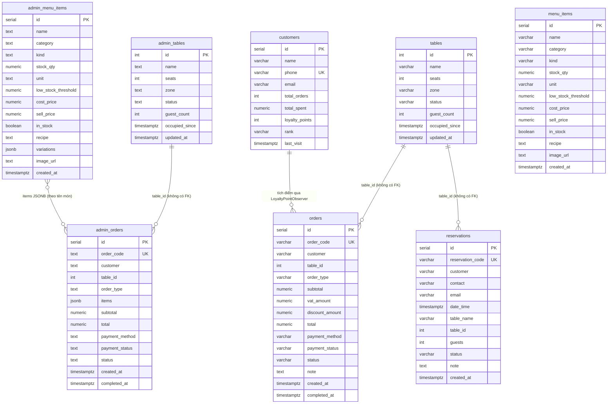

# ĐẶC TẢ CƠ SỞ DỮ LIỆU (DATABASE)
## DỰ ÁN: ĐÀ LẠT CAFE OPERATIONS & MANAGEMENT

Hệ thống có **hai tầng lưu trữ độc lập**, mỗi tầng có schema riêng. Cả hai cùng hỗ trợ chạy không cần cơ sở dữ liệu ("zero-crash") nhờ kho dữ liệu trong bộ nhớ.

| Tầng | Khi có `DATABASE_URL` | Khi không có hoặc mất kết nối | Định nghĩa schema |
| :--- | :--- | :--- | :--- |
| **Frontend Next.js** | PostgreSQL qua Drizzle ORM: bảng `admin_tables`, `admin_menu_items`, `admin_orders` | Mock store trong bộ nhớ (`lib/db/mock-store.ts`) | `frontend-nextjs/lib/db/schema.ts` |
| **Backend Java** | PostgreSQL qua JDBC (`org.postgresql:postgresql:42.7.14`, `sslmode=require`): bảng `tables`, `menu_items`, `orders`, `reservations`, `customers` | `InMemoryDatabase` (chế độ mặc định của `DaoFactory`) | `backend-java/.../dao/JdbcDatabase.java` (`initializeSchema`) |

> Hai bộ bảng **không chia sẻ dữ liệu**, kể cả khi cùng trỏ tới một database. Khi frontend gọi Java (xem [ARCHITECTURE §2](ARCHITECTURE.md#2-tích-hợp-frontend-nextjs--backend-java)), đơn được ghi ở Java, sau đó frontend ghi thêm một bản sao vào kho của mình, mang mã đơn do Java cấp. Chỉ hỗ trợ PostgreSQL: SQL dùng `ON CONFLICT` và `jsonb`, nên không chạy trên MySQL.

---

## 1. Sơ đồ quan hệ

---

## 2. Schema Frontend (Drizzle — `lib/db/schema.ts`)

| Bảng | Cột đáng chú ý | Giá trị hợp lệ |
| :--- | :--- | :--- |
| `admin_tables` | `zone` mặc định `'Main'`, `guest_count`, `occupied_since` | `status`: `available`, `occupied`, `reserved`, `cleaning` |
| `admin_menu_items` | `kind` (`menu` / `ingredient`), `unit` mặc định `'pcs'`, `variations` JSONB `[{ name, price }]` | — |
| `admin_orders` | `order_code` duy nhất, `items` JSONB `[{ name, qty, price, variation? }]`, **không có cột VAT, giảm giá hay ghi chú** (`total` = `subtotal × 1,08`) | `order_type`: `dine-in`, `pickup`, `delivery`; `payment_method`: `cash`, `qr`, `card`; `payment_status`: `paid`, `unpaid`, `refunded`; `status`: `pending`, `brewing`, `ready`, `completed` |

Dữ liệu mẫu của mock store gồm 15 bàn, 13 món bán, 5 nguyên liệu và lịch sử đơn hàng.

---

## 3. Schema Backend Java (JDBC — `JdbcDatabase.initializeSchema`)

| Bảng | Cột đáng chú ý | Giá trị lưu trong cột trạng thái |
| :--- | :--- | :--- |
| `tables` | `zone` mặc định `'Main Floor'` | `AVAILABLE`, `OCCUPIED`, `RESERVED`, `CLEANING` |
| `menu_items` | `unit` mặc định `'ly'`, **không có `variations`** | — |
| `orders` | `vat_amount`, `discount_amount`, `note`, **không có `items`** | `order_type`: `DINE_IN`, `PICKUP`, `DELIVERY`; `payment_method`: `CASH`, `QR`, `CARD`; `payment_status`: `PAID`, `UNPAID`, …; `status`: `PENDING`, `BREWING`, `READY`, `COMPLETED`, `CANCELLED` |
| `reservations` | `id` SERIAL + `reservation_code` duy nhất (`RES-xxxx`), `table_id`, `table_name`, **không có `pre_orders`** | `PENDING` (Chờ xác nhận), `CONFIRMED` (Đã xác nhận đặt bàn), `SEATED` (Khách đã nhận bàn), `CANCELLED` (Đã hủy) |
| `customers` | `phone` duy nhất, `loyalty_points`, `total_spent` | `rank`: `BRONZE` (Đồng, 0%), `SILVER` (Bạc, 5%), `GOLD` (Vàng, 10%), `VIP` (Kim Cương, 15%) |

DAO ghi trạng thái bằng **tên enum in hoa**. Khi đọc thì so khớp không phân biệt hoa thường, nên các giá trị mặc định chữ thường trong DDL vẫn đọc được.

---

## 4. Giới hạn đã biết

1. **Chế độ JDBC chưa lưu dữ liệu dạng danh sách.** DDL và DAO không có cột cho món trong đơn (`items`), tuỳ chọn món (`variations`) hay món đặt trước (`pre_orders`), nên các dữ liệu này chỉ tồn tại ở chế độ In-Memory.
2. **`initializeSchema` chưa được gọi tự động.** Muốn dùng chế độ JDBC trên một database mới, phải chạy DDL trước.
3. **Không có ràng buộc khoá ngoại** (`table_id`) ở cả hai schema.
4. **Chưa triển khai:** bảng `vouchers` (mã giảm giá đang cố định trong code, xem [API_SPEC](API_SPEC.md)) và bảng `staff` (giao diện nhân sự dùng dữ liệu mẫu).
