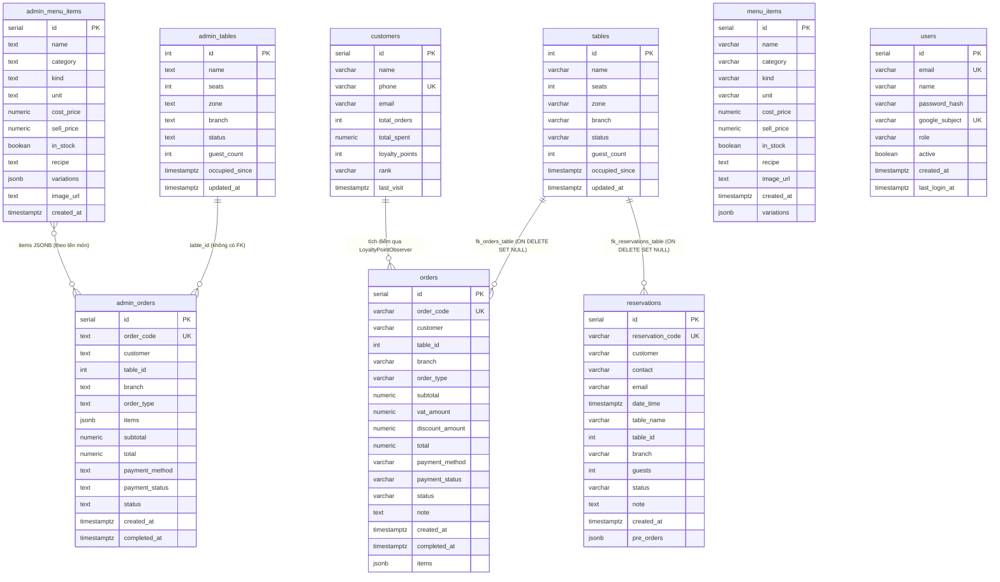

# ĐẶC TẢ CƠ SỞ DỮ LIỆU (DATABASE)
## DỰ ÁN: ĐÀ LẠT CAFE OPERATIONS & MANAGEMENT

Hệ thống có **hai tầng lưu trữ độc lập**, mỗi tầng có schema riêng. Cả hai cùng hỗ trợ chạy không cần cơ sở dữ liệu ("zero-crash") nhờ kho dữ liệu trong bộ nhớ.

| Tầng | Khi có `DATABASE_URL` | Khi không có hoặc mất kết nối | Định nghĩa schema |
| :--- | :--- | :--- | :--- |
| **Frontend Next.js** | PostgreSQL qua Drizzle ORM: bảng `admin_tables`, `admin_menu_items`, `admin_orders` | Mock store trong bộ nhớ (`lib/db/mock-store.ts`) | `frontend-nextjs/lib/db/schema.ts` |
| **Backend Java** | PostgreSQL qua JDBC (`org.postgresql:postgresql:42.7.14`, `sslmode=require`): bảng `tables`, `menu_items`, `orders`, `reservations`, `customers` | `InMemoryDatabase` (chế độ mặc định của `DaoFactory`) | `backend-java/.../dao/JdbcDatabase.java` (`initializeSchema`) |

> Hai bộ bảng **không chia sẻ dữ liệu**, kể cả khi cùng trỏ tới một database. Khi frontend gọi Java (xem [ARCHITECTURE §2](ARCHITECTURE.md#2-tích-hợp-frontend-nextjs--backend-java)), đơn được ghi ở Java, sau đó frontend ghi thêm một bản sao vào kho của mình, mang mã đơn do Java cấp. Chỉ hỗ trợ PostgreSQL: SQL dùng `ON CONFLICT` và `jsonb`, nên không chạy trên MySQL.

---

## 1. Sơ đồ quan hệ

---

## 2. Schema Frontend (Drizzle — `lib/db/schema.ts`)

| Bảng | Cột đáng chú ý | Giá trị hợp lệ |
| :--- | :--- | :--- |
| `admin_tables` | `zone` mặc định `'Main'`, `branch` (mặc định `phan-dinh-phung`), `guest_count`, `occupied_since` | `status`: `available`, `occupied`, `reserved`, `cleaning` |
| `admin_menu_items` | `kind` (`menu` / `ingredient`), `unit` mặc định `'pcs'`, `variations` JSONB `[{ name, price }]` | — |
| `admin_orders` | `order_code` duy nhất, `branch` (mặc định `phan-dinh-phung`), `items` JSONB `[{ name, qty, price, variation? }]`, **không có cột VAT, giảm giá hay ghi chú** (`total` = `subtotal × 1,08`) | `order_type`: `dine-in`, `pickup`, `delivery`; `payment_method`: `cash`, `qr`, `card`; `payment_status`: `paid`, `unpaid`, `refunded`; `status`: `pending`, `brewing`, `ready`, `completed` |

Hai bảng phụ do `lib/admin/local-links.ts` tự tạo (`CREATE TABLE IF NOT EXISTS`) ở lần dùng đầu, **không sửa** các bảng `admin_*`:

| Bảng | Cột | Vai trò |
| :--- | :--- | :--- |
| `admin_menu_links` | `menu_item_id` (PK), `java_menu_id`, `linked_at` | Cặp id món frontend ↔ Java. Ghép theo tên một lần rồi lưu lại, hoặc ghi thẳng khi tạo món qua `POST /api/menu`; đổi tên món sau đó không làm mất liên kết |
| `admin_sync_queue` | `order_code` (PK), `queued_at` | Đơn ghi cục bộ mà Java chưa nhận; được gửi qua `POST /api/orders/sync` rồi xoá khỏi hàng đợi |

Không có `DATABASE_URL`, hoặc không tạo được bảng, thì hai danh sách này nằm trong bộ nhớ cùng mock store.

Dữ liệu mẫu của mock store gồm 15 bàn ở 123 Phan Đình Phùng, 8 bàn ở 456 Bùi Thị Xuân, 13 món bán, 5 nguyên liệu và lịch sử đơn hàng.

---

## 3. Schema Backend Java (JDBC — `JdbcDatabase.initializeSchema`)

| Bảng | Cột đáng chú ý | Giá trị lưu trong cột trạng thái |
| :--- | :--- | :--- |
| `tables` | `zone` mặc định `'Main Floor'`, `branch` | `AVAILABLE`, `OCCUPIED`, `RESERVED`, `CLEANING` |
| `menu_items` | `unit` mặc định `'ly'`, `variations` JSONB `[{ name, price }]` | — |
| `orders` | `vat_amount`, `discount_amount`, `note`, `items` JSONB `[{ menuItemId, name, qty, price, variation, notes }]`, `table_id` → `tables(id)` | `order_type`: `DINE_IN`, `PICKUP`, `DELIVERY`; `payment_method`: `CASH`, `QR`, `CARD`; `payment_status`: `PAID`, `UNPAID`, …; `status`: `PENDING`, `BREWING`, `READY`, `COMPLETED`, `CANCELLED` |
| `reservations` | `id` SERIAL + `reservation_code` duy nhất (`RES-0001` theo id), `table_id` → `tables(id)`, `table_name`, `pre_orders` JSONB `[{ name, qty, price }]` | `PENDING` (Chờ xác nhận), `CONFIRMED` (Đã xác nhận đặt bàn), `SEATED` (Khách đã nhận bàn), `CANCELLED` (Đã hủy) |
| `customers` | `phone` duy nhất, `loyalty_points`, `total_spent` | `rank`: `BRONZE` (Đồng, 0%), `SILVER` (Bạc, 5%), `GOLD` (Vàng, 10%), `VIP` (Kim Cương, 15%) |
| `users` | `email` duy nhất (chữ thường), `name`, `password_hash` (PBKDF2, rỗng với khách chỉ đăng nhập Google), `google_subject` duy nhất (chỉ tài khoản khách hàng), `active`, `created_at`, `last_login_at` | `role`: `CUSTOMER`, `STAFF`, `MANAGER`, `ADMIN` |

DAO ghi trạng thái bằng **tên enum in hoa** (giá trị mặc định trong DDL cũng in hoa). Khi đọc thì so khớp không phân biệt hoa thường, nên dữ liệu cũ ghi chữ thường vẫn đọc được.

**Khởi tạo và nâng cấp.** Khi `DaoFactory` kết nối được PostgreSQL, nó gọi `JdbcDatabase.initializeSchema` trước khi chọn chế độ JDBC. Mọi lệnh đều chạy lại được nhiều lần:
- `CREATE TABLE IF NOT EXISTS` cho 5 bảng, rồi `ALTER TABLE … ADD COLUMN IF NOT EXISTS` cho 3 cột JSONB (mặc định `'[]'`), nên database cũ được nâng cấp tại chỗ.
- Khoá ngoại `fk_orders_table` và `fk_reservations_table` được thêm trong khối `DO` có kiểm tra tồn tại, với `NOT VALID`: dòng cũ được giữ nguyên, dòng mới phải trỏ tới bàn có thật. Kèm chỉ mục cho `table_id`, `orders.status`, `reservations.date_time`.
- Nếu `tables` hoặc `menu_items` còn trống, 15 bàn và thực đơn mẫu của `InMemoryDatabase` được ghi vào (đơn tại bàn cần bàn tồn tại vì có khoá ngoại). Sau đó `syncSequences` đưa các sequence SERIAL vượt id lớn nhất.
- Nếu không chuẩn bị được schema (ví dụ thiếu quyền), server ở lại chế độ In-Memory và ghi log lỗi.
- **Chi nhánh.** `tables`, `orders`, `reservations` có cột `branch VARCHAR(40) NOT NULL DEFAULT 'phan-dinh-phung'` (kèm chỉ mục), thêm bằng `ADD COLUMN IF NOT EXISTS`: dòng cũ thuộc chi nhánh đầu. Nếu chưa có bàn nào ở `bui-thi-xuan`, `DaoFactory` thêm 8 bàn mẫu cho chi nhánh này với id nối sau id lớn nhất, không đụng bàn cũ. Phía frontend, `ensureTableImages` / `ensureOrderTableGroups` thêm cột `branch` tương tự cho `admin_tables`, `admin_orders`.
- **Không theo dõi tồn kho.** `menu_items` và `admin_menu_items` không còn cột `stock_qty`, `low_stock_threshold`; món bán hay không chỉ do cột `in_stock`. Database cũ còn giữ hai cột vẫn chạy được, vì code không đọc hay ghi chúng và chúng có giá trị mặc định.

**Kết nối.** `JdbcDatabase` giữ một pool nhỏ (tối đa 8 kết nối rảnh): `close()` trả kết nối về pool sau khi rollback giao dịch dở và bật lại auto-commit. `isAvailable()` lưu kết quả kiểm tra 5 giây, nên kiểm tra sức khoẻ trên đường xử lý request không mở kết nối mới mỗi lần.

---

## 4. Giới hạn đã biết

1. **Hai bộ bảng vẫn tách rời.** Bảng `admin_*` của frontend không có khoá ngoại; quan hệ giữa đơn và bàn chỉ được kiểm ở tầng ứng dụng.
2. **Khoá ngoại `NOT VALID`** không kiểm các dòng ghi trước khi nâng cấp. Muốn kiểm cả dữ liệu cũ, chạy `ALTER TABLE orders VALIDATE CONSTRAINT fk_orders_table;` (và tương tự cho `reservations`) sau khi đã dọn các dòng trỏ tới bàn không tồn tại.
3. **Chưa triển khai:** bảng `vouchers` (mã giảm giá nằm trong `VoucherCatalog`, xem [API_SPEC §3.16](API_SPEC.md)) và bảng `staff` (giao diện nhân sự dùng dữ liệu mẫu).
4. **Kiểm thử:** `JdbcIntegrationTest` chạy DAO JDBC và Facade trên một PostgreSQL nhúng (zonky `embedded-postgres`) ngay trong JVM test, không cần Docker và không đụng tới Supabase dùng chung.
