# ĐẶC TẢ CƠ SỞ DỮ LIỆU (DATABASE SPECIFICATION)
## DỰ ÁN: ĐÀ LẠT CAFE OPERATIONS & MANAGEMENT

---

**Phiên bản tài liệu:** 1.0.0  
**Hệ quản trị CSDL hỗ trợ:** PostgreSQL 14+ / MySQL 8.0+ / In-Memory Data Store  
**Mục tiêu:** Mô tả chi tiết cấu trúc các bảng, trường dữ liệu, kiểu dữ liệu, quan hệ khóa chính/khóa ngoại, chỉ mục (Index) và các ràng buộc nghiệp vụ toàn vẹn dữ liệu. Giúp các lập trình viên Frontend, Backend và AI tránh việc tạo API dựa trên các bảng hoặc trường dữ liệu không tồn tại.

---

## 1. Sơ đồ Quan hệ Thực thể (Entity-Relationship Diagram - ERD)

```mermaid
erDiagram
    TABLES ||--o{ ORDERS : "phục vụ tại bàn"
    TABLES ||--o{ RESERVATIONS : "được đặt trước"
    CUSTOMERS ||--o{ ORDERS : "tích điểm đơn hàng"
    CUSTOMERS ||--o{ RESERVATIONS : "đặt bàn hẹn trước"
    VOUCHERS ||--o{ ORDERS : "áp dụng giảm giá"
    STAFF ||--o{ ORDERS : "thu ngân lập hóa đơn"

    TABLES {
        int id PK "Mã bàn (1-15)"
        string name "Tên hiển thị (Bàn 01..)"
        int seats "Số ghế (1, 2, 4, 6)"
        string zone "Khu vực (Main Floor, Patio, Coffee Bar)"
        string status "Trạng thái (available, occupied, reserved, cleaning)"
        int guest_count "Số lượng khách đang ngồi"
        timestamp occupied_since "Thời điểm khách vào ngồi"
        timestamp updated_at "Thời điểm cập nhật trạng thái"
    }

    MENU_ITEMS {
        int id PK "Mã món (Tự tăng)"
        string name "Tên món / nguyên liệu"
        string category "Danh mục (Cà phê, Trà, Bánh...)"
        string kind "Phân loại (menu, ingredient)"
        numeric stock_qty "Số lượng tồn kho"
        string unit "Đơn vị tính (ly, bánh, gói, kg)"
        numeric low_stock_threshold "Ngưỡng cảnh báo sắp hết"
        numeric cost_price "Giá vốn nguyên liệu"
        numeric sell_price "Giá bán niêm yết"
        boolean in_stock "Bật/Tắt trạng thái bán"
        string recipe "Công thức / Mô tả tóm tắt"
        jsonb variations "Danh sách biến thể (Size, Nóng/Đá)"
        string image_url "Đường dẫn hình ảnh"
        timestamp created_at "Ngày tạo"
    }

    ORDERS {
        int id PK "Mã ID (Tự tăng)"
        string order_code UK "Mã hóa đơn duy nhất (AC-xxxxx)"
        string customer "Tên khách hàng"
        int table_id FK "Mã bàn (NULL nếu mang đi/giao hàng)"
        string order_type "Loại đơn (dine-in, pickup, delivery)"
        jsonb items "Danh sách chi tiết món và topping"
        numeric subtotal "Tổng tiền trước giảm giá"
        numeric total "Tổng thanh toán sau giảm giá & VAT"
        string payment_method "Phương thức (cash, qr, card)"
        string payment_status "Trạng thái thanh toán (unpaid, paid, refunded)"
        string status "Tiến trình đơn (pending, brewing, ready, completed)"
        timestamp created_at "Thời điểm tạo đơn"
        timestamp completed_at "Thời điểm pha chế xong"
    }

    RESERVATIONS {
        string id PK "Mã phiếu đặt bàn (RES-xxx)"
        string customer "Tên khách đặt"
        string contact "Số điện thoại liên hệ"
        string email "Email nhận xác nhận"
        timestamp date_time "Khung giờ hẹn đến"
        string table_name "Tên bàn mong muốn"
        int guests "Số lượng khách (1-20)"
        string status "Trạng thái (Chờ xác nhận, Đã đặt, Hoàn thành, Đã hủy)"
        string note "Ghi chú yêu cầu đặc biệt"
        jsonb pre_orders "Danh sách món đặt trước"
        timestamp created_at "Ngày gửi yêu cầu"
    }

    CUSTOMERS {
        int id PK "Mã khách hàng"
        string name "Họ và tên"
        string phone UK "Số điện thoại định danh"
        string email "Địa chỉ email"
        int total_orders "Tổng số đơn hàng đã mua"
        numeric total_spent "Tổng tiền chi tiêu tích lũy"
        int loyalty_points "Điểm thưởng khả dụng"
        string rank "Hạng thành viên (Đồng, Bạc, Vàng, Kim Cương)"
        timestamp last_visit "Lần ghé quán gần nhất"
    }

    VOUCHERS {
        int id PK "Mã ID"
        string code UK "Mã khuyến mãi (WELCOME10...)"
        string discount_type "Loại chiết khấu (percentage, fixed, tiered)"
        numeric discount_value "Giá trị giảm (% hoặc số tiền)"
        numeric min_order_value "Giá trị đơn tối thiểu để áp dụng"
        numeric max_discount "Số tiền giảm tối đa (với %)"
        date start_date "Ngày bắt đầu áp dụng"
        date end_date "Ngày hết hạn"
        boolean is_active "Trạng thái kích hoạt"
    }

    STAFF {
        int id PK "Mã nhân viên"
        string name "Họ và tên nhân sự"
        string role "Vai trò (Admin, Manager, Staff, Barista)"
        string phone "Số điện thoại liên lạc"
        string email "Email công việc"
        string shift "Ca làm việc (Sáng, Chiều, Tối)"
        string status "Trạng thái làm việc (Đang làm, Nghỉ ca)"
    }
```



---

## 2. Đặc tả Chi tiết Các Bảng Dữ liệu

### 2.1. Bảng `admin_tables` (Quản lý Sơ đồ Bàn)
- **Mục đích:** Lưu trữ thông tin và trạng thái thời gian thực của 15 bàn phục vụ.
- **Tên bảng vật lý:** `admin_tables` (hoặc `tables`).

| Tên Cột | Kiểu Dữ liệu | Khóa / Ràng buộc | Giá trị Mặc định | Ý nghĩa Nghiệp vụ |
| :--- | :--- | :---: | :---: | :--- |
| `id` | `INTEGER` | **PK** | - | Mã số bàn (1 đến 15) |
| `name` | `VARCHAR(50)` | NOT NULL | - | Tên hiển thị (Ví dụ: "Bàn 01", "Bàn VIP") |
| `seats` | `INTEGER` | NOT NULL | `2` | Sức chứa tối đa (1, 2, 4, 6 ghế) |
| `zone` | `VARCHAR(50)` | NOT NULL | `'Main Floor'` | Phân khu: `Main Floor`, `Patio`, `Coffee Bar` |
| `status` | `VARCHAR(20)` | NOT NULL | `'available'` | Enum: `available`, `occupied`, `reserved`, `cleaning` |
| `guest_count` | `INTEGER` | NOT NULL | `0` | Số khách thực tế đang ngồi |
| `occupied_since`| `TIMESTAMP` | NULL | NULL | Thời điểm khách bắt đầu vào ngồi |
| `updated_at` | `TIMESTAMP` | NOT NULL | `CURRENT_TIMESTAMP` | Thời điểm cập nhật trạng thái gần nhất |

---

### 2.2. Bảng `admin_menu_items` (Quản lý Thực đơn & Kho hàng)
- **Mục đích:** Quản lý danh mục đồ uống bán cho khách và tồn kho nguyên liệu pha chế.
- **Tên bảng vật lý:** `admin_menu_items` (hoặc `menu_items`).

| Tên Cột | Kiểu Dữ liệu | Khóa / Ràng buộc | Giá trị Mặc định | Ý nghĩa Nghiệp vụ |
| :--- | :--- | :---: | :---: | :--- |
| `id` | `SERIAL` / `INT AUTO_INC` | **PK** | - | Mã định danh sản phẩm |
| `name` | `VARCHAR(150)` | NOT NULL | - | Tên món nước hoặc nguyên liệu |
| `category` | `VARCHAR(100)` | NOT NULL | - | Danh mục: Cà phê, Cà phê ủ lạnh, Trà, Bánh ngọt... |
| `kind` | `VARCHAR(20)` | NOT NULL | `'menu'` | Phân loại: `'menu'` (Món bán), `'ingredient'` (Nguyên liệu kho) |
| `stock_qty` | `NUMERIC(10,2)` | NOT NULL | `0` | Số lượng tồn kho hiện tại |
| `unit` | `VARCHAR(20)` | NOT NULL | `'ly'` | Đơn vị: `ly`, `bánh`, `gói`, `kg` |
| `low_stock_threshold`| `NUMERIC(10,2)` | NOT NULL | `10` | Ngưỡng cảnh báo tồn kho thấp (Low Stock Alert) |
| `cost_price` | `NUMERIC(10,2)` | NOT NULL | `0` | Giá vốn đầu vào (VNĐ) |
| `sell_price` | `NUMERIC(10,2)` | NOT NULL | `0` | Giá bán lẻ niêm yết (VNĐ) |
| `in_stock` | `BOOLEAN` | NOT NULL | `TRUE` | Công tắc bật/tắt bán tại quầy POS |
| `recipe` | `TEXT` | NULL | NULL | Công thức pha chế / Ghi chú nguyên liệu |
| `variations` | `JSONB` / `JSON` | NOT NULL | `'[]'` | Mảng các biến thể (Nóng/Đá, Sữa tươi/Oat...) |
| `image_url` | `VARCHAR(255)` | NULL | NULL | Link ảnh đại diện món nước |
| `created_at` | `TIMESTAMP` | NOT NULL | `CURRENT_TIMESTAMP` | Thời điểm tạo sản phẩm |

---

### 2.3. Bảng `admin_orders` (Quản lý Hóa đơn & Đơn hàng)
- **Mục đích:** Lưu trữ lịch sử giao dịch bán lẻ tại quầy POS và đơn đặt trực tuyến.
- **Tên bảng vật lý:** `admin_orders` (hoặc `orders`).

| Tên Cột | Kiểu Dữ liệu | Khóa / Ràng buộc | Giá trị Mặc định | Ý nghĩa Nghiệp vụ |
| :--- | :--- | :---: | :---: | :--- |
| `id` | `SERIAL` / `INT AUTO_INC` | **PK** | - | Mã ID hóa đơn |
| `order_code` | `VARCHAR(50)` | **UK**, NOT NULL | - | Mã đơn hàng duy nhất (Ví dụ: `AC-98214`) |
| `customer` | `VARCHAR(100)` | NOT NULL | `'Walk-in'` | Tên khách hàng (hoặc Khách vãng lai) |
| `table_id` | `INTEGER` | **FK** -> `tables(id)` | NULL | Số bàn (NULL nếu khách mua mang đi / giao hàng) |
| `order_type` | `VARCHAR(20)` | NOT NULL | `'dine-in'` | Enum: `dine-in` (Tại bàn), `pickup` (Mang đi), `delivery` |
| `items` | `JSONB` / `JSON` | NOT NULL | `'[]'` | Mảng các món, số lượng, giá và tùy chọn topping |
| `subtotal` | `NUMERIC(10,2)` | NOT NULL | `0` | Tổng giá trị món trước chiết khấu và thuế |
| `total` | `NUMERIC(10,2)` | NOT NULL | `0` | Tổng số tiền thanh toán thực tế cuối cùng |
| `payment_method` | `VARCHAR(20)`| NOT NULL | `'cash'` | Enum: `cash` (Tiền mặt), `qr` (MoMo), `card` (VNPay/Thẻ) |
| `payment_status` | `VARCHAR(20)`| NOT NULL | `'unpaid'` | Enum: `paid` (Đã thanh toán), `unpaid`, `refunded` |
| `status` | `VARCHAR(20)` | NOT NULL | `'pending'` | Enum KDS: `pending`, `brewing`, `ready`, `completed` |
| `created_at` | `TIMESTAMP` | NOT NULL | `CURRENT_TIMESTAMP` | Thời điểm tạo đơn |
| `completed_at` | `TIMESTAMP` | NULL | NULL | Thời điểm pha chế xong / hoàn tất giao hàng |

---

### 2.4. Bảng `reservations` (Phiếu Đặt bàn trước)
- **Mục đích:** Quản lý các cuộc hẹn đặt bàn của khách qua mạng hoặc điện thoại.

| Tên Cột | Kiểu Dữ liệu | Khóa / Ràng buộc | Giá trị Mặc định | Ý nghĩa Nghiệp vụ |
| :--- | :--- | :---: | :---: | :--- |
| `id` | `VARCHAR(30)` | **PK** | - | Mã phiếu đặt bàn (Ví dụ: `RES-001`) |
| `customer` | `VARCHAR(100)` | NOT NULL | - | Tên khách hàng đặt chỗ |
| `contact` | `VARCHAR(20)` | NOT NULL | - | Số điện thoại liên lạc (bắt buộc 10 chữ số) |
| `email` | `VARCHAR(150)` | NULL | - | Email gửi thông báo xác nhận |
| `date_time` | `TIMESTAMP` | NOT NULL | - | Khung giờ hẹn đến quán (07:00 - 22:00) |
| `table_name` | `VARCHAR(50)` | NOT NULL | - | Bàn đã giữ trước (Ví dụ: "Bàn 04") |
| `guests` | `INTEGER` | NOT NULL | `2` | Số lượng khách tham gia (1 đến 20 người) |
| `status` | `VARCHAR(30)` | NOT NULL | `'Chờ xác nhận'` | Enum: `Chờ xác nhận`, `Đã đặt`, `Hoàn thành`, `Đã hủy` |
| `note` | `TEXT` | NULL | - | Ghi chú yêu cầu đặc biệt của khách |
| `pre_orders` | `JSONB` / `JSON` | NOT NULL | `'[]'` | Danh sách các món nước và bánh khách đặt trước |
| `created_at` | `TIMESTAMP` | NOT NULL | `CURRENT_TIMESTAMP` | Ngày giờ gửi đơn đặt bàn |

---

### 2.5. Bảng `customers` (Khách hàng Thân thiết & CRM)
- **Mục đích:** Lưu trữ hồ sơ chi tiêu và điểm tích lũy thành viên.

| Tên Cột | Kiểu Dữ liệu | Khóa / Ràng buộc | Giá trị Mặc định | Ý nghĩa Nghiệp vụ |
| :--- | :--- | :---: | :---: | :--- |
| `id` | `SERIAL` | **PK** | - | Mã định danh khách hàng |
| `name` | `VARCHAR(100)` | NOT NULL | - | Họ và tên khách hàng |
| `phone` | `VARCHAR(20)` | **UK**, NOT NULL | - | Số điện thoại duy nhất dùng để tra cứu điểm |
| `email` | `VARCHAR(150)` | NULL | - | Email khách hàng |
| `total_orders` | `INTEGER` | NOT NULL | `0` | Tổng số lượt mua hàng |
| `total_spent` | `NUMERIC(12,2)` | NOT NULL | `0` | Tổng số tiền đã chi tiêu tại quán (VNĐ) |
| `loyalty_points`| `INTEGER` | NOT NULL | `0` | Số điểm thưởng khả dụng (10.000đ = 1 điểm) |
| `rank` | `VARCHAR(20)` | NOT NULL | `'Đồng'` | Hạng thẻ: `Đồng`, `Bạc`, `Vàng`, `Kim Cương` |
| `last_visit` | `TIMESTAMP` | NULL | NULL | Ngày gần nhất ghé quán |

---

### 2.6. Bảng `vouchers` (Mã Giảm giá Khuyến mãi)
- **Mục đích:** Hỗ trợ tính toán chiết khấu hóa đơn theo **Strategy Pattern**.

| Tên Cột | Kiểu Dữ liệu | Khóa / Ràng buộc | Giá trị Mặc định | Ý nghĩa Nghiệp vụ |
| :--- | :--- | :---: | :---: | :--- |
| `id` | `SERIAL` | **PK** | - | Mã định danh voucher |
| `code` | `VARCHAR(50)` | **UK**, NOT NULL | - | Mã khuyến mãi (Ví dụ: `WELCOME10`) |
| `discount_type`| `VARCHAR(20)` | NOT NULL | `'percentage'` | Enum Strategy: `percentage`, `fixed`, `tiered` |
| `discount_value`| `NUMERIC(10,2)`| NOT NULL | `0` | Tỷ lệ giảm (Vd: 0.10 cho 10%) hoặc số tiền cố định |
| `min_order_value`|`NUMERIC(10,2)`| NOT NULL | `0` | Giá trị hóa đơn tối thiểu để mã có hiệu lực |
| `max_discount` | `NUMERIC(10,2)`| NULL | NULL | Mức giảm tối đa (khi dùng theo phần trăm) |
| `start_date` | `DATE` | NOT NULL | - | Ngày bắt đầu áp dụng |
| `end_date` | `DATE` | NOT NULL | - | Ngày hết hạn |
| `is_active` | `BOOLEAN` | NOT NULL | `TRUE` | Trạng thái kích hoạt của voucher |

---

### 2.7. Bảng `staff` (Quản lý Nhân sự & Phân ca)
- **Mục đích:** Lưu trữ hồ sơ nhân viên phục vụ, pha chế và quản lý (tương ứng giao diện `staff-management.tsx`).

| Tên Cột | Kiểu Dữ liệu | Khóa / Ràng buộc | Giá trị Mặc định | Ý nghĩa Nghiệp vụ |
| :--- | :--- | :---: | :---: | :--- |
| `id` | `SERIAL` | **PK** | - | Mã định danh nhân viên |
| `name` | `VARCHAR(100)` | NOT NULL | - | Họ và tên nhân viên |
| `role` | `VARCHAR(50)` | NOT NULL | `'Staff'` | Vai trò: `Admin`, `Manager`, `Staff`, `Barista` |
| `phone` | `VARCHAR(20)` | NOT NULL | - | Số điện thoại liên lạc |
| `email` | `VARCHAR(150)` | NULL | - | Email công việc |
| `shift` | `VARCHAR(50)` | NOT NULL | `'Sáng'` | Ca làm việc: `Sáng`, `Chiều`, `Tối` |
| `status` | `VARCHAR(30)` | NOT NULL | `'Đang làm'` | Trạng thái: `Đang làm`, `Nghỉ ca` |
| `created_at` | `TIMESTAMP` | NOT NULL | `CURRENT_TIMESTAMP` | Thời điểm tạo hồ sơ |

---

## 3. Script SQL Khởi tạo Cơ sở Dữ liệu Mẫu (DDL Script)

> [!NOTE]
> **Hiện trạng triển khai Schema:**
> - Trong mã nguồn Frontend (`lib/db/schema.ts` - Drizzle ORM): Hiện tại đã cài đặt 3 bảng cốt lõi phục vụ vận hành tức thì là `admin_tables`, `admin_menu_items` và `admin_orders`.
> - Script DDL dưới đây cung cấp đầy đủ 7 bảng quan hệ chuẩn (kèm `customers`, `reservations`, `vouchers`, `staff`) sẵn sàng nạp vào PostgreSQL/MySQL cho tầng DAO của Backend Java SE.

Dưới đây là mã SQL chuẩn chạy trên PostgreSQL hoặc MySQL để thiết lập toàn bộ cơ sở dữ liệu:

```sql
-- 1. BẢNG SƠ ĐỒ BÀN
CREATE TABLE IF NOT EXISTS admin_tables (
    id INTEGER PRIMARY KEY,
    name VARCHAR(50) NOT NULL,
    seats INTEGER NOT NULL DEFAULT 2,
    zone VARCHAR(50) NOT NULL DEFAULT 'Main Floor',
    status VARCHAR(20) NOT NULL DEFAULT 'available' CHECK (status IN ('available', 'occupied', 'reserved', 'cleaning')),
    guest_count INTEGER NOT NULL DEFAULT 0,
    occupied_since TIMESTAMP WITH TIME ZONE NULL,
    updated_at TIMESTAMP WITH TIME ZONE NOT NULL DEFAULT CURRENT_TIMESTAMP
);

-- 2. BẢNG THỰC ĐƠN & KHO HÀNG
CREATE TABLE IF NOT EXISTS admin_menu_items (
    id SERIAL PRIMARY KEY,
    name VARCHAR(150) NOT NULL,
    category VARCHAR(100) NOT NULL,
    kind VARCHAR(20) NOT NULL DEFAULT 'menu' CHECK (kind IN ('menu', 'ingredient')),
    stock_qty NUMERIC(10,2) NOT NULL DEFAULT 0,
    unit VARCHAR(20) NOT NULL DEFAULT 'ly',
    low_stock_threshold NUMERIC(10,2) NOT NULL DEFAULT 10,
    cost_price NUMERIC(10,2) NOT NULL DEFAULT 0,
    sell_price NUMERIC(10,2) NOT NULL DEFAULT 0,
    in_stock BOOLEAN NOT NULL DEFAULT TRUE,
    recipe TEXT NULL,
    variations JSONB NOT NULL DEFAULT '[]'::jsonb,
    image_url VARCHAR(255) NULL,
    created_at TIMESTAMP WITH TIME ZONE NOT NULL DEFAULT CURRENT_TIMESTAMP
);

-- 3. BẢNG KHÁCH HÀNG CRM
CREATE TABLE IF NOT EXISTS customers (
    id SERIAL PRIMARY KEY,
    name VARCHAR(100) NOT NULL,
    phone VARCHAR(20) UNIQUE NOT NULL,
    email VARCHAR(150) NULL,
    total_orders INTEGER NOT NULL DEFAULT 0,
    total_spent NUMERIC(12,2) NOT NULL DEFAULT 0,
    loyalty_points INTEGER NOT NULL DEFAULT 0,
    rank VARCHAR(20) NOT NULL DEFAULT 'Đồng',
    last_visit TIMESTAMP WITH TIME ZONE NULL
);

-- 4. BẢNG HÓA ĐƠN & ĐƠN HÀNG
CREATE TABLE IF NOT EXISTS admin_orders (
    id SERIAL PRIMARY KEY,
    order_code VARCHAR(50) UNIQUE NOT NULL,
    customer VARCHAR(100) NOT NULL DEFAULT 'Walk-in',
    table_id INTEGER NULL REFERENCES admin_tables(id) ON DELETE SET NULL,
    order_type VARCHAR(20) NOT NULL DEFAULT 'dine-in' CHECK (order_type IN ('dine-in', 'pickup', 'delivery')),
    items JSONB NOT NULL DEFAULT '[]'::jsonb,
    subtotal NUMERIC(10,2) NOT NULL DEFAULT 0,
    total NUMERIC(10,2) NOT NULL DEFAULT 0,
    payment_method VARCHAR(20) NOT NULL DEFAULT 'cash' CHECK (payment_method IN ('cash', 'qr', 'card')),
    payment_status VARCHAR(20) NOT NULL DEFAULT 'unpaid' CHECK (payment_status IN ('unpaid', 'paid', 'refunded')),
    status VARCHAR(20) NOT NULL DEFAULT 'pending' CHECK (status IN ('pending', 'brewing', 'ready', 'completed')),
    created_at TIMESTAMP WITH TIME ZONE NOT NULL DEFAULT CURRENT_TIMESTAMP,
    completed_at TIMESTAMP WITH TIME ZONE NULL
);

-- 5. BẢNG ĐẶT BÀN TRƯỚC
CREATE TABLE IF NOT EXISTS reservations (
    id VARCHAR(30) PRIMARY KEY,
    customer VARCHAR(100) NOT NULL,
    contact VARCHAR(20) NOT NULL,
    email VARCHAR(150) NULL,
    date_time TIMESTAMP WITH TIME ZONE NOT NULL,
    table_name VARCHAR(50) NOT NULL,
    guests INTEGER NOT NULL DEFAULT 2,
    status VARCHAR(30) NOT NULL DEFAULT 'Chờ xác nhận',
    note TEXT NULL,
    pre_orders JSONB NOT NULL DEFAULT '[]'::jsonb,
    created_at TIMESTAMP WITH TIME ZONE NOT NULL DEFAULT CURRENT_TIMESTAMP
);

-- 6. BẢNG VOUCHER KHUYẾN MÃI
CREATE TABLE IF NOT EXISTS vouchers (
    id SERIAL PRIMARY KEY,
    code VARCHAR(50) UNIQUE NOT NULL,
    discount_type VARCHAR(20) NOT NULL DEFAULT 'percentage' CHECK (discount_type IN ('percentage', 'fixed', 'tiered')),
    discount_value NUMERIC(10,2) NOT NULL DEFAULT 0,
    min_order_value NUMERIC(10,2) NOT NULL DEFAULT 0,
    max_discount NUMERIC(10,2) NULL,
    start_date DATE NOT NULL,
    end_date DATE NOT NULL,
    is_active BOOLEAN NOT NULL DEFAULT TRUE
);

-- 7. BẢNG NHÂN SỰ & PHÂN CA
CREATE TABLE IF NOT EXISTS staff (
    id SERIAL PRIMARY KEY,
    name VARCHAR(100) NOT NULL,
    role VARCHAR(50) NOT NULL DEFAULT 'Staff',
    phone VARCHAR(20) NOT NULL,
    email VARCHAR(150) NULL,
    shift VARCHAR(50) NOT NULL DEFAULT 'Sáng',
    status VARCHAR(30) NOT NULL DEFAULT 'Đang làm',
    created_at TIMESTAMP WITH TIME ZONE NOT NULL DEFAULT CURRENT_TIMESTAMP
);

-- TẠO CHỈ MỤC TỐI ƯU HÓA TRUY VẤN
CREATE INDEX IF NOT EXISTS idx_orders_status ON admin_orders(status);
CREATE INDEX IF NOT EXISTS idx_orders_created_at ON admin_orders(created_at);
CREATE INDEX IF NOT EXISTS idx_tables_status ON admin_tables(status);
CREATE INDEX IF NOT EXISTS idx_customers_phone ON customers(phone);
CREATE INDEX IF NOT EXISTS idx_vouchers_code ON vouchers(code);
CREATE INDEX IF NOT EXISTS idx_staff_role ON staff(role);
```

