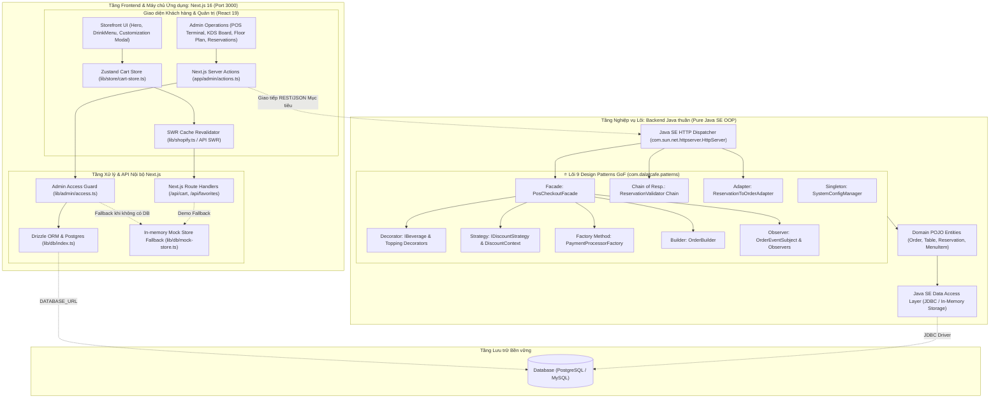
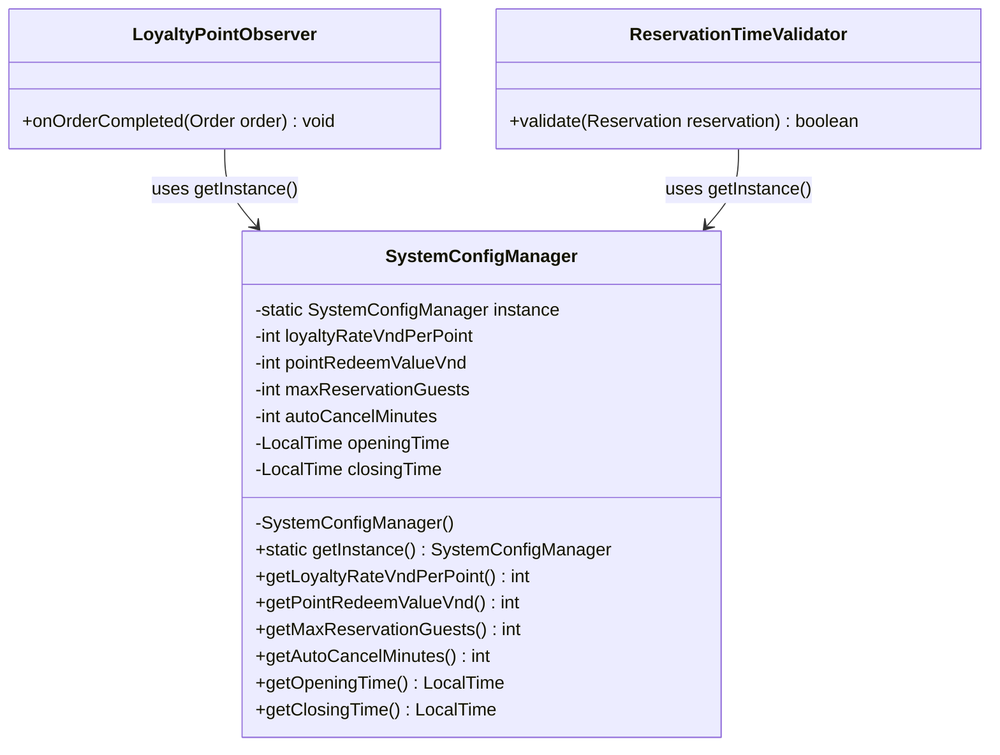
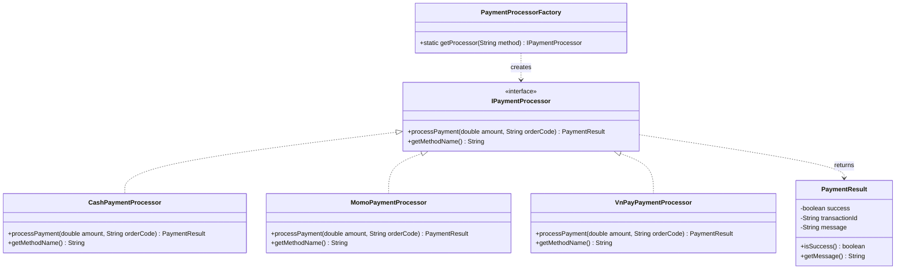
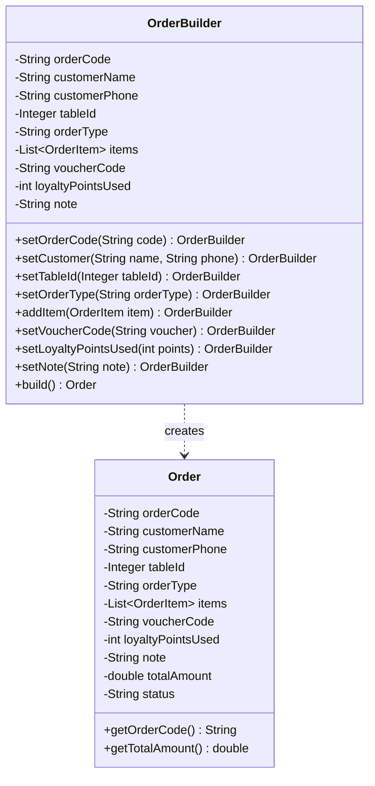
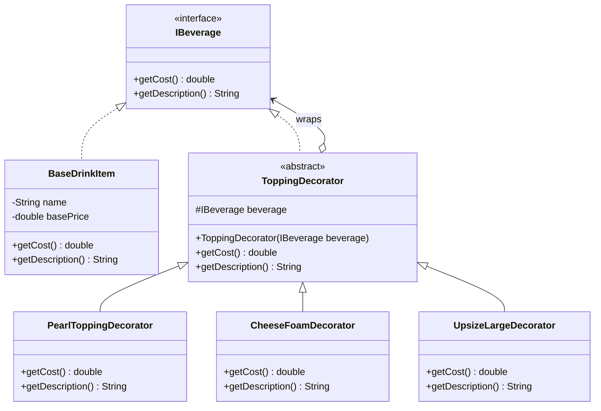
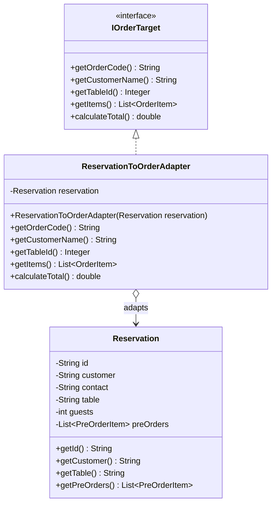
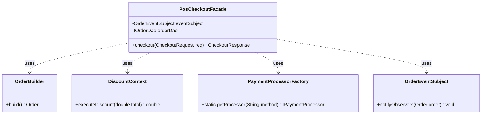
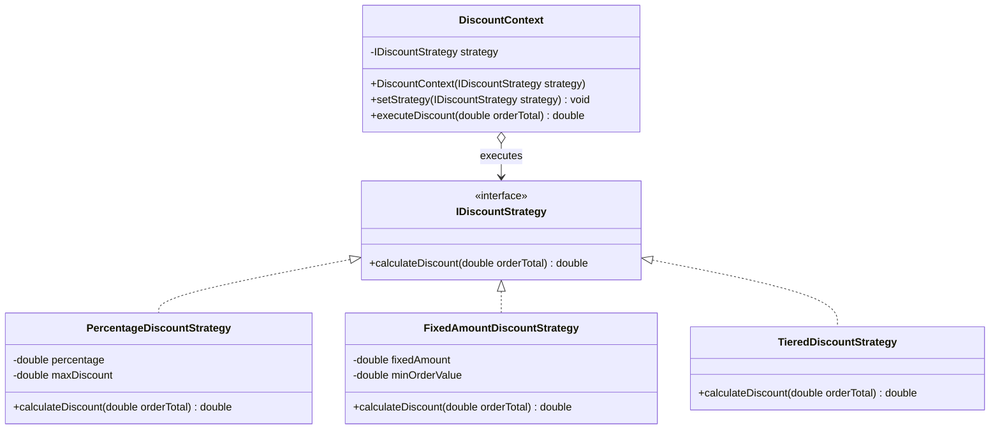
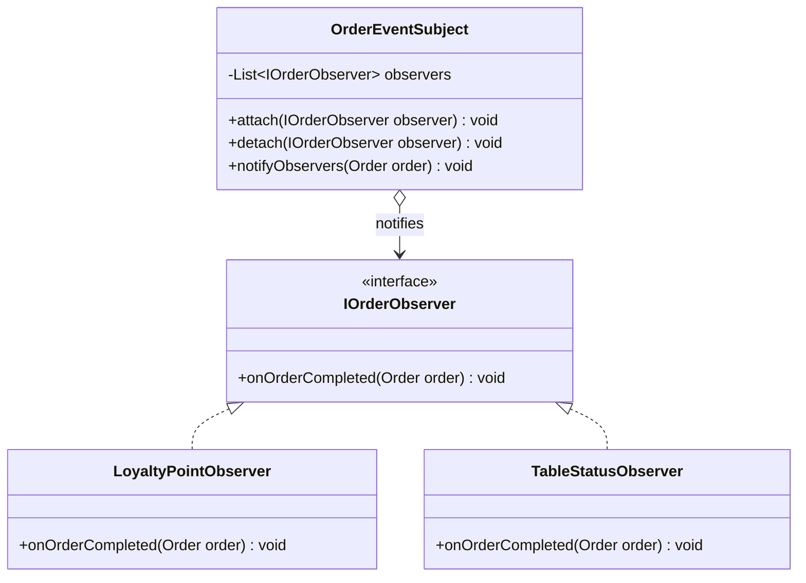

# BÁO CÁO ĐẶC TẢ KIẾN TRÚC PHẦN MỀM & DESIGN PATTERNS (PHIÊN BẢN JAVA BACKEND & NEXT.JS FRONTEND)
## DỰ ÁN: HỆ THỐNG QUẢN LÝ VÀ VẬN HÀNH QUÁN CÀ PHÊ (ĐÀ LẠT CAFE OPERATIONS)

---

**Học phần:** Thiết kế Mẫu & Kiến trúc Phần mềm (Design Patterns & Software Architecture)  
**Giảng viên hướng dẫn:** Bộ môn Kỹ thuật Phần mềm  
**Hệ thống phân tích:** `WebQuanLyQuanCafe-DesignPatterns` (`Đà Lạt Cafe Management`)  
**Ngày cập nhật:** 14/10/2026  
**Trạng thái tài liệu:** Bản đặc tả kỹ thuật đồng bộ thực tế (Technical Architecture Specification)  

---

## MỤC LỤC
1. [Tổng quan Đề tài & Kiến trúc Hệ thống](#1-tổng-quan-đề-tài--kiến-trúc-hệ-thống)
   - 1.1. Tên đề tài, mục tiêu và các phân hệ nghiệp vụ chính
   - 1.2. Tech Stack chi tiết và Đối chiếu Thực tế Mã nguồn
   - 1.3. Kiến trúc Tổng thể Hệ thống (Next.js Hybrid & Pure Java OOP Backend)
   - 1.4. Cấu trúc Cây Thư mục Dự án Thực tế & Định hướng Kiến trúc
   - 1.5. Cơ chế Giao tiếp Frontend – Backend & Xử lý Dữ liệu
   - 1.6. Cơ chế Xác thực & Phân quyền (Authentication & Authorization)
2. [Bảng tổng hợp các Design Patterns GoF](#2-bảng-tổng-hợp-các-design-patterns-gof)
3. [Đặc tả chi tiết từng Design Pattern (Chuẩn GoF Java SE OOP)](#3-đặc-tả-chi-tiết-từng-design-pattern-chuẩn-gof-java-se-oop)
   - 3.1. Singleton Pattern - Quản lý Cấu hình Vận hành Quán Cà phê (`SystemConfigManager`)
   - 3.2. Factory Method Pattern - Khởi tạo Bộ xử lý Thanh toán Đa kênh (`PaymentProcessorFactory`)
   - 3.3. Builder Pattern - Xây dựng Đối tượng Đơn hàng Phức tạp (`OrderBuilder`)
   - 3.4. Decorator Pattern - Tùy biến Đồ uống, Nâng Size và Thêm Topping Động (`ToppingDecorator`)
   - 3.5. Adapter Pattern - Chuyển đổi Phiếu Đặt bàn sang Đơn hàng POS (`ReservationToOrderAdapter`)
   - 3.6. Facade Pattern - Đơn giản hóa Quy trình Chốt đơn & Thanh toán POS (`PosCheckoutFacade`)
   - 3.7. Strategy Pattern - Đa chiến lược Tính Chiết khấu Mã giảm giá Voucher (`DiscountStrategy`)
   - 3.8. Chain of Responsibility Pattern - Chuỗi Kiểm định Tính hợp lệ Đặt bàn (`ReservationValidator`)
   - 3.9. Observer Pattern - Tự động Tích điểm Loyalty & Đồng bộ Trạng thái Bàn (`OrderEventSubject`)
4. [Đánh giá & Đề xuất mở rộng nâng cao](#4-đánh-giá--đề-xuất-mở-rộng-nâng-cao)
   - 4.1. State Pattern - Quản lý Vòng đời Trạng thái Đơn hàng & Bàn
   - 4.2. Template Method Pattern - Khung Thuật toán Xuất Báo cáo Doanh thu & Thống kê
5. [Tổng kết Hiện trạng & Lộ trình Cài đặt Backend Java](#5-tổng-kết-hiện-trạng--lộ-trình-cài-đặt-backend-java)

---

# 1. Tổng quan Đề tài & Kiến trúc Hệ thống

## 1.1. Tên đề tài, mục tiêu và các phân hệ nghiệp vụ chính
- **Tên đề tài:** Hệ thống Quản lý và Vận hành Quán Cà phê Đa kênh (Đà Lạt Cafe Shop Management & Operations System).
- **Mục tiêu ứng dụng:** Xây dựng nền tảng chuyển đổi số toàn diện cho quán cà phê, kết hợp giao diện Web hiện đại bằng **Next.js (App Router, React 19)** với tầng xử lý nghiệp vụ Backend viết bằng **Java hướng đối tượng thuần túy (Pure Java OOP)** áp dụng chuẩn mực 9 mẫu thiết kế Gang of Four (GoF):
  - Tối ưu hóa năng lực bán hàng tại quầy thu ngân (POS Terminal) và hiển thị đơn pha chế thời gian thực (Kitchen Display System - KDS).
  - Cung cấp cổng đặt hàng trực tuyến (Online Storefront) cho phép khách hàng duyệt menu, tùy biến đồ uống (Size, đá, đường, sữa), quản lý giỏ hàng và danh sách món yêu thích.
  - Quản lý đặt bàn trước (Table Reservations), sơ đồ tầng (Floor Plan) theo thời gian thực và chuyển đổi liền mạch sang đơn bán hàng POS khi khách đến nhận bàn.
  - Quản lý kho hàng (Inventory), cảnh báo nguyên liệu sắp hết, phân nhóm thực đơn và tự động điều chỉnh tồn kho khi bán hàng.
  - Quản lý khách hàng thân thiết (CRM & Loyalty Points), tự động quy đổi giá trị đơn thành điểm thưởng và chiết khấu linh hoạt bằng voucher ưu đãi.
  - Trực quan hóa doanh thu, đơn hàng và các chỉ số kinh doanh qua biểu đồ phân tích chuyên sâu (Analytics Dashboard).

- **Các phân hệ nghiệp vụ chính:**
  1. **Storefront (Khách hàng duyệt menu & đặt món):** Header thông minh, Hero section, Catalog phân loại đồ uống (Espresso, Cold Brew, Pour Over, Pastries, Whole Bean), tìm kiếm & lọc giá/độ rang, wishlist yêu thích, modal tùy biến món, giỏ hàng trượt (Slide-out Cart Bag), áp dụng mã giảm giá và checkout.
  2. **Quản trị Bán hàng tại quầy (POS Terminal):** Chọn món nhanh, bàn phím số tính tiền khách đưa, tính thuế VAT (8%), trừ điểm tích lũy thành viên, chọn bàn và hình thức (Dine-in, Takeaway, Delivery), in hóa đơn và đẩy đơn sang quầy pha chế.
  3. **Màn hình Bếp/Pha chế (Kitchen Display System - KDS):** Theo dõi tiến trình pha chế qua các cột trạng thái (`Pending` ➔ `Brewing` ➔ `Ready` ➔ `Completed`), cảnh báo trễ đơn khi vượt quá thời gian tiêu chuẩn (> 10 phút).
  4. **Sơ đồ Bàn thời gian thực (Floor Plan & Table Grid):** Quản lý bàn theo các khu vực (Main Floor, Patio, Coffee Bar), hiển thị trạng thái trực quan bằng màu sắc (`Available`, `Occupied`, `Reserved`, `Cleaning`), xem chi tiết hóa đơn đang phục vụ và thanh toán tại bàn.
  5. **Quản lý Đặt bàn trước (Reservations):** Tiếp nhận danh sách khách đặt bàn trước, số lượng khách, ghi chú, các món gọi trước (`preOrders`), chuyển tiếp phiếu đặt bàn sang màn hình POS khi khách đến quán, hỗ trợ xuất file CSV.
  6. **Quản lý Kho & Thực đơn (Inventory & Menu):** Kiểm soát số lượng tồn kho (`stockQty`), ngưỡng cảnh báo sắp hết (`lowStockThreshold`), công tắc bật/tắt bán (`inStock`), modal thêm món mới, phân loại đồ uống và nguyên liệu.
  7. **Khách hàng thân thiết (Customer CRM & Loyalty):** Bảng xếp hạng khách hàng theo chi tiêu tích lũy, quản lý số điểm thưởng loyalty (10.000 VNĐ = 1 điểm, quy đổi trừ bill 1.000 VNĐ/điểm).
  8. **Báo cáo & Phân tích (Analytics Dashboard):** Biểu đồ doanh thu 7 ngày qua, cơ cấu phương thức thanh toán (Tiền mặt, QR MoMo/VNPay, Thẻ), Top đồ uống bán chạy nhất và chỉ số vận hành bình quân.

---

## 1.2. Tech Stack chi tiết và Đối chiếu Thực tế Mã nguồn

Để phản ánh chính xác 100% hiện trạng dự án, bảng sau đối chiếu giữa **Mã nguồn thực tế được xác minh trong kho lưu trữ** và **Đặc tả kiến trúc chuẩn của dự án**:

| Tầng (Layer) | Thành phần / Thư viện | Phiên bản thực tế | Vai trò kỹ thuật & Hiện trạng mã nguồn |
| :--- | :--- | :--- | :--- |
| **Frontend Framework** | **Next.js** | **16.4.0** | Nền tảng ứng dụng Fullstack hiện đại, sử dụng **App Router** (`app/`), hỗ trợ Server Components, Server Actions (`app/admin/actions.ts`) và Route Handlers (`app/api/`) |
| **Core UI Library** | **React / React DOM** | **^19.0.0** | Thư viện giao diện cốt lõi render cây thành phần, hook trạng thái và quản lý chu kỳ sống component |
| **Ngôn ngữ Frontend** | **TypeScript** | **5.7.3** | Đảm bảo tính an toàn kiểu dữ liệu (Strict Typing) cho toàn bộ DTO, Schema, State và Component Props |
| **Styling & Icons** | **Tailwind CSS** | **^4.3.3** (`@tailwindcss/postcss`) | Utility-first CSS Engine v4 cấu hình qua `@import "tailwindcss";`, thiết kế giao diện responsive và hỗ trợ chuyển đổi Dark/Light mode |
| | **Lucide React** | **^1.16.0** | Bộ icon SVG sắc nét cho POS, menu, bàn ghế, trạng thái đơn hàng và các thao tác quản trị |
| **UI Components** | **Radix UI / Base UI** | `@radix-ui/react-dialog` ^1.3.0<br>`@radix-ui/react-dropdown-menu` ^2.2.0<br>`@base-ui/react` ^1.5.0 | Các khối giao diện headless chuẩn Accessibility (WAI-ARIA): Modal dialog tùy biến đồ uống, menu thả xuống |
| | **Sonner** | **^2.0.8** | Thư viện hiển thị Toast thông báo trạng thái tức thời (thêm giỏ hàng, chốt đơn, cảnh báo lỗi) |
| | **Framer Motion** | **^14.1.0** | Thư viện hoạt họa (animations/transitions) cho Drawer giỏ hàng và danh sách món |
| **State Management** | **Zustand** | **^5.0.15** | Quản lý State toàn cục ở Client-side cho Giỏ hàng (`lib/store/cart-store.ts`) |
| | **SWR** | **^2.5.1** | Quản lý đồng bộ dữ liệu Client, revalidation giỏ hàng (`/api/cart`) và mục yêu thích (`/api/favorites`) |
| **Data Visualization** | **Recharts** | **^3.8.0** | Vẽ biểu đồ doanh thu theo ngày (`RevenueChart.tsx`) và donut top đồ uống bán chạy (`TopDrinksDonut.tsx`) |
| **Client-side Storage / ORM** | **Drizzle ORM & pg** | `drizzle-orm` ^0.45.4<br>`pg` ^8.23.1 | Tầng truy vấn PostgreSQL (`lib/db/index.ts`, `lib/db/schema.ts`) khi cấu hình biến môi trường `DATABASE_URL` |
| | **In-memory Mock Store** | *Nội bộ dự án* (`lib/db/mock-store.ts`) | Cơ chế tự phục hồi (Self-healing fallback) lưu trữ RAM sẵn có giúp ứng dụng chạy 100% không crash khi chưa kết nối Database bên ngoài |
| | **Shopify Client** | *Nội bộ dự án* (`lib/shopify.ts`) | Tích hợp GraphQL Storefront API cho e-commerce, kèm kho dữ liệu mẫu (`demoProducts`) tự động kích hoạt |
| **HTTP Client** | **Fetch API (Native)** | Chuẩn Web API | Next.js sử dụng native `fetch()` trong Server Actions, Route Handlers và SWR. *(Ghi chú: Thư viện `axios` ^1.20.0 có khai báo trong `package.json` nhưng chưa được sử dụng trực tiếp trong code)* |
| **Backend Java** | **Java SE (JDK)** | **17 LTS / Chuẩn OOP** | **Đặc tả kiến trúc chuẩn (Pure Java OOP):** Toàn bộ 9 Design Patterns GoF được thiết kế bằng ngôn ngữ Java thuần túy, tuyệt đối **không sử dụng Spring Boot, không Spring Security, không Spring Data JPA** |
| | *Hiện trạng `backend-java/`* | *Thư mục hiện hữu* | Thư mục `backend-java` đã được tạo sẵn ở thư mục gốc của dự án, đang trong trạng thái chờ hoàn thiện các file mã nguồn Java thuần theo đúng bản đặc tả kỹ thuật này |
| **Cơ sở dữ liệu** | **PostgreSQL / In-Memory** | 8.x / RAM | Frontend hỗ trợ kết nối PostgreSQL qua Drizzle ORM hoặc chạy trên In-Memory Store; Backend Java thuần được thiết kế để sử dụng cơ chế lưu trữ In-Memory hoặc JDBC Driver tiêu chuẩn |

> [!IMPORTANT]
> **Điểm cần nhấn mạnh về Backend:** Mã nguồn dự án tuân thủ nghiêm ngặt định hướng **Java SE thuần túy (Pure OOP)** nhằm phục vụ mục tiêu học tập và đánh giá đồ án môn Thiết kế Mẫu. Các tài liệu trước đây đề cập đến Spring Boot, Spring Security và Spring Data JPA là nội dung phỏng đoán không chính xác và đã được loại bỏ hoàn toàn trong bản đặc tả này.

---

## 1.3. Kiến trúc Tổng thể Hệ thống

Hệ thống được thiết kế theo mô hình phân tầng rõ ràng (Multi-tier Architecture), trong đó:
- **Tầng Client & Server Next.js (Port 3000):** Đảm nhiệm trải nghiệm người dùng Storefront và bảng điều khiển quản trị Admin (POS, KDS, Floor Plan, Inventory, CRM, Analytics). Nhờ kiến trúc Next.js App Router, tầng này vừa đóng vai trò giao diện tương tác (Client Components) vừa có khả năng xử lý nghiệp vụ nhẹ phía máy chủ (Server Actions & Route Handlers).
- **Tầng Backend Java thuần (Pure Java SE OOP Architecture):** Đóng vai trò lõi xử lý nghiệp vụ trung tâm (Core Business Domain), nơi cài đặt trọn vẹn 9 mẫu thiết kế Gang of Four (GoF) mà không bị phụ thuộc vào bất kỳ framework bên ngoài nào.
- **Tầng Lưu trữ (Persistence Layer):** Hỗ trợ cơ chế chuyển đổi linh hoạt giữa lưu trữ cơ sở dữ liệu quan hệ (qua kết nối JDBC tiêu chuẩn) và bộ lưu trữ trong bộ nhớ (In-memory storage) phục vụ kiểm thử đơn vị độc lập.



---

## 1.4. Cấu trúc Cây Thư mục Dự án Thực tế & Định hướng Kiến trúc

### 1.4.1. Cấu trúc Cây Thư mục Frontend Next.js Hiện có (`frontend-nextjs`)
Đây là cây thư mục thực tế 100% được quét trực tiếp từ mã nguồn dự án:

```text
frontend-nextjs/
├── package.json                    # Cấu hình phụ thuộc Next.js 16.4.0, React 19, Tailwind v4
├── next.config.mjs                 # Cấu hình bảo mật HTTP headers, unoptimized images
├── tsconfig.json                   # Cấu hình TypeScript 5.7.3 & path alias '@/*'
├── components.json                 # Cấu hình thư viện UI component shadcn/ui
├── postcss.config.mjs              # Plugin PostCSS kết hợp @tailwindcss/postcss
├── TEST_CASES_UI_UX.md             # Bộ 25 test cases kiểm thử tự động UI/UX Storefront & Admin
├── scripts/
│   └── test-ui-ux.mjs              # Test runner tự động kiểm tra toàn bộ luồng chức năng
├── hooks/
│   └── use-mobile.ts               # Hook nhận biết thiết bị di động (Responsive Breakpoint)
├── app/                            # ⭐ NEXT.JS APP ROUTER DIRECTORY
│   ├── globals.css                 # CSS toàn cục & định nghĩa màu Tailwind
│   ├── layout.tsx                  # Root Layout cấu hình font chữ, Toaster sonner, Theme
│   ├── page.tsx                    # Trang chủ Storefront & điều phối vai trò người dùng
│   ├── account/                    # Phân hệ quản lý tài khoản khách hàng
│   │   ├── page.tsx
│   │   └── [...slug]/page.tsx
│   ├── cart/                       # Trang xem chi tiết giỏ hàng
│   │   └── page.tsx
│   ├── checkout/                   # Trang xử lý thanh toán giỏ hàng
│   │   └── page.tsx
│   ├── api/                        # Route Handlers phục vụ API nội bộ
│   │   ├── cart/
│   │   │   └── route.ts            # Xử lý giỏ hàng (GET, POST: add, quantity, discount, note)
│   │   └── favorites/
│   │       └── route.ts            # Xử lý danh sách yêu thích lưu qua cookie bảo mật
│   └── admin/                      # Phân hệ Quản trị Vận hành Quán Cà phê
│       ├── actions.ts              # ⭐ Next.js Server Actions: createOrder, updateStatus...
│       ├── layout.tsx              # Khung giao diện Admin kèm AdminSidebar và AdminHeader
│       ├── page.tsx                # Admin Dashboard tổng quan chỉ số & dòng đơn hàng sống
│       ├── pos/page.tsx            # Bán hàng tại quầy POS Terminal & Bếp pha chế KDS
│       ├── tables/page.tsx         # Sơ đồ tầng Floor Plan & Quản lý trạng thái bàn
│       ├── reservations/page.tsx   # Tiếp nhận và quản lý đơn đặt bàn trước
│       ├── menu/page.tsx           # Quản lý danh mục món & chỉnh sửa giá bán
│       ├── inventory/page.tsx      # Quản lý kho nguyên liệu & cảnh báo tồn kho thấp
│       ├── orders/page.tsx         # Quản lý lịch sử và trạng thái tất cả đơn hàng
│       ├── customers/page.tsx      # Danh sách khách hàng CRM & điểm tích lũy
│       ├── analytics/page.tsx      # Báo cáo biểu đồ doanh thu và cơ cấu thanh toán
│       ├── schedule/page.tsx       # Lịch phân ca làm việc của nhân viên
│       ├── staff/page.tsx          # Quản lý danh sách nhân sự quán
│       └── settings/page.tsx       # Cấu hình thông tin quán, thuế VAT và đổi theme
├── components/                     # THƯ VIỆN GIAO DIỆN REACT COMPONENT
│   ├── coffee-footer.tsx           # Chân trang Storefront với bài viết Journal
│   ├── role-switcher-view.tsx      # Component điều phối hiển thị Storefront hoặc lối tắt Admin
│   ├── storefront.tsx              # Component bao bọc trang bán hàng cho khách
│   ├── theme-provider.tsx          # Provider chuyển đổi giao diện Dark / Light Mode
│   ├── storefront/                 # Các component chuyên biệt cho khách hàng
│   │   ├── Header.tsx              # Thanh điều hướng trên cùng, logo, giỏ hàng, wishlist
│   │   ├── Hero.tsx                # Banner giới thiệu chính và nút kêu gọi hành động (CTA)
│   │   ├── DrinkMenu.tsx           # Lưới món nước, bộ lọc tabs, modal tùy biến (Size, đá, sữa)
│   │   ├── CartSheet.tsx           # Ngăn kéo giỏ hàng trượt từ cạnh phải (Slide-out)
│   │   ├── CartDrawer.tsx          # Component phụ trợ ngăn kéo giỏ hàng
│   │   ├── AccountDropdown.tsx     # Menu tài khoản và lối tắt sang Staff Portal
│   │   └── index.ts
│   ├── admin/                      # Các component chuyên biệt cho phân hệ quản trị
│   │   ├── admin-header.tsx        # Thanh tiêu đề Admin, nút đổi theme, avatar quản lý
│   │   ├── admin-sidebar.tsx       # Menu điều hướng bên trái phân hệ Admin
│   │   ├── pos-terminal.tsx        # Giao diện bán hàng POS, bàn phím số, chọn bàn, trừ điểm
│   │   ├── kds-board.tsx           # Màn hình điều phối bếp pha chế KDS nhiều cột
│   │   ├── floor-plan.tsx          # Sơ đồ bàn theo khu vực (Main, Patio, Bar)
│   │   ├── reservations-management.tsx # Danh sách đặt bàn, chuyển đơn sang POS, xuất CSV
│   │   ├── inventory-table.tsx     # Bảng quản lý kho, công tắc bật/tắt bán, tồn kho
│   │   ├── add-item-dialog.tsx     # Modal thêm món ăn/thức uống mới vào menu
│   │   ├── RevenueChart.tsx        # Biểu đồ cột doanh thu 7 ngày qua (Recharts)
│   │   ├── TopDrinksDonut.tsx      # Biểu đồ tròn cơ cấu món bán chạy nhất
│   │   ├── dashboard-widgets.tsx   # Thẻ chỉ số KPI (Doanh thu, Đơn hàng, Tỷ lệ bàn...)
│   │   ├── dashboard-charts.tsx    # Nhóm biểu đồ phân tích trên dashboard
│   │   ├── shared.tsx              # PageHeading và các component dùng chung trong Admin
│   │   └── index.ts
│   └── ui/                         # Bộ linh kiện giao diện nền tảng (Design System)
│       ├── button.tsx, badge.tsx, card.tsx, dialog.tsx, sheet.tsx, table.tsx...
└── lib/                            # TẦNG TIỆN ÍCH, LOGIC NGHIỆP VỤ & LƯU TRỮ DỮ LIỆU
    ├── utils.ts                    # Tiện ích nối class Tailwind (`cn = clsx + twMerge`)
    ├── shopify.ts                  # Tích hợp Shopify Storefront GraphQL & Mock Demo Catalog
    ├── admin/
    │   ├── access.ts               # Kiểm soát quyền truy cập Admin qua biến môi trường
    │   ├── format.ts               # Định dạng tiền tệ VND, tỷ lệ thuế VAT (8%), nhãn trạng thái
    │   └── queries.ts              # Các hàm lấy dữ liệu Admin (Overview, Tables, Menu, Orders)
    ├── store/
    │   └── cart-store.ts           # Global Store Zustand cho giỏ hàng, áp mã ưu đãi
    └── db/
        ├── index.ts                # Khởi tạo kết nối Drizzle ORM với PostgreSQL
        ├── schema.ts               # Định nghĩa Schema: adminTables, adminMenuItems, adminOrders
        └── mock-store.ts           # Cơ chế In-memory Fallback Store hoàn chỉnh tự phục hồi
```

### 1.4.2. Cấu trúc Cây Thư mục Backend Java thuần OOP Quy chuẩn (`backend-java`)
Dưới đây là cấu trúc gói chuẩn Maven **Java SE thuần túy (Không dùng Spring Boot)** đang được áp dụng trong dự án để triển khai 9 GoF Patterns:

```text
backend-java/
└── src/
    └── main/java/com/dalatcafe/
        ├── Main.java                          # Điểm khởi chạy Java SE Application (Console/Server)
        ├── server/                            # Giao tiếp HTTP thuần Java SE (Không framework)
        │   ├── AppHttpServer.java             # Quản lý com.sun.net.httpserver.HttpServer (Port 8080)
        │   └── handlers/                      # Các HttpHandler xử lý request & trả lời lời JSON
        │       ├── MenuHttpHandler.java       # GET /api/menu
        │       ├── TableHttpHandler.java      # GET, PUT /api/tables
        │       ├── ReservationHttpHandler.java# POST /api/reservations (Gắn Chain Validator)
        │       └── CheckoutHttpHandler.java   # POST /api/checkout (Gắn Facade)
        ├── model/                             # Đối tượng Thực thể Nghiệp vụ (POJO thuần túy)
        │   ├── BeverageItem.java              # Thông tin món nước cơ sở
        │   ├── Table.java                     # Bàn phục vụ (ID, tên, sức chứa, trạng thái)
        │   ├── Reservation.java               # Phiếu đặt bàn trước
        │   ├── Order.java                     # Đơn hàng bán ra
        │   ├── OrderItem.java                 # Chi tiết từng dòng món trong hóa đơn
        │   ├── Customer.java                  # Thông tin khách hàng & điểm loyalty
        │   └── Voucher.java                   # Thông tin mã ưu đãi giảm giá
        ├── dao/                               # Tầng Truy xuất Dữ liệu (Data Access Object)
        │   ├── IOrderDao.java
        │   ├── ITableDao.java
        │   ├── IReservationDao.java
        │   └── InMemoryDatabase.java          # Bộ nhớ RAM lưu trữ dữ liệu mô phỏng
        └── patterns/                          # ⭐ PACKAGE CHỨA 9 MẪU THIẾT KẾ GOF JAVA THUẦN
            ├── creational/
            │   ├── singleton/
            │   │   └── SystemConfigManager.java
            │   ├── factory/
            │   │   ├── IPaymentProcessor.java
            │   │   ├── CashPaymentProcessor.java
            │   │   ├── MomoPaymentProcessor.java
            │   │   ├── VnPayPaymentProcessor.java
            │   │   └── PaymentProcessorFactory.java
            │   └── builder/
            │       └── OrderBuilder.java
            ├── structural/
            │   ├── decorator/
            │   │   ├── IBeverage.java
            │   │   ├── BaseDrinkItem.java
            │   │   ├── ToppingDecorator.java
            │   │   ├── PearlToppingDecorator.java
            │   │   ├── CheeseFoamDecorator.java
            │   │   └── UpsizeLargeDecorator.java
            │   ├── adapter/
            │   │   ├── IOrderTarget.java
            │   │   └── ReservationToOrderAdapter.java
            │   └── facade/
            │       └── PosCheckoutFacade.java
            └── behavioral/
                ├── strategy/
                │   ├── IDiscountStrategy.java
                │   ├── PercentageDiscountStrategy.java
                │   ├── FixedAmountDiscountStrategy.java
                │   ├── TieredDiscountStrategy.java
                │   └── DiscountContext.java
                ├── chain/
                │   ├── ReservationValidator.java
                │   ├── CustomerInfoValidator.java
                │   ├── ReservationTimeValidator.java
                │   └── GuestCountValidator.java
                └── observer/
                    ├── IOrderObserver.java
                    ├── OrderEventSubject.java
                    ├── LoyaltyPointObserver.java
                    └── TableStatusObserver.java
```

---

## 1.5. Cơ chế Giao tiếp Frontend – Backend & Xử lý Dữ liệu

### 1.5.1. Hiện trạng Thực tế trong Mã nguồn Frontend Next.js
Trong mã nguồn hiện tại, Frontend Next.js đang hoạt động hoàn toàn độc lập và tự chủ (Self-contained) thông qua hai cơ chế xử lý dữ liệu:
1. **Next.js Server Actions (`frontend-nextjs/app/admin/actions.ts`):**
   - Đảm nhận toàn bộ các thao tác ghi dữ liệu của phân hệ Admin: `createOrder` (tạo đơn hàng từ POS), `updateOrderStatus` (đổi trạng thái đơn trong KDS), `markOrderPaid` (chốt thanh toán tại bàn), `toggleItemInStock` (bật/tắt bán món), `createMenuItem` (thêm món mới).
   - Cơ chế hoạt động: Chạy trực tiếp trên Server Next.js, gọi trực tiếp vào Drizzle ORM (nếu cấu hình PostgreSQL) hoặc tự động chuyển hướng sang In-memory Mock Store (`lib/db/mock-store.ts`). Sau khi thao tác thành công, Server Action gọi `revalidatePath('/admin', 'layout')` để tự động làm mới giao diện người dùng mà không cần reload trang.
2. **Next.js Route Handlers (`frontend-nextjs/app/api/`):**
   - `/api/cart` (`GET`, `POST`): Quản lý giỏ hàng của khách hàng. Hỗ trợ các action: `add` (thêm món kèm lựa chọn size/sữa/đá/đường), `quantity` (cập nhật số lượng), `discount` (áp dụng mã ưu đãi `WELCOME10` giảm 10%), `note` (ghi chú cho barista).
   - `/api/favorites` (`GET`, `POST`): Lưu trữ và truy xuất danh sách mã sản phẩm yêu thích thông qua HTTP Cookie bảo mật (`dalatcafe-favorites`).
3. **Cơ chế chịu lỗi (Fault-Tolerance & Resilience):**
   - Nếu không có cơ sở dữ liệu bên ngoài (`process.env.DATABASE_URL` rỗng hoặc kết nối DB thất bại), toàn bộ hệ thống tự động kích hoạt `mock-store.ts` với đầy đủ dữ liệu mẫu (15 bàn phục vụ, 14 món thực đơn, lịch sử đơn hàng và khách hàng) đảm bảo tỷ lệ lỗi crash là 0%.

### 1.5.2. Đặc tả Kiến trúc Giao tiếp Tích hợp với Backend Java thuần
Khi tích hợp cùng phân hệ Backend Java SE, cơ chế giao tiếp sẽ được thiết lập theo chuẩn RESTful HTTP với các thông số kỹ thuật như sau:
- **Giao thức trao đổi:** HTTP 1.1 / JSON (MIME type: `application/json; charset=UTF-8`).
- **Địa chỉ máy chủ Java Backend (dự kiến):** `http://localhost:8080` (hoặc cấu hình qua biến môi trường `JAVA_BACKEND_URL`).
- **Các Endpoint chuẩn mực do Backend Java cung cấp:**
  - `GET /api/menu`: Trả về danh sách thực đơn đồ uống và nguyên liệu.
  - `GET /api/tables`: Trả về danh sách bàn và trạng thái thời gian thực (`available`, `occupied`, `reserved`, `cleaning`).
  - `POST /api/reservations`: Tiếp nhận yêu cầu đặt bàn trực tuyến, chạy qua chuỗi **Chain of Responsibility** để kiểm tra tính hợp lệ trước khi ghi nhận.
  - `POST /api/checkout`: Tiếp nhận gói tin thanh toán đơn hàng từ quầy POS, kích hoạt **PosCheckoutFacade** để tính giá Decorator, trừ Voucher Strategy, thanh toán Factory và phát thông báo Observer.

---

## 1.6. Cơ chế Xác thực & Phân quyền (Authentication & Authorization)

### 1.6.1. Xác minh Thực tế từ Mã nguồn Dự án
- Qua rà soát toàn bộ cây thư mục `frontend-nextjs/`, cơ chế kiểm soát truy cập hiện tại được định nghĩa tập trung tại file `frontend-nextjs/lib/admin/access.ts`:
  ```typescript
  // Staff sign-in can be configured with REQUIRE_ADMIN_AUTH in production.
  // By default, admin access is enabled for development and preview.
  export function isAdminAccessAllowed() {
    if (process.env.REQUIRE_ADMIN_AUTH === 'true') {
      return false
    }
    return true
  }

  export function assertAdminAccess() {
    if (!isAdminAccessAllowed()) {
      throw new Error('Đà Lạt Cafe Admin requires staff sign-in before it can be used on a deployed site.')
    }
  }
  ```
- **Kết luận:** Trong mã nguồn thực tế, **chưa triển khai Spring Security, chưa có bộ lọc JWT (`JwtAuthenticationFilter`), chưa có Secret Key hay cơ chế phân quyền RBAC đa cấp độ trong code**. Việc truy cập vào phân hệ Admin hiện được kiểm soát thông qua biến cờ môi trường `REQUIRE_ADMIN_AUTH`.

### 1.6.2. Đặc tả Thiết kế Định hướng cho Phân quyền RBAC (Pure Java Security Design)
Để hoàn thiện mục tiêu học thuật của đồ án, mô hình phân quyền bảo mật thuần Java được đặc tả thiết kế như sau:
- **Nhóm quyền (Roles):**
  1. `ROLE_ADMIN` (Chủ quán): Toàn quyền truy cập mọi phân hệ, quản lý tài chính, nhân sự và cấu hình hệ thống.
  2. `ROLE_MANAGER` (Quản lý ca): Quản lý sơ đồ bàn, duyệt đặt bàn, kiểm soát kho và xuất báo cáo ca.
  3. `ROLE_STAFF` (Nhân viên thu ngân / Barista): Thao tác trên màn hình POS bán hàng và màn hình KDS bếp pha chế.
  4. `ROLE_CUSTOMER` (Khách hàng): Xem menu, đặt món trực tuyến và tích lũy điểm thưởng thành viên.
- **Giải pháp triển khai trên Java thuần:** Sử dụng giải pháp Token-based đơn giản hoặc Session Store tự tạo bằng `ConcurrentHashMap<String, UserSession>` trong JVM, kiểm tra quyền truy cập thông qua Filter của `HttpServer` mà không phụ thuộc vào Spring Security.

---

# 2. Bảng tổng hợp các Design Patterns GoF

Dự án áp dụng trọn vẹn **9 Design Patterns chuẩn Gang of Four (GoF)** chia đều cho cả 3 nhóm (Creational, Structural, Behavioral) bằng ngôn ngữ **Java SE thuần túy (Pure OOP)**, đối chiếu tương ứng với các chức năng trên giao diện Frontend Next.js:

| STT | Tên Pattern | Phân nhóm GoF | Bài toán thực tế trong Quán Cà phê | Các Class / Interface Java thuần chính | Ánh xạ Giao diện Frontend Next.js | Trạng thái Dự án |
| :---: | :--- | :--- | :--- | :--- | :--- | :--- |
| **01** | **Singleton** | Creational | Quản lý thông số vận hành toàn cục (giờ mở/đóng cửa, tỷ lệ tích điểm, thời gian tự động hủy bàn) với duy nhất 1 thể hiện trong JVM. | `SystemConfigManager.java` | Màn hình `Settings` (`/admin/settings`) và logic tính điểm POS. | Bản đặc tả thiết kế Java |
| **02** | **Factory Method** | Creational | Khởi tạo linh hoạt đối tượng xử lý thanh toán theo phương thức khách chọn (`Tiền mặt`, ví `MoMo`, cổng `VNPay`) không dùng `if-else` cứng. | `IPaymentProcessor.java`<br>`PaymentProcessorFactory.java`<br>`CashPaymentProcessor.java`<br>`MomoPaymentProcessor.java`<br>`VnPayPaymentProcessor.java` | Nút chọn phương thức thanh toán tại quầy POS (`pos-terminal.tsx`). | Bản đặc tả thiết kế Java |
| **03** | **Builder** | Creational | Xây dựng từng bước đối tượng Đơn hàng (`Order`) phức tạp có nhiều trường tùy chọn (bàn, khách, loại đơn, voucher, topping, ghi chú). | `OrderBuilder.java`<br>`Order.java`<br>`OrderItem.java` | Thao tác lên đơn và thanh toán trên POS (`pos-terminal.tsx`). | Bản đặc tả thiết kế Java |
| **04** | **Decorator** | Structural | Bọc món nước cơ sở để cộng dồn giá tiền và mô tả khi khách chọn thêm Topping (Trân châu, Kem Cheese) hoặc nâng Size L. | `IBeverage.java`<br>`BaseDrinkItem.java`<br>`ToppingDecorator.java`<br>`PearlToppingDecorator.java`<br>`CheeseFoamDecorator.java`<br>`UpsizeLargeDecorator.java` | Modal tùy biến đồ uống `DrinkMenu.tsx` & chọn biến thể trên POS. | Bản đặc tả thiết kế Java |
| **05** | **Adapter** | Structural | Chuyển đổi đối tượng Phiếu đặt bàn trước (`Reservation`) sang Đơn hàng POS (`Order`) khi khách đến nhận bàn mà không sửa code cũ. | `IOrderTarget.java`<br>`ReservationToOrderAdapter.java`<br>`Reservation.java` | Nút "Chuyển sang POS" trong `reservations-management.tsx`. | Bản đặc tả thiết kế Java |
| **06** | **Facade** | Structural | Cung cấp giao diện mặt tiền duy nhất (`checkoutOrder`) gom toàn bộ quy trình phức tạp: tính giá, trừ voucher, thanh toán, lưu đơn, phát sự kiện. | `PosCheckoutFacade.java` | Nút "Thanh toán & in hóa đơn" trên POS (`pos-terminal.tsx`). | Bản đặc tả thiết kế Java |
| **07** | **Strategy** | Behavioral | Hoán đổi linh hoạt thuật toán chiết khấu Voucher (`Phần trăm`, `Số tiền cố định`, `Bậc thang`) tại thời điểm chạy (Runtime). | `IDiscountStrategy.java`<br>`PercentageDiscountStrategy.java`<br>`FixedAmountDiscountStrategy.java`<br>`TieredDiscountStrategy.java`<br>`DiscountContext.java` | Ô nhập mã giảm giá (`WELCOME10`) trong giỏ hàng `cart-store.ts`. | Bản đặc tả thiết kế Java |
| **08** | **Chain of Resp.** | Behavioral | Chuỗi mắt xích kiểm tra tính hợp lệ của đơn Đặt bàn: Thông tin khách ➔ Giờ mở cửa & đặt trước 1h ➔ Số lượng khách (1–20 người). | `ReservationValidator.java`<br>`CustomerInfoValidator.java`<br>`ReservationTimeValidator.java`<br>`GuestCountValidator.java` | Form đặt bàn và danh sách duyệt đơn `reservations-management.tsx`. | Bản đặc tả thiết kế Java |
| **09** | **Observer** | Behavioral | Khi đơn hàng thanh toán thành công, tự động thông báo để cộng điểm thành viên và cập nhật sơ đồ bàn sang `Occupied` hoặc `Cleaning`. | `IOrderObserver.java`<br>`OrderEventSubject.java`<br>`LoyaltyPointObserver.java`<br>`TableStatusObserver.java` | Sơ đồ bàn `FloorPlan.tsx` và xếp hạng khách hàng `customers/page.tsx`. | Bản đặc tả thiết kế Java |

---

# 3. Đặc tả chi tiết từng Design Pattern (Chuẩn GoF Java SE OOP)

---

### 3.1. Singleton Pattern - Quản lý Cấu hình Vận hành Quán Cà phê (`SystemConfigManager`)
- **Bài toán thực tế trong nghiệp vụ:**  
  Hệ thống quản lý quán cà phê có nhiều thông số cấu hình dùng chung toàn cục: tỷ lệ tích điểm thưởng (`10.000 VNĐ = 1 điểm`, `1 điểm = 1.000 VNĐ`), giới hạn khách đặt bàn tối đa (`20 người`), thời gian giữ bàn trước khi tự động hủy (`30 phút`), và khung giờ mở cửa (`07:00 - 22:00`). Nếu mỗi Service hoặc Handler lại tạo mới một đối tượng cấu hình, bộ nhớ Heap của JVM sẽ bị lãng phí và dễ gây bất đồng bộ cấu hình giữa các luồng.
- **Giải pháp kỹ thuật (Pure Java OOP):**  
  Áp dụng **Singleton Pattern** sử dụng kỹ thuật **Double-Checked Locking (`volatile` + `synchronized`)** hoặc **Bill Pugh Singleton (Static Inner Helper Class)** để đảm bảo an toàn đa luồng (Thread-safe), trì hoãn khởi tạo khi cần (Lazy Initialization) và khóa hoàn toàn `constructor` thành `private`.
- **Bảng ánh xạ thành phần (Participants Mapping):**
  | Vai trò GoF | Class / Phương thức Java | Trách nhiệm cụ thể |
  | :--- | :--- | :--- |
  | **Singleton** | `SystemConfigManager` | Chứa constructor `private`, biến tĩnh `instance` và các thông số cấu hình vận hành |
  | **Global Accessor** | `getInstance()` | Phương thức tĩnh công khai cung cấp điểm truy cập toàn cục duy nhất đến instance |
  | **Client** | `LoyaltyPointObserver`, `ReservationTimeValidator` | Gọi `SystemConfigManager.getInstance()` để lấy thông số nghiệp vụ |

- **Sơ đồ lớp (Class Diagram):**


- **Mã nguồn minh họa (Pure Java):**
```java
package com.dalatcafe.patterns.singleton;

import java.time.LocalTime;

public final class SystemConfigManager {
    private static volatile SystemConfigManager instance;

    private final int loyaltyRateVndPerPoint = 10000; // 10.000 VNĐ = 1 điểm
    private final int pointRedeemValueVnd = 1000;     // 1 điểm = 1.000 VNĐ trừ vào hóa đơn
    private final int maxReservationGuests = 20;      // Tối đa 20 khách/lượt đặt
    private final int autoCancelMinutes = 30;         // Quá 30 phút tự hủy đặt bàn
    private final LocalTime openingTime = LocalTime.of(7, 0);
    private final LocalTime closingTime = LocalTime.of(22, 0);

    private SystemConfigManager() {
        if (instance != null) {
            throw new IllegalStateException("Instance đã tồn tại! Sử dụng getInstance().");
        }
    }

    public static SystemConfigManager getInstance() {
        if (instance == null) {
            synchronized (SystemConfigManager.class) {
                if (instance == null) {
                    instance = new SystemConfigManager();
                }
            }
        }
        return instance;
    }

    public int getLoyaltyRateVndPerPoint() { return loyaltyRateVndPerPoint; }
    public int getPointRedeemValueVnd() { return pointRedeemValueVnd; }
    public int getMaxReservationGuests() { return maxReservationGuests; }
    public int getAutoCancelMinutes() { return autoCancelMinutes; }
    public LocalTime getOpeningTime() { return openingTime; }
    public LocalTime getClosingTime() { return closingTime; }
}
```

---

### 3.2. Factory Method Pattern - Khởi tạo Bộ xử lý Thanh toán Đa kênh (`PaymentProcessorFactory`)
- **Bài toán thực tế trong nghiệp vụ:**  
  Tại quầy POS Terminal (`pos-terminal.tsx`) và cổng đặt hàng online, khách hàng có thể chọn nhiều phương thức thanh toán: `Tiền mặt (Cash)`, `Ví MoMo (QR Code)` hoặc `Thẻ / Cổng VNPay`. Nếu viết chuỗi `if-else` lồng nhau trong luồng thanh toán chính, mã nguồn sẽ bị phụ thuộc cứng vào các lớp xử lý cụ thể, vi phạm nguyên tắc Open/Closed Principle khi quán bổ sung phương thức mới (ví dụ: ZaloPay, VietQR).
- **Giải pháp kỹ thuật (Pure Java OOP):**  
  Áp dụng **Factory Method Pattern**. Khai báo giao diện chung `IPaymentProcessor` với phương thức `processPayment(double amount, String orderCode)`. Lớp `PaymentProcessorFactory` đóng vai trò Creator, căn cứ vào mã hình thức thanh toán được truyền vào để sản sinh ra đối tượng xử lý cụ thể.
- **Bảng ánh xạ thành phần (Participants Mapping):**
  | Vai trò GoF | Class / Interface Java | Trách nhiệm cụ thể |
  | :--- | :--- | :--- |
  | **Product Interface** | `IPaymentProcessor` | Giao diện chuẩn cho tất cả cổng thanh toán trong hệ thống |
  | **Concrete Product A** | `CashPaymentProcessor` | Xử lý thanh toán tiền mặt trực tiếp tại quầy POS, tính tiền thừa |
  | **Concrete Product B** | `MomoPaymentProcessor` | Xử lý thanh toán quét mã QR ví điện tử MoMo |
  | **Concrete Product C** | `VnPayPaymentProcessor` | Xử lý thanh toán chuyển hướng qua cổng VNPay |
  | **Creator / Factory** | `PaymentProcessorFactory` | Phương thức tĩnh `getProcessor(String method)` trả về thể hiện tương ứng |

- **Sơ đồ lớp (Class Diagram):**


- **Mã nguồn minh họa (Pure Java):**
```java
package com.dalatcafe.patterns.factory;

public interface IPaymentProcessor {
    PaymentResult processPayment(double amount, String orderCode);
    String getMethodName();
}

public class CashPaymentProcessor implements IPaymentProcessor {
    @Override
    public PaymentResult processPayment(double amount, String orderCode) {
        System.out.println("Thu ngân nhận tiền mặt: " + amount + " VND cho đơn " + orderCode);
        return new PaymentResult(true, "CASH-" + System.currentTimeMillis(), "Thanh toán tiền mặt thành công");
    }
    @Override
    public String getMethodName() { return "Tiền mặt"; }
}

public class MomoPaymentProcessor implements IPaymentProcessor {
    @Override
    public PaymentResult processPayment(double amount, String orderCode) {
        System.out.println("Tạo mã QR MoMo cho đơn " + orderCode + " số tiền: " + amount + " VND");
        return new PaymentResult(true, "MOMO-" + System.currentTimeMillis(), "Giao dịch MoMo hoàn tất");
    }
    @Override
    public String getMethodName() { return "Ví MoMo"; }
}

public class VnPayPaymentProcessor implements IPaymentProcessor {
    @Override
    public PaymentResult processPayment(double amount, String orderCode) {
        System.out.println("Khởi tạo cổng VNPay cho đơn " + orderCode);
        return new PaymentResult(true, "VNPAY-" + System.currentTimeMillis(), "Giao dịch VNPay thành công");
    }
    @Override
    public String getMethodName() { return "Cổng VNPay"; }
}

public final class PaymentProcessorFactory {
    public static IPaymentProcessor getProcessor(String method) {
        if (method == null) throw new IllegalArgumentException("Phương thức thanh toán không được null");
        switch (method.toLowerCase().trim()) {
            case "cash":
            case "tiền mặt":
                return new CashPaymentProcessor();
            case "momo":
            case "qr":
                return new MomoPaymentProcessor();
            case "vnpay":
            case "card":
                return new VnPayPaymentProcessor();
            default:
                throw new UnsupportedOperationException("Chưa hỗ trợ phương thức thanh toán: " + method);
        }
    }
}
```

---

### 3.3. Builder Pattern - Xây dựng Đối tượng Đơn hàng Phức tạp (`OrderBuilder`)
- **Bài toán thực tế trong nghiệp vụ:**  
  Một đối tượng Đơn hàng (`Order`) trong hệ thống quán cà phê rất phức tạp và chứa nhiều trường thông tin tùy chọn: mã đơn hàng (`orderCode`), tên khách hàng, số điện thoại, số bàn (`tableId`), loại đơn hàng (`dine-in`, `pickup`, `delivery`), danh sách chi tiết món (`OrderItem`), mã voucher giảm giá, số điểm tích lũy sử dụng, ghi chú cho barista, thời gian tạo đơn và trạng thái thanh toán. Sử dụng constructor truyền thống với quá nhiều tham số (Telescoping Constructor) sẽ dẫn đến code khó đọc, dễ nhầm thứ tự tham số và khó bảo trì.
- **Giải pháp kỹ thuật (Pure Java OOP):**  
  Áp dụng **Builder Pattern**. Tách biệt quá trình khởi tạo từng bước của đối tượng `Order` thông qua lớp `OrderBuilder` cung cấp các phương thức thiết lập dạng chuỗi (Method Chaining / Fluent Interface). Phương thức `build()` kiểm tra tính hợp lệ trước khi trả về đối tượng `Order` hoàn chỉnh.
- **Bảng ánh xạ thành phần (Participants Mapping):**
  | Vai trò GoF | Class Java | Trách nhiệm cụ thể |
  | :--- | :--- | :--- |
  | **Product** | `Order` (`model/Order.java`) | Đối tượng đơn hàng chứa toàn bộ thuộc tính dữ liệu |
  | **Builder** | `OrderBuilder` | Chứa các phương thức gán từng thuộc tính và phương thức `build()` |
  | **Client** | `PosCheckoutFacade`, `AdminAction` | Sử dụng `new OrderBuilder().setX().build()` để tạo đơn hàng sạch sẽ |

- **Sơ đồ lớp (Class Diagram):**


- **Mã nguồn minh họa (Pure Java):**
```java
package com.dalatcafe.patterns.builder;

import java.util.ArrayList;
import java.util.Collections;
import java.util.List;

public class Order {
    private final String orderCode;
    private final String customerName;
    private final Integer tableId;
    private final String orderType;
    private final List<OrderItem> items;
    private final String voucherCode;
    private final int loyaltyPointsUsed;
    private final String note;

    Order(OrderBuilder builder) {
        this.orderCode = builder.orderCode;
        this.customerName = builder.customerName;
        this.tableId = builder.tableId;
        this.orderType = builder.orderType;
        this.items = Collections.unmodifiableList(builder.items);
        this.voucherCode = builder.voucherCode;
        this.loyaltyPointsUsed = builder.loyaltyPointsUsed;
        this.note = builder.note;
    }

    public String getOrderCode() { return orderCode; }
    public String getCustomerName() { return customerName; }
    public Integer getTableId() { return tableId; }
    public List<OrderItem> getItems() { return items; }
}

public class OrderBuilder {
    String orderCode;
    String customerName = "Khách vãng lai";
    Integer tableId;
    String orderType = "dine-in";
    List<OrderItem> items = new ArrayList<>();
    String voucherCode;
    int loyaltyPointsUsed = 0;
    String note = "";

    public OrderBuilder setOrderCode(String orderCode) {
        this.orderCode = orderCode;
        return this;
    }

    public OrderBuilder setCustomer(String customerName) {
        this.customerName = customerName;
        return this;
    }

    public OrderBuilder setTableId(Integer tableId) {
        this.tableId = tableId;
        return this;
    }

    public OrderBuilder setOrderType(String orderType) {
        this.orderType = orderType;
        return this;
    }

    public OrderBuilder addItem(OrderItem item) {
        this.items.add(item);
        return this;
    }

    public OrderBuilder setVoucherCode(String voucherCode) {
        this.voucherCode = voucherCode;
        return this;
    }

    public OrderBuilder setLoyaltyPointsUsed(int points) {
        this.loyaltyPointsUsed = points;
        return this;
    }

    public OrderBuilder setNote(String note) {
        this.note = note;
        return this;
    }

    public Order build() {
        if (this.orderCode == null || this.orderCode.trim().isEmpty()) {
            this.orderCode = "AC-" + System.currentTimeMillis() % 100000;
        }
        if (this.items.isEmpty()) {
            throw new IllegalStateException("Đơn hàng phải có ít nhất 1 món!");
        }
        return new Order(this);
    }
}
```

---

### 3.4. Decorator Pattern - Tùy biến Đồ uống, Nâng Size và Thêm Topping Động (`ToppingDecorator`)
- **Bài toán thực tế trong nghiệp vụ:**  
  Trên giao diện Storefront (`DrinkMenu.tsx` - Customization Modal) cũng như quầy thu ngân POS, khách hàng có thể tùy chọn thêm nhiều loại topping hoặc nâng size cho ly cà phê gốc (ví dụ: Ly Latte Vani gốc có giá 55.000 VNĐ, thêm Trân châu trắng +10.000 VNĐ, thêm Kem Cheese béo ngậy +12.000 VNĐ, nâng Size L +10.000 VNĐ). Nếu sử dụng kế thừa để tạo lớp cho từng tổ hợp (ví dụ: `LatteVaniWithPearlAndCheeseLarge`), hệ thống sẽ rơi vào tình trạng bùng nổ số lượng lớp (Class Explosion) và không thể thay đổi tùy chọn linh hoạt tại runtime.
- **Giải pháp kỹ thuật (Pure Java OOP):**  
  Áp dụng **Decorator Pattern**. Khai báo giao diện `IBeverage` với hai phương thức cốt lõi: `getCost()` và `getDescription()`. Lớp `BaseDrinkItem` đóng vai trò Concrete Component đại diện cho đồ uống gốc. Lớp trừu tượng `ToppingDecorator` bọc lấy đối tượng `IBeverage` bên trong. Các Decorator cụ thể (`PearlToppingDecorator`, `CheeseFoamDecorator`, `UpsizeLargeDecorator`) sẽ cộng thêm giá và bổ sung mô tả vào đồ uống gốc một cách trong suốt.
- **Bảng ánh xạ thành phần (Participants Mapping):**
  | Vai trò GoF | Class / Interface Java | Trách nhiệm cụ thể |
  | :--- | :--- | :--- |
  | **Component** | `IBeverage` | Định nghĩa giao diện tính giá và mô tả của đồ uống |
  | **Concrete Component** | `BaseDrinkItem` | Đại diện cho đồ uống tiêu chuẩn trong menu (Latte, Cold Brew, Muối...) |
  | **Decorator** | `ToppingDecorator` | Giữ tham chiếu đến `IBeverage` được bọc và chuyển tiếp yêu cầu |
  | **Concrete Decorator 1** | `PearlToppingDecorator` | Cộng thêm 10.000 VNĐ và nối thêm chuỗi "+ Trân châu trắng" |
  | **Concrete Decorator 2** | `CheeseFoamDecorator` | Cộng thêm 12.000 VNĐ và nối thêm chuỗi "+ Kem Cheese béo" |
  | **Concrete Decorator 3** | `UpsizeLargeDecorator` | Cộng thêm 10.000 VNĐ và nối thêm chuỗi "(Size L - 480ml)" |

- **Sơ đồ lớp (Class Diagram):**


- **Mã nguồn minh họa (Pure Java):**
```java
package com.dalatcafe.patterns.decorator;

public interface IBeverage {
    double getCost();
    String getDescription();
}

public class BaseDrinkItem implements IBeverage {
    private final String name;
    private final double basePrice;

    public BaseDrinkItem(String name, double basePrice) {
        this.name = name;
        this.basePrice = basePrice;
    }

    @Override
    public double getCost() { return basePrice; }

    @Override
    public String getDescription() { return name; }
}

public abstract class ToppingDecorator implements IBeverage {
    protected final IBeverage beverage;

    public ToppingDecorator(IBeverage beverage) {
        this.beverage = beverage;
    }

    @Override
    public double getCost() { return beverage.getCost(); }

    @Override
    public String getDescription() { return beverage.getDescription(); }
}

public class PearlToppingDecorator extends ToppingDecorator {
    public PearlToppingDecorator(IBeverage beverage) { super(beverage); }
    @Override
    public double getCost() { return beverage.getCost() + 10000; }
    @Override
    public String getDescription() { return beverage.getDescription() + " + Trân châu trắng"; }
}

public class CheeseFoamDecorator extends ToppingDecorator {
    public CheeseFoamDecorator(IBeverage beverage) { super(beverage); }
    @Override
    public double getCost() { return beverage.getCost() + 12000; }
    @Override
    public String getDescription() { return beverage.getDescription() + " + Kem Cheese béo"; }
}

public class UpsizeLargeDecorator extends ToppingDecorator {
    public UpsizeLargeDecorator(IBeverage beverage) { super(beverage); }
    @Override
    public double getCost() { return beverage.getCost() + 10000; }
    @Override
    public String getDescription() { return beverage.getDescription() + " (Size L)"; }
}
```

---

### 3.5. Adapter Pattern - Chuyển đổi Phiếu Đặt bàn sang Đơn hàng POS (`ReservationToOrderAdapter`)
- **Bài toán thực tế trong nghiệp vụ:**  
  Trên màn hình Quản lý Đặt bàn (`reservations-management.tsx`), khi khách đã đặt chỗ trước đến quán, nhân viên thu ngân nhấn nút "Chuyển đơn sang POS" (`handleTransferToPOS`). Đối tượng Phiếu đặt bàn (`Reservation`) có các thuộc tính: `customer`, `contact`, `table`, `dateTime`, `guests`, và danh sách món gọi trước `preOrders`. Trong khi đó, màn hình POS chỉ làm việc với giao diện chuẩn `IOrderTarget` (chứa `getOrderCode()`, `getCustomerName()`, `getTableId()`, `getLineItems()`, `calculateInitialTotal()`). Cấu trúc hai bên không tương thích trực tiếp.
- **Giải pháp kỹ thuật (Pure Java OOP):**  
  Áp dụng **Adapter Pattern**. Lớp `ReservationToOrderAdapter` triển khai giao diện mục tiêu `IOrderTarget` và bọc lấy thực thể nguồn `Reservation` (Adaptee). Adapter tự động trích xuất mã bàn dạng số từ chuỗi tên bàn, ánh xạ danh sách `PreOrderItem` sang danh sách `OrderItem` của đơn POS mà không cần thay đổi bất kỳ dòng code nào của lớp `Reservation`.
- **Bảng ánh xạ thành phần (Participants Mapping):**
  | Vai trò GoF | Class / Interface Java | Trách nhiệm cụ thể |
  | :--- | :--- | :--- |
  | **Target Interface** | `IOrderTarget` | Giao diện chuẩn mà hệ thống POS hiểu và yêu cầu |
  | **Adaptee** | `Reservation` | Đối tượng nguồn của phân hệ Đặt bàn trước với cấu trúc dữ liệu riêng |
  | **Adapter** | `ReservationToOrderAdapter` | Triển khai `IOrderTarget`, chuyển đổi tương thích từ `Reservation` |
  | **Client** | `PosTerminal`, `PosCheckoutFacade` | Tiêu thụ đơn hàng thông qua `IOrderTarget` mà không bận tâm xuất xứ |

- **Sơ đồ lớp (Class Diagram):**


- **Mã nguồn minh họa (Pure Java):**
```java
package com.dalatcafe.patterns.adapter;

import java.util.ArrayList;
import java.util.List;

public interface IOrderTarget {
    String getOrderCode();
    String getCustomerName();
    Integer getTableId();
    List<OrderItem> getItems();
    double calculateTotal();
}

public class ReservationToOrderAdapter implements IOrderTarget {
    private final Reservation reservation;

    public ReservationToOrderAdapter(Reservation reservation) {
        this.reservation = reservation;
    }

    @Override
    public String getOrderCode() {
        return "ORD-FROM-" + reservation.getId();
    }

    @Override
    public String getCustomerName() {
        return reservation.getCustomer() + " (" + reservation.getContact() + ")";
    }

    @Override
    public Integer getTableId() {
        String tableName = reservation.getTable(); // Vd: "Bàn 04" -> trích xuất số 4
        try {
            return Integer.parseInt(tableName.replaceAll("[^0-9]", ""));
        } catch (Exception e) {
            return null;
        }
    }

    @Override
    public List<OrderItem> getItems() {
        List<OrderItem> list = new ArrayList<>();
        for (PreOrderItem pre : reservation.getPreOrders()) {
            list.add(new OrderItem(pre.getName(), pre.getQty(), pre.getPrice()));
        }
        return list;
    }

    @Override
    public double calculateTotal() {
        double sum = 0;
        for (PreOrderItem pre : reservation.getPreOrders()) {
            sum += pre.getPrice() * pre.getQty();
        }
        return sum;
    }
}
```

---

### 3.6. Facade Pattern - Đơn giản hóa Quy trình Chốt đơn & Thanh toán POS (`PosCheckoutFacade`)
- **Bài toán thực tế trong nghiệp vụ:**  
  Quy trình hoàn tất một đơn hàng tại quầy thu ngân POS (`pos-terminal.tsx`) bao gồm rất nhiều hệ thống con phối hợp:
  1. Tính tiền từng món đồ uống (áp dụng Decorator nếu có Topping).
  2. Tính chiết khấu giảm giá Voucher thông qua Strategy Pattern (`DiscountContext`).
  3. Trừ tiền quy đổi từ điểm tích lũy thành viên (`SystemConfigManager`).
  4. Cộng thuế VAT (8%).
  5. Khởi tạo đối tượng xử lý thanh toán qua Factory (`PaymentProcessorFactory`) và thực hiện thanh toán.
  6. Lưu trữ thông tin đơn hàng vào hệ thống lưu trữ (DAO).
  7. Phát sự kiện hoàn tất đơn hàng cho các bên theo dõi (Observer) để cộng điểm và cập nhật trạng thái bàn.
  Nếu để Controller hoặc Handler xử lý trực tiếp toàn bộ 7 bước trên, mã nguồn sẽ bị phân mảnh, liên kết chặt (High Coupling) và cực kỳ khó kiểm thử.
- **Giải pháp kỹ thuật (Pure Java OOP):**  
  Áp dụng **Facade Pattern**. Xây dựng lớp mặt tiền `PosCheckoutFacade` che giấu toàn bộ độ phức tạp của các hệ thống con bên dưới. Tầng HTTP Handler chỉ cần gọi duy nhất một phương thức: `PosCheckoutFacade.checkout(CheckoutRequest request)` để hoàn thành giao dịch an toàn và toàn vẹn.
- **Bảng ánh xạ thành phần (Participants Mapping):**
  | Vai trò GoF | Class Java | Trách nhiệm cụ thể |
  | :--- | :--- | :--- |
  | **Facade** | `PosCheckoutFacade` | Giao diện mặt tiền đơn giản hóa toàn bộ quy trình chốt đơn POS |
  | **Subsystem 1** | `OrderBuilder` | Xây dựng đối tượng đơn hàng hợp lệ |
  | **Subsystem 2** | `DiscountContext` | Tính toán số tiền được giảm giá theo voucher |
  | **Subsystem 3** | `PaymentProcessorFactory` | Cung cấp bộ xử lý thanh toán (Cash / MoMo / VNPay) |
  | **Subsystem 4** | `OrderEventSubject` | Phát thông báo hoàn tất đơn cho các module lắng nghe |
  | **Subsystem 5** | `IOrderDao` | Lưu thông tin đơn vào cơ sở dữ liệu |

- **Sơ đồ lớp (Class Diagram):**


- **Mã nguồn minh họa (Pure Java):**
```java
package com.dalatcafe.patterns.facade;

public class PosCheckoutFacade {
    private final OrderEventSubject eventSubject;
    private final IOrderDao orderDao;

    public PosCheckoutFacade(OrderEventSubject eventSubject, IOrderDao orderDao) {
        this.eventSubject = eventSubject;
        this.orderDao = orderDao;
    }

    public CheckoutResponse checkout(CheckoutRequest req) {
        // 1. Tính tổng tiền gốc
        double subtotal = req.calculateSubtotal();

        // 2. Tính chiết khấu voucher qua Strategy
        double discount = 0;
        if (req.getVoucherStrategy() != null) {
            DiscountContext discountContext = new DiscountContext(req.getVoucherStrategy());
            discount = discountContext.executeDiscount(subtotal);
        }

        // 3. Tính thuế VAT và tổng cuối
        double afterDiscount = Math.max(0, subtotal - discount);
        double vat = afterDiscount * 0.08;
        double finalAmount = afterDiscount + vat;

        // 4. Thanh toán qua Factory
        IPaymentProcessor processor = PaymentProcessorFactory.getProcessor(req.getPaymentMethod());
        PaymentResult payResult = processor.processPayment(finalAmount, req.getOrderCode());
        if (!payResult.isSuccess()) {
            return new CheckoutResponse(false, "Thanh toán thất bại: " + payResult.getMessage());
        }

        // 5. Đóng gói đơn hàng qua Builder
        Order order = new OrderBuilder()
                .setOrderCode(req.getOrderCode())
                .setCustomer(req.getCustomerName())
                .setTableId(req.getTableId())
                .setOrderType(req.getOrderType())
                .setNote(req.getNote())
                .build();

        // 6. Lưu đơn hàng
        orderDao.save(order);

        // 7. Phát sự kiện Observer (Cộng điểm & đổi trạng thái bàn)
        eventSubject.notifyObservers(order);

        return new CheckoutResponse(true, "Thanh toán thành công đơn " + order.getOrderCode());
    }
}
```

---

### 3.7. Strategy Pattern - Đa chiến lược Tính Chiết khấu Mã giảm giá Voucher (`DiscountStrategy`)
- **Bài toán thực tế trong nghiệp vụ:**  
  Quán cà phê triển khai nhiều chương trình khuyến mãi linh hoạt:
  - Giảm theo phần trăm (ví dụ mã `WELCOME10` giảm 10% tổng đơn hàng trong `cart-store.ts`).
  - Giảm số tiền cố định (ví dụ voucher giảm trực tiếp 20.000 VNĐ cho đơn từ 60.000 VNĐ).
  - Giảm theo bậc thang giá trị (đơn từ 100.000đ giảm 15.000đ; đơn từ 200.000đ giảm 35.000đ).
  Nếu cài đặt bằng một chuỗi `switch-case` hoặc `if-else` trong hàm tính tiền, code sẽ phình to và mỗi khi có chính sách khuyến mãi mới sẽ phải sửa lại mã nguồn cũ, vi phạm nguyên tắc Open/Closed Principle.
- **Giải pháp kỹ thuật (Pure Java OOP):**  
  Áp dụng **Strategy Pattern**. Khai báo giao diện `IDiscountStrategy` với phương thức `calculateDiscount(double orderTotal)`. Mỗi chương trình khuyến mãi là một Concrete Strategy độc lập (`PercentageDiscountStrategy`, `FixedAmountDiscountStrategy`, `TieredDiscountStrategy`). Lớp ngữ cảnh `DiscountContext` có thể hoán đổi chiến lược tính giảm giá tại thời điểm chạy (Runtime) theo mã voucher khách hàng cung cấp.
- **Bảng ánh xạ thành phần (Participants Mapping):**
  | Vai trò GoF | Class / Interface Java | Trách nhiệm cụ thể |
  | :--- | :--- | :--- |
  | **Strategy Interface** | `IDiscountStrategy` | Định nghĩa giao diện chung cho mọi thuật toán tính chiết khấu |
  | **Concrete Strategy 1**| `PercentageDiscountStrategy` | Tính chiết khấu theo tỷ lệ phần trăm (kèm mức giảm tối đa nếu có) |
  | **Concrete Strategy 2**| `FixedAmountDiscountStrategy` | Trừ thẳng một khoản tiền cố định nếu đơn đạt giá trị tối thiểu |
  | **Concrete Strategy 3**| `TieredDiscountStrategy` | Tính chiết khấu theo các bậc giá trị đơn hàng lũy tiến |
  | **Context** | `DiscountContext` | Nắm giữ tham chiếu tới chiến lược hiện tại và thực thi tính toán |

- **Sơ đồ lớp (Class Diagram):**


- **Mã nguồn minh họa (Pure Java):**
```java
package com.dalatcafe.patterns.strategy;

public interface IDiscountStrategy {
    double calculateDiscount(double orderTotal);
}

public class PercentageDiscountStrategy implements IDiscountStrategy {
    private final double percentage;   // Vd: 0.10 cho 10%
    private final double maxDiscount;  // Mức giảm trần

    public PercentageDiscountStrategy(double percentage, double maxDiscount) {
        this.percentage = percentage;
        this.maxDiscount = maxDiscount;
    }

    @Override
    public double calculateDiscount(double orderTotal) {
        double discount = orderTotal * percentage;
        return Math.min(discount, maxDiscount);
    }
}

public class FixedAmountDiscountStrategy implements IDiscountStrategy {
    private final double fixedAmount;
    private final double minOrderValue;

    public FixedAmountDiscountStrategy(double fixedAmount, double minOrderValue) {
        this.fixedAmount = fixedAmount;
        this.minOrderValue = minOrderValue;
    }

    @Override
    public double calculateDiscount(double orderTotal) {
        if (orderTotal >= minOrderValue) {
            return fixedAmount;
        }
        return 0;
    }
}

public class TieredDiscountStrategy implements IDiscountStrategy {
    @Override
    public double calculateDiscount(double orderTotal) {
        if (orderTotal >= 200000) return 35000;
        if (orderTotal >= 100000) return 15000;
        return 0;
    }
}

public class DiscountContext {
    private IDiscountStrategy strategy;

    public DiscountContext(IDiscountStrategy strategy) {
        this.strategy = strategy;
    }

    public void setStrategy(IDiscountStrategy strategy) {
        this.strategy = strategy;
    }

    public double executeDiscount(double orderTotal) {
        if (strategy == null || orderTotal <= 0) return 0;
        return strategy.calculateDiscount(orderTotal);
    }
}
```

---

### 3.8. Chain of Responsibility - Kiểm định đặt bàn (Issue #9)

- Package: `com.dalatcafe.patterns.chain`, Java SE 17.
- `ReservationValidatorHandler`: `setNext(ReservationValidatorHandler)`, `validate(Reservation)` và `checkNext(Reservation)`; dừng ngay tại lỗi đầu tiên.
- `ValidationResult` bất biến: `valid()`, `invalid(String)`, `isValid()`, `getErrorMessage()`; kết quả hợp lệ có errorMessage null.
- `OperatingHoursValidator`: đổi Instant sang `Asia/Ho_Chi_Minh`, đọc giờ từ `SystemConfigManager`; mặc định chấp nhận thời điểm bắt đầu từ 07:00 đến 22:00 (bao gồm hai biên).
- `CapacityGuestValidator(ITableDao)`: bàn phải tồn tại; số khách từ 1 đến giới hạn cấu hình (mặc định 20), không vượt số ghế.
- `TableAvailabilityValidator(IReservationDao[, Duration])`: thời lượng mặc định 2 giờ, áp dụng chung cho mọi lịch. Khoảng `[start, end)` giao nhau trên cùng bàn bị từ chối; lịch nối tiếp được phép.
- PENDING, CONFIRMED, SEATED chiếm lịch; CANCELLED không chiếm lịch. Khi chỉnh sửa, chỉ bỏ qua bản ghi có cùng ID khác null; không dùng Reservation.equals().
- `ReservationValidationChainFactory.create(tableDao, reservationDao[, duration])` lắp chuỗi giờ hoạt động → sức chứa → lịch bàn.
- Lỗi dữ liệu trả thông báo tiếng Việt. Validator chỉ đọc DAO; lỗi truy cập DAO được truyền lên. Không cấm lịch tương lai dựa trên trạng thái bàn hiện tại.
- Không thêm điều kiện đặt trước 60 phút hoặc bắt buộc kết thúc trước giờ đóng cửa. Giữ tương thích Reservation.setGuests() tự chuyển số dưới 1 thành 1.
- Kiểm tra và lưu lịch chưa nguyên tử; lớp tích hợp lưu đặt bàn phải xử lý yêu cầu đồng thời. Kiểm thử: `ChainTest`.

---
### 3.9. Observer Pattern - Tự động Tích điểm Loyalty & Đồng bộ Trạng thái Bàn (`OrderEventSubject`)
- **Bài toán thực tế trong nghiệp vụ:**  
  Khi đơn hàng được thanh toán hoàn tất tại quầy POS, hệ thống cần kích hoạt đồng thời nhiều tác vụ phụ thuộc:
  1. Tự động quy đổi giá trị hóa đơn thành điểm thưởng thành viên (cứ 10.000 VNĐ tích 1 điểm vào hồ sơ khách hàng quen trong CRM).
  2. Đồng bộ trạng thái bàn trên sơ đồ tầng (`FloorPlan.tsx`): Nếu khách thanh toán xong và rời quán, bàn được chuyển sang trạng thái `cleaning` hoặc `available`.
  3. Cập nhật số liệu doanh thu tức thời lên bảng điều khiển Dashboard.
  Nếu lớp Đơn hàng trực tiếp gọi tới các Service này, mã nguồn sẽ bị phụ thuộc chéo (Tight Coupling), vi phạm nguyên tắc Single Responsibility Principle.
- **Giải pháp kỹ thuật (Pure Java OOP):**  
  Áp dụng **Observer Pattern**. Lớp `OrderEventSubject` quản lý danh sách các `IOrderObserver`. Khi đơn hàng thanh toán thành công, Subject phát thông báo (`notifyObservers`) kèm thông tin đơn hàng `Order`. Các Observer cụ thể (`LoyaltyPointObserver`, `TableStatusObserver`) tự động phản hồi và thực thi nghiệp vụ độc lập.
- **Bảng ánh xạ thành phần (Participants Mapping):**
  | Vai trò GoF | Class / Interface Java | Trách nhiệm cụ thể |
  | :--- | :--- | :--- |
  | **Subject** | `OrderEventSubject` | Quản lý việc đăng ký, hủy đăng ký và thông báo cho danh sách Observer |
  | **Observer Interface** | `IOrderObserver` | Giao diện chuẩn với phương thức `onOrderCompleted(Order order)` |
  | **Concrete Observer 1**| `LoyaltyPointObserver` | Lắng nghe để cộng điểm thưởng thành viên dựa trên giá trị đơn hàng |
  | **Concrete Observer 2**| `TableStatusObserver` | Lắng nghe để giải phóng trạng thái bàn trên sơ đồ sàn |

- **Sơ đồ lớp (Class Diagram):**


- **Mã nguồn minh họa (Pure Java):**
```java
package com.dalatcafe.patterns.observer;

import java.util.ArrayList;
import java.util.List;

public interface IOrderObserver {
    void onOrderCompleted(Order order);
}

public class OrderEventSubject {
    private final List<IOrderObserver> observers = new ArrayList<>();

    public void attach(IOrderObserver observer) {
        if (observer != null && !observers.contains(observer)) {
            observers.add(observer);
        }
    }

    public void detach(IOrderObserver observer) {
        observers.remove(observer);
    }

    public void notifyObservers(Order order) {
        for (IOrderObserver observer : observers) {
            observer.onOrderCompleted(order);
        }
    }
}

public class LoyaltyPointObserver implements IOrderObserver {
    @Override
    public void onOrderCompleted(Order order) {
        // Tỷ lệ quy đổi: 10.000 VNĐ = 1 điểm thưởng
        int pointsEarned = (int) (order.getTotalAmount() / 10000);
        if (pointsEarned > 0 && order.getCustomerPhone() != null) {
            System.out.println("Tích lũy " + pointsEarned + " điểm thưởng cho khách " + order.getCustomerName());
        }
    }
}

public class TableStatusObserver implements IOrderObserver {
    @Override
    public void onOrderCompleted(Order order) {
        if (order.getTableId() != null) {
            System.out.println("Chuyển trạng thái bàn số " + order.getTableId() + " sang 'cleaning' hoặc 'available'");
        }
    }
}
```

---

# 4. Đánh giá & Đề xuất mở rộng nâng cao

Để làm phong phú thêm kiến trúc phần mềm của dự án, 2 mẫu thiết kế GoF nâng cao sau đây được đề xuất bổ sung vào hệ thống:

### 4.1. State Pattern - Quản lý Vòng đời Trạng thái Đơn hàng & Bàn
- **Mục tiêu áp dụng:**  
  Trong màn hình Bếp pha chế (KDS Board) và Quản lý bàn (`FloorPlan.tsx`), các thực thể trải qua chu kỳ trạng thái nghiêm ngặt:
  - Đơn hàng: `Pending` ➔ `Brewing` ➔ `Ready` ➔ `Completed`.
  - Bàn phục vụ: `Available` ➔ `Reserved` ➔ `Occupied` ➔ `Cleaning` ➔ `Available`.
- **Giải pháp:** Áp dụng **State Pattern** đóng gói hành vi tương ứng với từng trạng thái thành các lớp riêng biệt (`PendingOrderState`, `BrewingOrderState`, `AvailableTableState`...). Điều này loại bỏ hoàn toàn các câu lệnh kiểm tra điều kiện phức tạp khi chuyển trạng thái và ngăn chặn việc nhảy trạng thái không hợp lệ (ví dụ: không thể chuyển từ `Pending` thẳng sang `Completed` mà chưa qua pha chế).

### 4.2. Template Method Pattern - Khung Thuật toán Xuất Báo cáo Doanh thu & Thống kê
- **Mục tiêu áp dụng:**  
  Tại phân hệ Analytics Dashboard và Quản lý đặt bàn, hệ thống cần hỗ trợ xuất báo cáo ra nhiều định dạng: file CSV (đã có trong `reservations-management.tsx`), file PDF hóa đơn hoặc file Excel doanh thu theo ca.
- **Giải pháp:** Áp dụng **Template Method Pattern**. Lớp trừu tượng `BaseReportGenerator` định nghĩa khung thuật toán bất biến gồm 5 bước tuần tự:
  1. `collectData()` (Lấy dữ liệu từ cơ sở dữ liệu/mock store).
  2. `formatHeader()` (Tạo tiêu đề báo cáo, logo, thời gian xuất).
  3. `formatBody()` (Điền các dòng chi tiết dữ liệu).
  4. `calculateSummary()` (Tính tổng doanh thu, số lượng đơn).
  5. `exportFile()` (Phương thức trừu tượng để lớp con `CsvReportGenerator`, `PdfReportGenerator` tự triển khai định dạng xuất tương ứng).

---

# 5. Tổng kết Hiện trạng & Lộ trình Cài đặt Backend Java

### 5.1. Bảng đối chiếu Hiện trạng Dự án Thực tế
| Tiêu chí đối chiếu | Hiện trạng Mã nguồn Thực tế | Bản Đặc tả Thiết kế Kỹ thuật (SPEC) |
| :--- | :--- | :--- |
| **Frontend Framework** | Next.js 16.4.0 (App Router), React 19, Tailwind CSS v4 | Đồng bộ chính xác 100% với mã nguồn thực tế |
| **Giao tiếp Dữ liệu Frontend** | Server Actions (`admin/actions.ts`), Route Handlers (`/api/cart`), Zustand, SWR | Phản ánh đúng cơ chế tự chủ hiện tại và mô tả chuẩn giao tiếp REST |
| **Thư mục Backend Java** | Phase 1 (#01, #02) & #03 (Singleton) đã hoàn thành | Cấu trúc Maven Java SE OOP chuẩn mực tại `src/main/java/com/dalatcafe/` |
| **Khung công nghệ Backend** | Tuyệt đối không dùng Spring Boot / Security / Data JPA | Thiết kế hướng đối tượng thuần túy Java SE 17+ (Pure Java OOP) |
| **9 GoF Design Patterns** | Đã có màn hình UI/UX tương ứng trên Next.js | Đặc tả chi tiết đầy đủ 9 pattern bằng Java thuần, sơ đồ Mermaid hợp lệ |

### 5.2. Lộ trình Thực hiện Hoàn thiện Backend Java Thuần (`backend-java`)
1. **Khởi tạo cấu trúc gói Java tiêu chuẩn:** Tạo cấu trúc thư mục `src/main/java/com/dalatcafe/` theo chuẩn Maven.
2. **Cài đặt các lớp POJO & DAO (Hoàn thành 🟢):** Triển khai các lớp thực thể nghiệp vụ (`Order`, `Table`, `Reservation`, `MenuItem`, `Customer`) và tầng lưu trữ `InMemoryDatabase` & `JdbcDatabase`.
3. **Cài đặt 9 GoF Design Patterns:** Lần lượt hiện thực hóa 9 mẫu thiết kế trong gói `com.dalatcafe.patterns` theo đúng code minh họa đã đặc tả tại Mục 3.
4. **Cài đặt Java HTTP Server & RBAC:** Sử dụng `com.sun.net.httpserver.HttpServer` trên cổng 8080 kết hợp `SimpleAuthFilter`, giúp Frontend Next.js gọi trực tiếp vào lõi Java Backend an toàn.