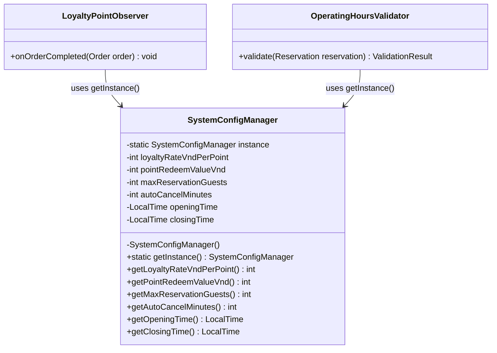
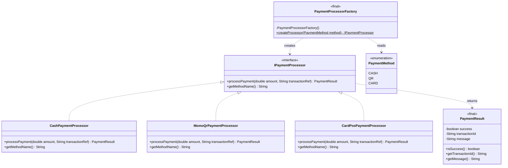
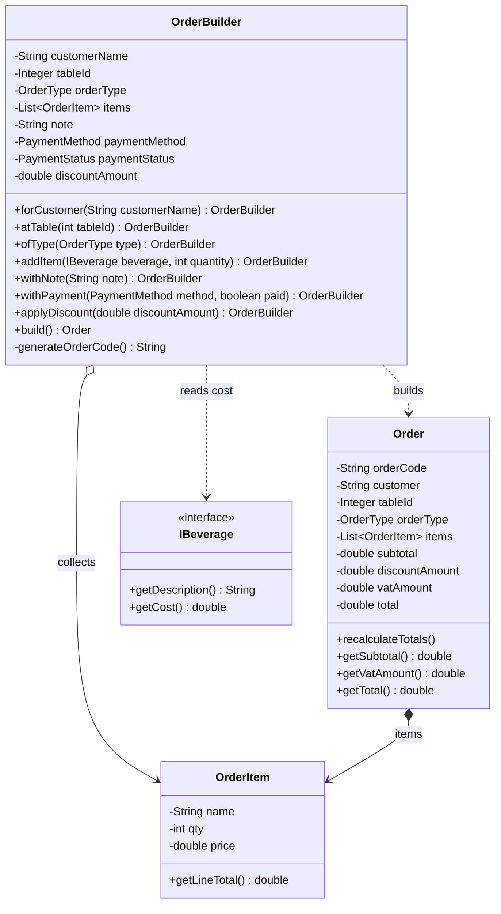
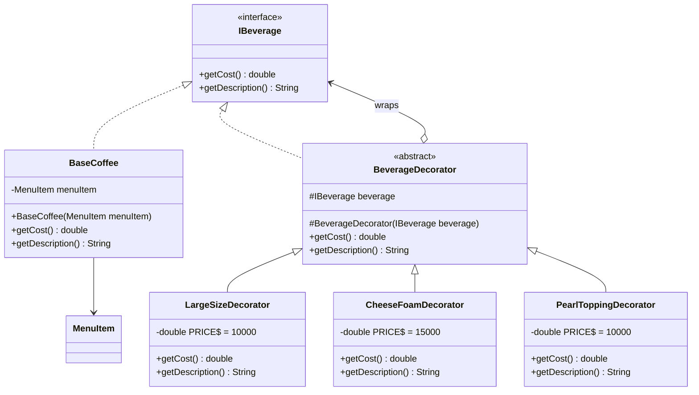
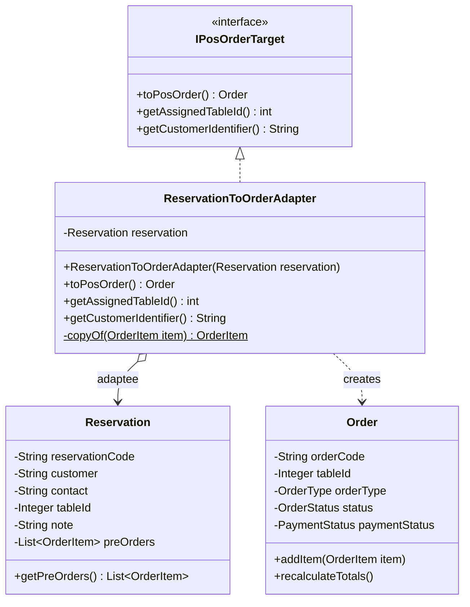
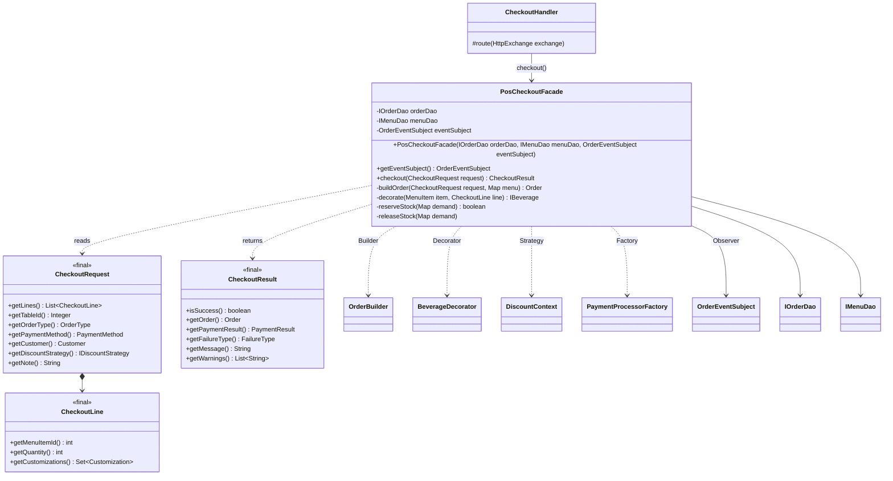
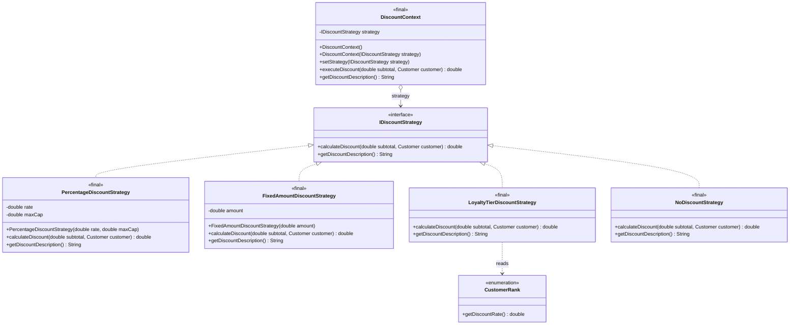
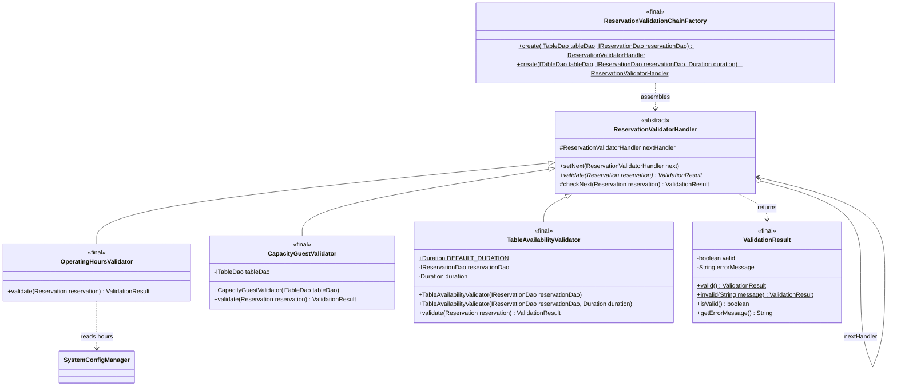
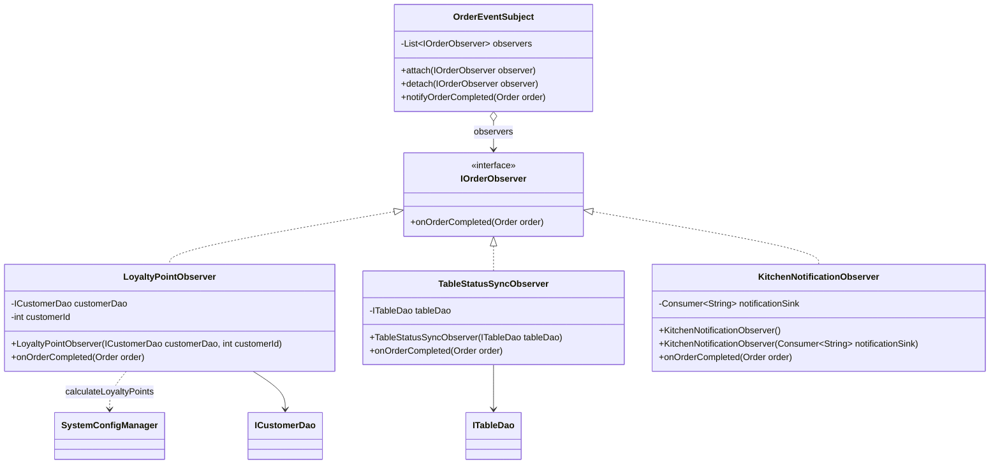

# BÁO CÁO ĐẶC TẢ KIẾN TRÚC PHẦN MỀM & DESIGN PATTERNS (PHIÊN BẢN JAVA BACKEND & NEXT.JS FRONTEND)
## DỰ ÁN: HỆ THỐNG QUẢN LÝ VÀ VẬN HÀNH QUÁN CÀ PHÊ (ĐÀ LẠT CAFE OPERATIONS)

---

**Học phần:** Thiết kế Mẫu & Kiến trúc Phần mềm (Design Patterns & Software Architecture)  
**Giảng viên hướng dẫn:** Bộ môn Kỹ thuật Phần mềm  
**Hệ thống phân tích:** `WebQuanLyQuanCafe-DesignPatterns` (`Đà Lạt Cafe Management`)  
**Ngày cập nhật:** 14/10/2026  
**Trạng thái tài liệu:** Bản đặc tả kỹ thuật đồng bộ thực tế (Technical Architecture Specification)  

---

## MỤC LỤC
1. [Tổng quan Đề tài & Kiến trúc Hệ thống](#1-tổng-quan-đề-tài--kiến-trúc-hệ-thống)
   - 1.1. Tên đề tài, mục tiêu và các phân hệ nghiệp vụ chính
   - 1.2. Công nghệ, kiến trúc, tích hợp & phân quyền (liên kết)
   - 1.3. Cấu trúc Cây Thư mục Dự án
2. [Bảng tổng hợp các Design Patterns GoF](#2-bảng-tổng-hợp-các-design-patterns-gof)
3. [Đặc tả chi tiết từng Design Pattern (Chuẩn GoF Java SE OOP)](#3-đặc-tả-chi-tiết-từng-design-pattern-chuẩn-gof-java-se-oop)
   - 3.1. Singleton Pattern - Quản lý Cấu hình Vận hành Quán Cà phê (`SystemConfigManager`)
   - 3.2. Factory Method Pattern - Khởi tạo Bộ xử lý Thanh toán Đa kênh (`PaymentProcessorFactory`)
   - 3.3. Builder Pattern - Xây dựng Đối tượng Đơn hàng Phức tạp (`OrderBuilder`)
   - 3.4. Decorator Pattern - Tùy biến Đồ uống, Nâng Size và Thêm Topping Động (`BeverageDecorator`)
   - 3.5. Adapter Pattern - Chuyển đổi Phiếu Đặt bàn sang Đơn hàng POS (`ReservationToOrderAdapter`)
   - 3.6. Facade Pattern - Đơn giản hóa Quy trình Chốt đơn & Thanh toán POS (`PosCheckoutFacade`)
   - 3.7. Strategy Pattern - Tính giảm giá (`DiscountContext`)
   - 3.8. Chain of Responsibility - Kiểm định đặt bàn (`ReservationValidatorHandler`)
   - 3.9. Observer Pattern - Tự động Tích điểm Loyalty & Đồng bộ Trạng thái Bàn (`OrderEventSubject`)
4. [Đánh giá & Đề xuất mở rộng nâng cao](#4-đánh-giá--đề-xuất-mở-rộng-nâng-cao)
   - 4.1. State Pattern - Quản lý Vòng đời Trạng thái Đơn hàng & Bàn
   - 4.2. Template Method Pattern - Khung Thuật toán Xuất Báo cáo Doanh thu & Thống kê
5. [Tổng kết Hiện trạng & Lộ trình Cài đặt Backend Java](#5-tổng-kết-hiện-trạng--lộ-trình-cài-đặt-backend-java)

---

# 1. Tổng quan Đề tài & Kiến trúc Hệ thống

## 1.1. Tên đề tài, mục tiêu và các phân hệ nghiệp vụ chính
- **Tên đề tài:** Hệ thống Quản lý và Vận hành Quán Cà phê Đa kênh (Đà Lạt Cafe Shop Management & Operations System).
- **Mục tiêu:** kết hợp giao diện Web **Next.js (App Router, React 19)** với tầng nghiệp vụ **Java SE hướng đối tượng thuần**, trong đó cài đặt 9 mẫu thiết kế GoF.
- **Các phân hệ nghiệp vụ:**
  - Storefront: menu, tìm kiếm, tuỳ biến món, giỏ hàng, voucher, checkout.
  - POS: lên đơn, chọn bàn, VAT 8%, thanh toán đa kênh.
  - KDS: Kanban `Pending → Brewing → Ready → Completed`, cảnh báo đơn trễ quá 10 phút.
  - Sơ đồ 15 bàn.
  - Đặt bàn trước: món đặt trước, xuất CSV.
  - Kho & thực đơn.
  - CRM: 10.000 VNĐ = 1 điểm.
  - Báo cáo doanh thu.

  Trạng thái triển khai của từng tính năng nằm tại [PROJECT_MANAGEMENT §1](PROJECT_MANAGEMENT.md#1-danh-mục-tính-năng-feature-matrix).

## 1.2. Công nghệ, kiến trúc, tích hợp & phân quyền
Để tránh lặp, các nội dung này chỉ được mô tả ở một nơi:
- **Công nghệ và phiên bản:** [README §3](../README.md#3-công-nghệ-sử-dụng). Backend là **Java SE 17 thuần**, không dùng Spring Boot / Spring Security / Spring Data JPA.
- **Kiến trúc tổng thể, tích hợp Next.js ↔ Java, phân quyền RBAC, luồng dữ liệu:** [ARCHITECTURE.md](ARCHITECTURE.md).
- **REST API:** [API_SPEC.md](API_SPEC.md).
- **Cơ sở dữ liệu:** [DATABASE.md](DATABASE.md).
- **Kiểm thử:** [TESTING.md](TESTING.md).

## 1.3. Cấu trúc Cây Thư mục Dự án

### 1.3.1. Frontend Next.js (`frontend-nextjs`)

```text
frontend-nextjs/
├── app/
│   ├── layout.tsx, page.tsx, globals.css     # Storefront (trang chủ)
│   ├── cart/, checkout/, account/[...slug]/   # Giỏ hàng, thanh toán, tài khoản
│   ├── api/cart/route.ts                      # Route Handler giỏ hàng
│   ├── api/favorites/route.ts                 # Route Handler yêu thích (cookie)
│   └── admin/
│       ├── actions.ts                         # Server Actions (gọi Java qua lib/api-client.ts)
│       ├── layout.tsx, page.tsx               # Dashboard
│       └── analytics/, customers/, inventory/, menu/, orders/, pos/,
│           reservations/, schedule/, settings/, staff/, tables/
├── components/
│   ├── storefront/   Header, Hero, DrinkMenu, CartSheet, CartDrawer, AccountDropdown
│   ├── admin/        pos-terminal, kds-board, floor-plan, TableGrid, reservations-management,
│   │                 inventory-table, menu-management, add-item-dialog, online-orders,
│   │                 staff-management, schedule-management, dashboard-*, KpiMetrics,
│   │                 RevenueChart, TopDrinksDonut, admin-header, admin-sidebar, shared
│   ├── ui/           Thành phần shadcn/ui
│   └── storefront.tsx, coffee-footer.tsx, role-switcher-view.tsx, theme-provider.tsx
├── lib/
│   ├── api-client.ts       # Proxy có kiểu tới Backend Java (JAVA_BACKEND_URL)
│   ├── admin/              access.ts, format.ts (VAT 8%), queries.ts
│   ├── db/                 index.ts (Drizzle), schema.ts, mock-store.ts
│   ├── store/cart-store.ts # Zustand
│   └── shopify.ts, utils.ts
└── scripts/test-ui-ux.mjs  # 25 test UI/UX
```

### 1.3.2. Backend Java (`backend-java`)
Đây là cấu trúc gói Maven **Java SE thuần (không dùng Spring Boot)** thực tế của dự án. Mỗi pattern có package riêng dưới `com.dalatcafe.patterns`, và một lớp kiểm thử JUnit 5 cùng tên trong `src/test/java/com/dalatcafe/patterns/`:

```text
backend-java/
├── pom.xml                                    # Java 17, JUnit 5, PostgreSQL JDBC driver
└── src/
    ├── main/java/com/dalatcafe/
    │   ├── server/                            # HTTP thuần Java SE (com.sun.net.httpserver)
    │   │   ├── MainServer.java                # Điểm khởi chạy, cổng mặc định 8080, đăng ký handler
    │   │   ├── ApiHandler.java                # Lớp cơ sở: đọc JSON, envelope {ok, data | error, code}
    │   │   ├── MenuHandler.java               # GET /api/menu
    │   │   ├── TableHandler.java              # GET /api/tables, PUT|PATCH /api/tables/{id}
    │   │   ├── ReservationHandler.java        # GET|POST /api/reservations (gắn Chain of Responsibility)
    │   │   ├── CheckoutHandler.java           # POST /api/checkout (gắn Facade, Strategy, Observer)
    │   │   ├── SimpleAuthFilter.java          # RBAC theo header X-User-Role
    │   │   ├── CorsHandler.java, Json.java, ApiException.java
    │   ├── model/                             # POJO: Order, OrderItem, MenuItem, Variation, Table,
    │   │                                      #       Reservation, Customer và các enum trạng thái
    │   ├── dao/                               # DAO: I*Dao, InMemory*Dao, Jdbc*Dao, DaoFactory, DaoMode,
    │   │                                      #      InMemoryDatabase, JdbcDatabase
    │   └── patterns/
    │       ├── singleton/   SystemConfigManager
    │       ├── factory/     IPaymentProcessor, CashPaymentProcessor, MomoQrPaymentProcessor,
    │       │                CardPosPaymentProcessor, PaymentProcessorFactory, PaymentResult
    │       ├── builder/     OrderBuilder
    │       ├── decorator/   IBeverage, BaseCoffee, BeverageDecorator, LargeSizeDecorator,
    │       │                CheeseFoamDecorator, PearlToppingDecorator
    │       ├── adapter/     IPosOrderTarget, ReservationToOrderAdapter
    │       ├── facade/      PosCheckoutFacade, CheckoutRequest, CheckoutLine, CheckoutResult, Customization
    │       ├── strategy/    IDiscountStrategy, PercentageDiscountStrategy, FixedAmountDiscountStrategy,
    │       │                LoyaltyTierDiscountStrategy, NoDiscountStrategy, DiscountContext, DiscountAmounts
    │       ├── chain/       ReservationValidatorHandler, OperatingHoursValidator, CapacityGuestValidator,
    │       │                TableAvailabilityValidator, ValidationResult, ReservationValidationChainFactory
    │       └── observer/    IOrderObserver, OrderEventSubject, LoyaltyPointObserver,
    │                        TableStatusSyncObserver, KitchenNotificationObserver
    └── test/java/com/dalatcafe/
        ├── patterns/        SingletonTest, FactoryTest, BuilderTest, DecoratorTest, AdapterTest,
        │                    FacadeTest, StrategyTest, ChainTest, ObserverTest
        ├── dao/DaoLayerTest, model/ModelEntitiesTest, server/ServerTest, SanityTest
```

---

# 2. Bảng tổng hợp các Design Patterns GoF

Dự án áp dụng trọn vẹn **9 Design Patterns chuẩn Gang of Four (GoF)** chia đều cho cả 3 nhóm (Creational, Structural, Behavioral) bằng ngôn ngữ **Java SE thuần túy (Pure OOP)**, đối chiếu tương ứng với các chức năng trên giao diện Frontend Next.js:

| STT | Tên Pattern | Phân nhóm GoF | Bài toán thực tế trong Quán Cà phê | Các Class / Interface Java thuần chính | Ánh xạ Giao diện Frontend Next.js | Trạng thái Dự án |
| :---: | :--- | :--- | :--- | :--- | :--- | :--- |
| **01** | **Singleton** | Creational | Quản lý thông số vận hành toàn cục (giờ mở/đóng cửa, tỷ lệ tích điểm, thời gian tự động hủy bàn) với duy nhất 1 thể hiện trong JVM. | `SystemConfigManager` | Màn hình `Settings` (`/admin/settings`) và logic tính điểm POS. | Đã cài đặt (#03), `SingletonTest` |
| **02** | **Factory Method** | Creational | Khởi tạo bộ xử lý thanh toán theo phương thức khách chọn (`Tiền mặt`, `QR MoMo`, `Thẻ POS`) không dùng `if-else` cứng. | `IPaymentProcessor`<br>`PaymentProcessorFactory`<br>`CashPaymentProcessor`<br>`MomoQrPaymentProcessor`<br>`CardPosPaymentProcessor` | Nút chọn phương thức thanh toán tại quầy POS (`pos-terminal.tsx`). | Đã cài đặt (#04), `FactoryTest` |
| **03** | **Builder** | Creational | Xây dựng từng bước đối tượng Đơn hàng (`Order`) có nhiều trường tùy chọn (bàn, khách, loại đơn, món, thanh toán, giảm giá, ghi chú). | `OrderBuilder`<br>`Order`<br>`OrderItem` | Thao tác lên đơn và thanh toán trên POS (`pos-terminal.tsx`). | Đã cài đặt (#06), `BuilderTest` |
| **04** | **Decorator** | Structural | Bọc món nước cơ sở để cộng dồn giá tiền và mô tả khi khách chọn thêm Topping (Trân châu, Cheese Foam) hoặc nâng Size L. | `IBeverage`<br>`BaseCoffee`<br>`BeverageDecorator`<br>`LargeSizeDecorator`<br>`CheeseFoamDecorator`<br>`PearlToppingDecorator` | Modal tuỳ biến đồ uống `DrinkMenu.tsx` (Storefront). Chọn Size L / Topping trên POS (`pos-terminal.tsx`), Java tính giá qua Decorator. | Đã cài đặt (#05), `DecoratorTest` |
| **05** | **Adapter** | Structural | Chuyển đổi Phiếu đặt bàn trước (`Reservation`) sang Đơn hàng POS (`Order`) khi khách đến nhận bàn mà không sửa code cũ. | `IPosOrderTarget`<br>`ReservationToOrderAdapter` | Nút "Sang POS" trong `reservations-management.tsx` gọi `POST /api/reservations/{code}/transfer-pos`. | Đã cài đặt (#10), `AdapterTest` |
| **06** | **Facade** | Structural | Một lời gọi `checkout(CheckoutRequest)` gom toàn bộ quy trình: tính giá, giảm giá, giữ kho, thanh toán, lưu đơn, phát sự kiện. | `PosCheckoutFacade`<br>`CheckoutRequest`<br>`CheckoutResult` | Nút thanh toán trên POS (`pos-terminal.tsx`) qua `POST /api/checkout`. | Đã cài đặt (#11), `FacadeTest` |
| **07** | **Strategy** | Behavioral | Hoán đổi thuật toán giảm giá (`Phần trăm có trần`, `Số tiền cố định`, `Hạng thành viên`, `Không giảm`) tại thời điểm chạy. | `IDiscountStrategy`<br>`PercentageDiscountStrategy`<br>`FixedAmountDiscountStrategy`<br>`LoyaltyTierDiscountStrategy`<br>`NoDiscountStrategy`<br>`DiscountContext` | Mã giảm giá `WELCOME10` và ưu đãi khách quen khi checkout. | Đã cài đặt (#07), `StrategyTest` |
| **08** | **Chain of Resp.** | Behavioral | Chuỗi kiểm tra phiếu đặt bàn: Giờ mở cửa ➔ Bàn tồn tại & sức chứa (1–20 khách) ➔ Không trùng lịch bàn. | `ReservationValidatorHandler`<br>`OperatingHoursValidator`<br>`CapacityGuestValidator`<br>`TableAvailabilityValidator`<br>`ReservationValidationChainFactory` | Đặt bàn qua `POST /api/reservations` và màn hình `reservations-management.tsx`. | Đã cài đặt (#09), `ChainTest` |
| **09** | **Observer** | Behavioral | Khi đơn hàng hoàn tất, tự động cộng điểm thành viên, chuyển bàn sang `Cleaning` và báo bếp gỡ phiếu. | `IOrderObserver`<br>`OrderEventSubject`<br>`LoyaltyPointObserver`<br>`TableStatusSyncObserver`<br>`KitchenNotificationObserver` | Sơ đồ bàn `floor-plan.tsx`, KDS và xếp hạng khách hàng `customers/page.tsx`. | Đã cài đặt (#08), `ObserverTest` |

---

# 3. Đặc tả chi tiết từng Design Pattern (Chuẩn GoF Java SE OOP)

---

### 3.1. Singleton Pattern - Quản lý Cấu hình Vận hành Quán Cà phê (`SystemConfigManager`)
- **Bài toán thực tế trong nghiệp vụ:**  
  Hệ thống quản lý quán cà phê có nhiều thông số cấu hình dùng chung toàn cục: tỷ lệ tích điểm thưởng (`10.000 VNĐ = 1 điểm`, `1 điểm = 1.000 VNĐ`), giới hạn khách đặt bàn tối đa (`20 người`), thời gian giữ bàn trước khi tự động hủy (`30 phút`), và khung giờ mở cửa (`07:00 - 22:00`). Nếu mỗi Service hoặc Handler lại tạo mới một đối tượng cấu hình, bộ nhớ Heap của JVM sẽ bị lãng phí và dễ gây bất đồng bộ cấu hình giữa các luồng.
- **Giải pháp kỹ thuật (Pure Java OOP):**  
  Áp dụng **Singleton Pattern** sử dụng kỹ thuật **Double-Checked Locking (`volatile` + `synchronized`)** hoặc **Bill Pugh Singleton (Static Inner Helper Class)** để đảm bảo an toàn đa luồng (Thread-safe), trì hoãn khởi tạo khi cần (Lazy Initialization) và khóa hoàn toàn `constructor` thành `private`.
- **Bảng ánh xạ thành phần (Participants Mapping):**
  | Vai trò GoF | Class / Phương thức Java | Trách nhiệm cụ thể |
  | :--- | :--- | :--- |
  | **Singleton** | `SystemConfigManager` | Chứa constructor `private`, biến tĩnh `instance` và các thông số cấu hình vận hành |
  | **Global Accessor** | `getInstance()` | Phương thức tĩnh công khai cung cấp điểm truy cập toàn cục duy nhất đến instance |
  | **Client** | `LoyaltyPointObserver`, `OperatingHoursValidator`, `CheckoutHandler` | Gọi `SystemConfigManager.getInstance()` để lấy thông số nghiệp vụ |

- **Sơ đồ lớp (Class Diagram):**


- **Mã nguồn minh họa (Pure Java):**
```java
package com.dalatcafe.patterns.singleton;

import java.time.LocalTime;

public final class SystemConfigManager {
    private static volatile SystemConfigManager instance;

    private final int loyaltyRateVndPerPoint = 10000; // 10.000 VNĐ = 1 điểm
    private final int pointRedeemValueVnd = 1000;     // 1 điểm = 1.000 VNĐ trừ vào hóa đơn
    private final int maxReservationGuests = 20;      // Tối đa 20 khách/lượt đặt
    private final int autoCancelMinutes = 30;         // Quá 30 phút tự hủy đặt bàn
    private final LocalTime openingTime = LocalTime.of(7, 0);
    private final LocalTime closingTime = LocalTime.of(22, 0);

    private SystemConfigManager() {
        if (instance != null) {
            throw new IllegalStateException("Instance đã tồn tại! Sử dụng getInstance().");
        }
    }

    public static SystemConfigManager getInstance() {
        if (instance == null) {
            synchronized (SystemConfigManager.class) {
                if (instance == null) {
                    instance = new SystemConfigManager();
                }
            }
        }
        return instance;
    }

    public int getLoyaltyRateVndPerPoint() { return loyaltyRateVndPerPoint; }
    public int getPointRedeemValueVnd() { return pointRedeemValueVnd; }
    public int getMaxReservationGuests() { return maxReservationGuests; }
    public int getAutoCancelMinutes() { return autoCancelMinutes; }
    public LocalTime getOpeningTime() { return openingTime; }
    public LocalTime getClosingTime() { return closingTime; }
}
```

---

### 3.2. Factory Method Pattern - Khởi tạo Bộ xử lý Thanh toán Đa kênh (`PaymentProcessorFactory`)
- **Bài toán thực tế trong nghiệp vụ:**  
  Tại quầy POS Terminal (`pos-terminal.tsx`) và cổng đặt hàng online, khách hàng có thể chọn nhiều phương thức thanh toán: `Tiền mặt (Cash)`, `Ví MoMo (QR Code)` hoặc `Thẻ ngân hàng (máy POS)`. Nếu viết chuỗi `if-else` lồng nhau trong luồng thanh toán chính, mã nguồn sẽ bị phụ thuộc cứng vào các lớp xử lý cụ thể, vi phạm nguyên tắc Open/Closed Principle khi quán bổ sung phương thức mới (ví dụ: ZaloPay, VietQR).
- **Giải pháp kỹ thuật (Pure Java OOP):**  
  Áp dụng **Factory Method Pattern** (dạng Simple/Static Factory). Giao diện chung `IPaymentProcessor` khai báo `processPayment(double amount, String transactionRef)` và `getMethodName()`. Lớp `PaymentProcessorFactory` (không thể khởi tạo) nhận enum `PaymentMethod` và trả về bộ xử lý tương ứng bằng biểu thức `switch`; thêm phương thức mới chỉ cần thêm một hằng enum và một lớp Concrete Product. `PosCheckoutFacade` là nơi duy nhất gọi Factory.
- **Bảng ánh xạ thành phần (Participants Mapping):**
  | Vai trò GoF | Class / Interface Java | Trách nhiệm cụ thể |
  | :--- | :--- | :--- |
  | **Product Interface** | `IPaymentProcessor` | Giao diện chuẩn cho mọi hình thức thanh toán |
  | **Concrete Product A** | `CashPaymentProcessor` | Thanh toán tiền mặt tại quầy, mã giao dịch `CASH-<uuid>` |
  | **Concrete Product B** | `MomoQrPaymentProcessor` | Thanh toán quét mã QR ví MoMo (`PaymentMethod.QR`) |
  | **Concrete Product C** | `CardPosPaymentProcessor` | Thanh toán thẻ qua máy POS (`PaymentMethod.CARD`) |
  | **Creator / Factory** | `PaymentProcessorFactory` | `createProcessor(PaymentMethod)` trả về thể hiện tương ứng |
  | **Kết quả** | `PaymentResult` | Bất biến: `isSuccess()`, `getTransactionId()`, `getMessage()` |

- **Sơ đồ lớp (Class Diagram):**


- **Mã nguồn thực tế** (`backend-java/src/main/java/com/dalatcafe/patterns/factory/PaymentProcessorFactory.java`):
```java
package com.dalatcafe.patterns.factory;

import com.dalatcafe.model.PaymentMethod;

public final class PaymentProcessorFactory {
    private PaymentProcessorFactory() {
    }

    public static IPaymentProcessor createProcessor(PaymentMethod method) {
        if (method == null) {
            throw new IllegalArgumentException("Payment method must not be null");
        }

        return switch (method) {
            case CASH -> new CashPaymentProcessor();
            case QR -> new MomoQrPaymentProcessor();
            case CARD -> new CardPosPaymentProcessor();
        };
    }
}
```
- **Kiểm thử:** `FactoryTest` (tạo đúng bộ xử lý cho từng `PaymentMethod`, từ chối `null`, trả về `PaymentResult` thành công).

---

### 3.3. Builder Pattern - Xây dựng Đối tượng Đơn hàng Phức tạp (`OrderBuilder`)
- **Bài toán thực tế trong nghiệp vụ:**  
  Một đối tượng Đơn hàng (`Order`) trong hệ thống quán cà phê rất phức tạp và chứa nhiều trường thông tin tùy chọn: mã đơn hàng (`orderCode`), tên khách hàng, số điện thoại, số bàn (`tableId`), loại đơn hàng (`dine-in`, `pickup`, `delivery`), danh sách chi tiết món (`OrderItem`), mã voucher giảm giá, số điểm tích lũy sử dụng, ghi chú cho barista, thời gian tạo đơn và trạng thái thanh toán. Sử dụng constructor truyền thống với quá nhiều tham số (Telescoping Constructor) sẽ dẫn đến code khó đọc, dễ nhầm thứ tự tham số và khó bảo trì.
- **Giải pháp kỹ thuật (Pure Java OOP):**  
  Áp dụng **Builder Pattern** dạng fluent interface. `OrderBuilder` gom từng bước tùy chọn: `forCustomer`, `atTable`, `ofType`, `addItem(IBeverage, qty)`, `withNote`, `withPayment`, `applyDiscount`, rồi `build()` tạo `Order`. Mỗi bước kiểm tra đầu vào ngay (bàn và số lượng phải dương, giảm giá không âm và hữu hạn, đối số bắt buộc khác `null`). Bước bị bỏ qua dùng giá trị mặc định: khách `Walk-in`, loại `DINE_IN`, thanh toán `CASH` chưa trả, không giảm giá. `build()` từ chối đơn rỗng, sinh mã đơn dạng `AC-XXXX-XXX`, còn `Order` tự tính subtotal, VAT 8% trên phần sau giảm giá và tổng tiền. Builder có thể dùng lại; đơn đã tạo không bị ảnh hưởng khi thêm món sau đó. `addItem` nhận `IBeverage`, nên giá đã gồm các Decorator.
- **Bảng ánh xạ thành phần (Participants Mapping):**
  | Vai trò GoF | Class / Interface Java | Trách nhiệm cụ thể |
  | :--- | :--- | :--- |
  | **Builder** | `OrderBuilder` | Lưu trạng thái trung gian và cung cấp các bước dựng đơn dạng chuỗi |
  | **Product** | `Order` | Đơn hàng hoàn chỉnh, tự tính subtotal, VAT và tổng tiền |
  | **Thành phần** | `OrderItem`, `IBeverage` | Dòng món được tạo từ đồ uống (đã bọc Decorator) và số lượng |
  | **Director / Client** | `PosCheckoutFacade.buildOrder(...)` | Gọi các bước theo dữ liệu của `CheckoutRequest` |

- **Sơ đồ lớp (Class Diagram):**


- **Mã nguồn thực tế** (`backend-java/src/main/java/com/dalatcafe/patterns/builder/OrderBuilder.java`, rút gọn):
```java
public class OrderBuilder {
    private String customerName = "Walk-in";
    private Integer tableId;
    private OrderType orderType = OrderType.DINE_IN;
    private final List<OrderItem> items = new ArrayList<>();
    private PaymentMethod paymentMethod = PaymentMethod.CASH;
    private PaymentStatus paymentStatus = PaymentStatus.UNPAID;
    private double discountAmount;
    // note, forCustomer, ofType, withNote, withPayment lược bớt

    public OrderBuilder atTable(int tableId) {
        if (tableId <= 0) {
            throw new IllegalArgumentException("Table ID must be greater than zero");
        }
        this.tableId = tableId;
        return this;
    }

    public OrderBuilder addItem(IBeverage beverage, int quantity) {
        Objects.requireNonNull(beverage, "Beverage must not be null");
        if (quantity <= 0) {
            throw new IllegalArgumentException("Quantity must be greater than zero");
        }
        items.add(new OrderItem(beverage.getDescription(), quantity, beverage.getCost()));
        return this;
    }

    public Order build() {
        if (items.isEmpty()) {
            throw new IllegalStateException("Order must contain at least one item");
        }
        Order order = new Order(null, generateOrderCode(), customerName, tableId, orderType);
        order.setItems(items);
        order.setPaymentMethod(paymentMethod);
        order.setPaymentStatus(paymentStatus);
        order.setDiscountAmount(discountAmount);
        return order;
    }
}

// Sử dụng
Order order = new OrderBuilder()
        .forCustomer("Nguyen Hung Thinh")
        .atTable(8)
        .addItem(new LargeSizeDecorator(new BaseCoffee(latte)), 2)
        .withPayment(PaymentMethod.CARD, true)
        .applyDiscount(10_000)
        .build();
```
- **Kiểm thử:** `BuilderTest` (dựng đơn và tính VAT, giá trị mặc định cho khách vãng lai, từ chối đơn rỗng và đối số sai, tái sử dụng builder).

---

### 3.4. Decorator Pattern - Tùy biến Đồ uống, Nâng Size và Thêm Topping Động (`BeverageDecorator`)
- **Bài toán thực tế trong nghiệp vụ:**  
  Trên giao diện Storefront (`DrinkMenu.tsx` - Customization Modal) cũng như quầy thu ngân POS, khách hàng có thể tùy chọn thêm nhiều loại topping hoặc nâng size cho ly cà phê gốc (ví dụ: Ly Latte Vani gốc có giá 55.000 VNĐ, thêm Trân châu trắng +10.000 VNĐ, thêm Kem Cheese béo ngậy +15.000 VNĐ, nâng Size L +10.000 VNĐ). Nếu sử dụng kế thừa để tạo lớp cho từng tổ hợp (ví dụ: `LatteVaniWithPearlAndCheeseLarge`), hệ thống sẽ rơi vào tình trạng bùng nổ số lượng lớp (Class Explosion) và không thể thay đổi tùy chọn linh hoạt tại runtime.
- **Giải pháp kỹ thuật (Pure Java OOP):**  
  Áp dụng **Decorator Pattern**. Giao diện `IBeverage` khai báo `getCost()` và `getDescription()`. Lớp `BaseCoffee` (Concrete Component) bọc một `MenuItem` và lấy giá bán `sellPrice`. Lớp trừu tượng `BeverageDecorator` giữ tham chiếu `protected final IBeverage beverage` (không nhận `null`) và chuyển tiếp lời gọi. Ba Concrete Decorator cộng thêm phụ thu và nối mô tả. Vì mỗi Decorator chỉ cộng một khoản cố định nên thứ tự bọc không làm thay đổi tổng tiền, và có thể bọc cùng một topping nhiều lần. `PosCheckoutFacade` dựng chuỗi Decorator từ danh sách `Customization` của từng dòng đơn.
- **Bảng ánh xạ thành phần (Participants Mapping):**
  | Vai trò GoF | Class / Interface Java | Trách nhiệm cụ thể |
  | :--- | :--- | :--- |
  | **Component** | `IBeverage` | Giao diện tính giá và mô tả đồ uống |
  | **Concrete Component** | `BaseCoffee` | Đồ uống gốc trong menu, giá = `MenuItem.getSellPrice()` |
  | **Decorator** | `BeverageDecorator` | Giữ `IBeverage` được bọc và chuyển tiếp yêu cầu |
  | **Concrete Decorator 1** | `LargeSizeDecorator` | +10.000 VNĐ, nối chuỗi `" (Size L)"` |
  | **Concrete Decorator 2** | `CheeseFoamDecorator` | +15.000 VNĐ, nối chuỗi `" + Salted Cheese Foam"` |
  | **Concrete Decorator 3** | `PearlToppingDecorator` | +10.000 VNĐ, nối chuỗi `" + White Pearls"` |

- **Sơ đồ lớp (Class Diagram):**


- **Mã nguồn thực tế** (`backend-java/src/main/java/com/dalatcafe/patterns/decorator/`):
```java
public abstract class BeverageDecorator implements IBeverage {
    protected final IBeverage beverage;

    protected BeverageDecorator(IBeverage beverage) {
        this.beverage = Objects.requireNonNull(beverage, "Beverage must not be null");
    }

    @Override
    public String getDescription() {
        return beverage.getDescription();
    }

    @Override
    public double getCost() {
        return beverage.getCost();
    }
}

public class CheeseFoamDecorator extends BeverageDecorator {
    private static final double PRICE = 15_000;

    public CheeseFoamDecorator(IBeverage beverage) {
        super(beverage);
    }

    @Override
    public String getDescription() {
        return beverage.getDescription() + " + Salted Cheese Foam";
    }

    @Override
    public double getCost() {
        return beverage.getCost() + PRICE;
    }
}

// Sử dụng: Cà phê muối 55.000 + Size L + Cheese Foam + Trân châu = 90.000 VNĐ
IBeverage drink = new PearlToppingDecorator(
        new CheeseFoamDecorator(
                new LargeSizeDecorator(new BaseCoffee(menuItem))));
```
- **Kiểm thử:** `DecoratorTest` (cộng dồn giá và mô tả, phụ thu từng topping, bọc lặp, độc lập thứ tự bọc, từ chối `null`).

---

### 3.5. Adapter Pattern - Chuyển đổi Phiếu Đặt bàn sang Đơn hàng POS (`ReservationToOrderAdapter`)
- **Bài toán thực tế trong nghiệp vụ:**  
  Trên màn hình Quản lý Đặt bàn (`reservations-management.tsx`), khi khách đã đặt chỗ trước đến quán, nhân viên thu ngân nhấn nút "Chuyển đơn sang POS" (`handleTransferToPOS`). Đối tượng Phiếu đặt bàn (`Reservation`) có các thuộc tính: `customer`, `contact`, `table`, `dateTime`, `guests`, và danh sách món gọi trước `preOrders`. Trong khi đó, màn hình POS chỉ làm việc với giao diện chuẩn `IPosOrderTarget` (chứa `toPosOrder()`, `getAssignedTableId()`, `getCustomerIdentifier()`). Cấu trúc hai bên không tương thích trực tiếp.
- **Giải pháp kỹ thuật (Pure Java OOP):**  
  Áp dụng **Object Adapter Pattern**. Màn hình POS chỉ làm việc với giao diện đích `IPosOrderTarget`. Lớp `ReservationToOrderAdapter` giữ một `Reservation` (Adaptee, không nhận `null`) và chuyển đổi khi được gọi: mã đặt bàn trở thành mã đơn, các món đặt trước (`preOrders`) được **sao chép** thành `OrderItem` mới, đơn mới có loại `DINE_IN`, trạng thái `PENDING`, thanh toán `UNPAID` và tổng tiền được tính lại. Adapter chỉ đọc Adaptee, không sửa `Reservation` hay `Order` gốc.
- **Bảng ánh xạ thành phần (Participants Mapping):**
  | Vai trò GoF | Class / Interface Java | Trách nhiệm cụ thể |
  | :--- | :--- | :--- |
  | **Target** | `IPosOrderTarget` | Giao diện POS mong đợi: `toPosOrder()`, `getAssignedTableId()`, `getCustomerIdentifier()` |
  | **Adaptee** | `Reservation` | Phiếu đặt bàn: khách, liên hệ, bàn, ghi chú, danh sách món đặt trước |
  | **Adapter** | `ReservationToOrderAdapter` | Chuyển `Reservation` thành `Order` POS đang hoạt động |
  | **Client** | Luồng tiếp nhận khách tại quầy POS | Gọi `toPosOrder()` khi khách đặt trước đến nhận bàn |

- **Sơ đồ lớp (Class Diagram):**


- **Mã nguồn thực tế** (`backend-java/src/main/java/com/dalatcafe/patterns/adapter/ReservationToOrderAdapter.java`):
```java
public class ReservationToOrderAdapter implements IPosOrderTarget {
    private final Reservation reservation;

    public ReservationToOrderAdapter(Reservation reservation) {
        this.reservation = Objects.requireNonNull(reservation, "reservation must not be null");
    }

    @Override
    public Order toPosOrder() {
        Order order = new Order(null, reservation.getReservationCode(), getCustomerIdentifier(),
                reservation.getTableId(), OrderType.DINE_IN);
        order.setStatus(OrderStatus.PENDING);
        order.setPaymentStatus(PaymentStatus.UNPAID);
        order.setNote(reservation.getNote());
        if (reservation.getPreOrders() != null) {
            for (OrderItem source : reservation.getPreOrders()) {
                if (source != null) {
                    order.addItem(copyOf(source));
                }
            }
        }
        order.recalculateTotals();
        return order;
    }

    @Override
    public int getAssignedTableId() {
        return reservation.getTableId() != null ? reservation.getTableId() : -1;
    }

    @Override
    public String getCustomerIdentifier() {
        String name = reservation.getCustomer();
        return name != null && !name.isBlank() ? name : reservation.getContact();
    }
}
```
- **Kiểm thử:** `AdapterTest` (chuyển đổi đầy đủ dữ liệu, sao chép món độc lập với phiếu gốc, phiếu không có bàn trả `-1`, từ chối `null`).

---

### 3.6. Facade Pattern - Đơn giản hóa Quy trình Chốt đơn & Thanh toán POS (`PosCheckoutFacade`)
- **Bài toán thực tế trong nghiệp vụ:**  
  Quy trình hoàn tất một đơn hàng tại quầy thu ngân POS (`pos-terminal.tsx`) bao gồm rất nhiều hệ thống con phối hợp:
  1. Tính tiền từng món đồ uống (áp dụng Decorator nếu có Topping).
  2. Tính chiết khấu giảm giá Voucher thông qua Strategy Pattern (`DiscountContext`).
  3. Trừ tiền quy đổi từ điểm tích lũy thành viên (`SystemConfigManager`). *Hiện chưa hỗ trợ khi checkout: API trả lỗi nếu `useLoyaltyPoints > 0`.*
  4. Cộng thuế VAT (8%).
  5. Khởi tạo đối tượng xử lý thanh toán qua Factory (`PaymentProcessorFactory`) và thực hiện thanh toán.
  6. Lưu trữ thông tin đơn hàng vào hệ thống lưu trữ (DAO).
  7. Phát sự kiện hoàn tất đơn hàng cho các bên theo dõi (Observer) để cộng điểm và cập nhật trạng thái bàn.
  Nếu để Controller hoặc Handler xử lý trực tiếp toàn bộ 7 bước trên, mã nguồn sẽ bị phân mảnh, liên kết chặt (High Coupling) và cực kỳ khó kiểm thử.
- **Giải pháp kỹ thuật (Pure Java OOP):**  
  Áp dụng **Facade Pattern**. `PosCheckoutFacade` cung cấp một lời gọi duy nhất `checkout(CheckoutRequest)` (được đồng bộ hóa) và trả về `CheckoutResult` thay vì ném ngoại lệ cho lỗi nghiệp vụ. Bên trong, Facade điều phối năm pattern khác theo thứ tự đảm bảo nhất quán:
  1. Tra menu qua `IMenuDao`, kiểm tra món tồn tại, còn bán và đủ tồn kho (`NOT_FOUND` / `OUT_OF_STOCK`).
  2. Bọc từng món bằng **Decorator** theo `Customization` (`SIZE_L`, `CHEESE_FOAM`, `WHITE_PEARL`), dựng đơn bằng **Builder**, áp giảm giá bằng **Strategy** (`DiscountContext`).
  3. Giữ chỗ tồn kho; nếu thất bại thì hoàn lại phần đã trừ.
  4. Tạo bộ xử lý qua **Factory** và thanh toán; đơn được giảm còn 0 VNĐ thì không thu tiền. Thanh toán lỗi → hoàn tồn kho, `PAYMENT_FAILED`.
  5. Đánh dấu `PAID` / `COMPLETED` và lưu qua `IOrderDao`; lưu lỗi → hoàn tồn kho, `PERSISTENCE_FAILED` kèm mã giao dịch cần hủy.
  6. Phát sự kiện cho các **Observer**; lỗi của observer chỉ thành cảnh báo trong `CheckoutResult.getWarnings()`, không hoàn tác đơn đã lưu.

  `CheckoutHandler` (`POST /api/checkout`) là client: chuyển JSON thành `CheckoutRequest`, gọi Facade và ánh xạ `FailureType` sang mã HTTP (404, 409, 400, 503).
- **Bảng ánh xạ thành phần (Participants Mapping):**
  | Vai trò GoF | Class / Interface Java | Trách nhiệm cụ thể |
  | :--- | :--- | :--- |
  | **Facade** | `PosCheckoutFacade` | Điểm vào duy nhất cho toàn bộ quy trình chốt đơn |
  | **Dữ liệu vào** | `CheckoutRequest`, `CheckoutLine`, `Customization` | Dòng món, bàn, loại đơn, phương thức thanh toán, khách, strategy giảm giá, ghi chú |
  | **Dữ liệu ra** | `CheckoutResult` (`FailureType`) | Thành công kèm `Order` và `PaymentResult`, hoặc loại lỗi và thông báo |
  | **Subsystems** | `OrderBuilder`, `BeverageDecorator`, `DiscountContext`, `PaymentProcessorFactory`, `OrderEventSubject`, `IOrderDao`, `IMenuDao` | Các thành phần được Facade điều phối |
  | **Client** | `CheckoutHandler` | Endpoint REST gọi Facade |

- **Sơ đồ lớp (Class Diagram):**


- **Mã nguồn thực tế** (`backend-java/src/main/java/com/dalatcafe/patterns/facade/PosCheckoutFacade.java`, rút gọn phần thanh toán và lưu đơn):
```java
public synchronized CheckoutResult checkout(CheckoutRequest request) {
    Objects.requireNonNull(request, "Request must not be null");
    Map<Integer, MenuItem> menu = new LinkedHashMap<>();
    Map<Integer, Integer> demand = new LinkedHashMap<>();
    CheckoutResult problem = resolveMenu(request, menu, demand);
    if (problem != null) {
        return problem;
    }
    // Steps 1-3: decorate drinks, build the order, apply the discount.
    Order order = buildOrder(request, menu);
    if (!reserveStock(demand)) {
        return CheckoutResult.failure(CheckoutResult.FailureType.OUT_OF_STOCK, "Could not reserve inventory", null);
    }
    // Step 4: payment.
    PaymentResult payment;
    try {
        if (order.getTotal() <= 0) {
            payment = new PaymentResult(true, "NO-CHARGE-" + order.getOrderCode(), "Nothing to charge");
        } else {
            IPaymentProcessor processor = PaymentProcessorFactory.createProcessor(request.getPaymentMethod());
            payment = processor.processPayment(order.getTotal(), order.getOrderCode());
        }
    } catch (RuntimeException e) {
        releaseStock(demand);
        return CheckoutResult.failure(CheckoutResult.FailureType.PAYMENT_FAILED, "Payment error: " + e.getMessage(), null);
    }
    // ... payment declined -> releaseStock + PAYMENT_FAILED
    // Step 5: persist the completed order (save failure -> releaseStock + PERSISTENCE_FAILED).
    order.setPaymentStatus(PaymentStatus.PAID);
    order.setStatus(OrderStatus.COMPLETED);
    // ...
    // Step 6: broadcast; observer failures must not undo a committed checkout.
    List<String> warnings = new ArrayList<>();
    try {
        eventSubject.notifyOrderCompleted(order);
    } catch (RuntimeException e) {
        warnings.add("Order event observer failed: " + e.getMessage());
    }
    return CheckoutResult.success(order, payment, warnings);
}
```
- **Kiểm thử:** `FacadeTest` (toàn bộ quy trình bằng một lời gọi, cộng dồn tùy chọn, giảm giá không làm tổng âm, thiếu tồn kho không gây tác dụng phụ, món không tồn tại/hết hàng, hoàn kho khi lưu lỗi, lỗi observer không hoàn tác đơn, kiểm tra cấu trúc yêu cầu).

---

### 3.7. Strategy Pattern - Tính giảm giá (`DiscountContext`)
- **Bài toán thực tế trong nghiệp vụ:**  
  Quán áp dụng nhiều chương trình giảm giá khác nhau: mã voucher theo phần trăm có trần (`WELCOME10` giảm 10%, tối đa 50.000 VNĐ), giảm số tiền cố định, ưu đãi theo hạng thành viên (Đồng/Bạc/Vàng/VIP) hoặc không giảm. Nếu viết các nhánh `if-else` theo loại khuyến mãi ngay trong luồng chốt đơn, mỗi chương trình mới đều buộc phải sửa mã thanh toán.
- **Giải pháp kỹ thuật (Pure Java OOP):**  
  Áp dụng **Strategy Pattern** trong package `com.dalatcafe.patterns.strategy` (Java SE 17):
  - `IDiscountStrategy`: `double calculateDiscount(double subtotal, Customer customer)` và `String getDiscountDescription()`.
  - `PercentageDiscountStrategy(rate, maxCap)`: tỷ lệ từ 0 đến 1, giới hạn mức giảm tối đa.
  - `FixedAmountDiscountStrategy(amount)`: giảm số tiền cố định, không vượt subtotal.
  - `LoyaltyTierDiscountStrategy`: dùng `CustomerRank.getDiscountRate()` (Đồng 0%, Bạc 5%, Vàng 10%, VIP 15%); khách/hạng null giảm 0.
  - `NoDiscountStrategy`: không giảm giá.
  - `DiscountContext`: mặc định không giảm; constructor nhận strategy, `setStrategy`, `executeDiscount(subtotal, customer)`, `getDiscountDescription`. Có thể đổi strategy lúc chạy mà không dựng lại Order.
  - Số tiền phải hữu hạn, không âm; sai đầu vào gây `IllegalArgumentException`. Strategy null bị từ chối. Context kiểm tra kết quả strategy và giới hạn trong `[0, subtotal]` (qua lớp tiện ích nội bộ `DiscountAmounts`).
  - `CheckoutHandler` chọn strategy theo yêu cầu: có voucher `WELCOME10` → `PercentageDiscountStrategy(0.10, 50000)`; khách quen tra được theo số điện thoại → `LoyaltyTierDiscountStrategy`; còn lại → không giảm. `PosCheckoutFacade` chỉ làm việc với `DiscountContext`.
- **Bảng ánh xạ thành phần (Participants Mapping):**
  | Vai trò GoF | Class / Interface Java | Trách nhiệm cụ thể |
  | :--- | :--- | :--- |
  | **Strategy** | `IDiscountStrategy` | Giao diện chung của mọi thuật toán giảm giá |
  | **Concrete Strategy A** | `PercentageDiscountStrategy` | Giảm theo phần trăm có trần tối đa (voucher) |
  | **Concrete Strategy B** | `FixedAmountDiscountStrategy` | Giảm một số tiền cố định |
  | **Concrete Strategy C** | `LoyaltyTierDiscountStrategy` | Giảm theo hạng thành viên `CustomerRank` |
  | **Concrete Strategy D** | `NoDiscountStrategy` | Null Object: không giảm |
  | **Context** | `DiscountContext` | Giữ strategy hiện tại, kẹp kết quả trong `[0, subtotal]` |

- **Sơ đồ lớp (Class Diagram):**


- **Mã nguồn thực tế** (`backend-java/src/main/java/com/dalatcafe/patterns/strategy/`):
```java
public final class DiscountContext {
    private IDiscountStrategy strategy;

    public DiscountContext() {
        this(new NoDiscountStrategy());
    }

    public DiscountContext(IDiscountStrategy strategy) {
        setStrategy(strategy);
    }

    public void setStrategy(IDiscountStrategy strategy) {
        this.strategy = Objects.requireNonNull(strategy, "Strategy must not be null");
    }

    public double executeDiscount(double subtotal, Customer customer) {
        DiscountAmounts.requireNonNegative(subtotal, "Subtotal");
        return DiscountAmounts.clamp(subtotal, strategy.calculateDiscount(subtotal, customer));
    }

    public String getDiscountDescription() {
        return strategy.getDiscountDescription();
    }
}

public final class PercentageDiscountStrategy implements IDiscountStrategy {
    private final double rate;
    private final double maxCap;

    @Override
    public double calculateDiscount(double subtotal, Customer customer) {
        DiscountAmounts.requireNonNegative(subtotal, "Subtotal");
        return DiscountAmounts.clamp(subtotal, Math.min(subtotal * rate, maxCap));
    }
    // constructor kiểm tra 0 <= rate <= 1 và maxCap >= 0
}
```
- **Kiểm thử:** `StrategyTest`.

---
### 3.8. Chain of Responsibility - Kiểm định đặt bàn (`ReservationValidatorHandler`)
- **Bài toán thực tế trong nghiệp vụ:**  
  Một phiếu đặt bàn chỉ được nhận khi qua đủ ba bước kiểm tra theo thứ tự: giờ đến nằm trong giờ mở cửa, bàn tồn tại và đủ ghế cho số khách, bàn không bị trùng lịch. Gộp cả ba vào một phương thức dài khiến việc thêm, bớt hoặc đổi thứ tự quy tắc trở nên rủi ro.
- **Giải pháp kỹ thuật (Pure Java OOP):**  
  Áp dụng **Chain of Responsibility** trong package `com.dalatcafe.patterns.chain` (Java SE 17):
  - `ReservationValidatorHandler`: `setNext(ReservationValidatorHandler)`, `validate(Reservation)` và `checkNext(Reservation)`; dừng ngay tại lỗi đầu tiên. `setNext` từ chối chuỗi có vòng lặp.
  - `ValidationResult` bất biến: `valid()`, `invalid(String)`, `isValid()`, `getErrorMessage()`; kết quả hợp lệ có errorMessage null.
  - `OperatingHoursValidator`: đổi Instant sang `Asia/Ho_Chi_Minh`, đọc giờ từ `SystemConfigManager`; mặc định chấp nhận thời điểm bắt đầu từ 07:00 đến 22:00 (bao gồm hai biên).
  - `CapacityGuestValidator(ITableDao)`: bàn phải tồn tại; số khách từ 1 đến giới hạn cấu hình (mặc định 20), không vượt số ghế.
  - `TableAvailabilityValidator(IReservationDao[, Duration])`: thời lượng mặc định 2 giờ, áp dụng chung cho mọi lịch. Khoảng `[start, end)` giao nhau trên cùng bàn bị từ chối; lịch nối tiếp được phép.
  - PENDING, CONFIRMED, SEATED chiếm lịch; CANCELLED không chiếm lịch. Khi chỉnh sửa, chỉ bỏ qua bản ghi có cùng ID khác null; không dùng Reservation.equals().
  - `ReservationValidationChainFactory.create(tableDao, reservationDao[, duration])` lắp chuỗi giờ hoạt động → sức chứa → lịch bàn.
  - Lỗi dữ liệu trả thông báo tiếng Việt. Validator chỉ đọc DAO; lỗi truy cập DAO được truyền lên. Không cấm lịch tương lai dựa trên trạng thái bàn hiện tại.
  - Không thêm điều kiện đặt trước 60 phút hoặc bắt buộc kết thúc trước giờ đóng cửa. Giữ tương thích Reservation.setGuests() tự chuyển số dưới 1 thành 1.
  - Kiểm tra và lưu lịch chưa nguyên tử; lớp tích hợp lưu đặt bàn phải xử lý yêu cầu đồng thời.
  - `ReservationHandler` (`POST /api/reservations`) chạy chuỗi trước khi lưu và trả `400 CHAIN_VALIDATION_FAILED` kèm thông báo của mắt xích đầu tiên thất bại.
- **Bảng ánh xạ thành phần (Participants Mapping):**
  | Vai trò GoF | Class / Interface Java | Trách nhiệm cụ thể |
  | :--- | :--- | :--- |
  | **Handler** | `ReservationValidatorHandler` | Lớp trừu tượng giữ mắt xích kế tiếp và chuyển tiếp yêu cầu |
  | **Concrete Handler 1** | `OperatingHoursValidator` | Giờ đến phải nằm trong giờ mở cửa |
  | **Concrete Handler 2** | `CapacityGuestValidator` | Bàn tồn tại, số khách hợp lệ và không vượt số ghế |
  | **Concrete Handler 3** | `TableAvailabilityValidator` | Không trùng khung giờ với lịch khác trên cùng bàn |
  | **Kết quả** | `ValidationResult` | Hợp lệ hoặc kèm thông báo lỗi |
  | **Client / Assembler** | `ReservationValidationChainFactory`, `ReservationHandler` | Lắp chuỗi theo thứ tự và gọi `validate` |

- **Sơ đồ lớp (Class Diagram):**


- **Mã nguồn thực tế** (`backend-java/src/main/java/com/dalatcafe/patterns/chain/`):
```java
public abstract class ReservationValidatorHandler {
    protected ReservationValidatorHandler nextHandler;

    public void setNext(ReservationValidatorHandler next) {
        // Reject cycles when assembling or extending a chain.
        for (ReservationValidatorHandler handler = next; handler != null; handler = handler.nextHandler) {
            if (handler == this) {
                throw new IllegalArgumentException("Validation chain must not contain a cycle");
            }
        }
        nextHandler = next;
    }

    public abstract ValidationResult validate(Reservation reservation);

    protected ValidationResult checkNext(Reservation reservation) {
        return nextHandler == null ? ValidationResult.valid() : nextHandler.validate(reservation);
    }
}

public final class ReservationValidationChainFactory {
    public static ReservationValidatorHandler create(
            ITableDao tableDao, IReservationDao reservationDao, Duration duration) {
        ReservationValidatorHandler hours = new OperatingHoursValidator();
        ReservationValidatorHandler capacity = new CapacityGuestValidator(tableDao);
        hours.setNext(capacity);
        capacity.setNext(new TableAvailabilityValidator(reservationDao, duration));
        return hours;
    }
}
```
- **Kiểm thử:** `ChainTest`.

---
### 3.9. Observer Pattern - Tự động Tích điểm Loyalty & Đồng bộ Trạng thái Bàn (`OrderEventSubject`)
- **Bài toán thực tế trong nghiệp vụ:**  
  Khi đơn hàng được thanh toán hoàn tất tại quầy POS, hệ thống cần kích hoạt đồng thời nhiều tác vụ phụ thuộc:
  1. Tự động quy đổi giá trị hóa đơn thành điểm thưởng thành viên (cứ 10.000 VNĐ tích 1 điểm vào hồ sơ khách hàng quen trong CRM).
  2. Đồng bộ trạng thái bàn trên sơ đồ tầng (`floor-plan.tsx`): Nếu khách thanh toán xong và rời quán, bàn được chuyển sang trạng thái `cleaning` để nhân viên dọn bàn.
  3. Báo cho màn hình bếp (KDS) gỡ phiếu của đơn đã hoàn tất.
  Nếu lớp Đơn hàng trực tiếp gọi tới các Service này, mã nguồn sẽ bị phụ thuộc chéo (Tight Coupling), vi phạm nguyên tắc Single Responsibility Principle.
- **Giải pháp kỹ thuật (Pure Java OOP):**  
  Áp dụng **Observer Pattern**. `OrderEventSubject` quản lý danh sách `IOrderObserver`: `attach` từ chối `null` và bỏ qua đăng ký trùng, `detach` hủy đăng ký, `notifyOrderCompleted(Order)` duyệt trên **bản sao** danh sách nên observer có thể tự hủy đăng ký trong lúc nhận tin. Ba Concrete Observer phản hồi độc lập:
  - `LoyaltyPointObserver(ICustomerDao, customerId)`: chỉ cộng điểm khi đơn đã `PAID`, số điểm do `SystemConfigManager.calculateLoyaltyPoints` quy đổi; khách không tồn tại gây `IllegalStateException`.
  - `TableStatusSyncObserver(ITableDao)`: chuyển bàn sang `CLEANING` và đưa số khách về 0; đơn mang đi (không có bàn) được bỏ qua.
  - `KitchenNotificationObserver`: gửi thông báo gỡ phiếu khỏi KDS (mặc định in ra console, có thể truyền `Consumer<String>`).

  `MainServer` đăng ký sẵn `TableStatusSyncObserver` và `KitchenNotificationObserver`; `CheckoutHandler` gắn `LoyaltyPointObserver` cho riêng khách quen trong thời gian một lần checkout. `PosCheckoutFacade` phát sự kiện sau khi đơn đã lưu, và lỗi của observer chỉ được ghi thành cảnh báo, không hoàn tác giao dịch.
- **Bảng ánh xạ thành phần (Participants Mapping):**
  | Vai trò GoF | Class / Interface Java | Trách nhiệm cụ thể |
  | :--- | :--- | :--- |
  | **Subject** | `OrderEventSubject` | Đăng ký, hủy đăng ký và thông báo cho các Observer |
  | **Observer Interface** | `IOrderObserver` | Phương thức `onOrderCompleted(Order order)` |
  | **Concrete Observer 1** | `LoyaltyPointObserver` | Cộng điểm và doanh số cho khách hàng thân thiết |
  | **Concrete Observer 2** | `TableStatusSyncObserver` | Giải phóng bàn trên sơ đồ sang trạng thái dọn dẹp |
  | **Concrete Observer 3** | `KitchenNotificationObserver` | Báo màn hình bếp gỡ phiếu của đơn đã xong |

- **Sơ đồ lớp (Class Diagram):**


- **Mã nguồn thực tế** (`backend-java/src/main/java/com/dalatcafe/patterns/observer/`):
```java
public class OrderEventSubject {
    private final List<IOrderObserver> observers = new ArrayList<>();

    public void attach(IOrderObserver observer) {
        Objects.requireNonNull(observer, "Observer must not be null");
        if (!observers.contains(observer)) {
            observers.add(observer);
        }
    }

    public void detach(IOrderObserver observer) {
        observers.remove(observer);
    }

    public void notifyOrderCompleted(Order order) {
        Objects.requireNonNull(order, "Order must not be null");
        for (IOrderObserver observer : List.copyOf(observers)) {
            observer.onOrderCompleted(order);
        }
    }
}

public class LoyaltyPointObserver implements IOrderObserver {
    private final ICustomerDao customerDao;
    private final int customerId;

    @Override
    public void onOrderCompleted(Order order) {
        Objects.requireNonNull(order, "Order must not be null");
        if (order.getPaymentStatus() != PaymentStatus.PAID) {
            return;
        }
        int earnedPoints = SystemConfigManager.getInstance().calculateLoyaltyPoints(order.getTotal());
        if (!customerDao.addOrderRecord(customerId, order.getTotal(), earnedPoints)) {
            throw new IllegalStateException("Customer not found: " + customerId);
        }
    }
}
```
- **Kiểm thử:** `ObserverTest` (thông báo cả ba observer, chống đăng ký trùng và hủy đăng ký, đơn chưa thanh toán không tích điểm, đơn mang đi không đổi bàn, khách/bàn không tồn tại, đối số `null`).

---

# 4. Đánh giá & Đề xuất mở rộng nâng cao

Để làm phong phú thêm kiến trúc phần mềm của dự án, 2 mẫu thiết kế GoF nâng cao sau đây được đề xuất bổ sung vào hệ thống:

### 4.1. State Pattern - Quản lý Vòng đời Trạng thái Đơn hàng & Bàn
- **Mục tiêu áp dụng:**  
  Trong màn hình Bếp pha chế (KDS Board) và Quản lý bàn (`floor-plan.tsx`), các thực thể trải qua chu kỳ trạng thái nghiêm ngặt:
  - Đơn hàng: `Pending` ➔ `Brewing` ➔ `Ready` ➔ `Completed`.
  - Bàn phục vụ: `Available` ➔ `Reserved` ➔ `Occupied` ➔ `Cleaning` ➔ `Available`.
- **Giải pháp:** Áp dụng **State Pattern** đóng gói hành vi tương ứng với từng trạng thái thành các lớp riêng biệt (`PendingOrderState`, `BrewingOrderState`, `AvailableTableState`...). Điều này loại bỏ hoàn toàn các câu lệnh kiểm tra điều kiện phức tạp khi chuyển trạng thái và ngăn chặn việc nhảy trạng thái không hợp lệ (ví dụ: không thể chuyển từ `Pending` thẳng sang `Completed` mà chưa qua pha chế).

### 4.2. Template Method Pattern - Khung Thuật toán Xuất Báo cáo Doanh thu & Thống kê
- **Mục tiêu áp dụng:**  
  Tại phân hệ Analytics Dashboard và Quản lý đặt bàn, hệ thống cần hỗ trợ xuất báo cáo ra nhiều định dạng: file CSV (đã có trong `reservations-management.tsx`), file PDF hóa đơn hoặc file Excel doanh thu theo ca.
- **Giải pháp:** Áp dụng **Template Method Pattern**. Lớp trừu tượng `BaseReportGenerator` định nghĩa khung thuật toán bất biến gồm 5 bước tuần tự:
  1. `collectData()` (Lấy dữ liệu từ cơ sở dữ liệu/mock store).
  2. `formatHeader()` (Tạo tiêu đề báo cáo, logo, thời gian xuất).
  3. `formatBody()` (Điền các dòng chi tiết dữ liệu).
  4. `calculateSummary()` (Tính tổng doanh thu, số lượng đơn).
  5. `exportFile()` (Phương thức trừu tượng để lớp con `CsvReportGenerator`, `PdfReportGenerator` tự triển khai định dạng xuất tương ứng).

---

# 5. Tổng kết Hiện trạng & Lộ trình Cài đặt Backend Java

### 5.1. Bảng đối chiếu Hiện trạng Dự án Thực tế
| Tiêu chí đối chiếu | Hiện trạng Mã nguồn Thực tế | Bản Đặc tả Thiết kế Kỹ thuật (SPEC) |
| :--- | :--- | :--- |
| **Frontend Framework** | Next.js 16.4.0 (App Router), React 19, Tailwind CSS v4 | Đồng bộ chính xác 100% với mã nguồn thực tế |
| **Giao tiếp Dữ liệu Frontend** | Server Actions (`admin/actions.ts`) chuyển tiếp sang Java qua `lib/api-client.ts`, fallback Mock Store; Route Handlers (`/api/cart`), Zustand, SWR | Mục 1.5 mô tả đúng luồng tích hợp và quy tắc chịu lỗi |
| **Thư mục Backend Java** | Hoàn thành #01–#12: POJO, DAO (In-Memory/JDBC), 9 pattern, HttpServer cổng 8080 | Cấu trúc Maven Java SE OOP tại `src/main/java/com/dalatcafe/` (mục 1.4.2) |
| **Khung công nghệ Backend** | Không dùng Spring Boot / Security / Data JPA | Thiết kế hướng đối tượng thuần túy Java SE 17+ (Pure Java OOP) |
| **9 GoF Design Patterns** | Đã cài đặt đủ 9 pattern, mỗi pattern có lớp test JUnit 5 riêng (#13) | Sơ đồ lớp Mermaid và mã nguồn tại Mục 3 được vẽ lại theo code thực tế |
| **Kiểm thử tự động** | 168 test JUnit 5 (`mvn test`) và 25 test UI/UX (`npm test`) chạy trên GitHub Actions | Kết quả E2E ghi tại [TESTING.md](TESTING.md) (#15) |

### 5.2. Lộ trình Thực hiện Backend Java Thuần (`backend-java`)
1. **Khởi tạo cấu trúc gói Java tiêu chuẩn (Hoàn thành 🟢, #01):** Cấu trúc thư mục `src/main/java/com/dalatcafe/` theo chuẩn Maven.
2. **Cài đặt các lớp POJO & DAO (Hoàn thành 🟢, #01–#02):** Các lớp thực thể nghiệp vụ (`Order`, `Table`, `Reservation`, `MenuItem`, `Customer`) và tầng lưu trữ `InMemoryDatabase` & `JdbcDatabase`.
3. **Cài đặt 9 GoF Design Patterns (Hoàn thành 🟢, #03–#11):** Hiện thực hóa 9 mẫu thiết kế trong gói `com.dalatcafe.patterns` như mô tả tại Mục 3.
4. **Cài đặt Java HTTP Server & RBAC (Hoàn thành 🟢, #12):** `com.sun.net.httpserver.HttpServer` trên cổng 8080 kết hợp `SimpleAuthFilter` và `CorsHandler`.
5. **Kiểm thử & Tích hợp (Hoàn thành 🟢, #13–#15):** Bộ test JUnit 5 cho 9 pattern, kết nối Server Actions Next.js với Java Backend, kiểm thử E2E toàn hệ thống.
