# KẾ HOẠCH KIỂM TRA TOÀN BỘ PROJECT VÀ ĐỀ XUẤT HẠNG MỤC PHÁT TRIỂN
## DỰ ÁN: ĐÀ LẠT CAFE - OPERATIONS & MANAGEMENT (GOF DESIGN PATTERNS)

---

## 1. Đánh giá Hiện trạng Toàn diện (Project Current State Audit)

Hệ thống đã trải qua đợt kiểm tra tự động toàn bộ codebase:
- **Backend Pure Java SE 17:** **205/205 Unit & Integration Tests đạt 100% PASS** (`mvn test`). Toàn bộ 9 mẫu thiết kế GoF cốt lõi (Singleton, Factory Method, Builder, Decorator, Adapter, Facade, Strategy, Chain of Responsibility, Observer) cùng kiến trúc DAO kép (JDBC Supabase + In-Memory Fallback) và máy chủ HTTP thuần (`com.sun.net.httpserver.HttpServer`) đã hoạt động ổn định.
- **Frontend Next.js 16 (App Router):** **37/37 Automated UI/UX Test Cases đạt 100% PASS** (`test-ui-ux.mjs`), bao gồm toàn bộ luồng Storefront, Giỏ hàng, POS, KDS, Floor Plan, Inventory, Customer CRM, Analytics, Role-based Access Control (RBAC).
- **Knowledge Graph (Graphify):** Đã phân tích 327 tệp tin, 2,057 nodes, 4,454 edges, 0 import cycles.

Dựa trên đối chiếu giữa [PROJECT_MANAGEMENT.md](PROJECT_MANAGEMENT.md), [DESIGN_PATTERNS_SPEC.md](DESIGN_PATTERNS_SPEC.md) và mã nguồn thực tế, dưới đây là các khoảng trống (gaps) và cơ hội phát triển nâng tầm dự án.

---

## 2. Các Hạng mục Đề xuất Phát triển (Categorized Opportunities)

```mermaid
graph TD
    A["Dự án Đà Lạt Cafe"] --> B["1. Mở rộng GoF Design Patterns (Học thuật)"]
    A --> C["2. Tự động hóa & Tác vụ nền Java"]
    A --> D["3. Tích hợp Real-time Frontend - Backend"]
    A --> E["4. Hoàn thiện Phân hệ Nghiệp vụ còn khuyết"]
    A --> F["5. Tiện ích Demo & Báo cáo Đồ án"]

    B --> B1["State Pattern: Vòng đời Đơn hàng & Bàn"]
    B --> B2["Template Method Pattern: Xuất báo cáo Doanh thu/CSV/HTML"]

    C --> C1["Scheduled Background Task: Tự hủy đặt bàn quá 30 phút"]
    C --> C2["Auto-release Table & Auto-archive expired sessions"]

    D --> D1["Storefront Live Menu: Đọc menu từ Java API có fallback"]
    D --> D2["Sơ đồ bàn Floor Plan: Đồng bộ 2 chiều với Java Tables API"]
    D --> D3["Tab Đơn Online trên POS: Fetch trực tiếp từ Java Orders"]

    E --> E1["Quản lý Nhân sự & Ca làm việc (FEAT-AUTH-05, FEAT-AUTH-06)"]
    E --> E2["Kho nguyên liệu tự động khấu trừ theo công thức đồ uống"]

    F --> F1["Chuyển đổi Live/Mock Store toggle trên Admin Header"]
    F --> F2["In phiếu / Hóa đơn nhiệt xem trước (Print Preview) tại POS"]
```



---

## 3. Các Quyết định Trọng tâm Cần Xác nhận (User Review Required)

> [!IMPORTANT]
> **Quyết định về phạm vi (Scope):**
> 1. **Môn học Mẫu Thiết Kế:** Bạn có muốn nhóm triển khai luôn **2 mẫu mở rộng (State Pattern và Template Method Pattern)** vào code Java để đạt điểm tối đa (11 GoF Patterns thay vì 9), hay giữ nguyên ở mức đặc tả lý thuyết trong tài liệu?
> 2. **Tích hợp Storefront với Java API:** Có nên cho phép trang chủ khách hàng (`DrinkMenu.tsx`) fetch trực tiếp từ Java Backend `/api/menu` (với cơ chế Zero-Crash tự chuyển về mock nếu Java chưa bật)?

---

## 4. Chi tiết Kỹ thuật Các Hạng mục Đề xuất (Proposed Changes)

### Component 1: Mở rộng GoF Patterns (State & Template Method)

Mục tiêu: Đưa 2 mẫu thiết kế được đánh giá cao trong đồ án vào code thực tế.

#### [NEW] `backend-java/src/main/java/com/dalatcafe/patterns/state/OrderState.java`
- Định nghĩa interface `OrderState`:
  ```java
  public interface OrderState {
      void pay(Order order);
      void startBrewing(Order order);
      void completeBrewing(Order order);
      void completeOrder(Order order);
      void cancel(Order order);
      String getStatusName();
  }
  ```
- Cài đặt các trạng thái cụ thể:
  - `PendingState`: Cho phép thanh toán hoặc hủy; không thể hoàn tất ngay.
  - `BrewingState`: Đang pha chế tại quầy pha chế / KDS.
  - `ReadyState`: Đồ uống đã sẵn sàng tại quầy trả món.
  - `CompletedState`: Đơn hàng kết thúc; không được sửa đổi.
  - `CancelledState`: Đơn bị hủy; các hành động tiếp theo bị từ chối.
- Tương tự cho `TableState` (`AvailableState`, `OccupiedState`, `CleaningState`, `ReservedState`).

#### [NEW] `backend-java/src/main/java/com/dalatcafe/patterns/template/AbstractReportExporter.java`
- Định nghĩa khuôn mẫu thuật toán xuất báo cáo:
  ```java
  public abstract class AbstractReportExporter {
      // Template Method
      public final String exportReport(LocalDate from, LocalDate to) {
          List<Order> orders = fetchOrders(from, to);
          ReportSummary summary = aggregate(orders);
          StringBuilder out = new StringBuilder();
          out.append(renderHeader(summary));
          out.append(renderBody(orders, summary));
          out.append(renderFooter(summary));
          return out.toString();
      }
      protected abstract String renderHeader(ReportSummary summary);
      protected abstract String renderBody(List<Order> orders, ReportSummary summary);
      protected abstract String renderFooter(ReportSummary summary);
  }
  ```
- Concrete classes:
  - `CsvRevenueReportExporter.java`: Xuất file CSV định dạng chuẩn Excel.
  - `MarkdownAnalyticsReportExporter.java`: Xuất báo cáo Markdown trực quan.
  - `JsonDataReportExporter.java`: Xuất dữ liệu cấu trúc cho API.

---

### Component 2: Background Schedulers trong Java Backend

Mục tiêu: Hiện thực hóa cấu hình `autoCancelMinutes = 30` trong `SystemConfigManager`.

#### [MODIFY] `backend-java/src/main/java/com/dalatcafe/server/MainServer.java`
- Tích hợp `ScheduledExecutorService`:
  ```java
  ScheduledExecutorService scheduler = Executors.newSingleThreadScheduledExecutor(r -> {
      Thread t = new Thread(r, "reservation-auto-canceller");
      t.setDaemon(true);
      return t;
  });
  // Chạy định kỳ mỗi 60 giây
  scheduler.scheduleAtFixedRate(this::cleanupExpiredReservations, 1, 1, TimeUnit.MINUTES);
  ```
- Kiểm tra các phiếu đặt bàn `PENDING`: Nếu `now > reservationTime + autoCancelMinutes` thì cập nhật trạng thái `CANCELLED` và log cảnh báo ra console.

---

### Component 3: Tích hợp Frontend Storefront & POS với Live Java Backend

Mục tiêu: Đưa cột "Tích hợp" trong `PROJECT_MANAGEMENT.md` từ ⚪ sang 🟢.

#### [MODIFY] `frontend-nextjs/components/storefront/DrinkMenu.tsx`
- Đổi từ việc import mảng cứng `demoProducts` sang gọi qua server/client fetch:
  - Gọi `/api/menu` (route handler gọi tiếp Java `http://localhost:8080/api/menu`).
  - Nếu kết nối Java thành công: hiển thị đúng menu theo DB PostgreSQL/Supabase.
  - Nếu Java sập hoặc tắt: fallback trong suốt về `demoProducts` (Zero-crash).

#### [MODIFY] `frontend-nextjs/components/admin/pos-terminal.tsx`
- Tab "Đơn online": fetch từ `GET /api/orders?type=ONLINE` của Java thay vì chỉ mock store.
- Thanh toán POS: đính kèm chính xác `customerPhone` và `useLoyaltyPoints` để Java kích hoạt `LoyaltyPointObserver` tự động cộng điểm sau mỗi hóa đơn.

#### [MODIFY] `frontend-nextjs/components/admin/floor-plan.tsx`
- Đọc danh sách bàn từ `GET /api/tables` của Java; khi nhân viên đổi trạng thái bàn trên UI sẽ đồng bộ tức thời với Java backend.

---

### Component 4: Hoàn thiện Phân hệ Quản lý Nhân sự & Ca làm việc

Mục tiêu: Xóa bỏ trạng thái ⚪ của `FEAT-AUTH-05` và `FEAT-AUTH-06`.

#### [NEW] `backend-java/src/main/java/com/dalatcafe/model/StaffProfile.java` & `WorkShift.java`
- Khởi tạo POJO lưu trữ thông tin nhân viên: Mã nhân viên, Họ tên, Chức vụ (Barista, Thu ngân, Phục vụ, Quản lý), Ca làm việc (Sáng 07:00-12:00, Chiều 12:00-17:00, Tối 17:00-22:00), Số điện thoại.
- Thêm `StaffDao` và `ShiftDao` vào `DaoFactory` (cả JDBC và In-Memory).
- Thêm `StaffHandler.java` tại endpoint `/api/staff` và `/api/shifts`.
- Tích hợp với giao diện có sẵn `staff-management.tsx` và `schedule-management.tsx` trên Next.js.

---

### Component 5: Tiện ích Trực quan phục vụ Demo Báo cáo Đồ án

#### [MODIFY] `frontend-nextjs/components/admin/admin-header.tsx`
- Thêm **Connection Mode Indicator**:
  - Huy hiệu nhỏ góc trên bên phải: 🟢 **Java Live Mode** (khi backend port 8080 đang chạy) hoặc 🟡 **Mock Fallback Mode** (khi backend tắt).
  - Giúp giảng viên và hội đồng phản biện nhìn thấy ngay lập tức cơ chế Zero-Crash kiến trúc phân tầng độc lập giữa Java SE và Next.js.

#### [NEW] `frontend-nextjs/components/admin/pos-receipt-modal.tsx`
- Dialog xem trước hóa đơn thanh toán (Hóa đơn in nhiệt 80mm phong cách Đà Lạt Cafe) hiển thị chi tiết: Tiền món, Topping Decorator, Giảm giá Strategy, Điểm tích lũy Singleton, Thuế VAT 8%, Mã hóa đơn từ Builder.

---

## 5. Kế hoạch Kiểm chứng (Verification Plan)

### Automated Tests
1. **Kiểm thử Java Backend:**
   ```powershell
   cd backend-java
   mvn test
   ```
   *Yêu cầu:* Toàn bộ các test cũ (205 tests) + các test mới cho State Pattern, Template Method, Background Scheduler, Staff Management đều phải PASS (0 failures, 0 errors).

2. **Kiểm thử Frontend UI/UX:**
   ```powershell
   cd frontend-nextjs
   npm test
   ```
   *Yêu cầu:* Toàn bộ 37 test cases hiện tại + các test case bổ sung cho State/Live menu tiếp tục PASS 100%.

### Manual Verification
1. Chạy Backend Java (`com.dalatcafe.server.MainServer`).
2. Mở `http://localhost:3000`:
   - Kiểm tra menu Storefront phản ánh đúng món trong CSDL Java.
   - Thêm món mới trong Admin Menu -> F5 trang Storefront xem món mới đã xuất hiện chưa.
   - Tạo đơn POS với số điện thoại thành viên -> Kiểm tra điểm loyalty point được cộng trong bảng Customer CRM.
   - Tạo 1 phiếu đặt bàn quá hạn -> Chờ background scheduler tự động hủy.

