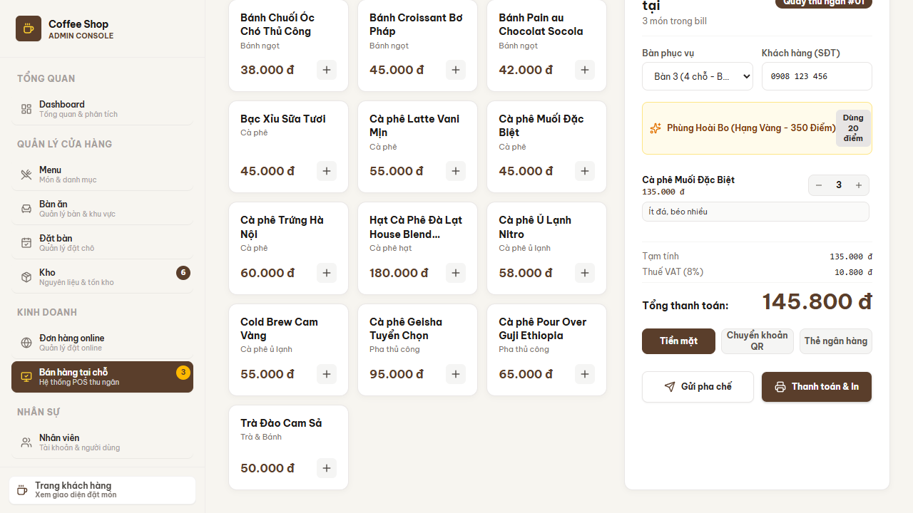

# BÁO CÁO KIỂM THỬ TÍCH HỢP ĐẦU-CUỐI (E2E TEST REPORT)
## DỰ ÁN: ĐÀ LẠT CAFE — Issue #15

---

## 1. Phạm vi & Môi trường

Kiểm thử chạy trên bản tích hợp gộp ba nhánh `feature/issue-13-junit5-suite`, `feature/issue-14-api-integration` và `feature/issue-15-e2e-report` lên `master` (merge không xung đột).

| Thành phần | Phiên bản / Cấu hình |
| :--- | :--- |
| Hệ điều hành | Windows 11 Pro |
| Backend | OpenJDK 17.0.20, Maven 3.9.16, `MainServer` cổng 8080, chế độ `IN_MEMORY` |
| Frontend | Node.js 24, Next.js 16.4.0 bản production (`next build` + `next start`), `JAVA_BACKEND_URL=http://localhost:8080` |
| Trình duyệt | Chrome điều khiển bằng Playwright CLI |

## 2. Kiểm thử tự động

| Bộ kiểm thử | Lệnh | Kết quả |
| :--- | :--- | :--- |
| JUnit 5 Backend (9 lớp test pattern + DAO, Model, Server) | `mvn clean test` | **166 / 166 PASS** |
| UI/UX & Admin Actions | `npm test` (25 kịch bản) | **25 / 25 PASS** (Java đang chạy) |
| TypeScript | `npx tsc --noEmit` | Không lỗi |
| Production build | `npm run build` | Thành công |
| Cú pháp sơ đồ Mermaid | `mermaid.parse` (Mermaid 11) cho 13 sơ đồ trong `DESIGN_PATTERNS_SPEC.md` và `ARCHITECTURE.md` | **13 / 13 hợp lệ** |
| API proxy `lib/api-client.ts` với Java thật | Kịch bản thủ công: menu, checkout, bàn, đặt bàn, backend tắt, `JAVA_BACKEND_URL=off` | **9 / 9 PASS** |

## 3. Kịch bản E2E

### Kịch bản 1 — Storefront: Duyệt menu ➔ Giỏ hàng ➔ Voucher ➔ Thanh toán

| Bước | Thao tác | Kết quả mong đợi | Kết quả thực tế |
| :---: | :--- | :--- | :--- |
| 1 | Mở `/`, thêm "Cà phê Latte Vani Mịn" vào giỏ | Giỏ có 1 món, 55.000 đ | Đạt |
| 2 | Nhập mã `WELCOME10`, bấm "Áp dụng" | Giảm 10% | Đạt: "Mã WELCOME10 đã được áp dụng (-10%)", tổng 49.500 đ |
| 3 | "Tiến hành đặt hàng" ➔ `/checkout` | Tạm tính 55.000, giảm 5.500, phí giao 15.000 | Đạt: tổng 64.500 đ |
| 4 | "Xác nhận đặt hàng" | Màn hình xác nhận kèm mã đơn | Đạt: "Đặt hàng thành công! Mã đơn hàng: #AC-663478" |

> Ghi chú: Luồng Storefront xử lý hoàn toàn trong Next.js (`/api/cart`, cart store), chưa gọi sang Java Backend.

### Kịch bản 2 — POS: Chọn bàn ➔ Lên món ➔ Thanh toán ➔ Sơ đồ bàn ➔ KDS

| Bước | Thao tác | Kết quả mong đợi | Kết quả thực tế |
| :---: | :--- | :--- | :--- |
| 1 | `/admin/pos`: chọn Bàn 3, 3 × "Cà phê Muối Đặc Biệt", Tiền mặt, "Thanh toán & In" | Đơn được chuyển tới `POST /api/checkout` | Đạt: Java cấp mã `AC-5E15-E64` |
| 2 | Kiểm tra Java sau checkout | Tồn kho giảm, Observer chạy | Đạt: tồn kho món #1 từ 85 còn 82; `TableStatusSyncObserver` chuyển bàn 3 sang `cleaning`; `KitchenNotificationObserver` in "Order AC-5E15-E64 completed; remove it from KDS" |
| 3 | Tổng tiền | Frontend và Java khớp nhau | Đạt: 135.000 + VAT 8% = 145.800 đ ở cả hai phía |
| 4 | `/admin/tables` | Bàn 3 đổi màu trạng thái | Đạt: Bàn 3 từ "Trống" sang "Có khách" |
| 5 | KDS `/admin/pos?tab=kitchen` | Phiếu hiển thị với mã đơn của Java | Đạt: thẻ `AC-5E15-E64 · Bàn 3 · 3× Cà phê Muối Đặc Biệt · Đã thanh toán 145.800 đ` |
| 6 | Dừng Java, thanh toán đơn mới cho Bàn 5 | Không crash, ghi vào kho cục bộ | Đạt: đơn `AC-0056-8CL` (mã kho cục bộ) xuất hiện trên KDS |
| 7 | Size L + Topping qua API: Latte + Size L + Cheese Foam + Trân châu, voucher `WELCOME10`, thẻ | Decorator + Strategy + Factory trong Facade | Đạt: subtotal 90.000, giảm 9.000, VAT 6.480, tổng **87.480 đ**, mã giao dịch `CARD-...` |

### Kịch bản 3 — Đặt bàn ➔ Chain of Responsibility ➔ Adapter

| Bước | Thao tác (`POST /api/reservations`) | Kết quả mong đợi | Kết quả thực tế |
| :---: | :--- | :--- | :--- |
| 1 | Bàn 9, 3 khách, 12:00 ngày mai, 2 món đặt trước | Qua cả ba mắt xích, lưu phiếu | Đạt: `201 { id: "RES-0010", status: "Chờ xác nhận" }` |
| 2 | Cùng bàn 9, cùng khung giờ | Mắt xích 3 `TableAvailabilityValidator` từ chối | Đạt: `400 CHAIN_VALIDATION_FAILED` "Bàn đã được đặt trong khung giờ này." |
| 3 | 03:00 sáng | Mắt xích 1 `OperatingHoursValidator` từ chối | Đạt: "Quán chỉ nhận đặt bàn trong giờ mở cửa (07:00 - 22:00)." |
| 4 | 6 khách ở bàn 4 chỗ | Mắt xích 2 `CapacityGuestValidator` từ chối | Đạt: "Số lượng khách vượt sức chứa của bàn (4 người)." |
| 5 | Khách đến: chuyển phiếu sang đơn POS | `ReservationToOrderAdapter.toPosOrder()` | Đạt ở mức đơn vị (`AdapterTest`: đơn `DINE_IN`, `PENDING`, `UNPAID`, sao chép món đặt trước). Chưa có endpoint hay nút giao diện gọi Adapter, xem mục 4 |

## 4. Phát hiện & Hạn chế còn tồn tại

1. **POS chưa có lựa chọn Size L / Topping.** Dòng đơn trên `pos-terminal.tsx` chỉ có món và số lượng, nên phần "Customize Size L + Topping" của kịch bản 2 chỉ kiểm được qua API (bước 7), chưa qua giao diện.
2. **Nút "Chuyển sang POS" ở `/admin/reservations` chỉ hiển thị thông báo và chuyển trang.** Nút này không nạp món đặt trước và không gọi Adapter. Backend Java cũng chưa có endpoint dùng `ReservationToOrderAdapter`.
3. **Trạng thái bàn sau thanh toán khác nhau giữa hai hệ thống.** Java coi checkout là đơn đã hoàn tất nên chuyển bàn sang `cleaning`. Frontend coi đơn mới gửi bếp nên bàn ở `occupied`. Sơ đồ bàn trên giao diện đọc theo kho của frontend.
4. **Form đặt bàn trên giao diện chưa gọi Server Action `createReservation`.** Action đã được kiểm qua API proxy; danh sách đặt bàn ở `/admin/reservations` vẫn dùng dữ liệu mẫu phía client.
5. **Hai kho menu đánh số độc lập.** Món được ghép theo tên. Món chỉ có ở frontend (ví dụ "Cà phê Ủ Lạnh Nitro"), hoặc tuỳ chọn có phụ thu, sẽ được lưu cục bộ thay vì gửi sang Java.

## 5. Kết luận

- Tất cả bộ kiểm thử tự động đều đạt: 166 JUnit 5, 25 UI/UX, 13 sơ đồ Mermaid.
- Ba kịch bản E2E đạt ở các bước được hệ thống hỗ trợ. Luồng POS ghi nhận đơn tại Java, kích hoạt đủ Facade, Decorator, Builder, Strategy, Factory và Observer. Khi Java dừng, giao diện vẫn hoạt động nhờ cơ chế fallback, không crash.
- Các hạn chế ở mục 4 là chức năng giao diện còn thiếu, không phải lỗi của 9 design pattern. Đề xuất xử lý ở các issue tiếp theo.
