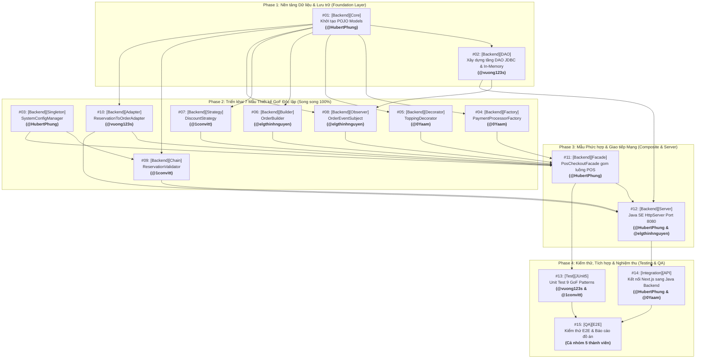

# KẾ HOẠCH PHÂN CHIA ISSUE & LỘ TRÌNH TRIỂN KHAI (ZERO-CONFLICT ISSUE ROADMAP)
## DỰ ÁN: ĐÀ LẠT CAFE — HỆ THỐNG QUẢN LÝ & VẬN HÀNH QUÁN CÀ PHÊ ĐA KÊNH

---

**Phiên bản:** 2.0.0  
**Ngày cập nhật:** 15/10/2026  
**Mục tiêu:** Phân rã toàn bộ khối lượng công việc thành 15 GitHub Issues chuẩn mực, gán cụ thể cho 5 thành viên theo đúng phân công GoF Design Patterns, tuân thủ quy chuẩn đặt tên rút gọn `[Scope][Pattern] Động từ + Tên Class - Nghiệp vụ`, và thiết lập thứ tự thực hiện (Dependencies) để **100% không bị xung đột mã nguồn (No Merge Conflicts)**.

---

## 1. Chiến lược Chống Xung đột Mã nguồn (Zero-Conflict Strategy)

Để 5 thành viên có thể lập trình song song độc lập mà không bao giờ bị đè code (merge conflict), dự án áp dụng **Sơ đồ Phụ thuộc 4 Giai đoạn (4 Phases)**:



### 3 Quy tắc Phân lập Mã nguồn Bắt buộc:
1. **Phân lập Gói (Package Isolation):** Mỗi thành viên chỉ làm việc trong package mẫu thiết kế riêng biệt của mình bên trong `backend-java/src/main/java/com/dalatcafe/patterns/<tên_pattern>/`.
2. **Quy tắc Khóa Model (Frozen Model Rule):** Các thực thể POJO (`Order`, `Table`, `MenuItem`, `Reservation`, `Customer`) do Nhóm trưởng tạo ở **Issue #01** và đóng băng. Các thành viên chỉ đọc thuộc tính qua Getter/Setter, không tự ý sửa đổi class Model chung.
3. **Quy tắc Nhánh Git (Feature Branching):** Mỗi issue tạo 1 branch riêng theo mẫu `feature/issue-<mã>-<tên-ngắn>` (Ví dụ: `feature/issue-05-decorator-topping`). Khi hoàn thành và test pass mới tạo Pull Request vào nhánh `develop`.

---

## 2. Bảng Phân bổ 15 Issue theo 5 Thành viên

| Thành viên | MSSV | GitHub | Issue phụ trách chính | Design Patterns & Nhiệm vụ cốt lõi |
| :--- | :---: | :--- | :--- | :--- |
| **Phùng Nguyễn Hoài Bo** (Lead) | `2312585` | `@HubertPhung` | **#01**, **#03**, **#11**, **#12**, **#14**, **#15** | Core POJO, **Singleton**, **Facade**, HttpServer, API Integration |
| **Nguyễn Ngọc Trường Dân** | `2312590` | `@0Yaam` | **#04**, **#05**, **#14**, **#15** | **Factory Method**, **Decorator**, API Integration |
| **Nguyễn Hưng Thịnh** | `2312756` | `@elgthinhnguyen` | **#06**, **#08**, **#12**, **#15** | **Builder**, **Observer**, HttpServer REST Handlers |
| **Vũ Thế Huỳnh** | `2312639` | `@1convitt` | **#07**, **#09**, **#13**, **#15** | **Strategy**, **Chain of Responsibility**, JUnit 5 Tests |
| **Phan Khánh Vương** | `2312802` | `@vuong123s` | **#02**, **#10**, **#13**, **#15** | Tầng DAO JDBC/In-Memory, **Adapter**, JUnit 5 Tests |

---

## 3. Nội dung Chi tiết 15 Issues Chuẩn hóa

### GIAI ĐOẠN 1: NỀN TẢNG DỮ LIỆU & LƯU TRỮ (FOUNDATION LAYER)

#### Issue #01: [Backend][Core] Khởi tạo cấu trúc dự án Java SE và các lớp thực thể POJO
- **Người thực hiện:** Phùng Nguyễn Hoài Bo (`@HubertPhung` - MSSV: `2312585`)
- **Nhãn:** `scope:backend`, `type:feature`, `priority:p0-blocker`
- **Nội dung:**
```markdown
### 1. Bối cảnh & Mục tiêu (Context & Objective)
Khởi tạo cấu trúc dự án Java SE thuần túy và định nghĩa các lớp thực thể POJO (Plain Old Java Objects) làm nền tảng dữ liệu cho toàn bộ 9 Design Patterns.
- **Mã tính năng:** `FEAT-AUTH-01`, `FEAT-POS-01`
- **Người thực hiện:** @HubertPhung (Phùng Nguyễn Hoài Bo - MSSV: 2312585)
- **Thư mục:** `backend-java/src/main/java/com/dalatcafe/model/`

### 2. Ràng buộc Kỹ thuật (Technical Constraints)
- [ ] Sử dụng Java SE 17+ thuần túy (Pure Java OOP). Tuyệt đối KHÔNG dùng Spring Boot, Hibernate hay bất kỳ framework nào.
- [ ] Tuân thủ quy chuẩn `.agents/rules/backend-java-constraints.md`.
- [ ] Quy tắc Khóa Model: Đóng băng cấu trúc class sau khi tạo để các thành viên khác không bị conflict.

### 3. Thiết kế Mẫu liên quan (Design Pattern Role)
- **Mô hình Dữ liệu POJO:**
  - `Order`: Chứa thông tin đơn hàng, danh sách món, bàn, khách hàng, tổng tiền, thuế, trạng thái.
  - `Table`: Quản lý số bàn, khu vực (Main Floor, Patio, Bar), trạng thái, số khách.
  - `MenuItem`: Quản lý tên món, phân loại, giá bán, giá vốn, tồn kho, công thức pha chế.
  - `Reservation`: Quản lý thông tin đặt bàn, giờ hẹn, số khách, ghi chú, món gọi trước.
  - `Customer`: Quản lý tên khách hàng, số điện thoại, điểm thưởng loyalty, hạng thành viên.

### 4. Phạm vi Công việc (Tasks Checklist)
- [ ] Tạo cấu trúc package: `com.dalatcafe.model`, `com.dalatcafe.patterns`, `com.dalatcafe.dao`, `com.dalatcafe.server`
- [ ] Tạo các file POJO Entity: `Order.java`, `Table.java`, `MenuItem.java`, `Reservation.java`, `Customer.java`
- [ ] Tạo các Enum định danh trạng thái:
  - `OrderStatus.java` (PENDING, BREWING, READY, COMPLETED)
  - `TableStatus.java` (AVAILABLE, OCCUPIED, RESERVED, CLEANING)
  - `PaymentMethod.java` (CASH, QR, CARD)
  - `OrderType.java` (DINE_IN, PICKUP, DELIVERY)

### 5. Tiêu chuẩn Nghiệm thu (Definition of Done)
- [ ] Mã nguồn biên dịch không có lỗi cú pháp qua `mvn compile`.
- [ ] Các POJO có đầy đủ Constructor, Getter/Setter, `toString()`.
- [ ] Mở khóa tiến độ cho các Issue từ #02 đến #10.

### 6. Phụ thuộc (Dependencies)
- **Blocked by:** Không (Mở đầu tiên)
- **Blocks:** #02, #04, #05, #06, #07, #08, #09, #10
```

---

#### Issue #02: [Backend][DAO] Xây dựng tầng DAO kết nối JDBC Supabase và In-Memory Store
- **Người thực hiện:** Phan Khánh Vương (`@vuong123s` - MSSV: `2312802`)
- **Nhãn:** `scope:backend`, `type:feature`, `priority:p1-high`
- **Nội dung:**
```markdown
### 1. Bối cảnh & Mục tiêu (Context & Objective)
Xây dựng tầng Data Access Object (DAO) độc lập kết nối cơ sở dữ liệu quan hệ PostgreSQL trên Supabase và cung cấp In-Memory Database làm fallback dự phòng khi chạy offline hoặc chạy test.
- **Mã tính năng:** `FEAT-TBL-01`, `FEAT-INV-01`
- **Người thực hiện:** @vuong123s (Phan Khánh Vương - MSSV: 2312802)
- **Package:** `com.dalatcafe.dao`

### 2. Ràng buộc Kỹ thuật (Technical Constraints)
- [ ] Sử dụng `java.sql.*` thuần túy (JDBC tiêu chuẩn), KHÔNG dùng Hibernate/JPA.
- [ ] Hỗ trợ kết nối PostgreSQL Supabase với chế độ SSL (`sslmode=require`).
- [ ] Cung cấp In-Memory Store sử dụng `ConcurrentHashMap` thread-safe.

### 3. Thiết kế Mẫu liên quan (Design Pattern Role)
- **DAO Pattern:** Tách rời hoàn toàn nghiệp vụ với nguồn dữ liệu vật lý.
  - Interfaces: `IOrderDao`, `ITableDao`, `IMenuDao`, `IReservationDao`
  - Implementations: `InMemoryOrderDao`, `JdbcOrderDao`, `DatabaseFactory`

### 4. Phạm vi Công việc (Tasks Checklist)
- [ ] Định nghĩa các Interfaces:
  - `IOrderDao.java` (`save`, `findById`, `findByCode`, `findAll`, `updateStatus`)
  - `ITableDao.java` (`findAll`, `findById`, `updateStatus`)
  - `IMenuDao.java` (`findAll`, `findById`, `save`, `updateStock`)
  - `IReservationDao.java` (`findAll`, `findById`, `save`, `updateStatus`)
- [ ] Cài đặt `InMemoryDatabase.java` lưu trữ dữ liệu trong RAM bằng `ConcurrentHashMap`.
- [ ] Cài đặt `JdbcDatabase.java` kết nối JDBC đọc `DATABASE_URL` từ biến môi trường.

### 5. Tiêu chuẩn Nghiệm thu (Definition of Done)
- [ ] Thực hiện CRUD thành công với cả 2 chế độ InMemory và JDBC.
- [ ] Dữ liệu khớp 100% với cấu trúc bảng trong `docs/DATABASE.md`.
- [ ] Độc lập, không làm sập server khi chưa có kết nối Internet.

### 6. Phụ thuộc (Dependencies)
- **Blocked by:** #01 (POJO Models)
- **Blocks:** #08 (Observer), #11 (Facade), #12 (HttpServer)
```

---

### GIAI ĐOẠN 2: TRIỂN KHAI 7 MẪU THIẾT KẾ GOF ĐỘC LẬP (INDEPENDENT PATTERNS)

#### Issue #03: [Backend][Singleton] Cài đặt SystemConfigManager quản lý thông số toàn cục
- **Người thực hiện:** Phùng Nguyễn Hoài Bo (`@HubertPhung` - MSSV: `2312585`)
- **Nhãn:** `scope:backend`, `type:pattern`, `priority:p1-high`
- **Nội dung:**
```markdown
### 1. Bối cảnh & Mục tiêu (Context & Objective)
Cài đặt mẫu Singleton quản lý các tham số vận hành quán (giờ mở/đóng cửa, tỷ lệ tích điểm thưởng, thời gian tự hủy bàn).
- **Mã tính năng:** `FEAT-AUTH-03`, `FEAT-RES-03`
- **Người thực hiện:** @HubertPhung (Phùng Nguyễn Hoài Bo - MSSV: 2312585)
- **Package:** `com.dalatcafe.patterns.singleton`

### 2. Ràng buộc Kỹ thuật (Technical Constraints)
- [ ] Java SE 17+ thuần túy.
- [ ] Triển khai cơ chế Double-Checked Locking với từ khóa `volatile` đảm bảo Thread-safe tuyệt đối trong môi trường đa luồng.
- [ ] Khởi tạo Constructor private ngăn chặn tạo đối tượng từ bên ngoài bằng toán tử `new`.

### 3. Thiết kế Mẫu liên quan (Design Pattern Role)
- **Mẫu thiết kế:** Singleton Pattern (GoF Creational)
- **Class:** `SystemConfigManager`
  - `private static volatile SystemConfigManager instance;`
  - `private SystemConfigManager()`
  - `public static SystemConfigManager getInstance()`

### 4. Phạm vi Công việc (Tasks Checklist)
- [ ] Tạo file `SystemConfigManager.java` trong package `com.dalatcafe.patterns.singleton`.
- [ ] Khởi tạo các tham số mặc định:
  - Tên quán: "Đà Lạt Cafe"
  - Giờ mở cửa: `07:00`, Giờ đóng cửa: `22:00`
  - Tỷ lệ tích điểm: 10.000 VNĐ = 1 điểm loyalty
  - Thời gian giữ bàn tối đa: 30 phút
- [ ] Cài đặt các phương thức tiện ích: `isWithinOperatingHours(LocalTime time)`, `calculateLoyaltyPoints(double amount)`, `calculateDiscountFromPoints(int points)`.

### 5. Tiêu chuẩn Nghiệm thu (Definition of Done)
- [ ] `getInstance()` luôn trả về 1 đối tượng duy nhất trên nhiều luồng chạy đồng thời.
- [ ] Phương thức `isWithinOperatingHours` trả về `false` với thời gian trước 07:00 hoặc sau 22:00.

### 6. Phụ thuộc (Dependencies)
- **Blocked by:** Không
- **Blocks:** #09 (Chain of Responsibility), #11 (PosCheckoutFacade)
```

---

#### Issue #04: [Backend][Factory] Cài đặt PaymentProcessorFactory xử lý thanh toán đa kênh
- **Người thực hiện:** Nguyễn Ngọc Trường Dân (`@0Yaam` - MSSV: `2312590`)
- **Nhãn:** `scope:backend`, `type:pattern`, `priority:p1-high`
- **Nội dung:**
```markdown
### 1. Bối cảnh & Mục tiêu (Context & Objective)
Hiện thực hóa Factory Method Pattern để khởi tạo linh hoạt các bộ xử lý thanh toán (Tiền mặt, Chuyển khoản QR, Quẹt thẻ POS).
- **Mã tính năng:** `FEAT-POS-05`
- **Người thực hiện:** @0Yaam (Nguyễn Ngọc Trường Dân - MSSV: 2312590)
- **Package:** `com.dalatcafe.patterns.factory`

### 2. Ràng buộc Kỹ thuật (Technical Constraints)
- [ ] Java SE 17 thuần túy, áp dụng đúng nguyên lý Open/Closed (OCP) - dễ dàng mở rộng kênh thanh toán mới mà không sửa đổi code cũ.

### 3. Thiết kế Mẫu liên quan (Design Pattern Role)
- **Mẫu thiết kế:** Factory Method Pattern (GoF Creational)
- **Thành phần:**
  - Interface Sản phẩm: `IPaymentProcessor`
  - Concrete Products: `CashPaymentProcessor`, `MomoQrPaymentProcessor`, `CardPosPaymentProcessor`
  - Factory: `PaymentProcessorFactory`

### 4. Phạm vi Công việc (Tasks Checklist)
- [ ] Tạo Interface `IPaymentProcessor.java`:
  - `PaymentResult processPayment(double amount, String transactionRef);`
  - `String getMethodName();`
- [ ] Cài đặt 3 lớp xử lý cụ thể:
  - `CashPaymentProcessor.java`: Tính tiền thừa trả lại khách.
  - `MomoQrPaymentProcessor.java`: Sinh mã QR động chuẩn hóa.
  - `CardPosPaymentProcessor.java`: Xác thực quẹt thẻ POS ngân hàng.
- [ ] Cài đặt `PaymentProcessorFactory.java` với phương thức `createProcessor(PaymentMethod method)`.

### 5. Tiêu chuẩn Nghiệm thu (Definition of Done)
- [ ] Khởi tạo chính xác bộ xử lý tương ứng khi truyền vào `PaymentMethod.CASH`, `QR`, `CARD`.
- [ ] Ném `IllegalArgumentException` kèm thông báo rõ ràng khi truyền phương thức thanh toán không hợp lệ.

### 6. Phụ thuộc (Dependencies)
- **Blocked by:** #01 (POJO Models)
- **Blocks:** #11 (PosCheckoutFacade)
```

---

#### Issue #05: [Backend][Decorator] Cài đặt ToppingDecorator tùy biến đồ uống và nâng Size L
- **Người thực hiện:** Nguyễn Ngọc Trường Dân (`@0Yaam` - MSSV: `2312590`)
- **Nhãn:** `scope:backend`, `type:pattern`, `priority:p1-high`
- **Nội dung:**
```markdown
### 1. Bối cảnh & Mục tiêu (Context & Objective)
Hiện thực hóa Decorator Pattern cho phép bọc thêm các tùy biến đồ uống (Trân châu trắng, Kem cheese, Nâng Size L) vào món gốc trong lúc chạy (runtime) mà không sửa đổi class cơ sở.
- **Mã tính năng:** `FEAT-SF-03`, `FEAT-POS-01`
- **Người thực hiện:** @0Yaam (Nguyễn Ngọc Trường Dân - MSSV: 2312590)
- **Package:** `com.dalatcafe.patterns.decorator`

### 2. Ràng buộc Kỹ thuật (Technical Constraints)
- [ ] Sử dụng cấu trúc Wrapper object lồng nhau chuẩn GoF.
- [ ] Không giới hạn số lượng topping gắn vào đồ uống (cho phép cộng dồn linh hoạt).

### 3. Thiết kế Mẫu liên quan (Design Pattern Role)
- **Mẫu thiết kế:** Decorator Pattern (GoF Structural)
- **Thành phần:**
  - Component: `IBeverage`
  - Concrete Component: `BaseCoffee`
  - Decorator cơ sở: `BeverageDecorator`
  - Concrete Decorators: `PearlToppingDecorator`, `CheeseFoamDecorator`, `LargeSizeDecorator`

### 4. Phạm vi Công việc (Tasks Checklist)
- [ ] Tạo Interface `IBeverage.java`:
  - `String getDescription();`
  - `double getCost();`
- [ ] Tạo `BaseCoffee.java implements IBeverage`: Bọc 1 `MenuItem` gốc.
- [ ] Tạo abstract class `BeverageDecorator.java implements IBeverage`:
  - Chứa thuộc tính `protected IBeverage beverage;`
- [ ] Tạo các Concrete Decorators:
  - `PearlToppingDecorator.java` (+10.000đ, mô tả thêm "+ Trân châu trắng")
  - `CheeseFoamDecorator.java` (+15.000đ, mô tả thêm "+ Kem cheese mặn")
  - `LargeSizeDecorator.java` (+10.000đ, mô tả thêm "+ Size L")

### 5. Tiêu chuẩn Nghiệm thu (Definition of Done)
- [ ] Đồ uống bọc nhiều decorator tính đúng tổng chi phí cộng dồn.
- [ ] `getDescription()` trả về chuỗi đầy đủ: ví dụ `"Cà phê Muối (Size L) + Kem cheese mặn + Trân châu trắng"`.

### 6. Phụ thuộc (Dependencies)
- **Blocked by:** #01 (POJO Models)
- **Blocks:** #11 (PosCheckoutFacade)
```

---

#### Issue #06: [Backend][Builder] Cài đặt OrderBuilder xây dựng thực thể hóa đơn Order linh hoạt
- **Người thực hiện:** Nguyễn Hưng Thịnh (`@elgthinhnguyen` - MSSV: `2312756`)
- **Nhãn:** `scope:backend`, `type:pattern`, `priority:p1-high`
- **Nội dung:**
```markdown
### 1. Bối cảnh & Mục tiêu (Context & Objective)
Áp dụng Builder Pattern để xây dựng đối tượng đơn hàng (`Order`) phức tạp với nhiều trường tùy chọn (khách hàng, bàn, danh sách món, ghi chú barista, voucher, điểm tích lũy).
- **Mã tính năng:** `FEAT-POS-01`, `FEAT-POS-02`
- **Người thực hiện:** @elgthinhnguyen (Nguyễn Hưng Thịnh - MSSV: 2312756)
- **Package:** `com.dalatcafe.patterns.builder`

### 2. Ràng buộc Kỹ thuật (Technical Constraints)
- [ ] Hỗ trợ Fluent Interface (Method Chaining: `.forCustomer(...).atTable(...).build()`).
- [ ] Đảm bảo tính bất biến (Immutability) của đối tượng `Order` sau khi được gọi `build()`.

### 3. Thiết kế Mẫu liên quan (Design Pattern Role)
- **Mẫu thiết kế:** Builder Pattern (GoF Creational)
- **Class:** `OrderBuilder`
  - Target Object: `Order`

### 4. Phạm vi Công việc (Tasks Checklist)
- [ ] Tạo file `OrderBuilder.java` trong package `com.dalatcafe.patterns.builder`.
- [ ] Cài đặt các phương thức chaining:
  - `OrderBuilder forCustomer(String customerName)`
  - `OrderBuilder atTable(int tableId)`
  - `OrderBuilder ofType(OrderType type)`
  - `OrderBuilder addItem(IBeverage beverage, int quantity)`
  - `OrderBuilder withNote(String note)`
  - `OrderBuilder withPayment(PaymentMethod method, boolean paid)`
  - `OrderBuilder applyDiscount(double discountAmount)`
- [ ] Cài đặt phương thức `Order build()`:
  - Tự động sinh mã đơn duy nhất (ví dụ: `AC-XXXX-XXX`).
  - Tự động tính subtotal, VAT (8%) và total tiền thanh toán.
  - Kiểm tra tính hợp lệ (báo lỗi nếu giỏ hàng rỗng).

### 5. Tiêu chuẩn Nghiệm thu (Definition of Done)
- [ ] Khởi tạo thành công đơn hàng qua chuỗi hàm chaining mượt mà.
- [ ] Đơn hàng tự động tính toán tổng tiền khớp 100% công thức nghiệp vụ.
- [ ] Ném ngoại lệ `IllegalStateException` khi gọi `build()` với đơn hàng 0 món.

### 6. Phụ thuộc (Dependencies)
- **Blocked by:** #01 (POJO Models)
- **Blocks:** #11 (PosCheckoutFacade)
```

---

#### Issue #07: [Backend][Strategy] Cài đặt DiscountStrategy đa thuật toán chiết khấu voucher
- **Người thực hiện:** Vũ Thế Huỳnh (`@1convitt` - MSSV: `2312639`)
- **Nhãn:** `scope:backend`, `type:pattern`, `priority:p1-high`
- **Nội dung:**
```markdown
### 1. Bối cảnh & Mục tiêu (Context & Objective)
Hiện thực hóa Strategy Pattern để hoán đổi linh hoạt các thuật toán tính giảm giá khuyến mãi (giảm theo %, giảm số tiền cố định, chiết khấu theo thứ hạng hội viên CRM).
- **Mã tính năng:** `FEAT-POS-04`, `FEAT-CRM-01`
- **Người thực hiện:** @1convitt (Vũ Thế Huỳnh - MSSV: 2312639)
- **Package:** `com.dalatcafe.patterns.strategy`

### 2. Ràng buộc Kỹ thuật (Technical Constraints)
- [ ] Java SE 17 thuần túy, loại bỏ hoàn toàn các khối lệnh `if-else` lồng nhau phức tạp khi tính khuyến mãi.
- [ ] Đảm bảo số tiền giảm giá không bao giờ vượt quá tổng giá trị đơn hàng.

### 3. Thiết kế Mẫu liên quan (Design Pattern Role)
- **Mẫu thiết kế:** Strategy Pattern (GoF Behavioral)
- **Thành phần:**
  - Interface Chiến lược: `IDiscountStrategy`
  - Concrete Strategies: `PercentageDiscountStrategy`, `FixedAmountDiscountStrategy`, `LoyaltyTierDiscountStrategy`, `NoDiscountStrategy`
  - Context: `DiscountContext`

### 4. Phạm vi Công việc (Tasks Checklist)
- [ ] Tạo Interface `IDiscountStrategy.java`:
  - `double calculateDiscount(double subtotal, Customer customer);`
  - `String getDiscountDescription();`
- [ ] Cài đặt 4 Concrete Strategies:
  - `PercentageDiscountStrategy.java`: Giảm X% (có ngưỡng giảm tối đa `maxCap`).
  - `FixedAmountDiscountStrategy.java`: Trừ trực tiếp số tiền cố định (ví dụ voucher 30.000đ).
  - `LoyaltyTierDiscountStrategy.java`: Giảm theo hạng thành viên (Bronze: 0%, Silver: 5%, Gold: 10%, VIP: 15%).
  - `NoDiscountStrategy.java`: Không áp dụng giảm giá (trả về 0).
- [ ] Cài đặt `DiscountContext.java` giữ tham chiếu chiến lược hiện tại.

### 5. Tiêu chuẩn Nghiệm thu (Definition of Done)
- [ ] Hoán đổi chiến lược trong lúc chạy thành công mà không cần khởi tạo lại đối tượng hóa đơn.
- [ ] Số tiền thanh toán cuối cùng không bao giờ âm (kết quả >= 0).

### 6. Phụ thuộc (Dependencies)
- **Blocked by:** #01 (POJO Models)
- **Blocks:** #11 (PosCheckoutFacade)
```

---

#### Issue #08: [Backend][Observer] Cài đặt OrderEventSubject phát sự kiện tích điểm và cập nhật bàn
- **Người thực hiện:** Nguyễn Hưng Thịnh (`@elgthinhnguyen` - MSSV: `2312756`)
- **Nhãn:** `scope:backend`, `type:pattern`, `priority:p1-high`
- **Nội dung:**
```markdown
### 1. Bối cảnh & Mục tiêu (Context & Objective)
Hiện thực hóa Observer Pattern để tạo cơ chế phát và lắng nghe sự kiện: khi đơn hàng POS hoàn thành, hệ thống tự động tích điểm loyalty cho khách và cập nhật trạng thái bàn sang trống.
- **Mã tính năng:** `FEAT-POS-03`, `FEAT-TBL-02`, `FEAT-CRM-01`
- **Người thực hiện:** @elgthinhnguyen (Nguyễn Hưng Thịnh - MSSV: 2312756)
- **Package:** `com.dalatcafe.patterns.observer`

### 2. Ràng buộc Kỹ thuật (Technical Constraints)
- [ ] Khớp nguyên lý Loose Coupling: Subject không phụ thuộc vào triển khai cụ thể của từng Observer.
- [ ] Xử lý an toàn ngoại lệ để lỗi của một Observer không làm gián đoạn luồng chốt đơn chính.

### 3. Thiết kế Mẫu liên quan (Design Pattern Role)
- **Mẫu thiết kế:** Observer Pattern (GoF Behavioral)
- **Thành phần:**
  - Subject: `OrderEventSubject`
  - Observer Interface: `IOrderObserver`
  - Concrete Observers: `LoyaltyPointObserver`, `TableStatusSyncObserver`, `KitchenNotificationObserver`

### 4. Phạm vi Công việc (Tasks Checklist)
- [ ] Tạo Interface `IOrderObserver.java`:
  - `void onOrderCompleted(Order order);`
- [ ] Tạo lớp Subject `OrderEventSubject.java`:
  - Quản lý danh sách `List<IOrderObserver> observers;`
  - `void attach(IOrderObserver observer)`
  - `void detach(IOrderObserver observer)`
  - `void notifyOrderCompleted(Order order)`
- [ ] Cài đặt các Concrete Observers:
  - `LoyaltyPointObserver.java`: Tính điểm theo tỷ lệ và cộng vào tài khoản khách hàng.
  - `TableStatusSyncObserver.java`: Đổi trạng thái bàn thành `CLEANING` hoặc `AVAILABLE`.
  - `KitchenNotificationObserver.java`: Gửi tín hiệu đẩy đơn sang quầy pha chế KDS.

### 5. Tiêu chuẩn Nghiệm thu (Definition of Done)
- [ ] Khi gọi `notifyOrderCompleted()`, tất cả các Observer đã đăng ký đều nhận được sự kiện và thực thi nghiệp vụ tương ứng.
- [ ] Khách hàng được cộng đúng số điểm loyalty sau khi hóa đơn được thanh toán.

### 6. Phụ thuộc (Dependencies)
- **Blocked by:** #01 (POJO Models), #02 (DAO Layer)
- **Blocks:** #11 (PosCheckoutFacade)
```

---

#### Issue #09: [Backend][Chain] Cài đặt ReservationValidator chuỗi kiểm định đặt bàn 3 bước
- **Người thực hiện:** Vũ Thế Huỳnh (`@1convitt` - MSSV: `2312639`)
- **Nhãn:** `scope:backend`, `type:pattern`, `priority:p1-high`
- **Nội dung:**
```markdown
### 1. Bối cảnh & Mục tiêu (Context & Objective)
Áp dụng Chain of Responsibility Pattern để xây dựng chuỗi kiểm định thông tin đặt bàn trước gồm 3 mắt xích độc lập: Kiểm tra giờ mở cửa, Kiểm tra số lượng khách, Kiểm tra bàn trống.
- **Mã tính năng:** `FEAT-RES-01`, `FEAT-RES-02`
- **Người thực hiện:** @1convitt (Vũ Thế Huỳnh - MSSV: 2312639)
- **Package:** `com.dalatcafe.patterns.chain`

### 2. Ràng buộc Kỹ thuật (Technical Constraints)
- [ ] Xử lý ngắt chuỗi ngay lập tức (Fail-Fast) khi gặp mắt xích không đạt yêu cầu.
- [ ] Tích hợp sử dụng `SystemConfigManager` từ mẫu Singleton để lấy khung giờ hoạt động chuẩn.

### 3. Thiết kế Mẫu liên quan (Design Pattern Role)
- **Mẫu thiết kế:** Chain of Responsibility Pattern (GoF Behavioral)
- **Thành phần:**
  - Handler trừu tượng: `ReservationValidatorHandler`
  - Concrete Handlers: `OperatingHoursValidator`, `CapacityGuestValidator`, `TableAvailabilityValidator`

### 4. Phạm vi Công việc (Tasks Checklist)
- [ ] Tạo abstract class `ReservationValidatorHandler.java`:
  - `protected ReservationValidatorHandler nextHandler;`
  - `public void setNext(ReservationValidatorHandler next)`
  - `public abstract ValidationResult validate(Reservation reservation);`
- [ ] Cài đặt 3 mắt xích kiểm tra:
  - `OperatingHoursValidator.java`: Kiểm tra giờ hẹn có nằm trong khung `07:00 - 22:00` hay không.
  - `CapacityGuestValidator.java`: Kiểm tra số khách không vượt quá sức chứa của bàn (1 - 20 khách).
  - `TableAvailabilityValidator.java`: Kiểm tra bàn chưa bị ai đặt trước trong cùng khung giờ.

### 5. Tiêu chuẩn Nghiệm thu (Definition of Done)
- [ ] Phiếu đặt bàn vi phạm bất kỳ tiêu chí nào sẽ bị từ chối ngay kèm thông báo lỗi cụ thể.
- [ ] Phiếu đặt bàn thỏa mãn cả 3 tiêu chí sẽ trả về `ValidationResult.valid()`.

### 6. Phụ thuộc (Dependencies)
- **Blocked by:** #01 (POJO Models), #03 (Singleton)
- **Blocks:** #10 (Adapter), #12 (HttpServer)
```

---

#### Issue #10: [Backend][Adapter] Cài đặt ReservationToOrderAdapter ánh xạ phiếu đặt bàn sang POS
- **Người thực hiện:** Phan Khánh Vương (`@vuong123s` - MSSV: `2312802`)
- **Nhãn:** `scope:backend`, `type:pattern`, `priority:p1-high`
- **Nội dung:**
```markdown
### 1. Bối cảnh & Mục tiêu (Context & Objective)
Áp dụng Adapter Pattern để chuyển đổi một phiếu Đặt bàn trước (`Reservation`) kèm danh sách món gọi trước (`preOrders`) thành một đơn hàng POS (`Order`) hoàn chỉnh khi khách đến nhận bàn tại quán.
- **Mã tính năng:** `FEAT-RES-03`
- **Người thực hiện:** @vuong123s (Phan Khánh Vương - MSSV: 2312802)
- **Package:** `com.dalatcafe.patterns.adapter`

### 2. Ràng buộc Kỹ thuật (Technical Constraints)
- [ ] Áp dụng Object Adapter Pattern: Giữ tham chiếu tới đối tượng `Adaptee` (`Reservation`).
- [ ] Không làm thay đổi cấu trúc của lớp `Reservation` hoặc lớp `Order`.

### 3. Thiết kế Mẫu liên quan (Design Pattern Role)
- **Mẫu thiết kế:** Adapter Pattern (GoF Structural)
- **Thành phần:**
  - Target Interface: `IPosOrderTarget`
  - Adaptee: `Reservation`
  - Adapter: `ReservationToOrderAdapter`

### 4. Phạm vi Công việc (Tasks Checklist)
- [ ] Tạo Interface `IPosOrderTarget.java`:
  - `Order toPosOrder();`
  - `int getAssignedTableId();`
  - `String getCustomerIdentifier();`
- [ ] Tạo lớp `ReservationToOrderAdapter.java implements IPosOrderTarget`:
  - Chứa thuộc tính `private final Reservation reservation;`
  - Ánh xạ mã đặt bàn sang mã đơn POS.
  - Chuyển danh sách `preOrders` thành các dòng món `OrderLine`.
  - Thiết lập trạng thái đơn ban đầu là `PENDING`.

### 5. Tiêu chuẩn Nghiệm thu (Definition of Done)
- [ ] Chuyển đổi thành công đối tượng `Reservation` sang `Order` mà không làm mất thông tin món hay bàn.
- [ ] Màn hình POS tiếp nhận trực tiếp đơn hàng chuyển đổi để tiến hành thanh toán bình thường.

### 6. Phụ thuộc (Dependencies)
- **Blocked by:** #01 (POJO Models), #09 (Chain of Responsibility)
- **Blocks:** #11 (PosCheckoutFacade), #12 (HttpServer)
```

---

### GIAI ĐOẠN 3: MẪU PHỨC HỢP & GIAO TIẾP MẠNG (COMPOSITE & SERVER)

#### Issue #11: [Backend][Facade] Cài đặt PosCheckoutFacade gom toàn bộ quy trình thanh toán POS
- **Người thực hiện:** Phùng Nguyễn Hoài Bo (`@HubertPhung` - MSSV: `2312585`)
- **Nhãn:** `scope:backend`, `type:pattern`, `priority:p0-blocker`
- **Nội dung:**
```markdown
### 1. Bối cảnh & Mục tiêu (Context & Objective)
Hiện thực hóa Facade Pattern đóng vai trò giao diện trung tâm duy nhất, tổng hợp và điều phối hoạt động của toàn bộ 6 mẫu thiết kế khác (Builder, Decorator, Strategy, Factory, Observer, DAO) để xử lý trọn vẹn luồng thanh toán tại quầy POS.
- **Mã tính năng:** `FEAT-POS-01`, `FEAT-POS-04`, `FEAT-POS-05`
- **Người thực hiện:** @HubertPhung (Phùng Nguyễn Hoài Bo - MSSV: 2312585)
- **Package:** `com.dalatcafe.patterns.facade`

### 2. Ràng buộc Kỹ thuật (Technical Constraints)
- [ ] Cung cấp phương thức đơn giản hóa cho phía Controller/Server mà không làm lộ sự phức tạp của các hệ thống con bên dưới.
- [ ] Xử lý Transaction nghiệp vụ an toàn: Lưu đơn hàng, trừ kho, tính tiền, phát sự kiện đồng bộ.

### 3. Thiết kế Mẫu liên quan (Design Pattern Role)
- **Mẫu thiết kế:** Facade Pattern (GoF Structural)
- **Class:** `PosCheckoutFacade`
  - Tích hợp Subsystems:
    - `OrderBuilder` (Khởi tạo đơn hàng)
    - `BeverageDecorator` (Tính tiền tùy biến món)
    - `DiscountStrategy` (Áp dụng voucher chiết khấu)
    - `PaymentProcessorFactory` (Thanh toán đa kênh)
    - `OrderEventSubject` (Tích điểm & cập nhật bàn)
    - `IOrderDao` (Lưu trữ CSDL)

### 4. Phạm vi Công việc (Tasks Checklist)
- [ ] Tạo file `PosCheckoutFacade.java` trong package `com.dalatcafe.patterns.facade`.
- [ ] Cài đặt phương thức chính:
  - `CheckoutResult checkout(CheckoutRequest request)`
- [ ] Hiện thực hóa quy trình 6 bước bên trong Facade:
  1. Tạo đơn hàng qua `OrderBuilder`.
  2. Tính giá các món tùy biến qua `BeverageDecorator`.
  3. Tính chiết khấu giảm giá qua `DiscountContext`.
  4. Thực hiện thanh toán qua `PaymentProcessorFactory`.
  5. Lưu hóa đơn vào cơ sở dữ liệu qua `IOrderDao`.
  6. Phát sự kiện hoàn tất đơn qua `OrderEventSubject`.

### 5. Tiêu chuẩn Nghiệm thu (Definition of Done)
- [ ] Phía Controller/Server chỉ cần gọi 1 hàm duy nhất `checkout()` để hoàn tất đơn hàng.
- [ ] Xử lý toàn vẹn luồng thanh toán POS mà không xảy ra sai lệch số tiền hay trạng thái.

### 6. Phụ thuộc (Dependencies)
- **Blocked by:** #03, #04, #05, #06, #07, #08, #10
- **Blocks:** #12 (HttpServer), #13 (JUnit 5 Tests)
```

---

#### Issue #12: [Backend][Server] Cài đặt Java SE HttpServer cổng 8080 và các REST HttpHandler
- **Người thực hiện:** Phùng Nguyễn Hoài Bo (`@HubertPhung`) & Nguyễn Hưng Thịnh (`@elgthinhnguyen`)
- **Nhãn:** `scope:backend`, `type:feature`, `priority:p1-high`
- **Nội dung:**
```markdown
### 1. Bối cảnh & Mục tiêu (Context & Objective)
Xây dựng máy chủ HTTP nhúng bằng thư viện thuần `com.sun.net.httpserver.HttpServer` trên cổng 8080, tiếp nhận và điều hướng các request REST JSON từ Frontend Next.js sang tầng xử lý nghiệp vụ Java.
- **Mã tính năng:** Toàn bộ API Backend
- **Người thực hiện:** @HubertPhung & @elgthinhnguyen
- **Package:** `com.dalatcafe.server`

### 2. Ràng buộc Kỹ thuật (Technical Constraints)
- [ ] Sử dụng `com.sun.net.httpserver.HttpServer` của Java SE tiêu chuẩn, KHÔNG dùng Spring Boot, Tomcat nhúng hay Netty.
- [ ] Thiết lập đầy đủ Header CORS (`Access-Control-Allow-Origin: *`, `Methods`, `Headers`).
- [ ] MIME Type trả về luôn là `application/json; charset=UTF-8`.

### 3. Thiết kế Mẫu liên quan (Design Pattern Role)
- **HTTP Dispatcher & Handlers:**
  - `MainServer.java`: Khởi động máy chủ cổng 8080.
  - `CorsHandler.java`: Bọc xử lý CORS preflight.
  - Các HttpHandler điều hướng: `MenuHandler`, `TableHandler`, `ReservationHandler`, `CheckoutHandler`.

### 4. Phạm vi Công việc (Tasks Checklist)
- [ ] Tạo file `MainServer.java` cấu hình mở cổng 8080.
- [ ] Cài đặt các HttpHandler:
  - `GET /api/menu`: Trả về danh mục đồ uống từ `IMenuDao`.
  - `GET /api/tables`, `PUT /api/tables/{id}`: Lấy và cập nhật trạng thái bàn qua `ITableDao`.
  - `POST /api/reservations`: Tiếp nhận đặt bàn và kiểm định qua `ReservationValidator`.
  - `POST /api/checkout`: Tiếp nhận thanh toán POS và chuyển giao cho `PosCheckoutFacade`.
- [ ] Xử lý phân tích chuỗi JSON request và sinh JSON response thuần Java.

### 5. Tiêu chuẩn Nghiệm thu (Definition of Done)
- [ ] Máy chủ khởi động thành công trên cổng 8080 với thời gian < 1 giây.
- [ ] Kiểm thử gửi request bằng `curl` trả về HTTP status 200 OK với body JSON hợp lệ.

### 6. Phụ thuộc (Dependencies)
- **Blocked by:** #02 (DAO), #09 (Chain), #10 (Adapter), #11 (Facade)
- **Blocks:** #14 (API Integration)
```

---

### GIAI ĐOẠN 4: KIỂM THỬ, TÍCH HỢP & NGHIỆM THU (TESTING & QA)

#### Issue #13: [Test][JUnit5] Viết bộ kiểm thử đơn vị JUnit 5 cho toàn bộ 9 Design Patterns
- **Người thực hiện:** Phan Khánh Vương (`@vuong123s`) & Vũ Thế Huỳnh (`@1convitt`)
- **Nhãn:** `scope:test`, `type:test`, `priority:p1-high`
- **Nội dung:**
```markdown
### 1. Bối cảnh & Mục tiêu (Context & Objective)
Xây dựng bộ kiểm thử đơn vị độc lập bằng thư viện JUnit 5, bao phủ trọn vẹn 9 mẫu thiết kế Gang of Four (GoF) đã triển khai trong mã nguồn Java SE.
- **Người thực hiện:** @vuong123s & @1convitt
- **Thư mục:** `backend-java/src/test/java/com/dalatcafe/patterns/`

### 2. Ràng buộc Kỹ thuật (Technical Constraints)
- [ ] Sử dụng JUnit 5 thuần túy (`org.junit.jupiter:junit-jupiter`).
- [ ] Kiểm thử độc lập hoàn toàn trên RAM (sử dụng `InMemoryDatabase`), không phụ thuộc vào kết nối mạng bên ngoài.

### 3. Thiết kế Mẫu liên quan (Design Pattern Role)
- **Danh sách 9 Test Classes tương ứng 9 Patterns:**
  1. `SingletonTest.java`: Kiểm tra tính đơn nhất và thread-safe của `SystemConfigManager`.
  2. `FactoryTest.java`: Kiểm tra sinh đối tượng thanh toán của `PaymentProcessorFactory`.
  3. `DecoratorTest.java`: Kiểm tra tính cộng dồn giá tiền và mô tả của `ToppingDecorator`.
  4. `BuilderTest.java`: Kiểm tra tính toán tổng hóa đơn của `OrderBuilder`.
  5. `StrategyTest.java`: Kiểm tra các thuật toán chiết khấu của `DiscountStrategy`.
  6. `ChainTest.java`: Kiểm tra các mắt xích từ chối/chấp thuận của `ReservationValidator`.
  7. `AdapterTest.java`: Kiểm tra ánh xạ phiếu đặt bàn của `ReservationToOrderAdapter`.
  8. `ObserverTest.java`: Kiểm tra phát sự kiện tích điểm của `OrderEventSubject`.
  9. `FacadeTest.java`: Kiểm tra tích hợp toàn trình của `PosCheckoutFacade`.

### 4. Phạm vi Công việc (Tasks Checklist)
- [ ] Tạo 9 test classes trong `src/test/java/com/dalatcafe/patterns/`.
- [ ] Viết tối thiểu 2 kịch bản kiểm thử (Positive & Negative) cho từng Design Pattern.
- [ ] Chạy kiểm thử tự động qua lệnh `mvn test` và đảm bảo kết quả 100% Passed.

### 5. Tiêu chuẩn Nghiệm thu (Definition of Done)
- [ ] Lệnh `mvn test` thực thi thành công, 9/9 Pattern tests đều PASS.
- [ ] Tích hợp mượt mà vào luồng Backend CI trên GitHub Actions.

### 6. Phụ thuộc (Dependencies)
- **Blocked by:** #11 (PosCheckoutFacade)
- **Blocks:** #15 (QA E2E)
```

---

#### Issue #14: [Integration][API] Kết nối Next.js Server Actions sang Java Backend qua cổng 8080
- **Người thực hiện:** Phùng Nguyễn Hoài Bo (`@HubertPhung`) & Nguyễn Ngọc Trường Dân (`@0Yaam`)
- **Nhãn:** `scope:integration`, `type:feature`, `priority:p1-high`
- **Nội dung:**
```markdown
### 1. Bối cảnh & Mục tiêu (Context & Objective)
Kết nối các Next.js Server Actions (`app/admin/actions.ts`) sang máy chủ Java SE Backend cổng 8080 qua native HTTP fetch, đồng thời duy trì cơ chế In-memory Mock Store dự phòng (Zero-crash).
- **Mã tính năng:** Toàn bộ luồng kết nối Fullstack
- **Người thực hiện:** @HubertPhung & @0Yaam
- **Thư mục:** `frontend-nextjs/app/admin/actions.ts`, `frontend-nextjs/lib/api-client.ts`

### 2. Ràng buộc Kỹ thuật (Technical Constraints)
- [ ] Cơ chế Zero-crash: Nếu Backend Java chưa bật hoặc lỗi mạng, hệ thống tự động fallback về In-Memory Mock Store nội bộ mà không làm sập giao diện web.
- [ ] Cấu hình địa chỉ Java Backend qua biến môi trường `JAVA_BACKEND_URL=http://localhost:8080`.

### 3. Thiết kế Mẫu liên quan (Design Pattern Role)
- **API Proxy Pattern tại Frontend:** Chuyển tiếp các thao tác POS, Đặt bàn, Đổi trạng thái bàn từ trình duyệt sang Backend Java.

### 4. Phạm vi Công việc (Tasks Checklist)
- [ ] Tạo module `lib/api-client.ts` đóng gói các hàm gọi fetch sang Backend Java.
- [ ] Cập nhật các Server Actions trong `app/admin/actions.ts`:
  - `createOrder`: Gọi sang endpoint `/api/checkout` của Java Backend.
  - `updateTableStatus`: Gọi sang endpoint `/api/tables/{id}` của Java Backend.
  - `createReservation`: Gọi sang endpoint `/api/reservations` của Java Backend.
- [ ] Cài đặt khối lệnh `try...catch` với cơ chế tự phục hồi Mock Store fallback.

### 5. Tiêu chuẩn Nghiệm thu (Definition of Done)
- [ ] Thao tác bán hàng tại màn hình POS gửi dữ liệu sang máy chủ Java SE và nhận về mã đơn hàng thành công.
- [ ] Khi tắt máy chủ Java, ứng dụng Frontend vẫn hoạt động bình thường nhờ Mock Store fallback.

### 6. Phụ thuộc (Dependencies)
- **Blocked by:** #12 (HttpServer)
- **Blocks:** #15 (QA E2E)
```

---

#### Issue #15: [QA][E2E] Kiểm thử tích hợp toàn trình End-to-End và hoàn thiện báo cáo đồ án
- **Người thực hiện:** Cả nhóm 5 thành viên (`@HubertPhung`, `@0Yaam`, `@elgthinhnguyen`, `@1convitt`, `@vuong123s`)
- **Nhãn:** `scope:test`, `scope:docs`, `type:test`, `priority:p1-high`
- **Nội dung:**
```markdown
### 1. Bối cảnh & Mục tiêu (Context & Objective)
Tiến hành kiểm thử tích hợp toàn trình End-to-End (E2E) trên toàn bộ hệ thống từ Storefront khách hàng đến POS quản trị và Backend Java SE, hoàn thiện tài liệu báo cáo và nghiệm thu đồ án.
- **Người thực hiện:** Cả nhóm 5 thành viên
- **Thư mục:** `docs/`, `frontend-nextjs/`, `backend-java/`

### 2. Ràng buộc Kỹ thuật (Technical Constraints)
- [ ] Toàn bộ 25 kịch bản UI/UX và toàn bộ Unit Tests JUnit 5 đều phải PASS trên CI/CD Pipeline GitHub Actions.
- [ ] Tài liệu báo cáo đồ án phải đầy đủ sơ đồ lớp (Class Diagram) cho cả 9 Design Patterns.

### 3. Phạm vi Công việc (Tasks Checklist)
- [ ] Kiểm thử E2E kịch bản 1: Khách đặt món trên Storefront ➔ Giỏ hàng ➔ Áp mã giảm giá ➔ Đặt hàng.
- [ ] Kiểm thử E2E kịch bản 2: Bán hàng tại quầy POS ➔ Chọn bàn ➔ Tùy biến món Size L + Topping ➔ Thanh toán ➔ Bàn đổi màu trên Floor Plan ➔ Đơn hiện trên màn hình Bếp KDS.
- [ ] Kiểm thử E2E kịch bản 3: Đặt bàn trước ➔ Kiểm tra qua chuỗi Chain of Responsibility ➔ Khách đến quán ➔ Chuyển đổi sang đơn POS qua Adapter.
- [ ] Hoàn thiện báo cáo đồ án Design Patterns và hướng dẫn cài đặt chạy demo.

### 4. Tiêu chuẩn Nghiệm thu (Definition of Done)
- [ ] CI/CD Pipeline trên GitHub Actions đạt trạng thái xanh (Passed 100%).
- [ ] Hệ thống hoạt động trơn tru không có lỗi crash, dữ liệu đồng bộ chính xác.
- [ ] Báo cáo đồ án nghiệm thu hoàn chỉnh sẵn sàng nộp và thuyết trình.

### 5. Phụ thuộc (Dependencies)
- **Blocked by:** #13 (JUnit 5 Tests), #14 (API Integration)
- **Blocks:** Không (Hoàn thành dự án)
```
