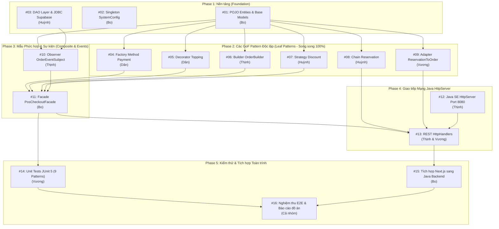

# KẾ HOẠCH PHÂN CHIA ISSUE & LỘ TRÌNH TRIỂN KHAI (ZERO-CONFLICT ISSUE ROADMAP)
## DỰ ÁN: ĐÀ LẠT CAFE — HỆ THỐNG QUẢN LÝ & VẬN HÀNH QUÁN CÀ PHÊ ĐA KÊNH

---

**Phiên bản:** 1.0.0  
**Ngày lập:** 15/10/2026  
**Mục tiêu:** Phân rã toàn bộ khối lượng công việc thành các GitHub Issues chi tiết, gán cụ thể cho 5 thành viên theo đúng phân công GoF Design Patterns, thiết lập thứ tự thực hiện (Dependencies) để **100% không bị xung đột mã nguồn (No Merge Conflicts)**.

---

## 1. Chiến lược Chống Xung đột Mã nguồn (Zero-Conflict Strategy)

Để 5 thành viên có thể lập trình song song mà không bao giờ bị đè code (merge conflict), dự án áp dụng **3 Quy tắc Vàng**:



### 3 Quy tắc Phân lập Mã nguồn:
1. **Phân lập Gói (Package Isolation):** Mỗi thành viên chỉ làm việc trong package mẫu thiết kế riêng biệt của mình bên trong `backend-java/src/com/dalatcafe/patterns/<tên_pattern>/`.
2. **Quy tắc Khóa Model (Frozen Model Rule):** Các thực thể POJO (`Order`, `Table`, `MenuItem`, `Reservation`, `Customer`) do Nhóm trưởng tạo ở **Phase 1** và đóng băng. Các thành viên chỉ đọc thuộc tính, không tự ý sửa đổi class Model chung.
3. **Quy tắc Nhánh Git (Feature Branching):** Mỗi issue tạo 1 branch riêng theo mẫu `feature/issue-<mã>-<tên-ngắn>` (Ví dụ: `feature/issue-05-decorator-topping`). Khi hoàn thành và test pass mới tạo Pull Request vào nhánh `develop`.

---

## 2. Danh mục 16 Issues Chi tiết theo Thứ tự Thực hiện

### GIAI ĐOẠN 1: THIẾT LẬP NỀN TẢNG (PHASE 1 - FOUNDATION)
> **Mục tiêu:** Tạo khung dự án Java SE, định nghĩa toàn bộ Entity POJO dùng chung và cấu hình kết nối CSDL Supabase.

#### Issue #01: [Backend][Core] Khởi tạo cấu trúc dự án Java SE và các lớp thực thể POJO
- **Người thực hiện:** **Phùng Nguyễn Hoài Bo** (`@HubertPhung`)
- **Nhãn:** `scope:backend`, `type:feature`, `priority:p0-blocker`
- **Mô tả:** 
  - Tạo khung thư mục `backend-java/src/com/dalatcafe/`.
  - Định nghĩa 5 lớp thực thể POJO chuẩn theo CSDL: `Order`, `Table`, `MenuItem`, `Reservation`, `Customer`.
  - Định nghĩa các Enum: `OrderStatus`, `TableStatus`, `PaymentMethod`, `OrderType`.
- **Phụ thuộc:** Không (Mở đầu tiên).
- **Chặn tiến độ:** #04, #05, #06, #07, #08, #09, #10.

#### Issue #02: [Backend][Singleton] Cài đặt SystemConfigManager quản lý tham số toàn cục
- **Người thực hiện:** **Phùng Nguyễn Hoài Bo** (`@HubertPhung`)
- **Nhãn:** `scope:backend`, `type:pattern`, `priority:p1-high`
- **Mô tả:** 
  - Tạo package `com.dalatcafe.patterns.singleton`.
  - Hiện thực hóa `SystemConfigManager` với cơ chế Double-Checked Locking đảm bảo Thread-safe.
  - Quản lý các tham số: Tên quán ("Đà Lạt Cafe"), giờ mở cửa (07:00), giờ đóng cửa (22:00), tỷ lệ tích điểm (10.000đ = 1 điểm), thời gian tự hủy bàn (30 phút).
- **Phụ thuộc:** Không.

#### Issue #03: [Backend][DAO] Xây dựng tầng DAO kết nối JDBC Supabase & In-Memory Fallback
- **Người thực hiện:** **Vũ Thế Huỳnh** (`@1convitt`)
- **Nhãn:** `scope:backend`, `type:feature`, `priority:p1-high`
- **Mô tả:** 
  - Tạo package `com.dalatcafe.dao`.
  - Định nghĩa các interface: `IOrderDao`, `ITableDao`, `IMenuDao`, `IReservationDao`.
  - Cài đặt `InMemoryDatabase` (sử dụng `ConcurrentHashMap`) phục vụ test độc lập không cần mạng.
  - Cài đặt `JdbcDatabase` kết nối PostgreSQL Supabase qua `java.sql.Connection` với SSL mode `require`.
- **Phụ thuộc:** #01.
- **Chặn tiến độ:** #10, #13.

---

### GIAI ĐOẠN 2: TRIỂN KHAI CÁC GOF PATTERN ĐỘC LẬP (PHASE 2 - INDEPENDENT PATTERNS)
> **Mục tiêu:** 4 thành viên triển khai song song 6 mẫu thiết kế độc lập trong các package riêng biệt. **Cam kết 0% xung đột code**.

#### Issue #04: [Backend][Factory] Cài đặt PaymentProcessorFactory xử lý thanh toán đa kênh
- **Người thực hiện:** **Nguyễn Ngọc Trường Dân** (`@0Yaam`)
- **Nhãn:** `scope:backend`, `type:pattern`, `priority:p1-high`
- **Package:** `com.dalatcafe.patterns.factory`
- **Mô tả:** 
  - Interface `IPaymentProcessor` với phương thức `processPayment(double amount)`.
  - 3 Concrete Classes: `CashPaymentProcessor`, `MomoQrPaymentProcessor`, `CardPosPaymentProcessor`.
  - Lớp `PaymentProcessorFactory` nhận `PaymentMethod` và trả về instance tương ứng.
- **Phụ thuộc:** #01.
- **Chặn tiến độ:** #11 (Facade).

#### Issue #05: [Backend][Decorator] Cài đặt ToppingDecorator tùy biến đồ uống và nâng Size L
- **Người thực hiện:** **Nguyễn Ngọc Trường Dân** (`@0Yaam`)
- **Nhãn:** `scope:backend`, `type:pattern`, `priority:p1-high`
- **Package:** `com.dalatcafe.patterns.decorator`
- **Mô tả:** 
  - Interface `IBeverage` (`getDescription()`, `getCost()`).
  - Lớp cơ sở `BaseCoffee` kế thừa từ `MenuItem`.
  - Abstract Decorator `BeverageDecorator`.
  - 3 Concrete Decorators: `PearlToppingDecorator` (+10.000đ), `CheeseFoamDecorator` (+15.000đ), `LargeSizeDecorator` (+10.000đ).
- **Phụ thuộc:** #01.
- **Chặn tiến độ:** #11 (Facade).

#### Issue #06: [Backend][Builder] Cài đặt OrderBuilder xây dựng thực thể hóa đơn Order linh hoạt
- **Người thực hiện:** **Nguyễn Hưng Thịnh** (`@elgthinhnguyen`)
- **Nhãn:** `scope:backend`, `type:pattern`, `priority:p1-high`
- **Package:** `com.dalatcafe.patterns.builder`
- **Mô tả:** 
  - Tạo `OrderBuilder` triển khai Fluent Interface (Method Chaining).
  - Các bước build: `setCustomer()`, `setTableId()`, `addItem()`, `applyVoucher()`, `setPaymentMethod()`, `calculateTotal()`.
  - Phương thức `build()` kiểm tra tính hợp lệ và trả về đối tượng `Order` hoàn chỉnh.
- **Phụ thuộc:** #01.
- **Chặn tiến độ:** #11 (Facade).

#### Issue #07: [Backend][Strategy] Cài đặt DiscountStrategy đa thuật toán chiết khấu voucher
- **Người thực hiện:** **Vũ Thế Huỳnh** (`@1convitt`)
- **Nhãn:** `scope:backend`, `type:pattern`, `priority:p1-high`
- **Package:** `com.dalatcafe.patterns.strategy`
- **Mô tả:** 
  - Interface `IDiscountStrategy` với hàm `calculateDiscount(double subtotal)`.
  - 3 Concrete Strategies: `PercentageDiscountStrategy` (Ví dụ: giảm 10% tối đa 50k), `FixedAmountDiscountStrategy` (giảm 20k cho đơn > 100k), `TieredDiscountStrategy` (giảm theo bậc chi tiêu).
  - Lớp `DiscountContext` để gán và thực thi chiến lược tại runtime.
- **Phụ thuộc:** #01.
- **Chặn tiến độ:** #11 (Facade).

#### Issue #08: [Backend][Chain] Cài đặt ReservationValidator chuỗi kiểm định đặt bàn 3 bước
- **Người thực hiện:** **Vũ Thế Huỳnh** (`@1convitt`)
- **Nhãn:** `scope:backend`, `type:pattern`, `priority:p1-high`
- **Package:** `com.dalatcafe.patterns.chain`
- **Mô tả:** 
  - Abstract Handler `ReservationValidator` với con trỏ `setNext(validator)`.
  - Step 1: `CustomerInfoValidator` (Kiểm tra tên, SĐT đủ 10 số).
  - Step 2: `ReservationTimeValidator` (Kiểm tra giờ đến trong khung 07:00 - 22:00 dựa trên Singleton Config).
  - Step 3: `GuestCountValidator` (Kiểm tra số lượng khách từ 1 đến 20 người).
- **Phụ thuộc:** #01, #02.
- **Chặn tiến độ:** #13 (HttpHandler).

#### Issue #09: [Backend][Adapter] Cài đặt ReservationToOrderAdapter ánh xạ phiếu đặt bàn sang POS
- **Người thực hiện:** **Phan Khánh Vương** (`@vuong123s`)
- **Nhãn:** `scope:backend`, `type:pattern`, `priority:p1-high`
- **Package:** `com.dalatcafe.patterns.adapter`
- **Mô tả:** 
  - Target Interface: `IOrderTarget` (Cung cấp `getOrderCode()`, `getCustomerInfo()`, `getItems()`, `getTableId()`).
  - Adaptee: Lớp `Reservation` (Phiếu đặt bàn hẹn trước có món gọi trước).
  - Adapter: `ReservationToOrderAdapter` triển khai `IOrderTarget` bọc đối tượng `Reservation`.
- **Phụ thuộc:** #01.
- **Chặn tiến độ:** #13 (HttpHandler).

---

### GIAI ĐOẠN 3: MẪU PHỨC HỢP & SỰ KIỆN (PHASE 3 - COMPOSITE & EVENTS)
> **Mục tiêu:** Tích hợp các mẫu đơn lẻ vào hệ thống phát sự kiện và bộ điều phối chốt đơn Facade.

#### Issue #10: [Backend][Observer] Cài đặt OrderEventSubject phát sự kiện tích điểm và cập nhật bàn
- **Người thực hiện:** **Nguyễn Hưng Thịnh** (`@elgthinhnguyen`)
- **Nhãn:** `scope:backend`, `type:pattern`, `priority:p1-high`
- **Package:** `com.dalatcafe.patterns.observer`
- **Mô tả:** 
  - Interface `IOrderObserver` và Subject `OrderEventSubject`.
  - Observer 1: `LoyaltyPointObserver` (Tự động tính và cộng điểm thành viên vào CRM sau khi hóa đơn thanh toán).
  - Observer 2: `TableStatusObserver` (Tự động chuyển trạng thái bàn từ "Available" sang "Occupied" khi lên đơn, sang "Cleaning" khi thanh toán).
- **Phụ thuộc:** #01, #03.
- **Chặn tiến độ:** #11 (Facade).

#### Issue #11: [Backend][Facade] Cài đặt PosCheckoutFacade gom toàn bộ quy trình thanh toán POS
- **Người thực hiện:** **Phùng Nguyễn Hoài Bo** (`@HubertPhung`)
- **Nhãn:** `scope:backend`, `type:pattern`, `priority:p0-blocker`
- **Package:** `com.dalatcafe.patterns.facade`
- **Mô tả:** 
  - Lớp `PosCheckoutFacade` tích hợp 5 mẫu thiết kế thành 1 phương thức duy nhất `checkoutOrder(CheckoutRequest request)`:
    1. Dùng **Decorator** tính tiền đồ uống tùy biến size/topping.
    2. Dùng **Strategy** tính chiết khấu voucher.
    3. Dùng **Builder** đóng gói đối tượng `Order`.
    4. Dùng **Factory Method** xử lý thanh toán Tiền mặt/QR/Thẻ.
    5. Lưu đơn vào DAO và dùng **Observer** bắn sự kiện tích điểm & đổi trạng thái bàn.
- **Phụ thuộc:** #04, #05, #06, #07, #10.
- **Chặn tiến độ:** #13 (CheckoutHandler), #14 (JUnit Test).

---

### GIAI ĐOẠN 4: GIAO TIẾP MẠNG HTTP SERVER (PHASE 4 - REST API DISPATCHER)
> **Mục tiêu:** Mở cổng 8080 bằng Java SE HttpServer thuần để đón nhận request JSON từ Frontend Next.js.

#### Issue #12: [Backend][Server] Cài đặt com.sun.net.httpserver.HttpServer trên cổng 8080
- **Người thực hiện:** **Nguyễn Hưng Thịnh** (`@elgthinhnguyen`)
- **Nhãn:** `scope:backend`, `type:feature`, `priority:p1-high`
- **Mô tả:** 
  - Khởi tạo `HttpServer.create(new InetSocketAddress(8080), 0)`.
  - Cài đặt `ThreadPoolExecutor` xử lý đa luồng đồng thời.
  - Xây dựng lớp tiện ích `HttpUtils` xử lý parse JSON, gửi JSON response UTF-8 và cấu hình CORS headers (`Access-Control-Allow-Origin: *`).
- **Phụ thuộc:** #01.
- **Chặn tiến độ:** #13.

#### Issue #13: [Backend][Handler] Cài đặt các HttpHandler tiếp nhận REST API cho Menu, Bàn, Đặt bàn, POS
- **Người thực hiện:** **Nguyễn Hưng Thịnh** (`@elgthinhnguyen`) & **Phan Khánh Vương** (`@vuong123s`)
- **Nhãn:** `scope:backend`, `type:feature`, `priority:p1-high`
- **Mô tả:** 
  - `MenuHttpHandler` (`GET /api/menu`, `POST /api/menu`) - Vương.
  - `TableHttpHandler` (`GET /api/tables`, `PATCH /api/tables/:id/status`) - Vương.
  - `ReservationHttpHandler` (`POST /api/reservations` qua Chain, `POST /transfer-pos` qua Adapter) - Vương.
  - `CheckoutHttpHandler` (`POST /api/checkout` qua PosCheckoutFacade) - Thịnh.
- **Phụ thuộc:** #08, #09, #11, #12.
- **Chặn tiến độ:** #15 (Integration).

---

### GIAI ĐOẠN 5: KIỂM THỬ ĐƠN VỊ & TÍCH HỢP HỆ THỐNG (PHASE 5 - TESTING & INTEGRATION)
> **Mục tiêu:** Viết Unit Test JUnit 5 cho 9 Pattern, nối Frontend Next.js sang Backend Java và nghiệm thu toàn trình.

#### Issue #14: [Backend][Test] Viết bộ kiểm thử đơn vị JUnit 5 cho toàn bộ 9 Design Patterns
- **Người thực hiện:** **Phan Khánh Vương** (`@vuong123s`)
- **Nhãn:** `scope:test`, `type:test`, `priority:p1-high`
- **Mô tả:** 
  - Tạo thư mục `backend-java/test/com/dalatcafe/patterns/`.
  - Viết 9 file Test tương ứng: `SingletonTest`, `FactoryTest`, `BuilderTest`, `DecoratorTest`, `AdapterTest`, `FacadeTest`, `StrategyTest`, `ChainTest`, `ObserverTest`.
  - Đảm bảo 100% test cases đều PASS và in ra báo cáo log rõ ràng.
- **Phụ thuộc:** #11.
- **Chặn tiến độ:** #16.

#### Issue #15: [Integration][API] Kết nối Next.js Server Actions sang Java Backend qua cổng 8080
- **Người thực hiện:** **Phùng Nguyễn Hoài Bo** (`@HubertPhung`)
- **Nhãn:** `scope:integration`, `type:feature`, `priority:p1-high`
- **Mô tả:** 
  - Thêm biến môi trường `JAVA_BACKEND_URL=http://localhost:8080` vào `frontend-nextjs/.env.local`.
  - Cập nhật các Server Actions trong [`app/admin/actions.ts`](file:///d:/University/MauThietKe/WebQuanLyQuanCafe-DesignPatterns/frontend-nextjs/app/admin/actions.ts) gọi `fetch()` sang Java Backend.
  - Giữ nguyên cơ chế tự động Fallback về Mock Store khi máy chủ Java chưa bật hoặc gặp sự cố.
- **Phụ thuộc:** #13.
- **Chặn tiến độ:** #16.

#### Issue #16: [QA][E2E] Kiểm thử tích hợp toàn trình End-to-End và hoàn thiện báo cáo đồ án
- **Người thực hiện:** **Cả nhóm** (Chủ trì: **Phan Khánh Vương** & **Vũ Thế Huỳnh**)
- **Nhãn:** `scope:test`, `scope:docs`, `type:test`, `priority:p1-high`
- **Mô tả:** 
  - Khởi động đồng thời cả Next.js (port 3000) và Java Backend (port 8080).
  - Chạy kịch bản 25 test cases UI/UX (`pnpm test`).
  - Kiểm tra luồng dữ liệu trọn vẹn: Đặt món Storefront ➔ POS Quầy ➔ KDS Bếp ➔ Lưu DB Supabase ➔ Biểu đồ Doanh thu.
  - Đóng gói tài liệu báo cáo nghiệm thu nộp giảng viên.
- **Phụ thuộc:** #14, #15.

---

## 3. Bảng Ma trận Phân công Nhiệm vụ theo Từng Thành viên

| Thành viên | Vai trò chính | Design Pattern phụ trách | Danh sách Issue thực hiện |
| :--- | :--- | :--- | :---: |
| **Phùng Nguyễn Hoài Bo** (`2312585`)<br>*(Nhóm trưởng)* | Kiến trúc hệ thống, Fullstack Lead | **Facade Pattern**, **Singleton Pattern** | **#01, #02, #11, #15** |
| **Nguyễn Ngọc Trường Dân** (`2312590`) | Backend Developer | **Factory Method**, **Decorator Pattern** | **#04, #05** |
| **Nguyễn Hưng Thịnh** (`2312756`) | Backend & Network Developer | **Builder Pattern**, **Observer Pattern**, Java HttpServer | **#06, #10, #12, #13** *(phần Checkout)* |
| **Vũ Thế Huỳnh** (`2312639`) | Database & Logic Developer | **Chain of Responsibility**, **Strategy Pattern**, DAO Layer | **#03, #07, #08, #16** |
| **Phan Khánh Vương** (`2312802`) | QA & Integration Developer | **Adapter Pattern**, State/DAO, Unit Test JUnit 5 | **#09, #13** *(phần Menu/Table/Res)*, **#14, #16** |

---

## 4. Hướng dẫn Quy trình Đẩy Code không Xung đột (Git Workflow)

1. **Bước 1:** Kéo code mới nhất từ nhánh chính:
   ```bash
   git checkout develop
   git pull origin develop
   ```
2. **Bước 2:** Tạo nhánh mới cho issue của mình:
   ```bash
   git checkout -b feature/issue-05-decorator-topping
   ```
3. **Bước 3:** Lập trình bên trong package riêng được phân công.
4. **Bước 4:** Commit và tạo Pull Request (PR) lên GitHub:
   ```bash
   git add .
   git commit -m "feat(decorator): complete ToppingDecorator implementation for #05"
   git push origin feature/issue-05-decorator-topping
   ```
5. **Bước 5:** Nhóm trưởng duyệt PR và Merge vào nhánh `develop`.

