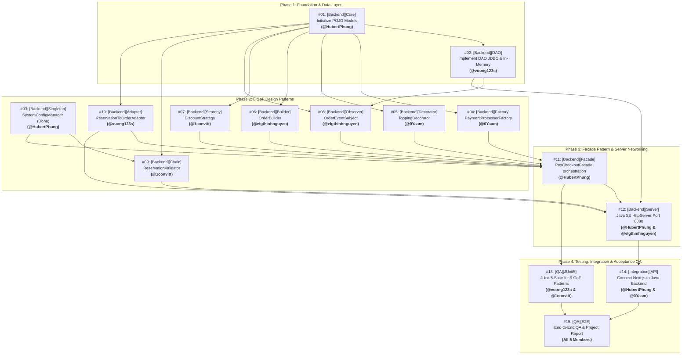

# KẾ HOẠCH PHÂN CHIA ISSUE & LỘ TRÌNH TRIỂN KHAI (ZERO-CONFLICT ISSUE ROADMAP)
## DỰ ÁN: ĐÀ LẠT CAFE — HỆ THỐNG QUẢN LÝ & VẬN HÀNH QUÁN CÀ PHÊ ĐA KÊNH

---

**Phiên bản:** 2.1.0 (English Issues Edition)  
**Ngày cập nhật:** 15/10/2026  
**Mục tiêu:** Phân rã toàn bộ khối lượng công việc thành 15 GitHub Issues chuẩn mực bằng **Tiếng Anh**, gán cụ thể cho 5 thành viên theo đúng phân công GoF Design Patterns, tuân thủ quy chuẩn đặt tên rút gọn `[Scope][Pattern] Action Verb + Class Name - Business Scope`, và thiết lập thứ tự thực hiện (Dependencies) để **100% không bị xung đột mã nguồn (No Merge Conflicts)**.

---

## 1. Chiến lược Chống Xung đột Mã nguồn (Zero-Conflict Strategy)

Để 5 thành viên có thể lập trình song song độc lập mà không bao giờ bị đè code (merge conflict), dự án áp dụng **Sơ đồ Phụ thuộc 4 Giai đoạn (4 Phases)**:



### 3 Core Rules for Zero Conflict:
1. **Package Isolation:** Each member develops exclusively within their assigned package inside `backend-java/src/main/java/com/dalatcafe/patterns/<pattern_name>/` or `dao/`.
2. **Extensible Domain Model:** Shared POJO models (`Order`, `Table`, `MenuItem`, `Reservation`, `Customer`) created in **Issue #01** serve as the common domain foundation. If a pattern requires additional fields or helper methods (e.g. `OrderLine` details, status helpers), additions must be backward-compatible (non-breaking existing constructors and getters).
3. **Issue-Based Branching:** Every issue is developed on a dedicated branch named `feature/issue-<number>-<short-title>` (e.g. `feature/issue-04-payment-factory`). Code is reviewed and merged into `master` via Pull Request only when all CI tests pass.
4. **Continuous Testing:** Unit tests are developed concurrently alongside each pattern implementation (e.g. `FactoryTest.java` in PR #04, `DecoratorTest.java` in PR #05), while Issue #13 consolidates the full test suite and edge-case coverage.

---

## 2. Team Member Workload Allocation

| Member | Student ID | GitHub | Primary Issues | Core GoF Design Patterns & Responsibilities |
| :--- | :---: | :--- | :--- | :--- |
| **Phùng Nguyễn Hoài Bo** (Lead) | `2312585` | `@HubertPhung` | **#01**, **#03**, **#11**, **#12**, **#14**, **#15** | Core POJO, **Singleton**, **Facade**, HttpServer, API Integration |
| **Nguyễn Ngọc Trường Dân** | `2312590` | `@0Yaam` | **#04**, **#05**, **#14**, **#15** | **Factory Method**, **Decorator**, API Integration |
| **Nguyễn Hưng Thịnh** | `2312756` | `@elgthinhnguyen` | **#06**, **#08**, **#12**, **#15** | **Builder**, **Observer**, HttpServer REST Handlers |
| **Vũ Thế Huỳnh** | `2312639` | `@1convitt` | **#07**, **#09**, **#13**, **#15** | **Strategy**, **Chain of Responsibility**, JUnit 5 Tests |
| **Phan Khánh Vương** | `2312802` | `@vuong123s` | **#02**, **#10**, **#13**, **#15** | DAO JDBC/In-Memory Layer, **Adapter**, JUnit 5 Tests |

---

## 3. Standardized 15 Issues Backlog (English Edition)

### PHASE 1: FOUNDATION & PERSISTENCE LAYER (Completed 🟢)

#### Issue #01: [Backend][Core] Initialize Java SE project structure and core POJO entities (Completed 🟢 - PR #17)
- **Assignee:** Phùng Nguyễn Hoài Bo (`@HubertPhung` - Student ID: `2312585`)
- **Labels:** `scope:backend`, `type:feature`, `priority:p0-blocker`
- **Status:** **[COMPLETED - Merged to master via PR #17]**
- **Body Template:**
```markdown
### 1. Context & Objective
Initialize the Java SE pure OOP project structure and define core Plain Old Java Objects (POJO) entities and enums as the unified shared data foundation for all 9 Gang of Four (GoF) Design Patterns.
- **Related Features:** `FEAT-CORE-01`, `FEAT-POS-01`
- **Lead Developer:** @HubertPhung (Phung Nguyen Hoai Bo - Student ID: 2312585)
- **Source Directory:** `backend-java/src/main/java/com/dalatcafe/model/`

### 2. Technical Constraints
- [x] Use pure Java SE 17+ OOP. Strictly NO Spring Boot, Spring Security, Spring Data JPA, Hibernate, or third-party web frameworks.
- [x] Comply with architectural rules in `.agents/rules/backend-java-constraints.md`.
- [x] Extensible Domain Model: Establish core POJO models; future extensions (new fields/helpers) must maintain backward compatibility.

### 3. Design Pattern Role
- **Core POJO Domain Models:**
  - `Order`: Encapsulates order code, customer, table ID, order type, items list, subtotal, VAT, total amount, payment method, payment status, and order status.
  - `Table`: Manages table number, zones (Main Floor, Patio, Coffee Bar), guest count, and operational status.
  - `MenuItem`: Manages item name, category, kind, stock quantity, unit, low stock threshold, cost price, selling price, and recipes.
  - `Reservation`: Manages customer details, booking date/time, table assignment, guest count, notes, and pre-ordered items.
  - `Customer`: Manages customer profile, phone, total spend, loyalty points, and membership rank.

### 4. Tasks Checklist
- [x] Create package hierarchy: `com.dalatcafe.model`, `com.dalatcafe.patterns`, `com.dalatcafe.dao`, `com.dalatcafe.server`
- [x] Implement POJO entity classes: `Order.java`, `Table.java`, `MenuItem.java`, `Reservation.java`, `Customer.java`
- [x] Implement Status Enums:
  - `OrderStatus.java` (PENDING, BREWING, READY, COMPLETED)
  - `TableStatus.java` (AVAILABLE, OCCUPIED, RESERVED, CLEANING)
  - `PaymentMethod.java` (CASH, QR, CARD)
  - `OrderType.java` (DINE_IN, PICKUP, DELIVERY)

### 5. Definition of Done
- [x] Source code compiles cleanly without warnings via `mvn compile`.
- [x] All POJOs contain complete constructors, getters/setters, and `toString()` methods.
- [x] Unblocks development progress for Issues #02 through #10.

### 6. Dependencies
- **Blocked by:** None (First issue to execute)
- **Blocks:** #02, #04, #05, #06, #07, #08, #09, #10
```

---

#### Issue #02: [Backend][DAO] Implement DAO layer with JDBC Supabase and In-Memory Store (Completed 🟢 - PR #19)
- **Assignee:** Phan Khánh Vương (`@vuong123s` - Student ID: `2312802`)
- **Labels:** `scope:backend`, `type:feature`, `priority:p1-high`
- **Status:** **[COMPLETED - Merged to master via PR #19]**
- **Body Template:**
```markdown
### 1. Context & Objective
Build an independent Data Access Object (DAO) persistence layer connecting to PostgreSQL on Supabase via standard JDBC, paired with an In-Memory Store (`ConcurrentHashMap`) as a zero-crash offline and testing fallback.
- **Related Features:** `FEAT-TBL-01`, `FEAT-INV-01`, `FEAT-CRM-01`
- **Lead Developer:** @vuong123s (Phan Khanh Vuong - Student ID: 2312802)
- **Package:** `com.dalatcafe.dao`

### 2. Technical Constraints
- [x] Use pure `java.sql.*` (standard JDBC). Strictly NO Hibernate, Spring Data, or heavyweight ORMs.
- [x] Support PostgreSQL Supabase connection with SSL mode (`sslmode=require`).
- [x] Provide thread-safe In-Memory fallback using `ConcurrentHashMap`.

### 3. Design Pattern Role
- **DAO Pattern:** Decouples core business domain logic from physical storage engines.
  - Interfaces: `IOrderDao`, `ITableDao`, `IMenuDao`, `IReservationDao`, `ICustomerDao`
  - Implementations: `InMemoryDatabase`, `JdbcDatabase`, `DaoFactory`

### 4. Tasks Checklist
- [x] Define DAO Interfaces:
  - `IOrderDao.java` (`save`, `findById`, `findByCode`, `findAll`, `updateStatus`)
  - `ITableDao.java` (`findAll`, `findById`, `updateStatus`)
  - `IMenuDao.java` (`findAll`, `findById`, `save`, `updateStock`)
  - `IReservationDao.java` (`findAll`, `findById`, `save`, `updateStatus`)
  - `ICustomerDao.java` (`findAll`, `findById`, `findByPhone`, `save`, `updatePoints`)
- [x] Implement thread-safe `InMemoryDatabase.java` with mock seed data matching frontend.
- [x] Implement `JdbcDatabase.java` reading `DATABASE_URL` environment variable for Supabase connectivity.
- [x] Implement `DaoFactory.java` supporting runtime switching between In-Memory and JDBC modes.

### 5. Definition of Done
- [x] CRUD operations execute successfully in both InMemory and JDBC modes.
- [x] Schema aligns 100% with database specifications in `docs/DATABASE.md`.
- [x] Unit tests verify CRUD operations across both implementations.

### 6. Dependencies
- **Blocked by:** #01 (POJO Models)
- **Blocks:** #08 (Observer), #11 (Facade), #12 (HttpServer)
```

---

### PHASE 2: 8 GOF DESIGN PATTERNS

#### Issue #03: [Backend][Singleton] Implement SystemConfigManager for global cafe parameters (Completed 🟢 - PR #20)
- **Assignee:** Phùng Nguyễn Hoài Bo (`@HubertPhung` - Student ID: `2312585`)
- **Labels:** `scope:backend`, `type:pattern`, `priority:p1-high`
- **Status:** **[COMPLETED - Merged to master via PR #20]**
- **Body Template:**
```markdown
### 1. Context & Objective
Implement the Singleton Pattern to manage global operational parameters for the cafe (store name, opening/closing hours, loyalty point earning ratios, table reservation expiration timeout).
- **Related Features:** `FEAT-AUTH-03`, `FEAT-POS-04`
- **Lead Developer:** @HubertPhung (Phung Nguyen Hoai Bo - Student ID: 2312585)
- **Package:** `com.dalatcafe.patterns.singleton`

### 2. Technical Constraints
- [x] Pure Java SE 17+ implementation.
- [x] Implement Double-Checked Locking with `volatile` modifier to guarantee absolute thread-safety in concurrent environments.
- [x] Enforce private constructor, reflection defense, and serialization defense (`readResolve`).

### 3. Design Pattern Role
- **Design Pattern:** Singleton Pattern (GoF Creational)
- **Target Class:** `SystemConfigManager`
  - `private static volatile SystemConfigManager instance;`
  - `private SystemConfigManager()`
  - `public static SystemConfigManager getInstance()`

### 4. Tasks Checklist
- [x] Create `SystemConfigManager.java` in package `com.dalatcafe.patterns.singleton`.
- [x] Initialize default configuration parameters:
  - Store Name: "Đà Lạt Cafe"
  - Operating Hours: `07:00` to `22:00`
  - Loyalty Point Ratio: 10,000 VND = 1 loyalty point (1 point = 1,000 VND bill redemption)
  - Max Reservation Hold Timeout: 30 minutes
- [x] Implement utility methods: `isWithinOperatingHours(LocalTime time)`, `calculateLoyaltyPoints(double amount)`, `calculateDiscountFromPoints(int points)`.
- [x] Write JUnit 5 unit tests (`SystemConfigManagerTest.java`) verifying thread safety and singleton integrity.

### 5. Definition of Done
- [x] `getInstance()` consistently returns a single instance across concurrent multi-threaded calls.
- [x] `isWithinOperatingHours()` correctly returns `false` for times outside 07:00 - 22:00.
- [x] Reflection defense prevents multiple instances.

### 6. Dependencies
- **Blocked by:** None
- **Blocks:** #09 (Chain of Responsibility), #11 (PosCheckoutFacade)
```

---

#### Issue #04: [Backend][Factory] Implement PaymentProcessorFactory for multi-channel checkout
- **Assignee:** Nguyễn Ngọc Trường Dân (`@0Yaam` - Student ID: `2312590`)
- **Labels:** `scope:backend`, `type:pattern`, `priority:p1-high`
- **Body Template:**
```markdown
### 1. Context & Objective
Implement the Factory Method Pattern to dynamically instantiate payment processors (Cash, Momo QR transfer, Bank Card POS) according to user selection during checkout.
- **Related Features:** `FEAT-POS-05`
- **Lead Developer:** @0Yaam (Nguyen Ngoc Truong Dan - Student ID: 2312590)
- **Package:** `com.dalatcafe.patterns.factory`

### 2. Technical Constraints
- [ ] Pure Java SE 17+, strictly honoring Open/Closed Principle (OCP) - easy to add future payment methods without modifying client code.

### 3. Design Pattern Role
- **Design Pattern:** Factory Method Pattern (GoF Creational)
- **Components:**
  - Product Interface: `IPaymentProcessor`
  - Concrete Products: `CashPaymentProcessor`, `MomoQrPaymentProcessor`, `CardPosPaymentProcessor`
  - Creator / Factory: `PaymentProcessorFactory`

### 4. Tasks Checklist
- [ ] Create `IPaymentProcessor.java` interface:
  - `PaymentResult processPayment(double amount, String transactionRef);`
  - `String getMethodName();`
- [ ] Implement Concrete Processors:
  - `CashPaymentProcessor.java`: Calculates cash change returned to guest.
  - `MomoQrPaymentProcessor.java`: Generates standardized dynamic QR payment payload.
  - `CardPosPaymentProcessor.java`: Validates bank terminal POS transaction reference.
- [ ] Implement `PaymentProcessorFactory.java` with static method `createProcessor(PaymentMethod method)`.

### 5. Definition of Done
- [ ] Instantiates exact payment processor matching `PaymentMethod.CASH`, `QR`, or `CARD`.
- [ ] Throws `IllegalArgumentException` with descriptive error message upon encountering unsupported methods.

### 6. Dependencies
- **Blocked by:** #01 (POJO Models)
- **Blocks:** #11 (PosCheckoutFacade)
```

---

#### Issue #05: [Backend][Decorator] Implement ToppingDecorator for beverage customization and Size L
- **Assignee:** Nguyễn Ngọc Trường Dân (`@0Yaam` - Student ID: `2312590`)
- **Labels:** `scope:backend`, `type:pattern`, `priority:p1-high`
- **Body Template:**
```markdown
### 1. Context & Objective
Implement the Decorator Pattern to dynamically attach customizations (White Pearls, Salted Cheese Foam, Size L upgrade) to base beverage items at runtime without altering base entity classes.
- **Related Features:** `FEAT-SF-03`, `FEAT-POS-01`
- **Lead Developer:** @0Yaam (Nguyen Ngoc Truong Dan - Student ID: 2312590)
- **Package:** `com.dalatcafe.patterns.decorator`

### 2. Technical Constraints
- [ ] Standard GoF nested wrapper object composition.
- [ ] Unlimited stacking of toppings and customizations without mutating core classes.

### 3. Design Pattern Role
- **Design Pattern:** Decorator Pattern (GoF Structural)
- **Components:**
  - Component: `IBeverage`
  - Concrete Component: `BaseCoffee`
  - Base Decorator: `BeverageDecorator`
  - Concrete Decorators: `PearlToppingDecorator`, `CheeseFoamDecorator`, `LargeSizeDecorator`

### 4. Tasks Checklist
- [ ] Create Component Interface `IBeverage.java`:
  - `String getDescription();`
  - `double getCost();`
- [ ] Implement `BaseCoffee.java implements IBeverage`: Wraps base `MenuItem`.
- [ ] Implement abstract class `BeverageDecorator.java implements IBeverage`:
  - Maintains `protected IBeverage beverage;`
- [ ] Implement Concrete Decorators:
  - `PearlToppingDecorator.java` (+10,000 VND, appends "+ White Pearls")
  - `CheeseFoamDecorator.java` (+15,000 VND, appends "+ Salted Cheese Foam")
  - `LargeSizeDecorator.java` (+10,000 VND, appends "(Size L)")

### 5. Definition of Done
- [ ] Stacked beverage decorators compute exact cumulative monetary cost.
- [ ] `getDescription()` outputs full composite description (e.g., `"Salted Cream Coffee (Size L) + Salted Cheese Foam + White Pearls"`).

### 6. Dependencies
- **Blocked by:** #01 (POJO Models)
- **Blocks:** #11 (PosCheckoutFacade)
```

---

#### Issue #06: [Backend][Builder] Implement OrderBuilder for flexible POS order assembly
- **Assignee:** Nguyễn Hưng Thịnh (`@elgthinhnguyen` - Student ID: `2312756`)
- **Labels:** `scope:backend`, `type:pattern`, `priority:p1-high`
- **Body Template:**
```markdown
### 1. Context & Objective
Apply the Builder Pattern to construct complex `Order` instances with numerous optional parameters (customer, table assignment, customized drinks list, barista notes, promotional vouchers, loyalty points).
- **Related Features:** `FEAT-POS-01`, `FEAT-POS-02`
- **Lead Developer:** @elgthinhnguyen (Nguyen Hung Thinh - Student ID: 2312756)
- **Package:** `com.dalatcafe.patterns.builder`

### 2. Technical Constraints
- [ ] Support Fluent Interface (Method Chaining: `.forCustomer(...).atTable(...).build()`).
- [ ] Ensure immutability of the resulting `Order` object upon calling `build()`.

### 3. Design Pattern Role
- **Design Pattern:** Builder Pattern (GoF Creational)
- **Target Class:** `OrderBuilder`
  - Product: `Order`

### 4. Tasks Checklist
- [ ] Create `OrderBuilder.java` in package `com.dalatcafe.patterns.builder`.
- [ ] Implement method chaining:
  - `OrderBuilder forCustomer(String customerName)`
  - `OrderBuilder atTable(int tableId)`
  - `OrderBuilder ofType(OrderType type)`
  - `OrderBuilder addItem(IBeverage beverage, int quantity)`
  - `OrderBuilder withNote(String note)`
  - `OrderBuilder withPayment(PaymentMethod method, boolean paid)`
  - `OrderBuilder applyDiscount(double discountAmount)`
- [ ] Implement `Order build()`:
  - Auto-generate unique order code (e.g., `AC-XXXX-XXX`).
  - Calculate subtotal, 8% VAT, and final total payable amount.
  - Enforce validation (throw exception if items list is empty).

### 5. Definition of Done
- [ ] Smooth fluent order assembly verified in tests.
- [ ] Accurate calculation of taxes and totals matching cafe business rules.
- [ ] Throws `IllegalStateException` when attempting to build an order with 0 items.

### 6. Dependencies
- **Blocked by:** #01 (POJO Models)
- **Blocks:** #11 (PosCheckoutFacade)
```

---

#### Issue #07: [Backend][Strategy] Implement DiscountStrategy for voucher calculation algorithms
- **Assignee:** Vũ Thế Huỳnh (`@1convitt` - Student ID: `2312639`)
- **Labels:** `scope:backend`, `type:pattern`, `priority:p1-high`
- **Body Template:**
```markdown
### 1. Context & Objective
Implement the Strategy Pattern to dynamically swap promotional discount algorithms (percentage discount, fixed cash deduction, CRM customer membership tier discounts).
- **Related Features:** `FEAT-POS-04`, `FEAT-CRM-01`
- **Lead Developer:** @1convitt (Vu The Huynh - Student ID: 2312639)
- **Package:** `com.dalatcafe.patterns.strategy`

### 2. Technical Constraints
- [x] Pure Java SE 17+, eliminating nested `if-else` conditionals for promotions.
- [x] Guarantee that discount deduction never exceeds the order subtotal (final total >= 0).

### 3. Design Pattern Role
- **Design Pattern:** Strategy Pattern (GoF Behavioral)
- **Components:**
  - Strategy Interface: `IDiscountStrategy`
  - Concrete Strategies: `PercentageDiscountStrategy`, `FixedAmountDiscountStrategy`, `LoyaltyTierDiscountStrategy`, `NoDiscountStrategy`
  - Context: `DiscountContext`

### 4. Tasks Checklist
- [x] Create Interface `IDiscountStrategy.java`:
  - `double calculateDiscount(double subtotal, Customer customer);`
  - `String getDiscountDescription();`
- [x] Implement 4 Concrete Strategies:
  - `PercentageDiscountStrategy.java`: Deducts X% (with configurable `maxCap` limit).
  - `FixedAmountDiscountStrategy.java`: Deducts fixed monetary amount (e.g., 30,000 VND).
  - `LoyaltyTierDiscountStrategy.java`: Discount based on membership rank (Bronze: 0%, Silver: 5%, Gold: 10%, VIP: 15%).
  - `NoDiscountStrategy.java`: Applies 0 discount.
- [x] Implement `DiscountContext.java` managing active strategy execution.

### 5. Definition of Done
- [x] Runtime strategy swapping executes cleanly without reconstructing the order.
- [x] Final order cost is guaranteed to be non-negative.

### 6. Dependencies
- **Blocked by:** #01 (POJO Models)
- **Blocks:** #11 (PosCheckoutFacade)
```

---

#### Issue #08: [Backend][Observer] Implement OrderEventSubject for CRM points and table sync
- **Assignee:** Nguyễn Hưng Thịnh (`@elgthinhnguyen` - Student ID: `2312756`)
- **Labels:** `scope:backend`, `type:pattern`, `priority:p1-high`
- **Body Template:**
```markdown
### 1. Context & Objective
Implement the Observer Pattern to establish an asynchronous event publish-subscribe system: upon order completion, automatically award customer loyalty points and transition table status to available.
- **Related Features:** `FEAT-POS-03`, `FEAT-TBL-02`, `FEAT-CRM-01`
- **Lead Developer:** @elgthinhnguyen (Nguyen Hung Thinh - Student ID: 2312756)
- **Package:** `com.dalatcafe.patterns.observer`

### 2. Technical Constraints
- [ ] Adhere to loose coupling: Subject does not depend on concrete implementations of observers.
- [ ] Safe exception containment: failures in an observer must not interrupt the primary POS checkout transaction.

### 3. Design Pattern Role
- **Design Pattern:** Observer Pattern (GoF Behavioral)
- **Components:**
  - Subject: `OrderEventSubject`
  - Observer Interface: `IOrderObserver`
  - Concrete Observers: `LoyaltyPointObserver`, `TableStatusSyncObserver`, `KitchenNotificationObserver`

### 4. Tasks Checklist
- [ ] Create Interface `IOrderObserver.java`:
  - `void onOrderCompleted(Order order);`
- [ ] Create Subject Class `OrderEventSubject.java`:
  - `List<IOrderObserver> observers;`
  - `void attach(IOrderObserver observer)`
  - `void detach(IOrderObserver observer)`
  - `void notifyOrderCompleted(Order order)`
- [ ] Implement Concrete Observers:
  - `LoyaltyPointObserver.java`: Calculates earned points and credits customer CRM profile.
  - `TableStatusSyncObserver.java`: Resets table status to `CLEANING` or `AVAILABLE`.
  - `KitchenNotificationObserver.java`: Emits dispatch notification to Kitchen Display System (KDS).

### 5. Definition of Done
- [ ] All attached observers receive notification and execute tasks upon `notifyOrderCompleted()`.
- [ ] Customer receives accurate loyalty points following paid transactions.

### 6. Dependencies
- **Blocked by:** #01 (POJO Models), #02 (DAO Layer)
- **Blocks:** #11 (PosCheckoutFacade)
```

---

#### Issue #09: [Backend][Chain] Implement ReservationValidator for 3-step booking validation
- **Assignee:** Vũ Thế Huỳnh (`@1convitt` - Student ID: `2312639`)
- **Labels:** `scope:backend`, `type:pattern`, `priority:p1-high`
- **Body Template:**
```markdown
### 1. Context & Objective
Apply the Chain of Responsibility Pattern to construct a 3-step validation pipeline for table reservations: Operating Hours verification, Guest Capacity verification, and Table Availability verification.
- **Related Features:** `FEAT-RES-01`, `FEAT-RES-02`
- **Lead Developer:** @1convitt (Vu The Huynh - Student ID: 2312639)
- **Package:** `com.dalatcafe.patterns.chain`

### 2. Technical Constraints
- [x] Fail-fast processing: terminate pipeline immediately upon encountering the first invalid validation rule.
- [x] Integrate with `SystemConfigManager` Singleton to retrieve authoritative operating hours.

### 3. Design Pattern Role
- **Design Pattern:** Chain of Responsibility Pattern (GoF Behavioral)
- **Components:**
  - Abstract Handler: `ReservationValidatorHandler`
  - Concrete Handlers: `OperatingHoursValidator`, `CapacityGuestValidator`, `TableAvailabilityValidator`

### 4. Tasks Checklist
- [x] Create abstract class `ReservationValidatorHandler.java`:
  - `protected ReservationValidatorHandler nextHandler;`
  - `public void setNext(ReservationValidatorHandler next)`
  - `public abstract ValidationResult validate(Reservation reservation);`
- [x] Implement 3 Validation Links:
  - `OperatingHoursValidator.java`: Verifies booking time falls within `07:00 - 22:00`.
  - `CapacityGuestValidator.java`: Verifies guest count fits table capacity (1 - 20 guests).
  - `TableAvailabilityValidator.java`: Verifies selected table is not already reserved in the desired time slot.

### 5. Definition of Done
- [x] Booking requests violating any rule are immediately rejected with descriptive error reason.
- [x] Bookings satisfying all 3 validation checks return `ValidationResult.valid()`.

### 6. Dependencies
- **Blocked by:** #01 (POJO Models), #03 (Singleton)
- **Blocks:** #10 (Adapter), #12 (HttpServer)
```

---

#### Issue #10: [Backend][Adapter] Implement ReservationToOrderAdapter to map bookings to POS orders
- **Assignee:** Phan Khánh Vương (`@vuong123s` - Student ID: `2312802`)
- **Labels:** `scope:backend`, `type:pattern`, `priority:p1-high`
- **Body Template:**
```markdown
### 1. Context & Objective
Apply the Adapter Pattern to convert an approved table booking (`Reservation`) with pre-ordered drinks (`preOrders`) into an active POS `Order` when the guest arrives at the cafe.
- **Related Features:** `FEAT-RES-03`
- **Lead Developer:** @vuong123s (Phan Khanh Vuong - Student ID: 2312802)
- **Package:** `com.dalatcafe.patterns.adapter`

### 2. Technical Constraints
- [ ] Implement Object Adapter Pattern: maintains reference to the Adaptee (`Reservation`).
- [ ] Zero structural alterations to either `Reservation` or `Order` classes.

### 3. Design Pattern Role
- **Design Pattern:** Adapter Pattern (GoF Structural)
- **Components:**
  - Target Interface: `IPosOrderTarget`
  - Adaptee: `Reservation`
  - Adapter: `ReservationToOrderAdapter`

### 4. Tasks Checklist
- [ ] Create Interface `IPosOrderTarget.java`:
  - `Order toPosOrder();`
  - `int getAssignedTableId();`
  - `String getCustomerIdentifier();`
- [ ] Implement `ReservationToOrderAdapter.java implements IPosOrderTarget`:
  - Encapsulates `private final Reservation reservation;`
  - Maps reservation code to POS order code.
  - Transforms `preOrders` entries into `OrderLine` items.
  - Initializes initial order status as `PENDING`.

### 5. Definition of Done
- [ ] Seamless transformation of `Reservation` to `Order` without losing guest details or item quantities.
- [ ] Transformed order is fully compatible with POS cashier checkout terminal.

### 6. Dependencies
- **Blocked by:** #01 (POJO Models), #09 (Chain of Responsibility)
- **Blocks:** #11 (PosCheckoutFacade), #12 (HttpServer)
```

---

### PHASE 3: FACADE PATTERN & SERVER NETWORKING

#### Issue #11: [Backend][Facade] Implement PosCheckoutFacade orchestrating POS checkout workflow
- **Assignee:** Phùng Nguyễn Hoài Bo (`@HubertPhung` - Student ID: `2312585`)
- **Labels:** `scope:backend`, `type:pattern`, `priority:p0-blocker`
- **Body Template:**
```markdown
### 1. Context & Objective
Implement the Facade Pattern acting as the central unified API orchestrating 6 GoF subsystems (OrderBuilder, BeverageDecorator, DiscountStrategy, PaymentProcessorFactory, OrderEventSubject, DAO) to execute atomic POS checkout transactions.
- **Related Features:** `FEAT-POS-01`, `FEAT-POS-04`, `FEAT-POS-05`
- **Lead Developer:** @HubertPhung (Phung Nguyen Hoai Bo - Student ID: 2312585)
- **Package:** `com.dalatcafe.patterns.facade`

### 2. Technical Constraints
- [ ] Present a clean, unified high-level interface hiding the internal complexity of underlying subsystems.
- [ ] Ensure transactional integrity: save order, decrement inventory, process payment, publish synchronization events.

### 3. Design Pattern Role
- **Design Pattern:** Facade Pattern (GoF Structural)
- **Central Class:** `PosCheckoutFacade`
  - Subsystems Coordinated:
    - `OrderBuilder` (Order construction)
    - `BeverageDecorator` (Drink customization pricing)
    - `DiscountStrategy` (Promotional voucher calculation)
    - `PaymentProcessorFactory` (Multi-channel payment dispatch)
    - `OrderEventSubject` (Loyalty points & table status events)
    - `IOrderDao` (Database persistence)

### 4. Tasks Checklist
- [ ] Create `PosCheckoutFacade.java` in package `com.dalatcafe.patterns.facade`.
- [ ] Implement primary method:
  - `CheckoutResult checkout(CheckoutRequest request)`
- [ ] Orchestrate 6-step internal checkout workflow:
  1. Build order instance via `OrderBuilder`.
  2. Compute customized drink costs via `BeverageDecorator`.
  3. Apply promotional discounts via `DiscountContext`.
  4. Process transactions via `PaymentProcessorFactory`.
  5. Persist completed order to database via `IOrderDao`.
  6. Broadcast completion events via `OrderEventSubject`.

### 5. Definition of Done
- [ ] Controller/Server only needs to invoke a single `checkout()` method to finalize transactions.
- [ ] Full checkout workflow executes atomically without state or monetary inconsistencies.

### 6. Dependencies
- **Blocked by:** #03, #04, #05, #06, #07, #08, #10
- **Blocks:** #12 (HttpServer), #13 (JUnit 5 Tests)
```

---

#### Issue #12: [Backend][Server] Implement Java SE HttpServer on port 8080 with REST handlers
- **Assignee:** Phùng Nguyễn Hoài Bo (`@HubertPhung`) & Nguyễn Hưng Thịnh (`@elgthinhnguyen`)
- **Labels:** `scope:backend`, `type:feature`, `priority:p1-high`
- **Body Template:**
```markdown
### 1. Context & Objective
Build an embedded HTTP server using standard Java SE `com.sun.net.httpserver.HttpServer` listening on port 8080, receiving and routing REST JSON requests from Next.js Frontend to core Java pattern domain, protected by RBAC auth filter.
- **Related Features:** `FEAT-AUTH-02`, `FEAT-SF-01`, `FEAT-TBL-01`, `FEAT-RES-01`, `FEAT-POS-05`, `FEAT-CRM-01`, `FEAT-ANA-01`
- **Lead Developers:** @HubertPhung & @elgthinhnguyen
- **Package:** `com.dalatcafe.server`

### 2. Technical Constraints
- [ ] Use pure Java SE `com.sun.net.httpserver.HttpServer`. Strictly NO Spring Boot, embedded Tomcat, or Netty.
- [ ] Configure standard CORS headers (`Access-Control-Allow-Origin: *`, `Methods`, `Headers`).
- [ ] Enforce response MIME type: `application/json; charset=UTF-8`.
- [ ] RBAC Security Filter (`SimpleAuthFilter`): Intercept incoming requests, validate role headers (`X-User-Role` or bearer authorization) for 4 system roles (`ADMIN`, `MANAGER`, `STAFF`, `CUSTOMER`), returning `401 UNAUTHORIZED` or `403 FORBIDDEN`.
- [ ] POS Transactional Safety: In `CheckoutHandler`, if database operations fail in JDBC mode, return `HTTP 503 DATABASE_UNAVAILABLE` rather than silent fallback to mock store (preventing phantom/unpersisted orders).

### 3. Design Pattern Role
- **HTTP Dispatcher & Handlers:**
  - `MainServer.java`: Boots HTTP server on port 8080.
  - `CorsHandler.java`: Manages CORS preflight OPTIONS requests.
  - `SimpleAuthFilter.java`: Pure Java SE HttpFilter enforcing RBAC rules.
  - REST Handlers: `MenuHandler`, `TableHandler`, `OrderHandler`, `ReservationHandler`, `CustomerHandler`, `VoucherHandler`, `AnalyticsHandler`, `CheckoutHandler`.

### 4. Tasks Checklist
- [ ] Create `MainServer.java` configuring socket listening on port 8080.
- [ ] Implement `SimpleAuthFilter.java` enforcing RBAC access rights:
  - Admin/Manager routes: `/api/analytics`, `/api/settings`
  - Staff routes: `/api/checkout`, `/api/orders`, `/api/tables`
  - Public routes: `/api/menu`, `/api/reservations`
- [ ] Implement REST HttpHandlers:
  - `MenuHandler`: `GET /api/menu`, `POST /api/menu`, `PATCH /api/menu/:id/stock`
  - `TableHandler`: `GET /api/tables`, `PATCH /api/tables/:id/status`
  - `OrderHandler`: `GET /api/orders`, `PATCH /api/orders/:id/status`, `POST /api/orders/:id/pay`
  - `ReservationHandler`: `GET /api/reservations`, `POST /api/reservations`, `PATCH /api/reservations/:id/status`, `POST /api/reservations/:id/transfer-pos`
  - `CustomerHandler`: `GET /api/customers`
  - `VoucherHandler`: `POST /api/vouchers/validate` (delegates to `DiscountStrategy`)
  - `AnalyticsHandler`: `GET /api/analytics/overview` (aggregates 7-day revenue and top drinks)
  - `CheckoutHandler`: `POST /api/checkout` (delegates to `PosCheckoutFacade` with HTTP 503 safety on DB failure)
- [ ] Implement lightweight JSON parser/builder helpers.

### 5. Definition of Done
- [ ] Server boots up in < 1 second on port 8080.
- [ ] All REST endpoints return standardized JSON schemas specified in `docs/API_SPEC.md`.
- [ ] Unauthorized requests properly receive HTTP 401 / 403.
- [ ] Database failure during checkout returns HTTP 503 instead of corrupting state.

### 6. Dependencies
- **Blocked by:** #02 (DAO), #09 (Chain), #10 (Adapter), #11 (Facade)
- **Blocks:** #14 (API Integration)
```

---

### PHASE 4: TESTING, INTEGRATION & ACCEPTANCE QA

#### Issue #13: [QA][JUnit5] Implement comprehensive JUnit 5 unit test suite for 9 GoF patterns
- **Assignee:** Phan Khánh Vương (`@vuong123s`) & Vũ Thế Huỳnh (`@1convitt`)
- **Labels:** `scope:test`, `type:test`, `priority:p1-high`
- **Body Template:**
```markdown
### 1. Context & Objective
Construct an independent unit test suite utilizing JUnit 5, providing 100% test coverage across all 9 Gang of Four (GoF) design patterns implemented in the Java SE backend.
- **Lead Developers:** @vuong123s & @1convitt
- **Test Directory:** `backend-java/src/test/java/com/dalatcafe/patterns/`

### 2. Technical Constraints
- [ ] Pure JUnit 5 (`org.junit.jupiter:junit-jupiter`).
- [ ] Fully isolated in-memory unit tests using `InMemoryDatabase` with no external network or database dependencies.

### 3. Design Pattern Role
- **9 Pattern Test Classes:**
  1. `SingletonTest.java`: Verifies single-instance guarantee and thread safety of `SystemConfigManager`.
  2. `FactoryTest.java`: Verifies processor creation by `PaymentProcessorFactory`.
  3. `DecoratorTest.java`: Verifies price accumulation and description formatting of `ToppingDecorator`.
  4. `BuilderTest.java`: Verifies fluent construction and VAT calculations of `OrderBuilder`.
  5. `StrategyTest.java`: Verifies discount calculation algorithms of `DiscountStrategy`.
  6. `ChainTest.java`: Verifies pipeline rule enforcement of `ReservationValidator`.
  7. `AdapterTest.java`: Verifies data transformation fidelity of `ReservationToOrderAdapter`.
  8. `ObserverTest.java`: Verifies event propagation and point calculation of `OrderEventSubject`.
  9. `FacadeTest.java`: Verifies end-to-end atomic workflow execution of `PosCheckoutFacade`.

### 4. Tasks Checklist
- [ ] Create 9 test classes in `src/test/java/com/dalatcafe/patterns/`.
- [ ] Write minimum of 2 test cases (Positive & Negative paths) for each design pattern.
- [ ] Execute automated tests via `mvn test` verifying 100% green pass rate.

### 5. Definition of Done
- [ ] `mvn test` executes with 100% passing rate across all 9 patterns.
- [ ] Seamlessly integrates into GitHub Actions CI pipeline.

### 6. Dependencies
- **Blocked by:** #11 (PosCheckoutFacade)
- **Blocks:** #15 (QA E2E)
```

---

#### Issue #14: [Integration][API] Connect Next.js Server Actions to Java Backend on port 8080
- **Assignee:** Phùng Nguyễn Hoài Bo (`@HubertPhung`) & Nguyễn Ngọc Trường Dân (`@0Yaam`)
- **Labels:** `scope:integration`, `type:feature`, `priority:p1-high`
- **Body Template:**
```markdown
### 1. Context & Objective
Connect Next.js Server Actions (`app/admin/actions.ts`) to Java SE Backend on port 8080 via native HTTP fetch, maintaining zero-crash fallback to in-memory store.
- **Related Features:** Fullstack End-to-End Integration
- **Lead Developers:** @HubertPhung & @0Yaam
- **Target Files:** `frontend-nextjs/app/admin/actions.ts`, `frontend-nextjs/lib/api-client.ts`

### 2. Technical Constraints
- [ ] Zero-Crash Resilience: If Java backend is unreachable, automatically fall back to local In-Memory Mock Store without throwing uncaught exceptions to browser.
- [ ] Configurable target address via `JAVA_BACKEND_URL=http://localhost:8080`.

### 3. Design Pattern Role
- **API Proxy Pattern in Frontend:** Forwards cashier POS, table updates, and booking requests from browser to Java SE Backend.

### 4. Tasks Checklist
- [ ] Implement `lib/api-client.ts` encapsulating typed fetch calls to Java Backend.
- [ ] Update Server Actions in `app/admin/actions.ts`:
  - `createOrder`: Forwards payload to Java `/api/checkout` endpoint.
  - `updateTableStatus`: Forwards status changes to Java `/api/tables/{id}` endpoint.
  - `createReservation`: Forwards booking requests to Java `/api/reservations` endpoint.
- [ ] Implement robust `try...catch` error handling with automatic Mock Store fallback.

### 5. Definition of Done
- [ ] POS transactions executed in browser create records in Java SE backend and return order codes.
- [ ] Frontend operates seamlessly via mock store fallback even when Java backend process is terminated.

### 6. Dependencies
- **Blocked by:** #12 (HttpServer)
- **Blocks:** #15 (QA E2E)
```

---

#### Issue #15: [QA][E2E] Execute End-to-End integration testing and complete project report
- **Assignee:** All 5 team members (`@HubertPhung`, `@0Yaam`, `@elgthinhnguyen`, `@1convitt`, `@vuong123s`)
- **Labels:** `scope:test`, `scope:docs`, `type:test`, `priority:p1-high`
- **Body Template:**
```markdown
### 1. Context & Objective
Perform comprehensive End-to-End (E2E) integration testing spanning Customer Storefront, Admin POS/KDS operations, and Java SE Backend, and finalize academic project report and submission documentation.
- **Assigned Team:** All 5 team members (@HubertPhung, @0Yaam, @elgthinhnguyen, @1convitt, @vuong123s)
- **Target Directories:** `docs/`, `frontend-nextjs/`, `backend-java/`

### 2. Technical Constraints
- [ ] All 25 UI/UX automated tests and all JUnit 5 tests must PASS on GitHub Actions CI.
- [ ] Final project documentation must contain complete UML Class Diagrams for all 9 GoF patterns.

### 3. Tasks Checklist
- [ ] Execute E2E Scenario 1: Customer browses Storefront ➔ Add to Cart ➔ Apply Voucher ➔ Complete Checkout.
- [ ] Execute E2E Scenario 2: Cashier uses POS terminal ➔ Select Table ➔ Customize Size L + Topping ➔ Process Payment ➔ Table changes color on Floor Plan ➔ Order displays on KDS.
- [ ] Execute E2E Scenario 3: Table Reservation ➔ Validated via Chain of Responsibility ➔ Guest arrives ➔ Converted to active POS order via Adapter.
- [ ] Finalize Software Architecture & Design Patterns Report and local setup guide.

### 4. Definition of Done
- [ ] GitHub Actions CI/CD pipeline displays green checkmark (100% Passed).
- [ ] System operates reliably with zero crashes across fullstack flow.
- [ ] Project report completed and ready for submission and defense.

### 5. Dependencies
- **Blocked by:** #13 (JUnit 5 Tests), #14 (API Integration)
- **Blocks:** None (Project Completion)
```
