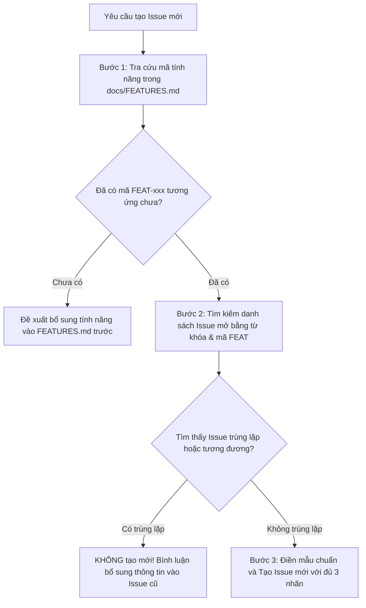
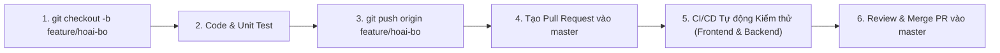

# QUY CHUẨN TẠO VÀ QUẢN LÝ ISSUE (ISSUE GUIDELINES)
## DỰ ÁN: ĐÀ LẠT CAFE OPERATIONS & MANAGEMENT

---

**Phiên bản tài liệu:** 1.0.0  
**Ngày cập nhật:** 14/10/2026  
**Đối tượng áp dụng:** Thành viên nhóm phát triển, Tech Lead và AI Coding Assistants  
**Mục tiêu:** Chuẩn hóa quy trình tạo issue, cách đặt tiêu đề, gắn nhãn (labels), phân cấp mức độ ưu tiên, thiết lập tiêu chuẩn nghiệm thu (Acceptance Criteria) và ngăn chặn triệt để việc tạo issue trùng lặp hoặc mơ hồ.

---

## 1. Nguyên tắc Cốt lõi khi Tạo Issue

Mọi Issue được khởi tạo trong dự án phải tuân thủ nghiêm ngặt **5 Nguyên tắc Vàng**:

1. **Phạm vi Độc lập (Single Responsibility):** Mỗi issue chỉ giải quyết duy nhất một bài toán hoặc một tính năng cụ thể. Không gom nhiều tính năng khác nhau vào cùng một issue lớn.
2. **Tuân thủ Ràng buộc Công nghệ (Tech Stack Compliance):**
   - Nhiệm vụ Backend: Phải ghi rõ là **Java SE thuần túy (Pure Java OOP)**, tuyệt đối không dùng Spring Boot, không Spring Security, không Spring Data JPA.
   - Nhiệm vụ Frontend: Phải tuân thủ kiến trúc **Next.js 16 (App Router)**, React 19, Tailwind CSS v4, TypeScript.
3. **Tiêu chuẩn Nghiệm thu Rõ ràng (Testable Definition of Done):** Mọi issue phải có danh sách checklist nghiệm thu cụ thể mà người kiểm thử hoặc bộ test tự động có thể xác minh được.
4. **Gắn kết với Mẫu Thiết kế (Design Pattern Linkage):** Nếu issue liên quan đến Backend, bắt buộc phải nêu rõ Design Pattern GoF tương ứng và vai trò của các class/interface cần hiện thực hóa.
5. **Kiểm tra Chống Trùng lặp (Deduplication First):** Bắt buộc phải tra cứu mã tính năng trong [docs/FEATURES.md](FEATURES.md) và rà soát danh sách issue hiện có trước khi tạo mới.

---

## 2. Quy chuẩn Đặt Tiêu đề Issue (Issue Title Convention)

Tiêu đề issue phải tuân theo cấu trúc chuẩn:

```text
[Phạm vi][Phân hệ / Pattern] Động từ hành động + Đối tượng cụ thể
```

### Các tiền tố Phạm vi (`Scope`):
- `[Frontend]`: Công việc liên quan đến giao diện Next.js, components, hooks, styling, client state.
- `[Backend]`: Công việc lập trình Java SE thuần túy, POJO entities, DAO, 9 GoF Design Patterns.
- `[Integration]`: Công việc kết nối mạng giữa Next.js và Backend Java, DTO, proxy, error fallback.
- `[Docs]`: Cập nhật tài liệu kỹ thuật, báo cáo, đặc tả kiến trúc.
- `[Test]`: Viết unit test JUnit, kiểm thử tự động UI/UX, test hiệu năng.

### Ví dụ Tiêu đề Chuẩn:
- `[Backend][POS] Cài đặt PosCheckoutFacade kết hợp Builder và Factory`
- `[Backend][Reservation] Triển khai chuỗi kiểm định Chain of Responsibility`
- `[Frontend][KDS] Hoàn thiện hiệu ứng cảnh báo đổi màu viền khi đơn trễ quá 10 phút`
- `[Integration][API] Kết nối Server Action createOrder với Java Backend qua cổng 8080`
- `[Docs][API] Cập nhật bảng mã lỗi chi tiết cho nhóm API Đặt bàn`

---

## 3. Hệ thống Nhãn Phân loại (Labels System)

Mỗi issue bắt buộc phải được gắn ít nhất **3 loại nhãn**: `scope`, `type` và `priority`.

### 3.1. Nhãn Phạm vi (`scope:*`)
| Nhãn | Ý nghĩa |
| :--- | :--- |
| `scope:frontend` | Toàn bộ mã nguồn trong thư mục `frontend-nextjs/` |
| `scope:backend` | Toàn bộ mã nguồn trong thư mục `backend-java/` |
| `scope:integration`| Giao tiếp HTTP REST, DTO và kết nối hai phân hệ |
| `scope:docs` | Toàn bộ tài liệu trong thư mục `docs/` và `README.md` |

### 3.2. Nhãn Loại công việc (`type:*`)
| Nhãn | Ý nghĩa |
| :--- | :--- |
| `type:feature` | Xây dựng chức năng mới |
| `type:pattern` | Hiện thực hóa một trong 9 GoF Design Patterns bằng Java thuần |
| `type:bug` | Sửa lỗi sai khác so với tài liệu đặc tả hoặc crash ứng dụng |
| `type:refactor` | Tái cấu trúc mã nguồn sạch sẽ (Clean Code) không đổi hành vi |
| `type:test` | Viết kịch bản kiểm thử tự động, unit tests |

### 3.3. Nhãn Mức độ Ưu tiên (`priority:*`)
| Nhãn | Mức độ | Định nghĩa & Tiêu chí | Thời hạn xử lý |
| :--- | :---: | :--- | :--- |
| `priority:p0-blocker` | **P0** | Lỗi nghiêm trọng làm crash hệ thống, chặn toàn bộ tiến độ | Khắc phục ngay lập tức |
| `priority:p1-high` | **P1** | Các GoF Design Patterns cốt lõi hoặc luồng thanh toán chính | Xử lý trong Sprint hiện tại |
| `priority:p2-medium` | **P2** | Các chức năng quản trị phụ (lọc, xuất CSV, đổi theme) | Xử lý trong vòng 1-2 tuần |
| `priority:p3-low` | **P3** | Tối ưu hóa UI/UX nhỏ, làm đẹp code, bổ sung tài liệu | Đưa vào backlog |

---

## 4. Mẫu Issue Markdown Tiêu chuẩn (Issue Template)

Khi tạo một issue mới trên GitHub/GitLab hoặc trong tài liệu quản lý tác vụ, hãy sao chép khung mẫu dưới đây:

```markdown
### 1. Bối cảnh & Mục tiêu (Context & Objective)
<!-- Mô tả ngắn gọn: Tại sao cần thực hiện issue này? Tính năng này phục vụ bài toán gì trong quán cà phê? -->
- **Mã tính năng liên quan:** `FEAT-xxx` (Xem tra cứu trong docs/FEATURES.md)
- **Mục tiêu:** Hiện thực hóa tính năng ...

### 2. Ràng buộc Kỹ thuật (Technical Constraints)
- [ ] Tuân thủ chuẩn công nghệ: Java SE 17+ thuần túy (Không dùng Spring Boot / Security / Data JPA) HOẶC Next.js 16 App Router.
- [ ] Giữ nguyên các comment và docstring có sẵn.
- [ ] Mã nguồn đặt đúng thư mục quy định (`backend-java/src/...` hoặc `frontend-nextjs/...`).

### 3. Thiết kế Mẫu liên quan (Design Pattern Role - Nếu là Backend)
- **Tên Pattern:** (Ví dụ: Factory Method / Decorator / Facade...)
- **Vai trò các Class/Interface:**
  - `InterfaceName`: ...
  - `ConcreteClass`: ...

### 4. Phạm vi Công việc (Scope of Work / Task Checklist)
<!-- Liệt kê các đầu việc cụ thể cần làm -->
- [ ] Tạo file ...
- [ ] Viết logic xử lý ...
- [ ] Cập nhật unit test tương ứng ...

### 5. Tiêu chuẩn Nghiệm thu (Acceptance Criteria / Definition of Done)
<!-- Các tiêu chí bắt buộc phải đạt để issue được đóng -->
- [ ] Mã nguồn biên dịch thành công không có lỗi syntax/type.
- [ ] Tất cả kịch bản kiểm thử liên quan đều PASS.
- [ ] Dữ liệu trả về đúng định dạng JSON chuẩn theo `docs/API_SPEC.md`.

### 6. Phụ thuộc (Dependencies)
- **Bị chặn bởi (Blocked by):** #... (hoặc Không)
- **Chặn tiến độ của (Blocks):** #... (hoặc Không)
```

---

## 5. Quy tắc Kiểm tra Chống Trùng lặp (Deduplication Rules)

Trước khi bấm tạo một issue mới, AI Agent hoặc lập trình viên phải thực hiện đủ 3 bước kiểm tra:



1. **Tra cứu Mã tính năng:** Bắt buộc phải gắn mã định danh tính năng chuẩn (`FEAT-POS-01`, `FEAT-RES-02`...) từ file [docs/FEATURES.md](FEATURES.md).
2. **Rà soát Từ khóa:** Tìm kiếm theo từ khóa tên class Java hoặc tên component (Ví dụ: `PosCheckoutFacade`, `ReservationValidator`, `DrinkMenu`).
3. **Nguyên tắc "Cập nhật thay vì Tạo mới":** Nếu một issue đã mô tả 80% công việc, hãy bổ sung comment hoặc cập nhật checklist của issue đó thay vì mở thêm issue mới gây phân mảnh backlog.

---

## 6. Danh mục 15 Issue Chuẩn hóa Triển khai (Standardized English Backlog)

Dưới đây là 15 Issue được chuẩn hóa bằng tiếng Anh theo quy chuẩn rút gọn `[Scope][Pattern] Action Verb + Class Name - Specific Business Feature`, phân tầng 4 giai đoạn và phân bổ đồng đều cho 5 thành viên trong nhóm:

### [PHASE 1: FOUNDATION & PERSISTENCE LAYER]
1. `[Backend][Core] Initialize Java SE project structure and core POJO entities` — `@HubertPhung` (`scope:backend`, `type:feature`, `priority:p0-blocker`)
2. `[Backend][DAO] Implement DAO layer with JDBC Supabase and In-Memory Store` — `@vuong123s` (`scope:backend`, `type:feature`, `priority:p1-high`)

### [PHASE 2: 7 INDEPENDENT GOF PATTERNS (PARALLEL WORK)]
3. `[Backend][Singleton] Implement SystemConfigManager for global cafe parameters` — `@HubertPhung` (`scope:backend`, `type:pattern`, `priority:p1-high`)
4. `[Backend][Factory] Implement PaymentProcessorFactory for multi-channel checkout` — `@0Yaam` (`scope:backend`, `type:pattern`, `priority:p1-high`)
5. `[Backend][Decorator] Implement ToppingDecorator for beverage customization and Size L` — `@0Yaam` (`scope:backend`, `type:pattern`, `priority:p1-high`)
6. `[Backend][Builder] Implement OrderBuilder for flexible POS order assembly` — `@elgthinhnguyen` (`scope:backend`, `type:pattern`, `priority:p1-high`)
7. `[Backend][Strategy] Implement DiscountStrategy for voucher calculation algorithms` — `@1convitt` (`scope:backend`, `type:pattern`, `priority:p1-high`)
8. `[Backend][Observer] Implement OrderEventSubject for CRM points and table sync` — `@elgthinhnguyen` (`scope:backend`, `type:pattern`, `priority:p1-high`)
9. `[Backend][Chain] Implement ReservationValidator for 3-step booking validation` — `@1convitt` (`scope:backend`, `type:pattern`, `priority:p1-high`)
10. `[Backend][Adapter] Implement ReservationToOrderAdapter to map bookings to POS orders` — `@vuong123s` (`scope:backend`, `type:pattern`, `priority:p1-high`)

### [PHASE 3: COMPOSITE PATTERN & SERVER NETWORKING]
11. `[Backend][Facade] Implement PosCheckoutFacade orchestrating POS checkout workflow` — `@HubertPhung` (`scope:backend`, `type:pattern`, `priority:p0-blocker`)
12. `[Backend][Server] Implement Java SE HttpServer on port 8080 with REST handlers` — `@HubertPhung` & `@elgthinhnguyen` (`scope:backend`, `type:feature`, `priority:p1-high`)

### [PHASE 4: TESTING, INTEGRATION & ACCEPTANCE QA]
13. `[Test][JUnit5] Implement comprehensive JUnit 5 unit test suite for 9 GoF patterns` — `@vuong123s` & `@1convitt` (`scope:test`, `type:test`, `priority:p1-high`)
14. `[Integration][API] Connect Next.js Server Actions to Java Backend on port 8080` — `@HubertPhung` & `@0Yaam` (`scope:integration`, `type:feature`, `priority:p1-high`)
15. `[QA][E2E] Execute End-to-End integration testing and complete project report` — All 5 team members (`scope:test`, `scope:docs`, `type:test`, `priority:p1-high`)

---

## 7. Quy chuẩn Phân nhánh Git & Quy trình Pull Request (Git Workflow)

Để bảo đảm tính toàn vẹn của mã nguồn và tránh xung đột (no-conflict), nhóm áp dụng nghiêm ngặt quy trình làm việc thông qua Pull Request:

### 7.1. Quy ước Đặt tên Nhánh (Branch Naming Convention)
- **Nhánh chính (`master`):** Là nhánh ổn định (production-ready). **NGHIÊM CẤM push trực tiếp vào `master`**.
- **Nhánh tính năng theo thành viên:** Sử dụng tiền tố `feature/<ten-thanh-vien>` hoặc `feature/<ten-thanh-vien>-issue-<so-issue>`.
  - Phùng Nguyễn Hoài Bo: `feature/hoai-bo`
  - Nguyễn Trí Vương: `feature/vuong`
  - Nguyễn Thị Hoàng Yến: `feature/yam`
  - Nguyễn Quốc Thịnh: `feature/thinh`
  - Trần Tiến Đạt: `feature/dat`

### 7.2. Chu trình Làm việc 6 Bước Chuẩn (Standard 6-Step Workflow)


1. **Tạo nhánh cá nhân từ `master` mới nhất:**
   ```bash
   git checkout master
   git pull origin master
   git checkout -b feature/hoai-bo
   ```
2. **Triển khai code và viết Unit Test (JUnit 5 / Next.js test).**
3. **Commit theo chuẩn Conventional Commits và push lên GitHub:**
   ```bash
   git add .
   git commit -m "feat(backend): implement SystemConfigManager Singleton pattern (#3)"
   git push -u origin feature/hoai-bo
   ```
4. **Tạo Pull Request trên GitHub hướng về nhánh `master`:**
   - Tiêu đề PR bám sát tiêu đề Issue.
   - Thêm `Closes #<so-issue>` vào nội dung PR để GitHub tự động đóng issue khi merge.
5. **Đợi GitHub Actions CI/CD chạy xong:** Đảm bảo cả hai job `Frontend CI` và `Backend CI` đều đạt trạng thái màu xanh (PASS 100%).
6. **Thực hiện Merge PR vào `master`:** Sau khi merge, đồng bộ lại nhánh `master` cục bộ.
