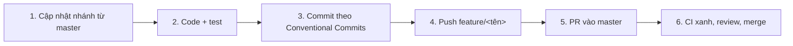

# QUẢN LÝ DỰ ÁN: TÍNH NĂNG, ISSUE & QUY TRÌNH GIT
## DỰ ÁN: ĐÀ LẠT CAFE OPERATIONS & MANAGEMENT

Tài liệu gộp danh mục tính năng, lịch sử 15 issue và quy trình làm việc nhóm. Thông tin thành viên và phân công nằm tại [README §2](../README.md#2-thành-viên-nhóm-thực-hiện-team-members). Kiến trúc kỹ thuật nằm tại [ARCHITECTURE.md](ARCHITECTURE.md).

---

## 1. Danh mục Tính năng (Feature Matrix)

**Quy ước trạng thái:**
- 🟢 **Đã triển khai**: có trong code ở `master`.
- 🟡 **Một phần**: chỉ có ở một phía (frontend hoặc Java), hoặc chưa nối với nhau.
- ⚪ **Chưa triển khai**: mới có trong thiết kế.
- ⛔ **Đã gỡ**: từng có, đã bỏ khỏi giao diện theo yêu cầu.
- 🔷 **Mở rộng**: chỉ trình bày trong báo cáo học thuật, không nằm trong 15 issue.

Cột *Frontend* là `frontend-nextjs/`, cột *Java* là `backend-java/`. Cột *Tích hợp* cho biết frontend đã gọi sang Java hay chưa (xem [ARCHITECTURE §2](ARCHITECTURE.md#2-tích-hợp-frontend-nextjs--backend-java)).

### 1.1. Nền tảng, Phân quyền & Cấu hình

| Mã | Tính năng | Pattern | Frontend | Java | Tích hợp |
| :--- | :--- | :---: | :---: | :---: | :---: |
| `FEAT-CORE-01` | Thực thể miền (`Order`, `Table`, `MenuItem`, `Reservation`, `Customer`) | Core OOP | 🟢 `lib/db/schema.ts` | 🟢 `com.dalatcafe.model` | — |
| `FEAT-AUTH-01` | Đăng nhập email/mật khẩu, đăng ký khách hàng, đăng nhập Google cho khách hàng | — | 🟢 `/login`, `/register` (route group `(auth)`, framer-motion), `lib/auth/*`, Google PKCE | 🟢 `/api/auth`, `PasswordHasher`, `TokenService`, `LoginThrottle` | 🟢 cookie httpOnly chứa token Java |
| `FEAT-AUTH-02` | Phân quyền 4 vai trò (CUSTOMER < STAFF < MANAGER < ADMIN) và quản lý tài khoản | — | 🟢 `proxy.ts`, `requirePageRole`, `/admin/users` | 🟢 `SimpleAuthFilter` (Bearer), `/api/users` | 🟢 vai trò đọc lại từ tài khoản mỗi request |
| `FEAT-AUTH-03` | Cấu hình quán toàn cục (07:00–22:00, 10.000đ = 1 điểm, tự huỷ 30 phút) | **Singleton** | 🟢 `admin/settings` + `store-settings-form.tsx` | 🟢 `SystemConfigManager`, `GET/PUT /api/config` | 🟢 (tự huỷ chưa có tác vụ chạy) |
| `FEAT-AUTH-04` | Giao diện sáng/tối | — | 🟢 `theme-provider` | — | — |
| `FEAT-AUTH-05` | Hồ sơ & chức danh nhân sự | — | ⛔ Đã gỡ (tài khoản nhân viên quản lý ở `/admin/users`) | — | — |
| `FEAT-AUTH-06` | Lịch ca làm việc | — | ⛔ Đã gỡ | — | — |

### 1.2. Storefront & Giỏ hàng

| Mã | Tính năng | Pattern | Frontend | Java | Tích hợp |
| :--- | :--- | :---: | :---: | :---: | :---: |
| `FEAT-SF-01` | Duyệt thực đơn & bộ lọc | — | 🟢 `DrinkMenu.tsx` | 🟢 `GET /api/menu` | ⚪ |
| `FEAT-SF-02` | Tìm kiếm & lọc nâng cao | — | 🟢 `DrinkMenu.tsx` | — | — |
| `FEAT-SF-03` | Tuỳ biến đồ uống trên Storefront (sữa, đường, đá) | **Decorator** | 🟢 Modal + `/api/cart` | 🟢 `BeverageDecorator` | ⚪ |
| `FEAT-SF-04` | Danh sách yêu thích (cookie) | — | 🟢 `/api/favorites` | — | — |
| `FEAT-SF-05` | Giỏ hàng trượt | — | 🟢 `CartSheet.tsx` | — | — |
| `FEAT-SF-06` | Mã giảm giá giỏ hàng | **Strategy** | 🟢 `/api/cart` hỏi Java, giảm 10% (giỏ demo tính USD) | 🟢 `VoucherCatalog`, `POST /api/vouchers/validate` | 🟢 có danh sách mã demo khi Java tắt |

### 1.3. Bán hàng tại quầy (POS)

| Mã | Tính năng | Pattern | Frontend | Java | Tích hợp |
| :--- | :--- | :---: | :---: | :---: | :---: |
| `FEAT-POS-01` | Lên đơn nhanh, chọn bàn hoặc mang đi | **Builder** | 🟢 `pos-terminal.tsx` | 🟢 `OrderBuilder` | 🟢 |
| `FEAT-POS-02` | Nhập tiền khách đưa, tính tiền thừa | — | 🟢 `pos-terminal.tsx` | 🟢 `changeDue` | 🟢 gửi `tenderedAmount` (tuỳ chọn) |
| `FEAT-POS-03` | VAT 8% trên phần sau giảm giá | — | 🟢 `lib/admin/format.ts` | 🟢 `Order.recalculateTotals` | 🟢 |
| `FEAT-POS-04` | Tra cứu thành viên & đổi điểm trừ vào hoá đơn | **Singleton, Strategy** | 🟢 `pos-terminal.tsx` + `lookupMember` | 🟢 `PointRedemptionDiscountStrategy`, `GET /api/customers` | 🟢 gửi `customerPhone`, `useLoyaltyPoints` |
| `FEAT-POS-05` | Chốt đơn & thanh toán đa kênh (Tiền mặt / QR / Thẻ) | **Facade, Factory** | 🟢 `createOrder` | 🟢 `POST /api/checkout` | 🟢 Chỉ đơn đã thanh toán |
| `FEAT-POS-06` | Quản lý đơn online | — | 🟢 `online-orders.tsx` | 🟢 `GET /api/orders` | ⚪ (đọc từ kho cục bộ) |
| `FEAT-POS-07` | Chọn Size L / Topping cho từng dòng đơn POS | **Decorator** | 🟢 `pos-terminal.tsx` + `lib/admin/customizations.ts` | 🟢 `Customization` + Decorator | 🟢 gửi `customizations` |

### 1.4. Màn hình bếp (KDS)

| Mã | Tính năng | Pattern | Frontend | Java | Tích hợp |
| :--- | :--- | :---: | :---: | :---: | :---: |
| `FEAT-KDS-01` | Bảng Kanban `Pending → Brewing → Ready → Completed` | 🔷 State | 🟢 `kds-board.tsx` | 🟢 enum `OrderStatus` | — |
| `FEAT-KDS-02` | Thao tác 1 chạm của barista; hoàn tất thì bàn sang dọn | **Observer** | 🟢 `updateOrderStatus` | 🟢 `PATCH /api/orders/{code}/status` | 🟢 404 → giữ cục bộ |
| `FEAT-KDS-03` | Cảnh báo đơn trễ quá 10 phút | — | 🟢 `kds-board.tsx` | — | — |

### 1.5. Sơ đồ bàn

| Mã | Tính năng | Pattern | Frontend | Java | Tích hợp |
| :--- | :--- | :---: | :---: | :---: | :---: |
| `FEAT-TBL-01` | 15 bàn, 3 khu (Main Floor, Patio, Coffee Bar) | — | 🟢 `floor-plan.tsx` | 🟢 `GET /api/tables` | ⚪ (đọc từ kho cục bộ) |
| `FEAT-TBL-02` | 4 màu trạng thái bàn | 🔷 State | 🟢 `TableGrid.tsx` | 🟢 enum `TableStatus` | — |
| `FEAT-TBL-03` | Đổi trạng thái bàn | — | 🟢 `updateTableStatus` | 🟢 `PUT /api/tables/{id}` | 🟢 |
| `FEAT-TBL-04` | Tự giải phóng bàn và tích điểm sau thanh toán | **Observer** | — | 🟢 `TableStatusSyncObserver`, `LoyaltyPointObserver` | 🟡 Chạy trong Java; frontend chưa gửi SĐT khách |

### 1.6. Đặt bàn trước

| Mã | Tính năng | Pattern | Frontend | Java | Tích hợp |
| :--- | :--- | :---: | :---: | :---: | :---: |
| `FEAT-RES-01` | Tiếp nhận phiếu đặt bàn | — | 🟢 Form "Tạo phiếu đặt bàn"; danh sách gộp phiếu Java và phiếu cục bộ | 🟢 `GET/POST /api/reservations` | 🟢 `createReservation`, `getReservations` |
| `FEAT-RES-02` | Kiểm định: giờ mở cửa → sức chứa → lịch bàn | **Chain of Resp.** | — | 🟢 `ReservationValidatorHandler` | 🟢 qua `createReservation` |
| `FEAT-RES-03` | Chuyển phiếu đặt bàn sang đơn POS | **Adapter** | 🟢 Nút "Sang POS" (`transferReservationToPos`) | 🟢 `POST /api/reservations/{code}/transfer-pos` | 🟢 (phiếu cục bộ dùng bản sao Adapter phía frontend) |
| `FEAT-RES-04` | Xuất CSV danh sách đặt bàn | 🔷 Template Method | 🟢 `handleExportCSV` | — | — |

### 1.7. Thực đơn, CRM & Báo cáo

| Mã | Tính năng | Pattern | Frontend | Java | Tích hợp |
| :--- | :--- | :---: | :---: | :---: | :---: |
| `FEAT-INV-01` | Danh sách thực đơn | — | 🟢 `menu-management.tsx` (trang Kho riêng đã gỡ) | 🟢 `IMenuDao` | ⚪ |
| `FEAT-INV-02` | Theo dõi số lượng tồn kho, cảnh báo sắp hết hàng | — | ⛔ Đã gỡ (món chỉ bật / tắt bán; cột `stock_qty`, `low_stock_threshold` đã xoá) | ⛔ Đã gỡ | — |
| `FEAT-INV-03` | Bật/tắt bán món | — | 🟢 `setItemInStock` | 🟢 `PATCH /api/menu/{id}/stock` | 🟢 ghép theo tên món |
| `FEAT-INV-04` | Thêm món mới | — | 🟢 `add-item-dialog.tsx` | 🟢 `POST /api/menu` (MANAGER) | 🟢 |
| `FEAT-CRM-01` | Xếp hạng khách hàng | — | 🟢 `admin/customers` (điểm, hạng) | 🟢 `GET /api/customers` | 🟢 tổng hợp đơn cục bộ khi Java tắt |
| `FEAT-ANA-01` | Doanh thu 7 ngày | — | 🟢 `RevenueChart.tsx` | 🟢 `GET /api/analytics/overview?days=7` | 🟢 kho cục bộ khi Java tắt |
| `FEAT-ANA-02` | Cơ cấu thanh toán & món bán chạy | — | 🟢 `dashboard-charts.tsx` | 🟢 `paymentMix`, `topItems` | 🟢 |
| `FEAT-OPS-01` | Đồng bộ đơn ghi lúc mất kết nối Java | — | 🟢 `admin_sync_queue` + nút "Đồng bộ đơn offline" | 🟢 `POST /api/orders/sync` | 🟢 |

> **Mở rộng (🔷):** State Pattern (vòng đời đơn và bàn) và Template Method (xuất báo cáo) được phân tích tại [DESIGN_PATTERNS_SPEC §4](DESIGN_PATTERNS_SPEC.md#4-đánh-giá--đề-xuất-mở-rộng-nâng-cao), không cài đặt trong code.

---

## 2. Lịch sử 15 Issue (đều đã đóng)

Tên issue giữ nguyên như trên GitHub. Một số tên lớp trong tiêu đề khác với tên lớp thật, được ghi ở cột cuối.

| # | Issue | Người phụ trách | PR | Lớp thật / Ghi chú |
| :---: | :--- | :--- | :--- | :--- |
| 01 | `[Backend][Core]` Java SE project & POJO entities | @HubertPhung | #17 | `com.dalatcafe.model` |
| 02 | `[Backend][DAO]` JDBC Supabase & In-Memory Store | @vuong123s | #19 | `DaoFactory`, `InMemory*Dao`, `Jdbc*Dao` |
| 03 | `[Backend][Singleton]` SystemConfigManager | @HubertPhung | #20 | `SystemConfigManager` |
| 04 | `[Backend][Factory]` PaymentProcessorFactory | @0Yaam | #22 | `PaymentProcessorFactory`, `CashPaymentProcessor`, `MomoQrPaymentProcessor`, `CardPosPaymentProcessor` |
| 05 | `[Backend][Decorator]` ToppingDecorator | @0Yaam | #22 | `BeverageDecorator`, `LargeSizeDecorator`, `CheeseFoamDecorator`, `PearlToppingDecorator` |
| 06 | `[Backend][Builder]` OrderBuilder | @elgthinhnguyen | #23 | `OrderBuilder` |
| 07 | `[Backend][Strategy]` DiscountStrategy | @1convitt | #24 | `IDiscountStrategy`, `DiscountContext` |
| 08 | `[Backend][Observer]` OrderEventSubject | @elgthinhnguyen | #23 | `OrderEventSubject` + 3 observer |
| 09 | `[Backend][Chain]` ReservationValidator | @1convitt | #24 | `ReservationValidatorHandler` + 3 validator |
| 10 | `[Backend][Adapter]` ReservationToOrderAdapter | @vuong123s | #25 | `ReservationToOrderAdapter`, `IPosOrderTarget` |
| 11 | `[Backend][Facade]` PosCheckoutFacade | @HubertPhung | #26 | `PosCheckoutFacade` |
| 12 | `[Backend][Server]` HttpServer cổng 8080 | @HubertPhung, @elgthinhnguyen | #27 | 4 handler: menu, tables, reservations (sau bổ sung `transfer-pos`), checkout. Các endpoint còn lại xem [API_SPEC §2](API_SPEC.md) |
| 13 | `[QA][JUnit5]` Bộ test 9 pattern | @vuong123s, @1convitt | #29, #30 | 9 lớp `*Test` trong `src/test/java/com/dalatcafe/patterns/` |
| 14 | `[Integration][API]` Next.js ↔ Java | @HubertPhung, @0Yaam | #31, #34 | `lib/api-client.ts` |
| 15 | `[QA][E2E]` Kiểm thử E2E & báo cáo | Cả nhóm | #29–#36 | [TESTING.md](TESTING.md) |

Thứ tự phụ thuộc đã dùng: #01 → #02, #03 → #04–#10 (làm song song) → #11 → #12 → #13, #14 → #15.

---

## 3. Quy ước Issue

- **Tiêu đề:** `[Phạm vi][Phân hệ/Pattern] Động từ + đối tượng`. Phạm vi gồm `[Frontend]`, `[Backend]`, `[Integration]`, `[Docs]`, `[QA]`.
- **Nhãn bắt buộc:**
  - `scope:frontend|backend|integration|docs|test`
  - `type:feature|pattern|bug|refactor|test`
  - `priority:p0-blocker|p1-high|p2-medium|p3-low`
- **Nội dung issue:** bối cảnh và mã `FEAT-*` ở mục 1; ràng buộc kỹ thuật (Java SE thuần, không Spring; Next.js 16 App Router); vai trò các lớp nếu là pattern; checklist công việc; tiêu chí nghiệm thu kiểm chứng được; phụ thuộc (`Blocked by` / `Blocks`).
- **Chống trùng:** tra mã `FEAT-*` và tìm issue đang mở trước khi tạo mới. Nếu một issue đã bao phủ phần lớn công việc thì bổ sung vào issue đó.

---

## 4. Quy trình Git & Pull Request

### 4.1. Nhánh theo từng thành viên

- `master` là nhánh ổn định, **không push trực tiếp**.
- Mỗi thành viên làm việc trên nhánh riêng `feature/<tên>`, tách từ `master` mới nhất:

| Thành viên | Nhánh |
| :--- | :--- |
| Phùng Nguyễn Hoài Bo (@HubertPhung) | `feature/hoai-bo` |
| Nguyễn Ngọc Trường Dân (@0Yaam) | `feature/truong-dan` |
| Nguyễn Hưng Thịnh (@elgthinhnguyen) | `feature/hung-thinh` |
| Vũ Thế Huỳnh (@1convitt) | `feature/the-huynh` |
| Phan Khánh Vương (@vuong123s) | `feature/vuong` |

### 4.2. Chu trình làm việc



```bash
git switch feature/hoai-bo
git pull origin master                      # đồng bộ với master mới nhất
# ... code + test ...
git commit -m "feat(backend): implement transfer-to-POS endpoint (#16)"
git push origin feature/hoai-bo
gh pr create --base master --head feature/hoai-bo   # ghi "Closes #<số>" nếu PR đóng issue
```

- **Commit:** dùng [Conventional Commits](https://www.conventionalcommits.org/) với dạng `type(scope): mô tả`. Các `type` gồm `feat`, `fix`, `docs`, `test`, `refactor`, `chore`; `scope` gồm `backend`, `frontend`, `ci`.
- **CI:** cả hai job *Frontend CI* và *Backend CI* trong `.github/workflows/ci.yml` phải xanh trước khi merge. CI tự chạy cho mọi nhánh `feature/**` và cho PR vào `master`.
