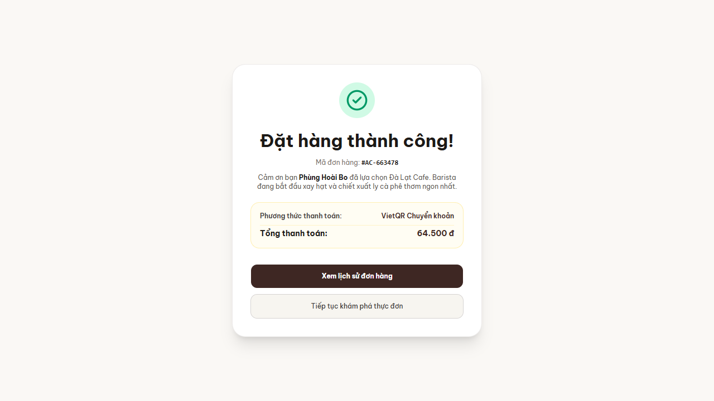
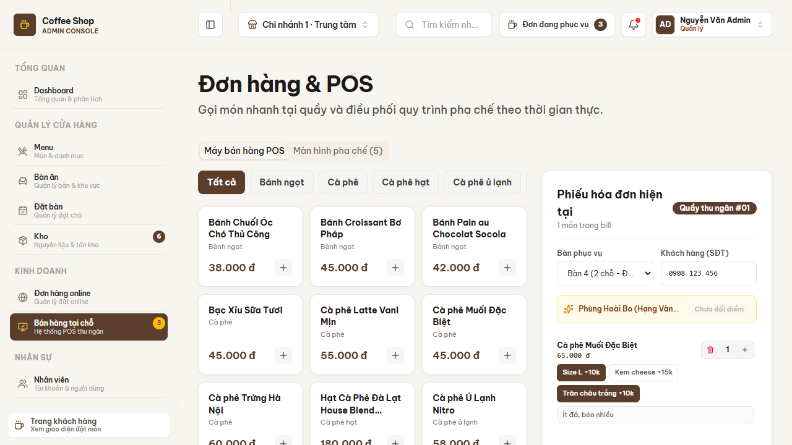
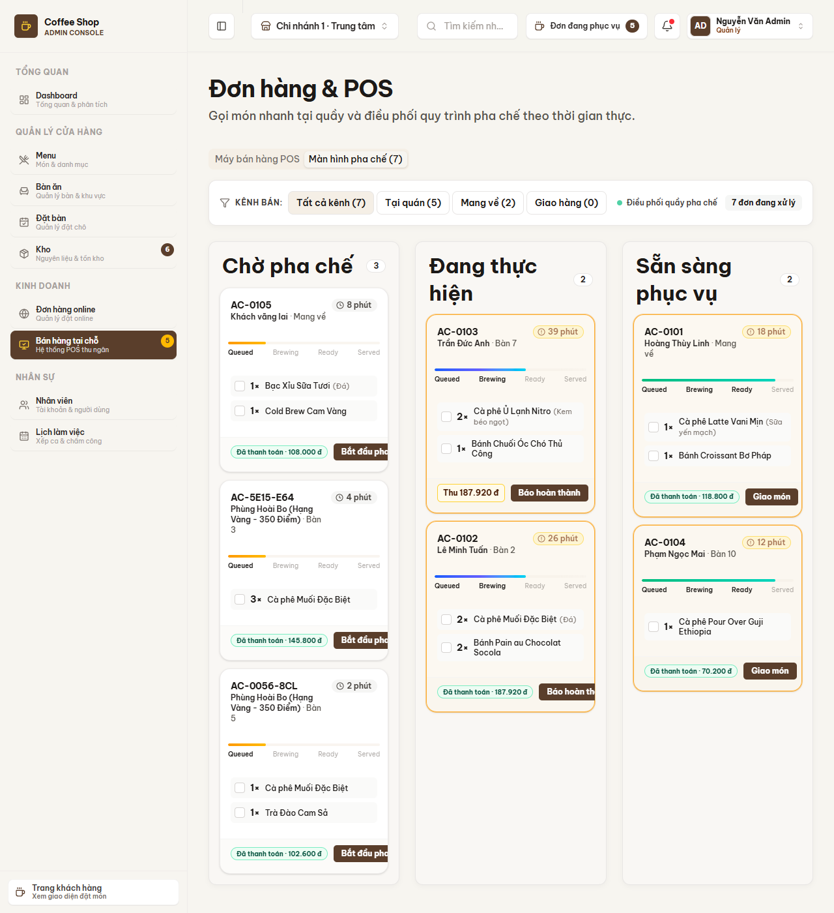
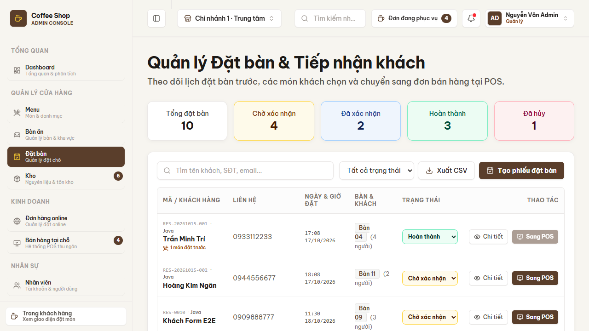

# KIỂM THỬ & BÁO CÁO E2E (TESTING)
## DỰ ÁN: ĐÀ LẠT CAFE OPERATIONS & MANAGEMENT

Tài liệu gom toàn bộ thông tin kiểm thử: cách chạy, danh mục test tự động và báo cáo kiểm thử đầu-cuối (E2E). Lệnh cài đặt môi trường xem tại [README §5](../README.md#5-cài-đặt--khởi-chạy).

---

## 1. Tổng quan & Cách chạy

| Bộ kiểm thử | Lệnh | Số ca | Chạy trên CI |
| :--- | :--- | :---: | :---: |
| JUnit 5 Backend | `cd backend-java && mvn clean test` | 204 | ✅ Job *Backend CI* |
| UI/UX & Admin Actions | `cd frontend-nextjs && npm test` | 36 | ✅ Job *Frontend CI* |
| Kiểu TypeScript | `cd frontend-nextjs && npx tsc --noEmit` | — | ✅ |
| Build production | `cd frontend-nextjs && npm run build` | — | ✅ |

- `npm test` chạy `tsx scripts/test-ui-ux.mjs`. Script tự khởi động `next dev` nếu chưa có server ở `TEST_BASE_URL` (mặc định `http://localhost:3000`). Đặt `TEST_BASE_URL` để kiểm thử một server đang chạy sẵn.
- Bộ JUnit chạy trong bộ nhớ (`InMemoryDatabase`), trừ `JdbcIntegrationTest`: lớp này tự khởi động một PostgreSQL nhúng (zonky `embedded-postgres`) trong JVM test, không cần Docker và không chạm tới Supabase dùng chung. Lần chạy đầu Maven tải bản PostgreSQL nhúng về.
- Mọi bộ test chạy trên GitHub Actions (`.github/workflows/ci.yml`) mỗi lần push hoặc mở PR; kết quả xem ở tab *Actions*.

---

## 2. Bộ test JUnit 5 (Backend)

| Lớp test | Phạm vi |
| :--- | :--- |
| `patterns/SingletonTest` | Một thể hiện duy nhất, an toàn đa luồng, chặn reflection, serialization, tham số vận hành |
| `patterns/FactoryTest` | Tạo đúng bộ xử lý cho từng `PaymentMethod`, từ chối `null` |
| `patterns/BuilderTest` | Dựng đơn và VAT, giá trị mặc định cho khách vãng lai, đối số sai, tái sử dụng builder |
| `patterns/DecoratorTest` | Cộng dồn giá và mô tả, phụ thu từng topping, bọc lặp, thứ tự bọc, `null` |
| `patterns/AdapterTest` | Chuyển phiếu đặt bàn thành đơn POS, sao chép món độc lập, thiếu dữ liệu tuỳ chọn |
| `patterns/FacadeTest` | Toàn quy trình checkout (đơn đã thu tiền ở trạng thái `PENDING`, chỉ phát sự kiện *paid*), thiếu tồn kho, hoàn kho khi lưu lỗi, lỗi observer |
| `patterns/StrategyTest` | Phần trăm có trần, số tiền cố định, hạng thành viên, kẹp kết quả |
| `patterns/ChainTest` | Giờ mở cửa, sức chứa, trùng lịch bàn, thứ tự mắt xích |
| `patterns/ObserverTest` | Sự kiện *paid* (cộng điểm, bàn → `OCCUPIED`, phiếu KDS) và *completed* (bàn → `CLEANING`, không cộng điểm lần hai), đăng ký trùng, đơn chưa trả tiền, đơn mang đi, khách/bàn không tồn tại |
| `dao/DaoLayerTest`, `model/ModelEntitiesTest` | Tầng DAO In-Memory và các thực thể |
| `dao/JdbcIntegrationTest` | DAO JDBC trên PostgreSQL thật: nâng cấp schema chạy lại được, khoá ngoại chặn bàn không tồn tại, cột JSONB (`items`, `variations`, `pre_orders`), seed và sequence, mã `AC-0001` / `RES-0001`, pool kết nối, checkout qua Facade, bảng `users` (email duy nhất, đổi vai trò và khoá) |
| `security/SecurityTest` | Băm PBKDF2 có salt và xác minh, token HS256 hết hạn và sai khoá, khoá sau nhiều lần sai, tạo admin đầu tiên, cấu hình từ biến môi trường (từ chối khoá dev khi `APP_ENV=production`), DAO tài khoản giữ email duy nhất |
| `server/AuthTest` | Server chạy như production (không nhận `X-User-Role`): đăng ký thành `CUSTOMER`, token giả / `alg: none` / khoá khác bị từ chối, sai mật khẩu và email lạ trả cùng một lỗi, khoá sau 5 lần sai, ADMIN cấp tài khoản STAFF, đổi vai trò và khoá có hiệu lực với token cũ, quản trị viên cuối cùng được bảo vệ, đổi mật khẩu |
| `server/ServerTest` | Định tuyến REST, mã lỗi, RBAC (chạy với `X-User-Role` cho gọn; mặc định từ chối, MANAGER cho tạo món và thống kê), 503 khi mất CSDL, `transfer-pos` qua Adapter, vòng đời đơn trên KDS và đồng bộ bàn, thanh toán đơn chuyển từ đặt bàn, đổi trạng thái phiếu, tạo món và chỉnh tồn kho, đổi điểm thành viên (kể cả không giảm quá hoá đơn), thống kê (chuỗi theo ngày, cơ cấu thanh toán, `days` sai), xem trước voucher, nhập đơn offline (idempotent, không trừ kho hai lần, dòng sai chỉ làm hỏng đơn đó), cài đặt `/api/config` (chỉ ADMIN, chuỗi đặt bàn đọc giá trị mới, cập nhật sai không đổi gì) |

---

## 3. Bộ test UI/UX & Admin Actions (36 ca)

Các mã dưới đây khớp chính xác với `frontend-nextjs/scripts/test-ui-ux.mjs`.

| Nhóm | Mã | Nội dung kiểm tra |
| :--- | :--- | :--- |
| Storefront | `TC-SF-01` | Thương hiệu & liên kết điều hướng |
| | `TC-SF-02` | Nội dung Hero & nút CTA |
| | `TC-SF-03` | Hiển thị catalog với dữ liệu mẫu dự phòng |
| | `TC-SF-04` | Tab danh mục & thanh công cụ |
| | `TC-SF-05` | Thuộc tính trợ năng (ARIA) |
| | `TC-SF-06` | Journal & chân trang |
| API giỏ hàng | `TC-API-01` | Thêm/bỏ món yêu thích (`/api/favorites`) |
| | `TC-API-02` | Thêm món có tuỳ chọn vào giỏ (`/api/cart`) |
| | `TC-API-03` | Tăng/giảm số lượng |
| | `TC-API-04` | Ghi chú cho barista |
| | `TC-API-05` | Áp mã giảm giá `WELCOME10` |
| Admin UI | `TC-ADM-01` | `/admin` – Dashboard tổng quan |
| | `TC-ADM-02` | `/admin/pos` – Máy bán hàng POS |
| | `TC-ADM-03` | `/admin/pos?tab=kitchen` – Màn hình bếp KDS |
| | `TC-ADM-04` | `/admin/tables` – Sơ đồ bàn |
| | `TC-ADM-05` | `/admin/inventory` – Kho & thực đơn |
| | `TC-ADM-06` | `/admin/customers` – CRM khách hàng |
| | `TC-ADM-07` | `/admin/analytics` – Biểu đồ phân tích |
| | `TC-ADM-08` | `/admin/settings` – Cấu hình chi nhánh |
| | `TC-ADM-09` | `/admin/staff` – Nhân sự & phân ca |
| Admin Actions (mock store) | `TC-ACT-01` | Tạo đơn POS (bàn 5 có khách, trừ tồn kho) |
| | `TC-ACT-02` | Đơn đi qua KDS: Brewing → Ready → Completed |
| | `TC-ACT-03` | Đổi trạng thái bàn & số khách |
| | `TC-ACT-04` | Bật/tắt bán món |
| | `TC-ACT-05` | Thêm món mới vào catalog |
| | `TC-ACT-06` | Đơn tại bàn đã thu tiền làm bàn `occupied`; hoàn tất trên KDS chuyển bàn sang `cleaning` |
| | `TC-ACT-07` | Đơn do Java định giá (giảm hạng, đổi điểm) giữ đúng tổng tiền của Java ở kho frontend |
| | `TC-ACT-08` | Tải lại đơn theo mã để đồng bộ offline (mã không có bị bỏ qua) |
| | `TC-ACT-09` | Món mới trả về id để liên kết với món Java |
| Đăng nhập & phân quyền | `TC-AUTH-01` | Khách chưa đăng nhập bị chuyển tới `/login?next=…` |
| | `TC-AUTH-02` | Phiên `CUSTOMER` không vào được `/admin` |
| | `TC-AUTH-03` | `STAFF` mở được POS nhưng bị chặn ở cài đặt (chỉ ADMIN) |
| | `TC-AUTH-04` | Token ký bằng khoá khác bị từ chối |
| | `TC-AUTH-05` | Trang đăng nhập có form mật khẩu, nút hiện/ẩn mật khẩu, nút chuyển sang đăng ký và logo |
| | `TC-AUTH-06` | Trang đăng ký tài khoản khách hàng, nút chuyển chế độ đánh dấu trang hiện tại |
| | `TC-AUTH-07` | `ADMIN` mở trang tài khoản & phân quyền, `MANAGER` bị chặn |

> Bộ UI ký cookie phiên bằng `AUTH_JWT_SECRET` (CI đặt một khoá chỉ dùng cho test) để mở các trang admin, và chỉ kiểm tra phản hồi HTTP, nội dung trang, cộng với các hàm của mock store. Các luồng có giao tiếp với Java được kiểm ở mục 4.

---

## 4. Báo cáo Kiểm thử Đầu-cuối (E2E)

### 4.1. Môi trường

| Thành phần | Cấu hình |
| :--- | :--- |
| Mã nguồn | `master` sau khi merge #13, #14 và #15 |
| Hệ điều hành | Windows 11 Pro |
| Backend | OpenJDK 17.0.20, Maven 3.9.16, `MainServer` cổng 8080, chế độ `IN_MEMORY` |
| Frontend | Node.js 24, Next.js 16.4.0 bản production (`next build` + `next start`), `JAVA_BACKEND_URL=http://localhost:8080` |
| Trình duyệt | Chrome điều khiển bằng Playwright CLI |

### 4.2. Kết quả tự động

| Hạng mục | Kết quả |
| :--- | :--- |
| JUnit 5 (`mvn clean test`) | **168 / 168 PASS** (bộ test lúc chạy E2E; hiện là 204, xem mục 1) |
| UI/UX (`npm test`, Java đang chạy) | **25 / 25 PASS** (hiện là 36, xem mục 3) |
| TypeScript, build production | Không lỗi |
| Cú pháp sơ đồ Mermaid (`mermaid.parse`, Mermaid 11) | Tất cả sơ đồ trong `docs/` hợp lệ |
| API proxy `lib/api-client.ts` với Java thật (menu, checkout, bàn, đặt bàn, backend tắt, `JAVA_BACKEND_URL=off`) | **9 / 9 PASS** |

### 4.3. Kịch bản 1 — Storefront: Duyệt menu ➔ Giỏ hàng ➔ Voucher ➔ Thanh toán

| Bước | Thao tác | Kết quả mong đợi | Kết quả thực tế |
| :---: | :--- | :--- | :--- |
| 1 | Mở `/`, thêm "Cà phê Latte Vani Mịn" vào giỏ | Giỏ có 1 món, 55.000 đ | Đạt |
| 2 | Nhập `WELCOME10`, bấm "Áp dụng" | Giảm 10% | Đạt: tổng 49.500 đ |
| 3 | "Tiến hành đặt hàng" ➔ `/checkout` | Tạm tính 55.000, giảm 5.500, phí giao 15.000 | Đạt: tổng 64.500 đ |
| 4 | "Xác nhận đặt hàng" | Màn hình xác nhận có mã đơn | Đạt: "Mã đơn hàng: #AC-663478" |

Luồng Storefront xử lý hoàn toàn trong Next.js (`/api/cart`), không gọi sang Java.

### 4.4. Kịch bản 2 — POS: Chọn bàn ➔ Lên món ➔ Thanh toán ➔ Sơ đồ bàn ➔ KDS

| Bước | Thao tác | Kết quả mong đợi | Kết quả thực tế |
| :---: | :--- | :--- | :--- |
| 1 | `/admin/pos`: Bàn 3, 3 × "Cà phê Muối Đặc Biệt", Tiền mặt, "Thanh toán & In" | Gửi tới `POST /api/checkout` | Đạt: Java cấp mã `AC-5E15-E64` |
| 2 | Kiểm tra Java sau checkout | Trừ tồn kho, Observer chạy | Đạt: tồn kho món #1 từ 85 còn 82; `TableStatusSyncObserver` chuyển bàn 3 sang `cleaning`; `KitchenNotificationObserver` báo gỡ phiếu |
| 3 | Đối chiếu tổng tiền | Frontend và Java khớp | Đạt: 135.000 + VAT 8% = 145.800 đ |
| 4 | `/admin/tables` | Bàn 3 đổi màu | Đạt: "Trống" ➔ "Có khách" |
| 5 | KDS `/admin/pos?tab=kitchen` | Phiếu mang mã đơn của Java | Đạt: `AC-5E15-E64 · Bàn 3 · 145.800 đ` |
| 6 | Dừng Java, thanh toán đơn cho Bàn 5 | Không crash, lưu kho cục bộ | Đạt: đơn `AC-0056-8CL` xuất hiện trên KDS |
| 7 | Gọi API: Latte + Size L + Cheese Foam + Trân châu, `WELCOME10`, thẻ | Decorator + Strategy + Factory trong Facade | Đạt: subtotal 90.000, giảm 9.000, VAT 6.480, tổng **87.480 đ** |

### 4.5. Kịch bản 3 — Đặt bàn ➔ Chain of Responsibility ➔ Adapter

| Bước | Thao tác (`POST /api/reservations`) | Kết quả mong đợi | Kết quả thực tế |
| :---: | :--- | :--- | :--- |
| 1 | Bàn 9, 3 khách, 12:00 hôm sau, 2 món đặt trước | Qua cả 3 mắt xích | Đạt: `201 { id: "RES-0010" }` |
| 2 | Cùng bàn, cùng khung giờ | `TableAvailabilityValidator` từ chối | Đạt: `400 CHAIN_VALIDATION_FAILED` |
| 3 | 03:00 sáng | `OperatingHoursValidator` từ chối | Đạt |
| 4 | 6 khách ở bàn 4 chỗ | `CapacityGuestValidator` từ chối | Đạt |
| 5 | Chuyển phiếu sang đơn POS | `ReservationToOrderAdapter.toPosOrder()` qua `POST /api/reservations/{code}/transfer-pos` | Đạt (xem mục 4.6) |

### 4.6. Kiểm thử lại sau khi sửa lỗi (giao diện thật, Java đang chạy)

| # | Thao tác | Kết quả mong đợi | Kết quả thực tế |
| :---: | :--- | :--- | :--- |
| 1 | POS: "Cà phê Muối Đặc Biệt" + chip **Size L** + **Kem cheese**, Bàn 6, Tiền mặt, "Thanh toán & In" | Giá 45.000 + 10.000 + 15.000; Java tính bằng Decorator | Đạt: hoá đơn 70.000 + VAT 5.600 = **75.600 đ**; Java cấp `AC-6C4C-236`; KDS hiện "Cà phê Muối Đặc Biệt (Size L + Kem cheese) · 75.600 đ". Gọi thẳng Java với `customizations: [SIZE_L, CHEESE_FOAM]` cũng ra 70.000 / 5.600 / 75.600 |
| 2 | Nút đổi điểm trên POS | Không trừ tiền khi chưa được hỗ trợ | Đạt ở thời điểm chạy: nút bị vô hiệu. *Từ bản sau, POS tra cứu thành viên và đổi điểm thật; xem mục 5.* |
| 3 | `/admin/reservations` → "Tạo phiếu đặt bàn" (Bàn 9, 3 khách, 11:30 hôm sau) | Phiếu đi qua chuỗi Java | Đạt: Java lưu `RES-0010` "Chờ xác nhận"; danh sách hiện phiếu kèm nhãn "Java" |
| 4 | "Sang POS" phiếu Java `RES-20261015-001` | Adapter tạo đơn, phiếu → nhận bàn, bàn → có khách | Đạt: KDS hiện `RES-20261015-001 · Bàn 4 · 2× Cà phê Muối Đặc Biệt · 97.200 đ`; Java: "Khách đã nhận bàn", bàn 4 `occupied` (2 khách); nút "Sang POS" bị vô hiệu |
| 5 | "Sang POS" phiếu cục bộ `RES-001` | Bản sao Adapter phía frontend | Đạt: KDS hiện `RES-001 · 2× Latte, 2× Croissant · 216.000 đ` |
| 6 | Tắt Java, mở `/admin/reservations` | Không crash, báo mất kết nối | Đạt: hiện thông báo, chỉ còn 7 phiếu cục bộ |
| 7 | Server giả trả `503 DATABASE_UNAVAILABLE` cho `/api/checkout` | `rejected`, không lưu cục bộ | Đạt; `500` khác và `502` không phải JSON vẫn được xếp loại `unreachable` |

---

## 5. Giới hạn đã biết

Báo cáo E2E ở mục 4 ghi lại một lần chạy trước khi bổ sung các endpoint dưới đây; những thay đổi sau đó được kiểm bằng test tự động trên CI (mục 2 và 3) thay vì chạy tay lại.

Đã khắc phục so với lần chạy E2E:
- Đổi điểm thành viên khi thanh toán (`FEAT-POS-04`): POS tra cứu khách qua `GET /api/customers?phone=`, gửi `customerPhone` và `useLoyaltyPoints`; bản sao ở frontend lưu đúng tổng tiền Java trả về, nên không còn lệch khi có giảm theo hạng.
- Đổi trạng thái phiếu đặt bàn được lưu qua `PATCH /api/reservations/{code}/status`.
- Trạng thái bàn thống nhất: thanh toán xong bàn là `occupied`; KDS báo hoàn tất thì bàn chuyển `cleaning`, ở cả Java lẫn frontend.
- Chế độ JDBC lưu đủ `items`, `variations`, `pre_orders`, có khoá ngoại và tự khởi tạo schema.
- Id món được liên kết qua `admin_menu_links` thay cho ghép tên mỗi lần; đơn ghi lúc Java tắt được xếp hàng và gửi lại qua `POST /api/orders/sync`.
- Dashboard, trang phân tích và khách hàng đọc từ Java; trang cài đặt sửa được Singleton `SystemConfigManager`.

Còn lại:
1. **Món chỉ có ở frontend** hoặc biến thể có phụ thu vẫn được lưu cục bộ trước rồi mới đồng bộ (không qua Facade), nên không đổi điểm được (POS báo lỗi thay vì thu đủ tiền). Lần ghép đầu tiên của một món vẫn dựa vào tên.
2. **Đồng bộ offline chỉ đẩy đơn mới.** Trạng thái KDS hay thanh toán đổi lúc Java tắt trên một đơn Java đã có sẽ không được gửi lại; đơn mới tạo lúc offline thì mang theo trạng thái mới nhất khi đồng bộ.
3. **Cài đặt trong `SystemConfigManager` không được lưu bền**: khởi động lại Java là về mặc định.
4. **Luồng đồng bộ phía frontend** (`pushQueuedOrders`) chưa có test tự động đầu-cuối; phần Java của nó có test trong `ServerTest`.
5. **Khoá ngoại `NOT VALID`** không kiểm dữ liệu ghi trước khi nâng cấp, xem [DATABASE.md §4](DATABASE.md#4-giới-hạn-đã-biết).
